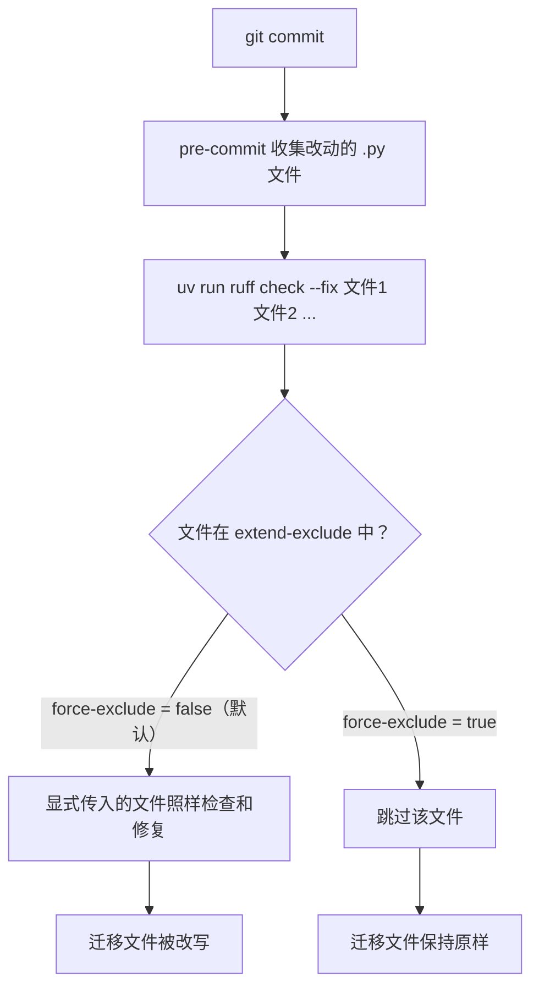

## 1. ruff 是什么

[ruff](https://docs.astral.sh/ruff/) 是 Astral 公司（uv 的作者）用 Rust 编写的 Python 代码检查与格式化工具。以前一个 Python 项目通常要装好几个工具，各有各的配置文件，现在一个 ruff 就够了：

| 原来的工具 | 作用 | ruff 中的对应功能 |
|-----------|------|------------------|
| flake8（含 pycodestyle、pyflakes） | 代码风格、未使用的变量和导入 | `ruff check`，规则集 `E`、`W`、`F` |
| flake8 插件（bugbear、bandit 等） | 常见 bug、安全问题 | `ruff check`，规则集 `B`、`S` 等 |
| isort | import 排序 | `ruff check`，规则集 `I` |
| pyupgrade | 改用新版 Python 语法 | `ruff check`，规则集 `UP` |
| black | 代码格式化 | `ruff format` |

它的特点：

* **快**：检查整个项目通常不到一秒，适合放在保存时、提交前反复运行。
* **配置集中**：所有配置都写在 `pyproject.toml` 的 `[tool.ruff]` 下。
* **能自动修复**：很多规则带有自动修复，加 `--fix` 即可。

ruff 是开发依赖，用 `uv add --dev ruff` 安装，之后统一用 `uv run ruff ...` 执行。

### 1.1. ruff check 与 ruff format

ruff 有两个子命令，分工不同：

| 命令 | 做什么 | 是否改文件 |
|------|--------|-----------|
| `ruff check` | **Lint**：按规则找问题（未使用的导入、可能的 bug、安全隐患等） | 默认只报告 |
| `ruff check --fix` | 报告问题，并自动修复其中"可安全修复"的那部分 | 是 |
| `ruff format` | **格式化**：统一缩进、引号、换行、空格等排版，不管代码逻辑 | 是 |
| `ruff format --check` | 只检查是否已格式化，不改文件，适合 CI | 否 |

```shell
uv run ruff check            # 检查整个项目
uv run ruff check --fix      # 检查并自动修复
uv run ruff format           # 格式化整个项目
uv run ruff format --check   # 只检查格式（CI 用）
```

`ruff check` 的输出里，带 `[*]` 的问题可以用 `--fix` 自动修复，其余的要手动改：

```text
rules_demo.py:1:1: I001 [*] Import block is un-sorted or un-formatted
rules_demo.py:1:8: F401 [*] `os` imported but unused
rules_demo.py:7:5: N802 Function name `getUser` should be lowercase
Found 13 errors.
[*] 4 fixable with `--fix` (5 unsafe fixes available with `--fix --unsafe-fixes`).
```

> 有些修复可能改变代码行为（"unsafe fixes"），`--fix` 默认不做，需要显式加 `--unsafe-fixes`。一般手动看过再改。

两者通常一起使用：先 `check --fix` 修问题（例如删掉未使用的导入、排好 import 顺序），再 `format` 统一排版。

## 2. 项目中的 ruff 配置

### 2.1. 基础配置

以项目 my-service 为例，`pyproject.toml` 中的 ruff 配置：

```toml
[tool.ruff]
line-length = 100
target-version = "py312"
src = ["src", "tests"]
extend-exclude = ["migrations/versions"]   # 自动生成的迁移文件不检查
force-exclude = true   # 即使显式传入文件路径（如 pre-commit），也遵守上面的排除规则

[tool.ruff.lint]
select = [
    "E", "W",   # pycodestyle 基础风格
    "F",        # pyflakes：未使用的变量、导入等
    "I",        # import 排序
    "B",        # bugbear：常见 bug 写法
    "UP",       # 使用新版 Python 语法
    "N",        # 命名规范
    "S",        # bandit：安全问题
    "ASYNC",    # 异步代码中的阻塞调用
    "SIM",      # 可简化的写法
    "RUF",      # ruff 自带规则
]
ignore = [
    "RUF001","RUF002","RUF003" # 允许中文全角标点出现在字符串、文档字符、注释中
]

[tool.ruff.lint.per-file-ignores]
"tests/**/*.py" = [
    "S101",            # 测试里允许使用 assert
    "S105", "S106",    # 测试里允许写死测试用的密码和密钥
]
```

| 配置项 | 含义 |
|--------|------|
| `line-length` | 每行最大宽度，`E501` 和 `ruff format` 都按它来 |
| `target-version` | 目标 Python 版本，`UP` 规则据此决定能用哪些新语法 |
| `src` | 项目自己的代码目录，`I` 规则据此区分"第一方导入"和"第三方导入" |
| `extend-exclude` | 在 ruff 默认排除列表（`.venv`、`.git` 等）之外，再排除一些目录 |
| `force-exclude` | 显式传入的文件路径也遵守排除规则，见第 6 节 |
| `select` | 启用哪些规则集 |
| `ignore` | 在已启用的规则集中再关掉某几条 |
| `per-file-ignores` | 只对匹配的文件关掉某些规则 |

### 2.2. 规则集说明

ruff 的规则编号由"前缀 + 数字"组成，`select` 里写前缀就会启用这一整组规则。下面每组的示例是 ruff 对相应代码给出的报错：

| 前缀 | 来源 | 检查什么 | 示例 |
|------|------|---------|------|
| `E` | pycodestyle（错误） | 基础代码风格：行太长、和 `None` 比较用了 `==` 等 | `E711 Comparison to None should be cond is None`、`E501 Line too long` |
| `W` | pycodestyle（警告） | 空白问题：行尾空格、文件末尾缺换行等 | `W291 Trailing whitespace` |
| `F` | pyflakes | 未使用的导入和变量、未定义的名字 | `F401 os imported but unused`、`F841 Local variable unused is assigned to but never used` |
| `I` | isort | import 的分组和排序 | `I001 Import block is un-sorted or un-formatted` |
| `B` | flake8-bugbear | 容易写出 bug 的写法 | `B006 Do not use mutable data structures for argument defaults`（参数默认值用了 `[]`） |
| `UP` | pyupgrade | 可以改用新版语法的地方 | `UP045 Use X \| None for type annotations`（`Optional[str]` → `str \| None`） |
| `N` | pep8-naming | PEP 8 命名规范 | `N802 Function name getUser should be lowercase` |
| `S` | flake8-bandit | 安全问题：`assert`、硬编码密码等 | `S101 Use of assert detected`、`S105 Possible hardcoded password` |
| `ASYNC` | flake8-async | `async` 函数里调用了会阻塞事件循环的函数 | `ASYNC251 Async functions should not call time.sleep` |
| `SIM` | flake8-simplify | 可以写得更简单的代码 | `SIM103 Return the condition bool(name) directly` |
| `RUF` | ruff 自带 | ruff 自己的规则，如可混淆字符、可变类属性 | `RUF001`、`RUF012` |

触发上面这些规则的示例代码：

```python
import os                      # F401：导入了没用
import json                    # F401；同时整个 import 块未排序 I001
import time
from typing import Optional


def getUser(name: Optional[str], items: list = []) -> bool:  # N802、UP045、B006
    unused = 1                 # F841：变量赋值后没用
    if name == None:           # E711：应写 name is None
        pass
    if name:                   # SIM103：可以直接 return bool(name)
        return True
    else:
        return False


async def handler() -> None:
    time.sleep(1)              # ASYNC251：会阻塞事件循环，应改用 await asyncio.sleep(1)


def check(x: int) -> None:
    assert x > 0               # S101
    password = "123456"        # S105
```

> `S` 规则对 Web 后端特别有用：`assert` 在 `python -O` 下会被直接去掉，不能拿来做业务校验；`S105`/`S106` 能拦住不小心写进代码里的密码和密钥。

### 2.3. per-file-ignores：测试代码放宽规则

测试代码和业务代码的要求不同。pytest 就是靠 `assert` 断言的，测试里也经常要写死一个测试账号的密码：

```python
# tests/conftest.py（节选）
TEST_USERNAME = "Alice"
TEST_PASSWORD = "Passw0rd!"
```

如果不做处理，`S101`（assert）和 `S105`/`S106`（硬编码密码）会在测试文件里报满屏。所以项目只对 `tests/` 下的文件关掉这三条：

| 规则 | 报什么 | 测试里为什么放开 |
|------|-------|-----------------|
| `S101` | 使用了 `assert` | pytest 的断言就是 `assert` |
| `S105` | 把字符串字面量赋给名字像密码的变量，如 `password = "..."` | 测试账号的密码本来就要写死 |
| `S106` | 把字符串字面量传给名字像密码的参数，如 `login(password="...")` | 同上 |

业务代码 `src/` 不受影响，仍然会检查这些规则。

## 3. 中文项目的常见误报

### 3.1. RUF001 / RUF002 / RUF003：全角标点

ruff 的 `RUF001`～`RUF003` 用来发现"长得像 ASCII 字符的 Unicode 字符"（比如把西里尔字母 `а` 混进英文代码里），防止肉眼看不出的混淆。三条规则分别检查不同位置：

| 规则 | 检查位置 |
|------|---------|
| `RUF001` | 字符串 |
| `RUF002` | 文档字符串（docstring） |
| `RUF003` | 注释 |

问题是，中文里常用的全角标点 `，` `：` `（` `）` 也被当成了"可混淆字符"：

```python
def f() -> str:
    # 校验失败，请重试
    return "用户名或密码错误，请重试（剩余次数：3）"
```

```text
RUF003 Comment contains ambiguous `，` (FULLWIDTH COMMA). Did you mean `,` (COMMA)?
RUF001 String contains ambiguous `，` (FULLWIDTH COMMA). Did you mean `,` (COMMA)?
RUF001 String contains ambiguous `（` (FULLWIDTH LEFT PARENTHESIS). Did you mean `(` (LEFT PARENTHESIS)?
RUF001 String contains ambiguous `：` (FULLWIDTH COLON). Did you mean `:` (COLON)?
RUF001 String contains ambiguous `）` (FULLWIDTH RIGHT PARENTHESIS). Did you mean `)` (RIGHT PARENTHESIS)?
```

项目的错误提示、注释、文档字符串都是中文，这三条规则只会产生噪音，所以在 `ignore` 里整体关掉：

```toml
[tool.ruff.lint]
ignore = [
    "RUF001","RUF002","RUF003" # 允许中文全角标点出现在字符串、文档字符、注释中
]
```

### 3.2. E501：中文字符按两个宽度计算

`E501` 检查行宽时按**显示宽度**计算，一个中文字符占 2 个宽度，而不是 1 个。下面这行注释看起来只有五十来个字，实际已经超过 100：

```python
def f() -> str:
    # 这是一个很长很长的中文注释，用来演示行宽统计时中文字符按两个宽度计算，所以很容易就超过了一百的限制
    ...
```

```text
E501 Line too long (104 > 100)
```

`ruff format` 不会折断注释和字符串，所以长中文注释需要自己折行：

```python
def f() -> str:
    # 这是一个很长的中文注释，用来演示行宽统计时
    # 中文字符按两个宽度计算
    ...
```

> 粗略估算：`line-length = 100` 时，一行中文注释大约写 45 个字左右就该换行了（还要减去缩进和 `# `）。

## 4. 用 noqa 处理个别误报：S105

### 4.1. 误报场景

`S105` 的判断方式很简单：变量名里含有 `password`、`token`、`secret` 等字样，并且赋值的是字符串字面量，就认为是"硬编码密码"。项目中有两处被误报：

```python
# src/my_service/schemas/auth.py
class TokenResponse(BaseModel):
    token_type: Literal["bearer"] = "bearer"

# src/my_service/core/security.py
_ACCESS_TOKEN_TYPE = "access"
```

```text
S105 Possible hardcoded password assigned to: "token_type"
S105 Possible hardcoded password assigned to: "_ACCESS_TOKEN_TYPE"
```

这两个值是令牌的**类型**（`bearer`、`access`），不是密码。它们在业务代码里，不能像测试那样整个文件关掉 `S105`，只能在这一行上标记"我确认这里没问题"。

### 4.2. noqa 的写法

在行尾加 `# noqa: <规则编号>`，ruff 就会跳过这一行的这条规则。项目中的写法：

```python
# src/my_service/schemas/auth.py
token_type: Literal["bearer"] = "bearer"  # noqa: S105  误报：这是令牌类型，不是密码

# src/my_service/core/security.py
_ACCESS_TOKEN_TYPE = "access"  # noqa: S105  误报：这是令牌类型，不是密码
```

规则编号后面可以跟说明文字，但**编号和说明之间要用空格隔开**。如果规则编号后面紧跟全角括号：

```python
_ACCESS_TOKEN_TYPE = "access"  # noqa: S105（误报：这是令牌类型）
```

ruff 会认为整个 `S105（误报：这是令牌类型）` 是一个规则编号，解析失败，`noqa` 不生效：

```text
warning: Invalid `# noqa` directive on noqa_demo.py:1: expected code to consist of uppercase letters followed by digits only (e.g. `F401`)
noqa_demo.py:1:22: S105 Possible hardcoded password assigned to: "_ACCESS_TOKEN_TYPE"
```

| 写法 | 结果 |
|------|------|
| `# noqa: S105  误报：这是令牌类型，不是密码` | 生效 |
| `# noqa: S105（误报：这是令牌类型）` | 出现 `Invalid # noqa directive` 警告，`S105` 仍然报错 |

使用 noqa 的建议：

* **一定写上规则编号**，不要只写 `# noqa`，否则这一行所有规则都会被跳过。
* **写上理由**，方便以后的人判断这个豁免是否还成立。
* 某类误报在一整个目录里都会出现时（如测试代码），用 `per-file-ignores`，不要逐行加 noqa。

## 5. RUF012：可变的类属性默认值

项目的业务异常用类属性定义状态码、错误码和响应头。如果直接这样写：

```python
class UnauthorizedError(AppError):
    status_code = status.HTTP_401_UNAUTHORIZED
    code = "unauthorized"
    headers = {"WWW-Authenticate": "Bearer"}
```

```text
RUF012 Mutable default value for class attribute
help: Consider initializing in `__init__` or annotating with `typing.ClassVar`
```

原因：类属性只有一份，被所有实例共享。`dict`、`list` 这类可变对象如果被某个实例修改（如 `exc.headers["X"] = "1"`），所有实例都会受影响。ruff 要求明确表态：

* 如果每个实例应该有自己的一份，就放到 `__init__` 里初始化；
* 如果它本来就是"整个类共享的常量"，就用 `ClassVar` 标注出来。

响应头属于后一种情况，推荐写法：

```python
# src/my_service/core/exceptions.py
from collections.abc import Mapping
from typing import Any, ClassVar


class AppError(Exception):
    """业务异常基类。在 service 层抛出，由全局处理器转成统一的错误响应。"""

    status_code: int = status.HTTP_400_BAD_REQUEST
    code: str = "bad_request"
    headers: ClassVar[Mapping[str, str] | None] = None  # 需要额外返回的响应头

    def __init__(self, message: str, *, details: Any = None) -> None:
        super().__init__(message)
        self.message = message
        self.details = details


class UnauthorizedError(AppError):
    status_code = status.HTTP_401_UNAUTHORIZED
    code = "unauthorized"
    # HTTP 规范要求 401 响应带上该头，告诉客户端用哪种方式认证
    headers: ClassVar[Mapping[str, str] | None] = {"WWW-Authenticate": "Bearer"}
```

这里做了两件事：

| 改动 | 作用 |
|------|------|
| `ClassVar[...]` | 告诉 ruff 和 mypy 这是类级别的共享属性，消除 `RUF012` |
| `Mapping[str, str]` 而不是 `dict[str, str]` | `Mapping` 是只读接口，没有 `__setitem__`，mypy 会拦住 `exc.headers["X"] = "1"` 这样的修改 |

> 用 `Mapping` 还有另一个好处，见 8.2 节。

## 6. extend-exclude 与 force-exclude

### 6.1. 问题：pre-commit 改写了迁移文件

Alembic 自动生成的迁移文件不需要检查，项目用 `extend-exclude` 把它们排除了：

```toml
[tool.ruff]
extend-exclude = ["migrations/versions"]
```

直接运行 `uv run ruff check` 时这个配置生效。但项目的 pre-commit 钩子是这样调用 ruff 的：

```yaml
# .pre-commit-config.yaml（节选）
- id: ruff-check
  name: ruff check
  entry: uv run ruff check --fix
  language: system
  types: [python]
- id: ruff-format
  name: ruff format
  entry: uv run ruff format
  language: system
  types: [python]
```

pre-commit 会把本次提交涉及的文件路径**逐个追加到命令后面**，实际执行的是：

```shell
uv run ruff check --fix migrations/versions/20261118_1351_42c6de21e591_add_users_and_refresh_tokens.py ...
uv run ruff format migrations/versions/20261118_1351_42c6de21e591_add_users_and_refresh_tokens.py ...
```

ruff 默认的行为是：**排除规则只在扫描目录时生效，对命令行上显式传入的文件不生效**（认为"你点名要检查这个文件"）。结果是已经执行过的 Alembic 迁移文件会被改写，例如：

* `Union[str, None]` 被 `UP` 规则改成 `str | None`；
* import 被 `I` 规则重新排序。

已经在数据库上执行过的迁移文件应该保持原样，不该被工具改动。



### 6.2. 解决：force-exclude = true

```toml
[tool.ruff]
extend-exclude = ["migrations/versions"]   # 自动生成的迁移文件不检查
force-exclude = true   # 即使显式传入文件路径（如 pre-commit），也遵守上面的排除规则
```

开启后，无论是扫描目录还是显式传入文件，`migrations/versions` 下的文件都会被跳过。`ruff check` 和 `ruff format` 都遵守这个配置。

| 调用方式 | 只配 `extend-exclude` | 再加 `force-exclude = true` |
|---------|---------------------|---------------------------|
| `uv run ruff check`（扫描整个项目） | 排除 | 排除 |
| `uv run ruff check migrations/versions/xxx.py`（显式传路径） | **不排除** | 排除 |
| pre-commit 钩子 | **不排除** | 排除 |

> 只要项目里配了排除规则，又通过 pre-commit 或编辑器插件（它们都是传文件路径）调用 ruff，就应该同时开启 `force-exclude`。

## 7. mypy：静态类型检查

### 7.1. 为什么需要 mypy

Python 的类型注解在运行时不会被检查，写错了也照样能跑，直到某条代码路径真的执行到才出错。mypy 在**不运行代码**的情况下读取注解，找出类型不匹配的地方。ruff 管"写法"，mypy 管"类型"，两者互补。

### 7.2. 项目配置

```toml
[tool.mypy]
python_version = "3.12"
strict = true
plugins = ["pydantic.mypy"]   # 让 mypy 理解 Pydantic 模型
mypy_path = "src"
```

| 配置项 | 含义 |
|--------|------|
| `python_version` | 按 Python 3.12 的语法和标准库检查 |
| `strict = true` | 开启一组严格检查，主要包括：函数必须写完整的类型注解、泛型必须写类型参数（`list` 要写成 `list[str]`）、禁止返回 `Any` 到有明确类型的位置、不允许未使用的 `# type: ignore` 等 |
| `plugins = ["pydantic.mypy"]` | Pydantic 插件。Pydantic 模型的 `__init__` 是运行时动态生成的，没有插件时 mypy 看不懂它的参数；插件会根据字段定义生成准确的签名，构造模型时传错字段名或类型能被发现 |
| `mypy_path = "src"` | src 布局下告诉 mypy 去 `src/` 找 `my_service` 包 |

新项目建议一开始就用 `strict`。代码量上去后再开，要补的注解会非常多。

### 7.3. 运行

```shell
uv run mypy src
```

没有类型问题时，运行后会输出：

```text
Success: no issues found in 30 source files
```

pre-commit 中 mypy 也检查整个 `src`，而不是只检查改动的文件，因为改一个函数的签名，出错的可能是调用它的其他文件：

```yaml
- id: mypy
  name: mypy
  entry: uv run mypy src
  language: system
  types: [python]
  pass_filenames: false         # mypy 要检查整个 src，而不是只检查改动的文件
```

## 8. 常见类型问题

下面是 FastAPI 项目开启 `strict` 后常见的几类 mypy 报错，报错文本为 mypy 的原始输出。

### 8.1. FastAPI 的 responses= 参数

为了让接口文档里显示 401 的响应格式，路由上加了 `responses=`：

```python
_UNAUTHORIZED = {status.HTTP_401_UNAUTHORIZED: {"model": ErrorResponse}}


@router.post("/login", summary="登录", responses=_UNAUTHORIZED)
async def login(body: LoginRequest, auth: AuthServiceDep) -> TokenResponse: ...
```

```text
Argument "responses" to "post" of "APIRouter" has incompatible type "dict[int, dict[str, type[ErrorResponse]]]"; expected "dict[int | str, dict[str, Any]] | None"
```

原因：mypy 根据字面量把 `_UNAUTHORIZED` 推断成了最具体的类型 `dict[int, dict[str, type[ErrorResponse]]]`，而 FastAPI 要求的是 `dict[int | str, dict[str, Any]]`。`dict` 是可变容器，类型参数必须完全一致（不变性），`int` 不能当成 `int | str` 用。

解决：给变量显式标注 FastAPI 要求的类型。

```python
# src/my_service/api/v1/auth.py
from typing import Any

# 让接口文档里展示 401 的响应格式
_UNAUTHORIZED: dict[int | str, dict[str, Any]] = {
    status.HTTP_401_UNAUTHORIZED: {"model": ErrorResponse}
}
```

> 直接把字典字面量写在 `responses=...` 里不会报错，因为这时 mypy 会按参数的类型去推断字面量。只有先赋给变量、再传进去时才会出现这个问题。

### 8.2. headers：用 Mapping 接收参数

统一错误响应的函数如果这样写：

```python
def build_error_response(
    status_code: int,
    code: str,
    message: str,
    *,
    details: Any = None,
    headers: dict[str, str] | None = None,
) -> JSONResponse: ...
```

处理 Starlette 的 `HTTPException` 时，把 `exc.headers` 传进去：

```text
Argument "headers" to "build_error_response" has incompatible type "Mapping[str, str] | None"; expected "dict[str, str] | None"
```

原因：Starlette 的 `HTTPException.headers` 类型是 `Mapping[str, str] | None`。`Mapping` 是只读接口，`dict` 是它的一种具体实现；能接收 `dict` 的地方不一定能接收任意 `Mapping`。

解决：函数只读取 `headers`，不修改它，参数就应该声明成更宽的 `Mapping`：

```python
# src/my_service/core/exceptions.py
from collections.abc import Mapping


def build_error_response(
    status_code: int,
    code: str,
    message: str,
    *,
    details: Any = None,
    headers: Mapping[str, str] | None = None,
) -> JSONResponse:
    ...
    return JSONResponse(status_code=status_code, content=body.model_dump(), headers=headers)
```

这样 `dict`、Starlette 的 `Mapping`、第 5 节里 `AppError.headers` 的 `ClassVar[Mapping[str, str] | None]` 都能传进来。

| 位置 | 建议类型 | 原因 |
|------|---------|------|
| 函数参数（只读） | `Mapping`、`Sequence`、`Iterable` 等抽象类型 | 调用方传什么都行 |
| 函数返回值 | `dict`、`list` 等具体类型 | 调用方能用到全部方法 |

### 8.3. 注册异常处理器：装饰器与 add_exception_handler

FastAPI 注册异常处理器有两种方式。项目用的是装饰器：

```python
# src/my_service/core/exceptions.py
def register_exception_handlers(app: FastAPI) -> None:
    @app.exception_handler(AppError)
    async def handle_app_error(_: Request, exc: AppError) -> JSONResponse:
        return build_error_response(
            exc.status_code, exc.code, exc.message, details=exc.details, headers=exc.headers
        )
```

处理函数的第二个参数直接写成具体的 `AppError`，可以访问 `exc.status_code`、`exc.code` 等属性，mypy 检查通过。

如果换成 `add_exception_handler` 传入同一个函数：

```python
async def handle_app_error(_: Request, exc: AppError) -> JSONResponse:
    return JSONResponse({"msg": str(exc)})


app.add_exception_handler(AppError, handle_app_error)
```

mypy 会报错：

```text
error: Argument 2 to "add_exception_handler" of "Starlette" has incompatible type "Callable[[Request[State], AppError], Coroutine[Any, Any, JSONResponse]]"; expected "Callable[[Request[State], Exception], Response | Awaitable[Response]] | Callable[[WebSocket[State], Exception], Awaitable[None]]"  [arg-type]
```

原因是函数参数的**逆变**：`add_exception_handler` 要求的是"能处理任意 `Exception` 的函数"，而 `handle_app_error` 只能处理 `AppError`。把只能处理子类的函数当成能处理父类的函数用，类型上是不安全的。`add_exception_handler` 的签名没有把"异常类型"和"处理函数参数类型"关联起来，所以 mypy 只能按 `Exception` 检查。`exception_handler` 装饰器在类型上没有这个限制，处理函数可以直接写具体的异常类型。

| 注册方式 | 处理函数参数写 `AppError` | 说明 |
|---------|-------------------------|------|
| `@app.exception_handler(AppError)` | mypy 通过 | 项目采用 |
| `app.add_exception_handler(AppError, func)` | mypy 报 `arg-type` | 需要把参数写成 `Exception` 再在函数里收窄类型 |

## 9. typeshed 版本差异：lifespan 的返回类型

### 9.1. 现象

FastAPI 的 `lifespan` 常见写法是：

```python
from collections.abc import AsyncIterator
from contextlib import asynccontextmanager


@asynccontextmanager
async def lifespan(app: FastAPI) -> AsyncIterator[None]:
    ...
    yield
    ...
```

这段代码 `uv run mypy src` 不报错，但 IDE 里在 `@asynccontextmanager` 处提示：

```text
Call to deprecated overload: "Annotating the return type as -> AsyncIterator[Foo] with @asynccontextmanager is deprecated. Use -> AsyncGenerator[Foo] instead."
```

### 9.2. 原因

类型检查器自己不知道标准库函数的类型，它们读取的是 [typeshed](https://github.com/python/typeshed) 项目提供的类型存根。mypy 和 IDE 各自内置了一份 typeshed，版本不同：

* IDE 内置的 typeshed 较新，`asynccontextmanager` 接收 `AsyncIterator` 的重载已经被标记为 deprecated；
* 项目里 mypy 自带的 typeshed 较旧，还没有这个 deprecated 标记，所以 mypy 不报。

为什么要改成 `AsyncGenerator`：`asynccontextmanager` 在退出上下文时，内部会调用生成器的 `athrow()`（with 块里抛了异常时）和 `aclose()`。`async def` 加 `yield` 得到的本来就是异步生成器，有这两个方法；但 `AsyncIterator` 类型只声明了 `__anext__`，没有 `athrow`、`aclose`。标注成 `AsyncIterator` 等于把类型说"窄"了，与 `asynccontextmanager` 实际的需要不符。

| 返回类型 | 有 `__anext__` | 有 `athrow` / `aclose` |
|---------|---------------|-----------------------|
| `AsyncIterator[None]` | 是 | 否 |
| `AsyncGenerator[None]` | 是 | 是 |

### 9.3. 项目写法

```python
# src/my_service/main.py
from collections.abc import AsyncGenerator
from contextlib import asynccontextmanager


@asynccontextmanager
async def lifespan(app: FastAPI) -> AsyncGenerator[None]:
    settings = get_settings()
    engine = create_engine(settings)
    app.state.db_engine = engine
    app.state.session_factory = create_session_factory(engine)
    log.info("app_startup", env=settings.app_env, version=__version__)

    yield

    await engine.dispose()
    log.info("app_shutdown")
```

`AsyncGenerator` 完整写法有两个类型参数 `AsyncGenerator[YieldType, SendType]`，typeshed 中第二个参数默认是 `None`，所以可以只写一个。在 Python 3.12 下 `AsyncGenerator[None]` 运行正常，mypy 也能通过。项目里的 FastAPI 依赖（`get_db_session`）和 pytest 的异步 fixture 也统一用这种写法：

```python
# src/my_service/api/deps.py
async def get_db_session(request: Request) -> AsyncGenerator[AsyncSession]: ...

# tests/conftest.py
async def client(app: FastAPI) -> AsyncGenerator[AsyncClient]: ...
```

> 经验：IDE 和 mypy 的结论不一致时，先想到两者的 typeshed 版本可能不同。以较新的提示为准修改，通常两边都能通过。

## 10. 编辑器集成

在 VS Code 中安装 Astral 官方的 **Ruff** 扩展（扩展 ID `charliermarsh.ruff`），然后把它设为 Python 文件的默认格式化工具，并开启保存时格式化。在用户设置 `settings.json` 中加入：

```json
{
    "[python]": {
        "editor.defaultFormatter": "charliermarsh.ruff",
        "editor.formatOnSave": true
    }
}
```

| 配置 | 作用 |
|------|------|
| `editor.defaultFormatter` | Python 文件用 Ruff 格式化，而不是其他格式化扩展 |
| `editor.formatOnSave` | 每次保存自动执行一次格式化，效果等同 `ruff format` |

扩展会读取项目 `pyproject.toml` 中的 `[tool.ruff]` 配置，编辑器里看到的提示和命令行 `uv run ruff check` 的结果一致。保存时格式化之后，提交前 pre-commit 的 `ruff format` 基本不会再改动文件。

## 11. 常用命令速查

| 命令 | 作用 |
|------|------|
| `uv run ruff check` | 检查整个项目 |
| `uv run ruff check --fix` | 检查并自动修复可安全修复的问题 |
| `uv run ruff check --statistics` | 按规则统计问题数量 |
| `uv run ruff format` | 格式化整个项目 |
| `uv run ruff format --check` | 只检查格式，不改文件 |
| `uv run mypy src` | 对 `src` 做类型检查 |
| `uv run pre-commit run --all-files` | 对所有文件跑一遍提交前检查（含 ruff 和 mypy） |

## 12. 小结

* ruff 一个工具替代了 flake8、isort、black 等；`ruff check` 找问题（`--fix` 自动修复），`ruff format` 只管排版。
* 规则集按前缀启用；测试目录用 `per-file-ignores` 放开 `S101`、`S105`、`S106`。
* 中文项目要关掉 `RUF001`～`RUF003`（全角标点误报）；`E501` 按显示宽度计算，中文占 2 格，长注释要手动折行。
* 个别误报用 `# noqa: 规则编号  说明`，编号和说明之间用空格隔开，紧跟全角括号会导致 noqa 失效。
* 类属性默认值是可变对象时报 `RUF012`，共享常量用 `ClassVar` 标注，只读字典用 `Mapping`。
* pre-commit 逐个传文件路径调用 ruff，`extend-exclude` 对显式路径默认无效，需要 `force-exclude = true`，否则迁移文件会被改写。
* mypy 用 `strict` 加 `pydantic.mypy` 插件，运行 `uv run mypy src`。
* 常见类型问题：变量要显式标注成框架要求的类型；只读参数用 `Mapping`；异常处理器用装饰器注册以避开参数逆变报错。
* IDE 和 mypy 的 typeshed 版本可能不同；`@asynccontextmanager` 的返回类型写 `AsyncGenerator[None]`。
