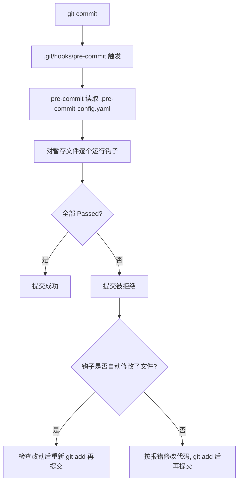

## 1. pre-commit 是什么

[pre-commit](https://pre-commit.com/) 是一个管理 Git 提交钩子的工具。执行 `git commit` 时，它会先对**本次暂存的文件**运行一组检查，任何一项不通过，提交就会被拒绝。

### 1.1. 为什么需要它

ruff、mypy 这类工具装好之后，前提是"记得在提交前跑一遍"。实际项目里经常忘，结果是：

* 行尾多余的空格被提交进仓库；
* 文件末尾缺少换行、函数之间缺空行；
* import 顺序不对，下一个人一格式化就产生一堆无关的 diff。

这些问题单个都不严重，但会让代码评审和 `git blame` 充满噪音。pre-commit 把"记得检查"变成"不检查就提交不了"：



### 1.2. 安装

pre-commit 本身是一个 Python 包，作为开发依赖加入项目：

```shell
# 写入 pyproject.toml 的 [dependency-groups] dev
uv add --dev pre-commit

# 在 .git/hooks/pre-commit 写入钩子脚本
uv run pre-commit install
```

两条命令的区别：

| 命令 | 作用 | 结果是否进入仓库 |
|------|------|----------------|
| `uv add --dev pre-commit` | 安装 pre-commit 工具 | 是，写在 `pyproject.toml` 和 `uv.lock` 里 |
| `uv run pre-commit install` | 把钩子脚本写进 `.git/hooks/` | **否**，`.git` 目录不会被提交 |

因为 `.git/hooks` 不随仓库分发，**每次克隆仓库后都要执行一次 `uv run pre-commit install`**，否则提交时不会有任何检查。建议直接写进 README 的"安装依赖"步骤，例如：

```shell
git clone <仓库地址> my-service
cd my-service

uv sync                         # 创建 .venv 并安装全部依赖（含开发依赖）
uv run pre-commit install       # 安装提交前检查的 git 钩子（每次克隆后执行一次）
```

## 2. 配置文件结构

pre-commit 的配置写在项目根目录的 `.pre-commit-config.yaml` 中。顶层是 `repos` 列表，每一项是一个"钩子来源"，有两种写法。

### 2.1. 远程仓库：repo + rev + hooks

```yaml
repos:
  - repo: https://github.com/pre-commit/pre-commit-hooks   # 钩子所在的 Git 仓库
    rev: v6.0.0                                             # 使用的版本（tag）
    hooks:
      - id: trailing-whitespace                             # 启用仓库中的哪个钩子
      - id: check-added-large-files
        exclude: ^uv\.lock$                                 # 钩子级别的可选参数
```

| 字段 | 含义 |
|------|------|
| `repo` | 钩子仓库的 Git 地址，仓库里有一个 `.pre-commit-hooks.yaml` 描述它提供哪些钩子 |
| `rev` | 固定使用的版本，通常是 tag |
| `hooks[].id` | 要启用的钩子 ID |
| `exclude` / `files` | 用正则排除或限定要检查的文件 |

pre-commit 会把远程仓库克隆到本机缓存（`~/.cache/pre-commit`），并为它**单独创建一个隔离环境**安装依赖，与项目的 `.venv` 无关。

### 2.2. 本地钩子：repo: local

如果要运行的命令已经在本机或项目环境里，可以不引用远程仓库，直接写命令：

```yaml
  - repo: local
    hooks:
      - id: ruff-check
        name: ruff check
        entry: uv run ruff check --fix
        language: system
        types: [python]
```

| 字段 | 含义 |
|------|------|
| `id` | 钩子的唯一标识，`pre-commit run <id>` 时使用 |
| `name` | 运行时输出中显示的名字 |
| `entry` | 要执行的命令 |
| `language: system` | 直接用系统里的命令执行，pre-commit 不为它创建任何环境 |
| `types` | 只对指定类型的文件运行，`[python]` 表示只有改动了 `.py` 文件才触发 |
| `pass_filenames` | 是否把文件路径追加到命令后面，默认 `true` |

默认情况下，pre-commit 会把本次暂存且匹配 `types` 的文件路径逐个追加到 `entry` 后面。例如暂存了 `a.py` 和 `b.py`，实际执行的是：

```shell
uv run ruff check --fix a.py b.py
```

### 2.3. 完整示例：Python 项目的配置

下面是一个使用 uv 管理依赖的 Python 项目的 `.pre-commit-config.yaml`：

```yaml
# 提交前自动检查。安装：uv run pre-commit install
# 手动对所有文件跑一遍：uv run pre-commit run --all-files
repos:
  # 通用文件检查
  - repo: https://github.com/pre-commit/pre-commit-hooks
    rev: v6.0.0
    hooks:
      - id: trailing-whitespace       # 删除行尾空格
      - id: end-of-file-fixer         # 文件末尾保留一个换行
      - id: check-yaml
      - id: check-toml
      - id: check-merge-conflict      # 防止把 <<<<<<< 冲突标记提交上去
      - id: check-added-large-files   # 拦截误提交的大文件（默认 500KB）
        exclude: ^uv\.lock$
      - id: detect-private-key        # 拦截私钥

  # 项目自己的检查：通过 uv run 调用，与 uv.lock 中锁定的版本一致
  - repo: local
    hooks:
      - id: ruff-check
        name: ruff check
        entry: uv run ruff check --fix
        language: system
        types: [python]
      - id: ruff-format
        name: ruff format
        entry: uv run ruff format
        language: system
        types: [python]
      - id: mypy
        name: mypy
        entry: uv run mypy src
        language: system
        types: [python]
        pass_filenames: false         # mypy 要检查整个 src，而不是只检查改动的文件
```

整体分两段：

| 段落 | 来源 | 负责什么 |
|------|------|---------|
| 第一段 `pre-commit-hooks` | 官方远程仓库 | 与语言无关的通用文件检查：空白、换行、语法、冲突标记、大文件、私钥 |
| 第二段 `local` | 项目环境中的 ruff、mypy | Python 代码的 lint、格式化、类型检查 |

钩子按配置中的顺序执行：先修空白和换行，再 `ruff check --fix` 修代码问题，然后 `ruff format` 统一格式，最后 mypy 做类型检查。

## 3. pre-commit-hooks 常用钩子

[pre-commit-hooks](https://github.com/pre-commit/pre-commit-hooks) 是 pre-commit 官方维护的通用钩子集合。上面示例中用到的几个：

| 钩子 ID | 作用 | 是否自动修复 |
|---------|------|------------|
| `trailing-whitespace` | 删除行尾多余的空格和制表符 | 是 |
| `end-of-file-fixer` | 保证文件以且仅以一个换行结尾 | 是 |
| `check-yaml` | 检查 YAML 文件能否被正确解析 | 否，只报错 |
| `check-toml` | 检查 TOML 文件（如 `pyproject.toml`）能否被正确解析 | 否，只报错 |
| `check-merge-conflict` | 发现 `<<<<<<<`、`=======`、`>>>>>>>` 等未解决的合并冲突标记 | 否，只报错 |
| `check-added-large-files` | 拦截新添加的大文件，默认上限 500KB | 否，只报错 |
| `detect-private-key` | 发现文件中包含私钥内容（如 `BEGIN RSA PRIVATE KEY`） | 否，只报错 |

可以把它们分成两类理解：

* **修复型**（前两个）：发现问题直接改文件，然后让本次提交失败，等你确认。
* **拦截型**（其余几个）：只报错，不改文件，需要你自己处理。

### 3.1. check-added-large-files 与 uv.lock

`check-added-large-files` 默认拦截超过 500KB 的新增文件，用来防止把数据文件、构建产物等误提交进仓库。

但 `uv.lock` 记录了整棵依赖树每个包的版本和哈希，体积不小：一个依赖 FastAPI、SQLAlchemy 等常见库的 Web 服务，`uv.lock` 很容易达到 500KB 左右，并且会随依赖增加继续增长。它必须提交，所以要单独排除：

```yaml
      - id: check-added-large-files
        exclude: ^uv\.lock$
```

`exclude` 是正则表达式，`^` 和 `$` 保证只匹配根目录下名字正好是 `uv.lock` 的文件，`.` 需要转义成 `\.`。

## 4. ruff 和 mypy 为什么用 local + uv run

ruff 和 mypy 都有官方提供的 pre-commit 钩子仓库，例如：

```yaml
# 官方钩子仓库的写法（上面的示例没有采用）
  - repo: https://github.com/astral-sh/ruff-pre-commit
    rev: <版本>
    hooks:
      - id: ruff
```

示例配置选择了 `repo: local` + `uv run`，原因如下。

### 4.1. 版本与 uv.lock 保持一致

| 对比 | 官方钩子仓库 | local + `uv run` |
|------|------------|-----------------|
| 工具安装在哪里 | pre-commit 的独立环境，另装一份 | 项目的 `.venv`，就是 `uv sync` 装的那一份 |
| 版本写在哪里 | `.pre-commit-config.yaml` 的 `rev` | `uv.lock` |
| 升级方式 | 改 `rev`，或 `pre-commit autoupdate` | `uv lock --upgrade-package ruff` |
| 风险 | 与 `uv.lock` 中的版本脱节，本地 `uv run ruff check` 通过、提交钩子却报错（或反过来） | 无，命令行、编辑器、钩子用的是同一个版本 |

用 `uv run` 调用，版本只维护在 `uv.lock` 一处。

### 4.2. mypy 必须在项目环境里运行

mypy 做类型检查时要读取**第三方依赖的类型信息**。例如项目代码大量使用 pydantic、sqlalchemy、fastapi，`pyproject.toml` 里还启用了 pydantic 的 mypy 插件：

```toml
[tool.mypy]
python_version = "3.12"
strict = true
plugins = ["pydantic.mypy"]   # 让 mypy 理解 Pydantic 模型
mypy_path = "src"
```

官方 mypy 钩子运行在 pre-commit 的独立环境里，那里没有安装 pydantic、sqlalchemy，要么找不到插件，要么只能把这些依赖在 `additional_dependencies` 里再写一遍（又一份要手动同步的版本）。`uv run mypy` 直接使用项目 `.venv`，所有依赖和插件都在。

### 4.3. mypy 设置 pass_filenames: false

```yaml
      - id: mypy
        entry: uv run mypy src
        pass_filenames: false
```

* ruff 是逐文件检查的工具，只检查改动的文件既快又够用，所以保留默认的 `pass_filenames: true`。
* mypy 要分析跨文件的类型关系：改了 `schemas/user.py` 里的字段类型，可能让没改动的 `services/user_service.py` 出错。只把改动的文件传给 mypy 会漏掉这类错误。

所以 mypy 的命令固定为 `uv run mypy src`，并设置 `pass_filenames: false`，不让 pre-commit 追加文件路径。`types: [python]` 仍然保留，作用是"只有改了 Python 文件才运行 mypy"，只改 README 时不触发。

### 4.4. 为什么不在提交钩子里跑测试

Web 服务的 pytest 测试通常需要连接数据库（如 PostgreSQL），跑一遍也比 lint 慢得多。放进提交钩子会带来两个问题：

* 数据库没启动时根本无法提交；
* 每次提交都要等测试跑完，大家很快就会习惯性跳过检查。

提交钩子只放**快速、不依赖外部服务**的检查，测试交给 CI。

## 5. 与 ruff force-exclude 的关系

使用 Alembic 的项目通常会在 `[tool.ruff]` 里排除自动生成的迁移文件：

```toml
[tool.ruff]
line-length = 100
target-version = "py312"
src = ["src", "tests"]
extend-exclude = ["migrations/versions"]   # 自动生成的迁移文件不检查
force-exclude = true   # 即使显式传入文件路径（如 pre-commit），也遵守上面的排除规则
```

问题出在 pre-commit 的调用方式：它会把文件路径逐个传给 ruff（`uv run ruff check --fix migrations/versions/xxx.py`）。ruff 的默认行为是：**命令行显式传入的路径不受 `exclude` / `extend-exclude` 约束**。

后果是：不加 `force-exclude` 时，pre-commit 调用的 ruff 会改写已经执行过的迁移文件。迁移文件一旦执行过就不应再改动，哪怕只是格式变化。

| 调用方式 | 没有 `force-exclude` | `force-exclude = true` |
|---------|---------------------|----------------------|
| `uv run ruff check`（不带路径） | 遵守 `extend-exclude` | 遵守 `extend-exclude` |
| `uv run ruff check migrations/versions/xxx.py`（pre-commit 的方式） | **不遵守**，迁移文件被检查和改写 | 遵守，迁移文件被跳过 |

所以只要用 pre-commit 调 ruff，就应该在 `[tool.ruff]` 中加上 `force-exclude = true`。ruff 的排除规则详见 [代码质量工具 ruff 与 mypy](./Python工程化篇002_代码质量工具ruff与mypy.md)。

## 6. 升级钩子版本：autoupdate

远程钩子仓库的版本固定在 `rev` 里，不会自动变化。升级用 `autoupdate`：

```shell
# 只升级 pre-commit-hooks 这一个仓库
uv run pre-commit autoupdate --repo https://github.com/pre-commit/pre-commit-hooks
```

它会查询该仓库的最新 tag 并改写 `.pre-commit-config.yaml` 里的 `rev`，例如从 `v5.0.0` 改为 `v6.0.0`。

* 不加 `--repo` 会升级配置中的所有远程仓库。
* `repo: local` 的钩子没有 `rev`，`autoupdate` 不会处理；ruff、mypy 的版本仍通过 `uv lock --upgrade-package` 升级。
* 升级后建议执行一次 `uv run pre-commit run --all-files`，确认新版本没有带来新的报错，再提交配置文件。

## 7. 首次对全部文件运行

`pre-commit install` 之后，钩子只检查**每次提交暂存的文件**。仓库里已有的文件不会被自动检查，所以接入 pre-commit 后应该手动对全部文件跑一遍：

```shell
uv run pre-commit run --all-files
```

### 7.1. 首次运行会安装环境

第一次运行时，pre-commit 要克隆 `pre-commit-hooks` 仓库并为它创建独立环境，输出中会出现：

```
[INFO] Installing environment for https://github.com/pre-commit/pre-commit-hooks.
```

这一步只在第一次（或 `rev` 变化后）发生，环境会缓存下来，之后的运行不再下载。`local` 钩子用 `language: system`，不需要安装环境。

### 7.2. 输出解读

在已有文件的仓库里首次运行，修复型钩子经常失败。例如 `end-of-file-fixer` 失败时，运行后会输出：

```
fix end of files.........................................................Failed
- hook id: end-of-file-fixer
- exit code: 1
- files were modified by this hook

Fixing migrations/README
Fixing .env.example
Fixing .gitignore
```

| 输出 | 含义 |
|------|------|
| `Failed` | 本次检查不通过，提交会被拒绝 |
| `files were modified by this hook` | 钩子已经**自动修复**了文件 |
| `Fixing migrations/README` 等 | 具体被修改的文件，这里是给三个文件的末尾补上了换行 |

修复型钩子即使已经改好了文件，也会报 `Failed`。原因是它改动了工作区，需要你确认这些改动。直接再运行一次：

```shell
uv run pre-commit run --all-files
```

第二次所有钩子都显示 `Passed`。然后把被修复的文件 `git add` 并提交。

## 8. 提交失败时怎么处理

### 8.1. 两类失败

| 提示 | 含义 | 处理方式 |
|------|------|---------|
| `files were modified by this hook` | 钩子已自动修复（空白、换行、`ruff check --fix`、`ruff format`） | 用 `git diff` 看一下改了什么，重新 `git add`，再提交 |
| ruff / mypy 输出具体错误位置 | 无法自动修复的问题 | 按报错改代码，`git add` 后再提交 |

为什么自动修复了还要手动 `git add`？pre-commit 改的是工作区里的文件，暂存区仍是你原来 `add` 的版本。它故意不帮你重新暂存，让你**看到并确认**它改了什么，再决定提交。

### 8.2. 拦截演示：行尾空格和未使用的 import

写一个有问题的文件并尝试提交：

```shell
printf 'import os\nx=1   \n' > src/my_service/demo.py
git add src/my_service/demo.py
git commit -m "demo"
```

这个文件有两个问题：`x=1` 后面有行尾空格，`import os` 没有被使用。结果：

* `trailing whitespace` 显示 `Failed`，并自动删掉了行尾空格；
* `ruff check` 显示 `Failed`，报出 `F401`（导入了未使用的模块），输出 `Found 1 error (1 fixed, 0 remaining).`，即已经通过 `--fix` 自动删除了这行 import；
* 提交被拒绝。

此时文件已被修复，重新 `git add` 再提交即可。

### 8.3. 拦截演示：类型错误

```python
def f() -> int:
    return "x"
```

函数声明返回 `int`，实际返回字符串。ruff 不会报错，但 `mypy` 钩子显示 `Failed`，提交被拒绝。这种错误无法自动修复，需要改代码后重新 `git add`。

### 8.4. --no-verify 与 CI 兜底

```shell
git commit --no-verify -m "..."
```

`--no-verify`（简写 `-n`）会跳过所有提交钩子。此外，没有执行 `pre-commit install` 的克隆也不会有任何检查。所以 pre-commit 只是本地的第一道防线，**CI 里还要再跑一遍**同样的检查作为兜底：

```shell
uv sync --locked
uv run pre-commit run --all-files
uv run pytest
```

## 9. 常用命令速查

| 命令 | 作用 |
|------|------|
| `uv add --dev pre-commit` | 把 pre-commit 加入开发依赖 |
| `uv run pre-commit install` | 在 `.git/hooks` 写入钩子，每次克隆后执行一次 |
| `uv run pre-commit run --all-files` | 对仓库全部文件运行所有钩子 |
| `uv run pre-commit run <id> --all-files` | 只运行某一个钩子，如 `mypy` |
| `uv run pre-commit autoupdate --repo <地址>` | 升级某个远程钩子仓库的 `rev` |
| `git commit --no-verify` | 跳过所有提交钩子（慎用） |

## 10. 小结

* pre-commit 在 `git commit` 前自动检查暂存的文件，不通过就拒绝提交，避免行尾空格、缺少换行、import 顺序错误等问题进入仓库。
* `uv add --dev pre-commit` 安装工具，`uv run pre-commit install` 写入 `.git/hooks`；钩子不随仓库分发，每次克隆后都要执行一次，写进 README。
* 配置分两种来源：远程仓库（`repo` + `rev` + `hooks`）适合通用文件检查；`repo: local` + `language: system` 直接调用项目里的命令。
* ruff、mypy 用 `uv run` 调用，版本跟随 `uv.lock`；mypy 在项目环境里才能读到 pydantic、sqlalchemy 的类型，并用 `pass_filenames: false` 检查整个 `src`。测试依赖数据库且耗时，放到 CI。
* pre-commit 会显式传入文件路径，`[tool.ruff]` 需要 `force-exclude = true`，否则迁移文件会被改写。
* `check-added-large-files` 默认 500KB，要排除 `uv.lock`；远程钩子用 `autoupdate` 升级。
* 接入后先跑一次 `--all-files`；看到 `files were modified by this hook` 就重新 `git add`；`--no-verify` 能跳过检查，所以 CI 要再跑一遍。
