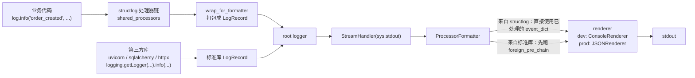

## 1. 为什么需要结构化日志

### 1.1. 自由文本日志的问题

很多项目的日志是这样写的：

```python
logger.info(f"用户 {user_id} 创建订单 {order_id}，金额 {amount}")
```

输出是一句给人看的话：

```
2026-11-18 15:06:22 INFO 用户 u-1 创建订单 1001，金额 99.5
```

人读起来没问题，但日志一多、要上日志平台检索时就很麻烦：

| 问题 | 说明 |
|------|------|
| 难以按字段检索 | 想查"金额大于 1000 的订单"，只能写正则去匹配句子，句式一改正则就失效 |
| 同一类事件写法不统一 | A 写"创建订单"，B 写"下单成功"，C 写"order created"，统计不到一起 |
| 上下文靠手工拼 | 每条日志都要自己把 `request_id` 拼进字符串，漏一条就串不起整个请求 |
| 机器解析成本高 | 日志平台需要为每种格式单独配置解析规则 |

### 1.2. 结构化日志：事件名 + 键值对

结构化日志的思路是：**每条日志 = 一个固定的事件名 + 一组键值对**。事件名说明"发生了什么"，键值对记录"相关的数据"。

```python
log.info("order_created", order_id=1001, amount=99.5)
```

生产环境下输出为一行 JSON：

```json
{"order_id": 1001, "amount": 99.5, "event": "order_created", "level": "info", "logger": "my_service.demo", "timestamp": "2026-11-18T07:06:23.157009Z"}
```

日志平台拿到的是现成的字段，可以直接写 `event = "order_created" AND amount > 1000` 这样的查询，不需要任何解析规则。

[structlog](https://www.structlog.org/) 是 Python 中最常用的结构化日志库。安装：

```shell
uv add structlog
```

### 1.3. 按环境选择输出格式

同一套日志调用，按环境输出不同格式：

| 环境 | 渲染器 | 输出形式 | 用途 |
|------|--------|---------|------|
| dev / test | `structlog.dev.ConsoleRenderer` | 彩色、对齐的单行文本，异常带完整堆栈 | 本地开发时人眼阅读 |
| prod | `structlog.processors.JSONRenderer` | 每行一条 JSON | 由 ELK、Loki、阿里云 SLS 等日志平台采集和检索 |

业务代码不关心最终格式，只管调用 `log.info(...)`；格式由启动时的日志配置决定。

### 1.4. 写法约定

| 写法 | 示例 | 说明 |
|------|------|------|
| ✅ 事件名 + 键值对 | `log.info("order_created", order_id=oid, amount=amt)` | 字段可检索 |
| ❌ f-string 拼接 | `log.info(f"order {oid} created, amount={amt}")` | 数据被拼进字符串，无法按字段查询 |
| ✅ 事件名用 snake_case | `user_login`、`http_request`、`unhandled_exception` | 固定、简短，便于统计同类事件 |
| ❌ 记录敏感信息 | `log.info("user_login", password=pwd, token=tok)` | 密码、令牌一旦进日志，所有能看日志的人都能拿到 |

业务代码统一用项目封装的 `get_logger` 获取 logger：

```python
from my_service.core.logging import get_logger

log = get_logger(__name__)

log.info("app_startup", env=settings.app_env, version=__version__)
```

`__name__` 是模块路径（如 `my_service.main`），会出现在每条日志的 `logger` 字段里，一眼就能看出日志来自哪个模块。

## 2. 与标准库 logging 桥接

### 2.1. 为什么要桥接

一个 FastAPI 服务里，日志来自两个地方：

* **自己的代码**：通过 structlog 输出。
* **第三方库**：uvicorn、sqlalchemy、httpx 等用的都是标准库 `logging`，不会改成 structlog。

如果两边各自输出，同一个服务的日志就会一半是 JSON、一半是普通文本，日志平台没法统一解析。桥接的目标是：**两条来源最终都交给同一个 formatter 渲染，输出格式完全一致。**



### 2.2. 配置代码

下面是日志模块 `src/my_service/core/logging.py` 的完整实现（服务启动时在 `create_app()` 中调用一次 `setup_logging(settings)`）：

```python
import logging
import sys

import structlog
from structlog.tracebacks import ExceptionDictTransformer
from structlog.types import EventDict, Processor, WrappedLogger

from my_service.core.config import Settings


def _drop_color_message(_: WrappedLogger, __: str, event_dict: EventDict) -> EventDict:
    """uvicorn 会在 extra 里附带一份带颜色控制符的 color_message，与 event 重复，去掉。"""
    event_dict.pop("color_message", None)
    return event_dict


def setup_logging(setting: Settings) -> None:
    # structlog 日志与第三方库（uvicorn、sqlalchemy 等）的标准库日志共用的处理链
    shared_processors: list[Processor] = [
        structlog.contextvars.merge_contextvars,  # 合并上下文变量，如 request_id
        structlog.stdlib.add_log_level,  # 增加 level 字段
        structlog.stdlib.add_logger_name,  # 增加 logger 字段
        structlog.stdlib.ExtraAdder(),  # 支持标准库的 logger.info("...", extra={...})
        _drop_color_message,
        structlog.processors.TimeStamper(fmt="iso", utc=True),
    ]

    renderer: list[Processor]
    if setting.is_prod:
        renderer = [
            # 异常堆栈转成 JSON；不输出局部变量，避免密码、token 写进日志
            structlog.processors.ExceptionRenderer(ExceptionDictTransformer(show_locals=False)),
            structlog.processors.JSONRenderer(),
        ]
    else:
        renderer = [structlog.dev.ConsoleRenderer()]

    structlog.configure(
        processors=[*shared_processors, structlog.stdlib.ProcessorFormatter.wrap_for_formatter],
        logger_factory=structlog.stdlib.LoggerFactory(),
        wrapper_class=structlog.stdlib.BoundLogger,
        cache_logger_on_first_use=True,
    )

    formatter = structlog.stdlib.ProcessorFormatter(
        foreign_pre_chain=shared_processors,
        processors=[structlog.stdlib.ProcessorFormatter.remove_processors_meta, *renderer],
    )
    handler = logging.StreamHandler(sys.stdout)
    handler.setFormatter(formatter)

    root = logging.getLogger()
    root.handlers.clear()
    root.addHandler(handler)
    root.setLevel(setting.log_level)

    # uvicorn 自带 handler，清掉后交给 root 统一输出，避免格式不一致或重复打印
    for name in ("uvicorn", "uvicorn.error", "uvicorn.access"):
        uv_logger = logging.getLogger(name)
        uv_logger.handlers.clear()
        uv_logger.propagate = True

    # 访问日志改由 RequestContextMiddleware 输出（带 request_id 和耗时），
    # 关掉 uvicorn 自带的，避免重复
    logging.getLogger("uvicorn.access").disabled = True


def get_logger(name: str | None = None) -> structlog.stdlib.BoundLogger:
    return structlog.stdlib.get_logger(name)
```

### 2.3. 关键配置项说明

`structlog.configure(...)` 决定 structlog 这一侧怎么处理：

| 配置项 | 值 | 作用 |
|--------|----|------|
| `processors` | `[*shared_processors, wrap_for_formatter]` | 先跑共享处理器，最后一步 `wrap_for_formatter` **不渲染**，而是把 event_dict 打包交给标准库 logging |
| `logger_factory` | `structlog.stdlib.LoggerFactory()` | structlog 底层使用标准库的 `logging.Logger`，日志因此会走 root 的 handler |
| `wrapper_class` | `structlog.stdlib.BoundLogger` | 提供 `info`、`warning`、`exception` 等与标准库一致的方法 |
| `cache_logger_on_first_use` | `True` | 首次使用后缓存 logger，减少每次调用的开销 |

`ProcessorFormatter(...)` 是挂在 handler 上的 formatter，决定最终输出什么：

| 参数 | 值 | 作用 |
|------|----|------|
| `foreign_pre_chain` | `shared_processors` | 只对**来自标准库**的日志（"外来"日志）执行，让第三方库日志也补齐 level、logger、timestamp 等字段 |
| `processors` | `[remove_processors_meta, *renderer]` | 两种来源都会执行；`remove_processors_meta` 删掉 structlog 内部用的 `_record`、`_from_structlog` 字段，再交给渲染器 |

handler 只有一个：

* root logger 上**只挂一个** `StreamHandler(sys.stdout)`，先 `root.handlers.clear()` 再添加，避免重复调用 `setup_logging` 时挂上多个 handler 导致每条日志打印多次。
* 所有 logger 默认 `propagate=True`，日志都会冒泡到 root，由这一个 handler 统一输出。
* `root.setLevel(setting.log_level)` 让日志级别由配置项 `LOG_LEVEL` 控制。

### 2.4. 两种来源的输出效果

用一个演示脚本分别从 structlog 和标准库 logger 写日志（logger 名称模拟 sqlalchemy）：

```python
import logging

from my_service.core.config import get_settings
from my_service.core.logging import get_logger, setup_logging

setup_logging(get_settings())
log = get_logger("my_service.demo")

log.info("order_created", order_id=1001, amount=99.5)
logging.getLogger("sqlalchemy.engine").warning("pool exhausted, size=%d", 10, extra={"pool": "main"})
```

`APP_ENV=prod` 时两条日志都是 JSON，字段一致：

```json
{"order_id": 1001, "amount": 99.5, "event": "order_created", "level": "info", "logger": "my_service.demo", "timestamp": "2026-11-18T07:06:23.157009Z"}
{"event": "pool exhausted, size=10", "level": "warning", "logger": "sqlalchemy.engine", "pool": "main", "timestamp": "2026-11-18T07:06:23.157271Z"}
```

标准库日志的消息（`%d` 已经被格式化）成为 `event` 字段，`extra` 里的 `pool` 成为普通字段。

## 3. 处理器链

### 3.1. 处理器的工作方式

structlog 的核心是一条**处理器链（processor chain）**：每次调用 `log.info("order_created", order_id=1001)`，structlog 把参数组装成一个字典 `event_dict`：

```python
{"event": "order_created", "order_id": 1001}
```

然后按顺序交给每个处理器，每个处理器接收上一个的结果、加工后返回，最后一个处理器（渲染器）把字典变成字符串。


### 3.2. 共享处理器各自的作用

| 处理器 | 新增 / 修改的字段 | 作用 |
|--------|-----------------|------|
| `structlog.contextvars.merge_contextvars` | `request_id` 等 | 把通过 `bound_contextvars` 绑定在当前上下文里的变量合并进来，见第 7 节 |
| `structlog.stdlib.add_log_level` | `level` | 记录日志级别，如 `info`、`warning`、`error` |
| `structlog.stdlib.add_logger_name` | `logger` | 记录 logger 名称，如 `my_service.main`、`uvicorn.error` |
| `structlog.stdlib.ExtraAdder()` | `extra` 中的键 | 把标准库 `logger.info("...", extra={...})` 传入的字段加进 event_dict，第三方库的附加信息不会丢 |
| `_drop_color_message` | 删除 `color_message` | 项目自定义，见 3.3 节 |
| `structlog.processors.TimeStamper(fmt="iso", utc=True)` | `timestamp` | ISO 8601 格式的 UTC 时间，如 `2026-11-18T07:06:23.157009Z`；统一 UTC，避免多台机器时区不同 |

这组处理器同时用在 `structlog.configure(processors=...)` 和 `ProcessorFormatter(foreign_pre_chain=...)` 里，所以两种来源的日志字段一致。

### 3.3. 自定义 processor

处理器就是一个普通函数，签名固定为：

```python
from structlog.types import EventDict, WrappedLogger


def my_processor(logger: WrappedLogger, method_name: str, event_dict: EventDict) -> EventDict:
    ...
    return event_dict
```

| 参数 | 含义 |
|------|------|
| `logger` | 底层的 logger 对象，一般用不到 |
| `method_name` | 调用的方法名，如 `"info"`、`"warning"` |
| `event_dict` | 当前的日志字典，可以增、删、改字段 |
| 返回值 | 加工后的字典，交给下一个处理器 |

项目中的 `_drop_color_message` 用来删除 uvicorn 附带的重复字段（原因见 6.2 节）。用不到的参数用 `_`、`__` 命名：

```python
def _drop_color_message(_: WrappedLogger, __: str, event_dict: EventDict) -> EventDict:
    """uvicorn 会在 extra 里附带一份带颜色控制符的 color_message，与 event 重复，去掉。"""
    event_dict.pop("color_message", None)
    return event_dict
```

**顺序很重要**：`color_message` 是 uvicorn 通过 `extra` 传入的，只有经过 `ExtraAdder` 之后它才会出现在 event_dict 里。所以 `_drop_color_message` 必须排在 `ExtraAdder` 之后。把两种顺序分别配置在 `foreign_pre_chain` 中，运行后会输出：

```python
# 顺序 1：[_drop_color_message, ExtraAdder()]
{"event": "Started server process [1]", "color_message": "Started server process [\u001b[36m%d\u001b[0m]"}

# 顺序 2：[ExtraAdder(), _drop_color_message]
{"event": "Started server process [1]"}
```

排在前面时删除操作什么都没删到，`color_message` 随后被 `ExtraAdder` 加了进来。

## 4. 异常日志与敏感信息

### 4.1. 坑①：dict_tracebacks 会输出局部变量

在 `except` 块里调用 `log.exception(...)`，structlog 会把异常信息一起记录。生产环境需要把堆栈也转成 JSON，常见写法是使用 structlog 自带的 `structlog.processors.dict_tracebacks`。

用下面的脚本验证：

```python
import sys

import structlog

structlog.configure(
    processors=[
        structlog.processors.add_log_level,
        structlog.processors.dict_tracebacks,
        structlog.processors.JSONRenderer(),
    ],
    logger_factory=structlog.PrintLoggerFactory(sys.stdout),
)
log = structlog.get_logger()


def divide(a, b):
    password = "s3cret"
    return a / b


try:
    divide(1, 0)
except ZeroDivisionError:
    log.exception("divide_failed")
```

输出（为便于阅读做了换行）：

```json
{"event": "divide_failed", "level": "error", "exception": [{"exc_type": "ZeroDivisionError", "exc_value": "division by zero",
  "frames": [
    {"filename": "/tmp/structlog_locals_demo.py", "lineno": 23, "name": "<module>",
     "locals": {"sys": "<module 'sys' (built-in)>", "structlog": "<module 'structlog' from '...'>", "log": "<BoundLoggerLazyProxy(...)>", "divide": "<function divide at 0x1010ba660>"}},
    {"filename": "/tmp/structlog_locals_demo.py", "lineno": 19, "name": "divide",
     "locals": {"a": "1", "b": "0", "password": "'s3cret'"}}
  ], ...}]}
```

`dict_tracebacks` 默认会把**每一帧的局部变量**都写进 `frames[].locals`：模块对象、函数对象，以及 `password` 这样的变量值。真实服务里，出错函数的局部变量可能就是用户密码、JWT、数据库连接串，一次异常就会把它们写进日志平台。

### 4.2. 解决：关闭 show_locals

`dict_tracebacks` 等价于使用默认参数的 `ExceptionRenderer(ExceptionDictTransformer())`。项目改为显式构造，并关闭局部变量：

```python
from structlog.tracebacks import ExceptionDictTransformer

renderer = [
    structlog.processors.ExceptionRenderer(ExceptionDictTransformer(show_locals=False)),
    structlog.processors.JSONRenderer(),
]
```

同样的异常，项目配置下的 prod 输出：

```json
{"event": "divide_failed", "level": "error", "logger": "my_service.demo", "timestamp": "2026-11-18T07:06:23.157375Z", "exception": [{"exc_type": "ZeroDivisionError", "exc_value": "division by zero", "exc_notes": [], "syntax_error": null, "is_cause": false, "frames": [{"filename": "/tmp/structlog_demo.py", "lineno": 30, "name": "<module>"}, {"filename": "/tmp/structlog_demo.py", "lineno": 26, "name": "divide"}], "is_group": false, "exceptions": []}]}
```

`frames` 里只剩 `filename`、`lineno`、`name`，足够定位出错位置，局部变量不再输出。

| 写法 | frames 内容 | 适用 |
|------|------------|------|
| `dict_tracebacks` | `filename`、`lineno`、`name`、`locals` | 不建议用于生产 |
| `ExceptionRenderer(ExceptionDictTransformer(show_locals=False))` | `filename`、`lineno`、`name` | 生产环境 |

### 4.3. dev 环境保留 locals

dev 环境使用 `ConsoleRenderer`，项目没有关闭局部变量。环境里装有 rich 时，堆栈会画成带框的表格，每一帧下面列出 locals，方便本地排查（节选）：

```
2026-11-18T07:06:35.246115Z [error    ] divide_failed                  [my_service.demo]
╭─────────────────────────────── Traceback (most recent call last) ────────────────────────────────╮
│ /tmp/structlog_demo.py:26 in divide                                                              │
│                                                                                                  │
│   24 def divide(a, b):                                                                           │
│   25 │   password = "s3cret"                                                                     │
│ ❱ 26 │   return a / b                                                                            │
│                                                                                                  │
│ ╭────── locals ───────╮                                                                          │
│ │        a = 1        │                                                                          │
│ │        b = 0        │                                                                          │
│ │ password = 's3cret' │                                                                          │
│ ╰─────────────────────╯                                                                          │
╰──────────────────────────────────────────────────────────────────────────────────────────────────╯
ZeroDivisionError: division by zero
```

本地数据是开发者自己的测试数据，看到局部变量的好处大于风险；生产日志会集中存储、多人可见，所以要关掉。

## 5. 容器中的日志输出位置

项目的 handler 是 `logging.StreamHandler(sys.stdout)`，**应用只把日志写到标准输出，不写日志文件**。这是容器部署的惯例：

| 做法 | 说明 |
|------|------|
| 应用写 stdout | 应用只管输出，不关心日志最终存到哪 |
| 平台负责收集 | Docker、Kubernetes 会接管容器的标准输出，日志平台的采集器（Filebeat、Promtail、Logtail 等）从这里读取 |
| 应用不写文件 | 容器文件系统是临时的，重建即丢失；写文件还要自己处理切割、清理和磁盘占满的问题 |

本地运行时，日志直接显示在终端；`docker compose logs` 或 `kubectl logs` 看到的也是同一份输出。

## 6. 接管 uvicorn 日志

### 6.1. 清空 uvicorn 自带的 handler

uvicorn 启动时会给 `uvicorn`、`uvicorn.error`、`uvicorn.access` 这几个 logger 挂上自己的 handler 和格式。如果不处理，这些日志会按 uvicorn 的格式单独打印，和我们的格式不一致。

```python
for name in ("uvicorn", "uvicorn.error", "uvicorn.access"):
    uv_logger = logging.getLogger(name)
    uv_logger.handlers.clear()   # 去掉 uvicorn 自己的 handler
    uv_logger.propagate = True   # 冒泡到 root，交给我们的 handler 输出
```

处理之后，uvicorn 的日志也经过 `foreign_pre_chain` 和同一个渲染器，`logger` 字段为 `uvicorn.error` 等。

### 6.2. 坑②：uvicorn 附带的 color_message

uvicorn 在写部分日志时会通过 `extra` 附带一个 `color_message` 字段，内容是带终端颜色控制符的同一句话，用于它自己的彩色格式。经过 `ExtraAdder` 后，这个字段会原样出现在 JSON 中：

```json
{"event": "Started server process [12345]", "level": "info", "logger": "uvicorn.error", "color_message": "Started server process [\u001b[36m%d\u001b[0m]", "timestamp": "..."}
```

`color_message` 和 `event` 内容重复，还带有 `\u001b[36m` 这样的控制符，对检索没有用处。项目用自定义的 `_drop_color_message` 处理器删掉它（排在 `ExtraAdder` 之后，见 3.3 节），删除后：

```json
{"event": "Started server process [12345]", "level": "info", "logger": "uvicorn.error", "timestamp": "2026-11-18T07:06:23.157303Z"}
```

### 6.3. 关闭 uvicorn.access，改由中间件输出访问日志

uvicorn 的访问日志（`uvicorn.access`）只有客户端地址、方法、路径和状态码，没有 `request_id` 和耗时。项目把它关掉：

```python
logging.getLogger("uvicorn.access").disabled = True
```

访问日志改由请求中间件 `RequestContextMiddleware`（`src/my_service/core/middleware.py`）在请求结束时输出：

```python
finally:
    if scope["path"] not in _SKIP_ACCESS_LOG_PATHS:
        log.info(
            "http_request",
            method=scope["method"],
            path=scope["path"],
            status=status_code,
            duration_ms=round((time.perf_counter() - start) * 1000, 2),
        )
```

| 对比 | uvicorn.access | 中间件 `http_request` |
|------|---------------|----------------------|
| 格式 | 一句文本 | 结构化字段 |
| request_id | 无 | 有（来自 contextvars） |
| 耗时 | 无 | `duration_ms` |
| 健康检查 | 每次探针都记录 | `/healthz`、`/readyz` 不记录，避免刷屏 |

如果两者都开着，每个请求会打印两条访问日志，所以只保留中间件这一条。

### 6.4. 启动最开始的几行不经过我们的格式

用 `fastapi dev` 或 `uvicorn` 启动时，终端最前面会出现几行 uvicorn 自己格式的日志：

```
INFO:     ...
INFO:     ...
```

这是正常现象：这几行是 uvicorn 在**导入我们的应用之前**打印的。那时 `create_app()` 还没执行，`setup_logging` 也还没被调用，用的仍是 uvicorn 默认的日志配置。应用导入之后的日志才会使用统一格式。

## 7. 请求上下文：自动携带 request_id

请求中间件在处理每个请求时，用 `structlog.contextvars.bound_contextvars` 绑定 `request_id`：

```python
# 绑定后，这个请求内的所有日志都会自动带上 request_id
with structlog.contextvars.bound_contextvars(request_id=request_id):
    try:
        await self.app(scope, receive, send_with_request_id)
    except Exception:
        log.exception("unhandled_exception")
        ...
```

原理是两部分配合：

1. `bound_contextvars` 把 `request_id` 存进 Python 的 `contextvars`，每个请求（每个异步任务）各自独立，并发请求之间不会串；`with` 块结束时自动解绑。
2. 处理器链第一步 `merge_contextvars` 把这些变量合并进每条日志。

因此在这个请求里，路由、service、repository 中的任意 `log.info(...)` 都不用手动传 `request_id`。由于 `merge_contextvars` 也在 `foreign_pre_chain` 里，第三方库在请求内写的标准库日志同样会带上它：

```python
with structlog.contextvars.bound_contextvars(request_id="3f2a9c"):
    log.info("user_login", user_id="u-1")
    logging.getLogger("sqlalchemy.engine").info("BEGIN (implicit)")
```

```json
{"user_id": "u-1", "event": "user_login", "request_id": "3f2a9c", "level": "info", "logger": "my_service.demo", "timestamp": "2026-11-18T07:06:23.157326Z"}
{"event": "BEGIN (implicit)", "request_id": "3f2a9c", "level": "info", "logger": "sqlalchemy.engine", "timestamp": "2026-11-18T07:06:23.157359Z"}
```

`request_id` 的生成规则、`X-Request-ID` 响应头、以及纯 ASGI 中间件的写法，详见 [FastAPI基础篇003_统一异常处理与请求追踪中间件](../fastapi/FastAPI基础篇003_统一异常处理与请求追踪中间件.md)。

## 8. 输出样例：dev 与 prod

先运行 2.4、6.2、7 节中的演示脚本，再用 httpx 的 `ASGITransport` 在进程内启动应用（包括 lifespan），带 `X-Request-ID: demo-req-001` 请求一次 `GET /api/v1/auth/me`（未登录，返回 401），再请求一次 `/healthz`，运行后会输出下面的日志。

### 8.1. dev 环境

`APP_ENV=dev`（终端里是彩色的，这里用 `NO_COLOR=1` 去掉颜色）：

```
2026-11-18T07:06:35.245771Z [info     ] order_created                  [my_service.demo] amount=99.5 order_id=1001
2026-11-18T07:06:35.245973Z [warning  ] pool exhausted, size=10        [sqlalchemy.engine] pool=main
2026-11-18T07:06:35.246016Z [info     ] Started server process [12345] [uvicorn.error]
2026-11-18T07:06:35.246046Z [info     ] user_login                     [my_service.demo] request_id=3f2a9c user_id=u-1
2026-11-18T07:06:35.246093Z [info     ] BEGIN (implicit)               [sqlalchemy.engine] request_id=3f2a9c
```

```
2026-11-18T07:07:10.480164Z [info     ] app_startup                    [my_service.main] env=dev version=0.1.0
2026-11-18T07:07:10.487404Z [info     ] http_request                   [my_service.core.middleware] duration_ms=6.47 method=GET path=/api/v1/auth/me request_id=demo-req-001 status=401
2026-11-18T07:07:10.487660Z [info     ] HTTP Request: GET http://test/api/v1/auth/me "HTTP/1.1 401 Unauthorized" [httpx]
2026-11-18T07:07:10.488106Z [info     ] HTTP Request: GET http://test/healthz "HTTP/1.1 200 OK" [httpx]
2026-11-18T07:07:10.488254Z [info     ] app_shutdown                   [my_service.main]
```

每行依次是：时间戳、级别、事件名、`[logger 名称]`、按字母排序的键值对。

### 8.2. prod 环境

`APP_ENV=prod`，每行一条 JSON：

```json
{"order_id": 1001, "amount": 99.5, "event": "order_created", "level": "info", "logger": "my_service.demo", "timestamp": "2026-11-18T07:06:23.157009Z"}
{"event": "pool exhausted, size=10", "level": "warning", "logger": "sqlalchemy.engine", "pool": "main", "timestamp": "2026-11-18T07:06:23.157271Z"}
{"event": "Started server process [12345]", "level": "info", "logger": "uvicorn.error", "timestamp": "2026-11-18T07:06:23.157303Z"}
{"user_id": "u-1", "event": "user_login", "request_id": "3f2a9c", "level": "info", "logger": "my_service.demo", "timestamp": "2026-11-18T07:06:23.157326Z"}
{"event": "BEGIN (implicit)", "request_id": "3f2a9c", "level": "info", "logger": "sqlalchemy.engine", "timestamp": "2026-11-18T07:06:23.157359Z"}
```

```json
{"env": "prod", "version": "0.1.0", "event": "app_startup", "level": "info", "logger": "my_service.main", "timestamp": "2026-11-18T07:07:10.079967Z"}
{"method": "GET", "path": "/api/v1/auth/me", "status": 401, "duration_ms": 11.13, "event": "http_request", "request_id": "demo-req-001", "level": "info", "logger": "my_service.core.middleware", "timestamp": "2026-11-18T07:07:10.092017Z"}
{"event": "HTTP Request: GET http://test/api/v1/auth/me \"HTTP/1.1 401 Unauthorized\"", "level": "info", "logger": "httpx", "timestamp": "2026-11-18T07:07:10.092641Z"}
{"event": "HTTP Request: GET http://test/healthz \"HTTP/1.1 200 OK\"", "level": "info", "logger": "httpx", "timestamp": "2026-11-18T07:07:10.093363Z"}
{"event": "app_shutdown", "level": "info", "logger": "my_service.main", "timestamp": "2026-11-18T07:07:10.093533Z"}
```

从样例中可以确认：

* 业务日志（`my_service.*`）和第三方库日志（`sqlalchemy.engine`、`uvicorn.error`、`httpx`）格式完全一致。
* `uvicorn.error` 那条没有 `color_message`。
* 请求内的日志都带 `request_id`；`/healthz` 没有 `http_request` 访问日志（最后的 `httpx` 那几行是演示用的客户端自己打印的）。
* 没有 `uvicorn.access` 的访问日志，每个请求只有中间件的一条 `http_request`。

## 9. 小结

| 要点 | 做法 |
|------|------|
| 日志写法 | `log.info("snake_case_event", key=value)`，不用 f-string 拼接，不记录密码和令牌 |
| 获取 logger | `log = get_logger(__name__)` |
| 输出格式 | dev / test 用 `ConsoleRenderer`，prod 用 `JSONRenderer`，每行一条 JSON |
| 与标准库桥接 | `structlog.configure` 末尾用 `wrap_for_formatter`；`ProcessorFormatter(foreign_pre_chain=shared_processors, processors=[remove_processors_meta, *renderer])` |
| handler | root 只挂一个 `StreamHandler(sys.stdout)`，所有 logger 冒泡到 root |
| 处理器链 | `merge_contextvars` → `add_log_level` → `add_logger_name` → `ExtraAdder` → 自定义处理器 → `TimeStamper(fmt="iso", utc=True)` |
| 自定义 processor | 签名 `(logger, method_name, event_dict) -> EventDict`；删除 extra 字段的处理器要排在 `ExtraAdder` 之后 |
| 异常与敏感信息 | prod 用 `ExceptionRenderer(ExceptionDictTransformer(show_locals=False))`，不要用默认的 `dict_tracebacks`；dev 保留 locals |
| 输出位置 | 只写 stdout，由容器平台收集，应用不写日志文件 |
| uvicorn | 清空 `uvicorn` / `uvicorn.error` / `uvicorn.access` 的 handler 并 `propagate=True`；删掉 `color_message`；`uvicorn.access` 设 `disabled=True`，访问日志由中间件输出 |
| 请求追踪 | 中间件用 `bound_contextvars(request_id=...)` 绑定，本请求内所有日志自动带 `request_id` |

几个容易踩的坑：

* 生产环境用 `dict_tracebacks` 会把每一帧的局部变量写进 JSON，可能泄露密码和令牌。
* uvicorn 的 `color_message` 会跟着 `extra` 进入日志，删除它的处理器放在 `ExtraAdder` 前面不会生效。
* 启动最开始几行 `INFO:     ...` 是 uvicorn 在导入应用之前打印的，不经过统一格式，属于正常现象。
