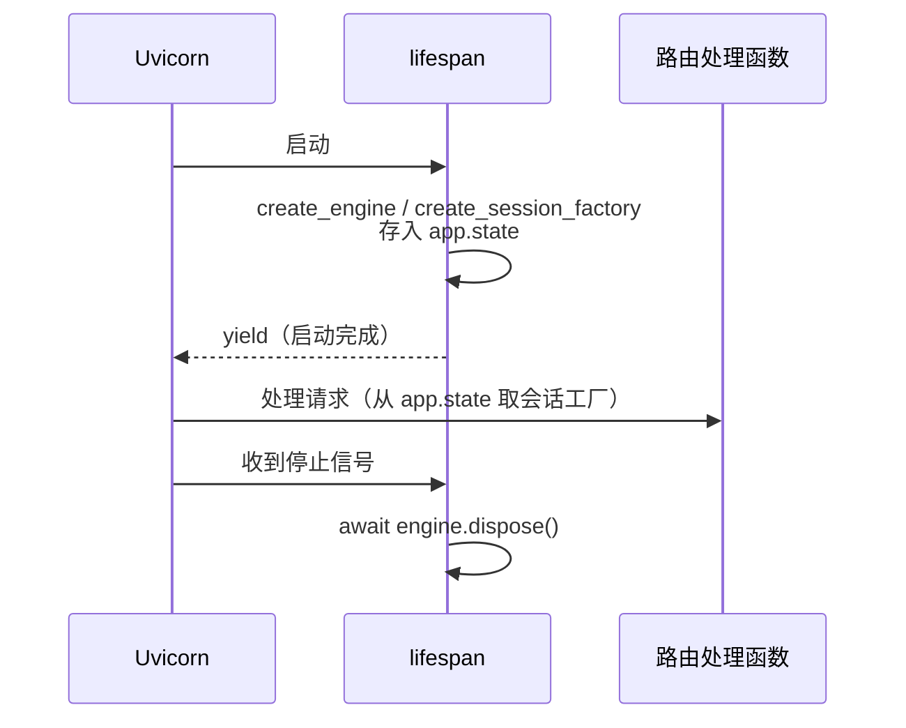
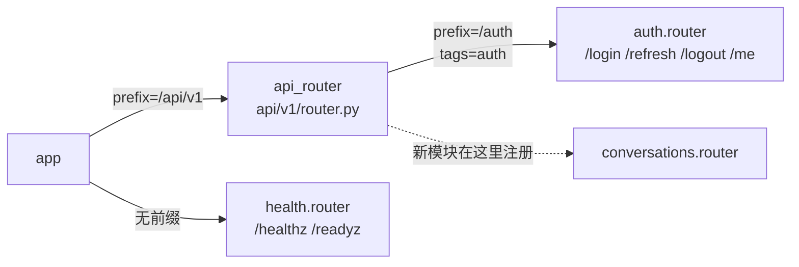
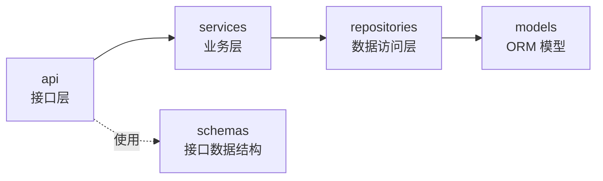

## 1. 启动服务：fastapi dev 与 fastapi run

安装 `fastapi[standard]` 后会附带 `fastapi` 命令行工具（底层是 Uvicorn），开发和生产分别使用两个子命令。

### 1.1. 两个命令的区别

| 对比项 | `fastapi dev` | `fastapi run` |
| ------ | ------------- | ------------- |
| 用途 | 本地开发 | 生产部署 |
| 自动重载 | 开启，代码变化后自动重启 | 关闭 |
| 默认监听地址 | `127.0.0.1`，只有本机能访问 | `0.0.0.0`，容器外或其他机器能访问 |
| 默认端口 | 8000 | 8000 |
| 多进程 | 没有 `--workers` 参数 | 支持 `--workers`（与 `--reload` 互斥） |

`fastapi dev --help` 里的说明是"等价于 `fastapi run`，但开启重载并监听 127.0.0.1"；`fastapi run --help` 则相反。

```shell
# 开发
uv run fastapi dev

# 换端口
uv run fastapi dev --port 8001

# 生产（容器内）
fastapi run --entrypoint my_service.main:app --host 0.0.0.0 --port 8000
```

### 1.2. 指定入口（entrypoint）

`fastapi` 命令需要知道 FastAPI 实例在哪里，格式是 `模块路径:变量名`。有两种配置方式：

**方式一：写在 `pyproject.toml` 里**

```toml
[tool.fastapi]
entrypoint = "my_service.main:app"
```

配置后在项目根目录直接运行 `uv run fastapi dev`，不需要再写路径。

**方式二：命令行参数**

```shell
uv run fastapi dev --entrypoint my_service.main:app
```

| 方式 | 适用场景 |
| ---- | -------- |
| `[tool.fastapi] entrypoint` | 本地开发，命令最短 |
| `--entrypoint` 参数 | 读不到 `pyproject.toml` 的环境，例如 Docker 运行镜像 |

### 1.3. 坑：Docker 镜像里找不到入口

常见的多阶段构建 Dockerfile 在运行阶段只复制虚拟环境、`alembic.ini` 和 `migrations/`，**没有 `pyproject.toml`**。如果 CMD 写成：

```dockerfile
CMD ["fastapi", "run"]
```

容器启动时会报错：

```text
Could not find a default file to run, please provide an explicit path
```

原因是 `fastapi run` 读不到 `[tool.fastapi]`，工作目录 `/app` 下也没有可以自动发现的入口文件（代码以 `--no-editable` 方式装进了虚拟环境）。CMD 里必须显式指定入口：

```dockerfile
# 运行阶段没有 pyproject.toml，读不到 [tool.fastapi] entrypoint，所以这里显式指定
CMD ["fastapi", "run", "--entrypoint", "my_service.main:app", "--host", "0.0.0.0", "--port", "8000"]
```

## 2. 应用工厂 create_app()

### 2.1. 把组装逻辑集中到一个函数

不要在模块顶层零散地创建和配置 `FastAPI`，而是把所有组装步骤放进 `create_app()`：

```python
# src/my_service/main.py
def create_app() -> FastAPI:
    settings = get_settings()
    setup_logging(settings)

    app = FastAPI(
        title=settings.app_name,
        version=__version__,
        debug=settings.app_debug,
        lifespan=lifespan,
        # 生产环境不暴露接口文档
        docs_url=None if settings.is_prod else "/docs",
        redoc_url=None if settings.is_prod else "/redoc",
        openapi_url=None if settings.is_prod else "/openapi.json",
    )

    register_exception_handlers(app)          # 统一错误响应
    app.add_middleware(RequestContextMiddleware)  # request_id、访问日志

    app.include_router(health.router)             # /healthz、/readyz
    app.include_router(api_router, prefix="/api/v1")
    return app


app = create_app()
```

工厂函数的好处：

| 好处 | 说明 |
| ---- | ---- |
| 组装顺序一目了然 | 配置、日志、异常处理、中间件、路由都在一个函数里，新人读这一个函数就知道应用由什么组成 |
| 可以按不同配置创建实例 | 测试中先改环境变量，再调用 `create_app()` 得到一个使用测试配置的新实例 |
| 实例之间互不影响 | 每个测试拿到独立的 app，`app.state` 里的连接池不会串用 |

测试里的用法（`tests/conftest.py`，简化）：

```python
@pytest.fixture
async def app() -> AsyncGenerator[FastAPI]:
    from my_service.main import create_app

    application = create_app()
    # 手动触发 lifespan：创建数据库连接池，测试结束后释放
    async with application.router.lifespan_context(application):
        yield application
```

### 2.2. 模块末尾的 app = create_app()

`main.py` 最后一行 `app = create_app()` 是给 `fastapi dev/run` 用的，它们按 `my_service.main:app` 导入这个变量。

这一行在**导入模块时就会执行**，也就是说只要 `import my_service.main`，就会读取配置、初始化日志、创建一个 app。对测试的影响：

- 配置必须在导入 `my_service.main` **之前**准备好。`conftest.py` 在文件顶部设置 `APP_ENV`、`DATABASE_URL`、`JWT_SECRET_KEY` 并调用 `get_settings.cache_clear()`，而 `create_app` 放在 fixture 内部导入。
- 必填配置缺失时（如没有 `JWT_SECRET_KEY`），连导入都会失败。
- 导入时只创建 app，不会执行 lifespan，所以不会连接数据库。

## 3. lifespan：启动与关闭逻辑

### 3.1. 基本写法

lifespan 是一个异步上下文管理器，传给 `FastAPI(lifespan=...)`。`yield` 之前的代码在应用启动时执行，`yield` 之后的代码在应用关闭时执行。

```python
from collections.abc import AsyncGenerator
from contextlib import asynccontextmanager

from fastapi import FastAPI


@asynccontextmanager
async def lifespan(app: FastAPI) -> AsyncGenerator[None]:
    settings = get_settings()

    # 启动：创建数据库引擎（连接池）。这里不会立即建立连接，第一次使用时才连接
    engine = create_engine(settings)
    app.state.db_engine = engine
    app.state.session_factory = create_session_factory(engine)
    log.info("app_startup", env=settings.app_env, version=__version__)

    yield

    # 关闭：释放连接池中的所有连接
    await engine.dispose()
    log.info("app_shutdown")
```



启动和关闭写在同一个函数里，创建的对象（`engine`）是局部变量，关闭时直接使用，不需要全局变量来传递。

### 3.2. 替代已废弃的 on_event

旧写法用两个装饰器分别注册启动和关闭函数：

```python
# ❌ 已废弃
@app.on_event("startup")
async def startup() -> None: ...

@app.on_event("shutdown")
async def shutdown() -> None: ...
```

当前版本调用 `@app.on_event` 会产生 `DeprecationWarning: on_event is deprecated, use lifespan event handlers instead.`。新代码统一使用 lifespan。

### 3.3. 返回类型写 AsyncGenerator[None]

lifespan 函数的返回类型写 `AsyncGenerator[None]`，不要写 `AsyncIterator[None]`。原因见 [Python工程化篇002_代码质量工具ruff与mypy](../engineering/Python工程化篇002_代码质量工具ruff与mypy.md)。

所有带 `yield` 的异步函数（lifespan、`get_db_session` 依赖、测试 fixture）都建议统一用这个写法。

### 3.4. app.state 存放进程级共享资源

`app.state` 是挂在应用实例上的一个对象，可以随意设置属性，适合存放**整个进程共用一份**的资源：

| 属性 | 类型 | 说明 |
| ---- | ---- | ---- |
| `app.state.db_engine` | `AsyncEngine` | 内部持有连接池，整个进程只创建一个 |
| `app.state.session_factory` | `async_sessionmaker[AsyncSession]` | 每个请求用它创建一个会话 |

在请求中通过 `request.app.state` 读取：

```python
# src/my_service/api/deps.py
async def get_db_session(request: Request) -> AsyncGenerator[AsyncSession]:
    """每个请求一个会话；请求结束时自动关闭，未提交的事务自动回滚。"""
    session_factory: async_sessionmaker[AsyncSession] = request.app.state.session_factory
    async with session_factory() as session:
        yield session
```

和模块级全局变量相比，资源跟随 app 实例：测试中每个 app 有自己的连接池，lifespan 结束时一起释放。

## 4. APIRouter：拆分路由

### 4.1. 每个模块一个 router

`APIRouter` 的用法和 `FastAPI` 实例一样（`@router.get`、`@router.post`……），作用类似 Gin 的路由组。每个业务模块新建一个文件，各自声明一个 `router`：

```python
# src/my_service/api/v1/auth.py
from fastapi import APIRouter, status

router = APIRouter()


@router.post("/login", summary="登录", responses=_UNAUTHORIZED)
async def login(body: LoginRequest, auth: AuthServiceDep) -> TokenResponse:
    return await auth.login(body.username, body.password)


@router.post("/logout", summary="注销", status_code=status.HTTP_204_NO_CONTENT)
async def logout(body: RefreshTokenRequest, auth: AuthServiceDep) -> None:
    await auth.logout(body.refresh_token)


@router.get("/me", summary="当前登录用户", responses=_UNAUTHORIZED)
async def me(user: CurrentUser) -> UserResponse:
    return UserResponse.model_validate(user)
```

模块内的路径只写相对部分（`/login`、`/me`），前缀在注册时统一加。

### 4.2. 汇总路由与版本前缀

前缀分两级添加：

```python
# src/my_service/api/v1/router.py —— v1 的所有模块在这里注册
from fastapi import APIRouter

from my_service.api.v1 import auth

api_router = APIRouter()
api_router.include_router(auth.router, prefix="/auth", tags=["auth"])
```

```python
# src/my_service/main.py —— 加上版本前缀
app.include_router(health.router)
app.include_router(api_router, prefix="/api/v1")
```

| 层级 | 位置 | 加的前缀 | 其他参数 |
| ---- | ---- | -------- | -------- |
| 模块 | `auth.py` | 无 | `summary`、`responses` 等单接口参数 |
| 版本汇总 | `api/v1/router.py` | `/auth` | `tags=["auth"]`，接口文档按 tag 分组 |
| 应用 | `main.py` | `/api/v1` | |

最终路径：

| 方法 | 路径 |
| ---- | ---- |
| POST | `/api/v1/auth/login` |
| POST | `/api/v1/auth/refresh` |
| POST | `/api/v1/auth/logout` |
| GET | `/api/v1/auth/me` |



新增模块时只改 `api/v1/router.py` 一处：

```python
api_router.include_router(conversations.router, prefix="/conversations", tags=["conversations"])
```

将来出现不兼容的 v2 接口，新建 `api/v2/router.py`，在 `main.py` 里用 `prefix="/api/v2"` 注册即可，v1 保持不变。

### 4.3. 健康检查挂在根路径

`health.router` 直接注册到 app，不经过 `/api/v1`：

```python
# src/my_service/api/health.py
router = APIRouter(tags=["health"])


@router.get("/healthz", summary="存活检查")
async def healthz() -> HealthResponse:
    return HealthResponse()
```

`/healthz`、`/readyz` 给 K8s 探针和负载均衡器使用，属于运维接口，和业务接口的版本无关，地址应保持固定。详见 [FastAPI基础篇004_健康检查](./FastAPI基础篇004_健康检查.md)。

### 4.4. 坑：路径漏写开头的 /

```python
@router.get("readyz")   # ❌ 少了开头的 /
async def readyz() -> HealthResponse: ...
```

这样写**启动时不报错**，但：

- `/openapi.json` 的 `paths` 里出现的是 `'readyz'`，不是 `'/readyz'`；
- `GET /readyz` 一直返回 404。

请求路径总是以 `/` 开头，而注册的路径是字面量 `readyz`，两者永远匹配不上。排查 404 时，先打开 `/openapi.json` 或 `/docs` 看实际注册的路径。路由路径一律以 `/` 开头。

## 5. 返回类型注解即响应模型

### 5.1. 用返回类型声明响应

```python
@router.get("/me", summary="当前登录用户", responses=_UNAUTHORIZED)
async def me(user: CurrentUser) -> UserResponse:
    return UserResponse.model_validate(user)
```

写了 `-> UserResponse` 之后，FastAPI 会用它做两件事：

| 作用 | 说明 |
| ---- | ---- |
| 序列化与过滤 | 返回值按 `UserResponse` 校验并转成 JSON，**模型里没有的字段不会输出** |
| 生成文档 | `/docs` 中该接口的 200 响应结构就是 `UserResponse` |

过滤效果：处理函数返回 `{"username": "alice", "password_hash": "xxx"}`，响应体只有 `{"username": "alice"}`。

效果等同于旧写法 `@router.get("/me", response_model=UserResponse)`，但类型注解同时能被 mypy 检查，不需要写两遍。

接口没有响应体时（如注销返回 204），返回类型写 `-> None`，并在装饰器里设置 `status_code=status.HTTP_204_NO_CONTENT`。

### 5.2. 从 ORM 对象构造响应模型

`CurrentUser` 依赖返回的是 SQLAlchemy 的 `User` 对象，而 Pydantic 默认只接受 dict。响应模型加上 `from_attributes=True` 后，就能按属性名从 ORM 对象读取字段：

```python
# src/my_service/schemas/user.py
class UserResponse(BaseModel):
    # 允许直接从 ORM 对象构造：UserResponse.model_validate(user)
    model_config = ConfigDict(from_attributes=True)

    id: uuid.UUID
    username: str
    is_active: bool
    created_at: datetime
```

```python
UserResponse.model_validate(user)   # user 是 ORM 对象
```

## 6. 生产环境关闭接口文档

FastAPI 默认提供三个文档相关的地址：

| 参数 | 默认地址 | 内容 |
| ---- | -------- | ---- |
| `docs_url` | `/docs` | Swagger UI 页面 |
| `redoc_url` | `/redoc` | ReDoc 页面 |
| `openapi_url` | `/openapi.json` | 完整接口定义（两个页面的数据来源） |

生产环境不应暴露接口结构，三个参数**都要设为 `None`**：

```python
app = FastAPI(
    ...,
    docs_url=None if settings.is_prod else "/docs",
    redoc_url=None if settings.is_prod else "/redoc",
    openapi_url=None if settings.is_prod else "/openapi.json",
)
```

只关一个是不够的，用 `TestClient` 请求三个地址，结果如下：

| 配置 | `/docs` | `/redoc` | `/openapi.json` |
| ---- | ------- | -------- | --------------- |
| 只设 `docs_url=None` | 404 | 200 | 200 |
| 三个都设为 `None` | 404 | 404 | 404 |

`/openapi.json` 里有全部路径、参数和响应结构，只关页面而留着它，等于把接口文档换了个地址继续公开。

按上面的写法，`APP_ENV=prod` 时（如用 docker compose 启动的生产容器），`/docs` 返回 404。

## 7. 项目分层

### 7.1. 目录结构

```text
my-service/
├── src/my_service/
│   ├── main.py                 # 应用入口：create_app()、lifespan（连接池的创建与释放）
│   ├── cli.py                  # 管理命令：my-service create-user
│   ├── api/                    # 接口层：参数解析、调用 service、返回响应
│   │   ├── deps.py             #   公共依赖：DbSession、AuthServiceDep、CurrentUser
│   │   ├── health.py           #   /healthz、/readyz
│   │   └── v1/
│   │       ├── router.py       #   v1 路由汇总，新模块在这里注册
│   │       └── auth.py         #   /api/v1/auth/*
│   ├── services/               # 业务逻辑层：业务规则、事务提交
│   ├── repositories/           # 数据访问层：只执行 SQL
│   ├── models/                 # ORM 模型（对应数据库表）
│   ├── schemas/                # Pydantic 模型（接口的输入输出）
│   ├── db/session.py           # 数据库引擎与会话工厂
│   └── core/                   # 基础设施
│       ├── config.py           #   配置（Settings）
│       ├── logging.py          #   日志
│       ├── exceptions.py       #   业务异常与统一错误响应
│       ├── middleware.py       #   request_id、访问日志、未处理异常兜底
│       └── security.py         #   密码哈希、JWT、refresh token
├── migrations/                 # Alembic 迁移脚本
├── tests/                      # 测试
├── Dockerfile
├── docker-compose.yml
├── alembic.ini
└── pyproject.toml
```

### 7.2. 分层约定

一个请求依次经过下面几层，**只允许上层调用下层**：



| 层 | 负责 | 不该做的事 |
| -- | ---- | ---------- |
| api | 解析参数、声明依赖、把 service 的结果转成响应 | 写业务判断、直接写 SQL |
| services | 业务规则、权限判断、**决定何时 `commit`**、抛出业务异常 | 依赖 `Request`、返回 HTTP 状态码 |
| repositories | 增删改查，最多 `flush`，**不 `commit`** | 包含业务规则 |
| models / schemas | 分别描述数据库表、接口数据结构 | 混用：不要把 ORM 对象直接作为响应返回 |

以创建用户为例，看事务边界落在哪一层：

```python
# repositories/user_repository.py —— 只 flush
async def add(self, user: User) -> User:
    self.session.add(user)
    await self.session.flush()  # 发送 INSERT，拿到数据库生成的默认值；不提交事务
    return user
```

```python
# services/user_service.py —— 业务判断 + commit
async def create_user(self, data: UserCreate) -> User:
    if await self.users.get_by_username(data.username) is not None:
        raise ConflictError("用户名已存在")

    user = User(username=data.username, password_hash=hash_password(data.password))
    try:
        await self.users.add(user)
        await self.session.commit()
    except IntegrityError as e:
        # 两个请求同时创建同一用户名时，上面的检查可能都通过，由数据库唯一约束兜底
        await self.session.rollback()
        raise ConflictError("用户名已存在") from e
    return user
```

repository 不提交，service 才能把多次数据库操作放进同一个事务，全部成功再一起 `commit`。service 只抛 `ConflictError` 这类业务异常，由全局异常处理器转成 409 响应，所以它不依赖任何 HTTP 概念，CLI（`my-service create-user`）也能直接调用。

### 7.3. schemas 与 models 分开

| 目录 | 基类 | 描述的对象 |
| ---- | ---- | ---------- |
| `models/` | SQLAlchemy `Base` | 数据库表 |
| `schemas/` | Pydantic `BaseModel` | 接口的请求和响应 |

两者字段看起来很像，但是故意分开定义。`User` 模型有 `password_hash` 字段：

```python
# models/user.py
class User(TimestampMixin, Base):
    __tablename__ = "users"

    id: Mapped[uuid.UUID] = mapped_column(primary_key=True, default=uuid.uuid4)
    username: Mapped[str] = mapped_column(String(50), unique=True)  # 区分大小写
    password_hash: Mapped[str] = mapped_column(String(255))
    is_active: Mapped[bool] = mapped_column(default=True, server_default=true())
```

而 `UserResponse`（见 5.2 节）只有 `id`、`username`、`is_active`、`created_at`，**故意不包含 `password_hash`**。以后给表加了新的敏感字段，只要不往响应模型里加，就不会被接口返回。

## 8. 小结

| 主题 | 要点 |
| ---- | ---- |
| 启动命令 | `fastapi dev` 热重载、监听 `127.0.0.1`；`fastapi run` 用于生产、不重载、监听 `0.0.0.0` |
| entrypoint | 本地用 `[tool.fastapi] entrypoint`；Docker 运行镜像没有 `pyproject.toml`，CMD 必须写 `--entrypoint` |
| 应用工厂 | `create_app()` 集中组装；`app = create_app()` 在导入时执行，测试要先设好环境变量再导入 |
| lifespan | `yield` 前创建引擎和会话工厂，`yield` 后 `engine.dispose()`；替代 `@app.on_event`；返回类型 `AsyncGenerator[None]` |
| app.state | 存放进程级共享资源（`db_engine`、`session_factory`） |
| 路由 | 每个模块一个 `APIRouter`；`api/v1/router.py` 加模块前缀和 tag，`main.py` 加 `/api/v1`；健康检查挂根路径 |
| 路径 | 一律以 `/` 开头，漏写不报错但永远 404 |
| 响应模型 | 返回类型注解即响应模型，负责过滤字段和生成文档；从 ORM 对象构造需要 `from_attributes=True` |
| 接口文档 | 生产环境 `docs_url`、`redoc_url`、`openapi_url` 三个都设为 `None` |
| 分层 | api → services → repositories → models，只允许上层调用下层；service 决定 `commit`，repository 最多 `flush`；schemas 与 models 分开 |
