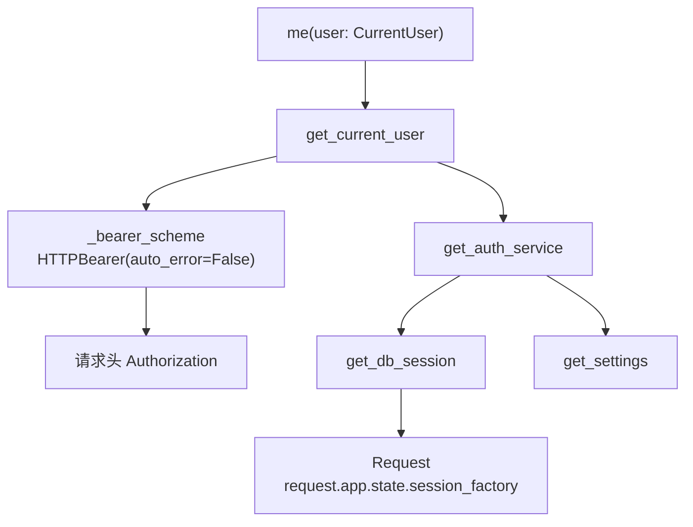
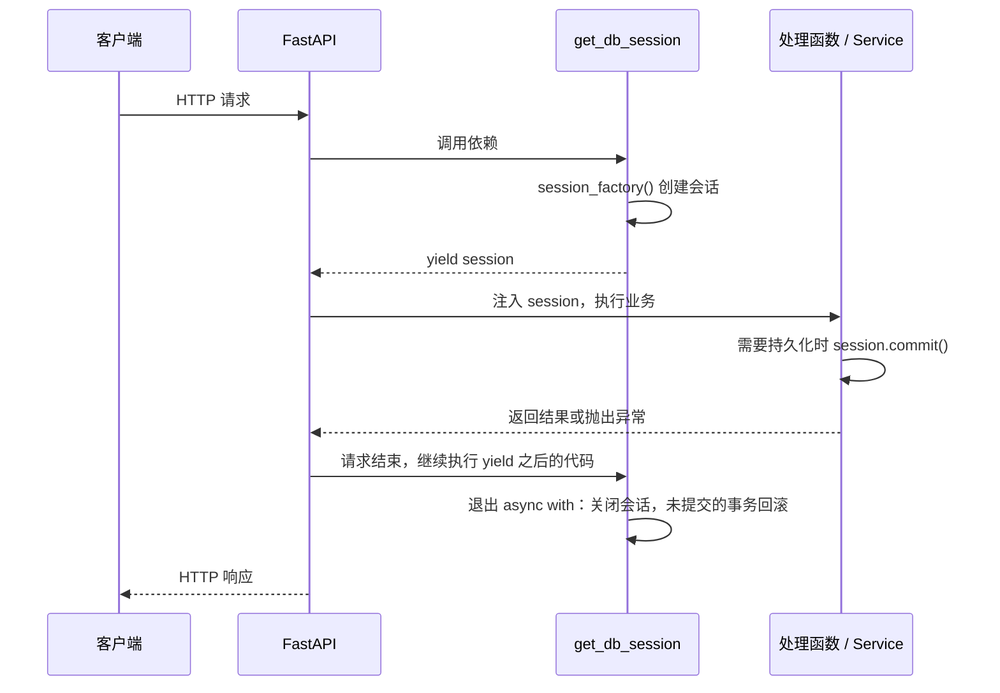

本文以一个 FastAPI 后端服务（包名 `my_service`）的认证模块为例，讲解 FastAPI 的依赖注入（`Depends`）以及如何用 `HTTPBearer` 实现"需要登录才能访问"的接口。

涉及的项目文件：

| 文件 | 作用 |
|------|------|
| `api/deps.py` | 路由层公共依赖：数据库会话、认证服务、当前用户 |
| `api/v1/auth.py` | 认证接口：login / refresh / logout / me |
| `services/auth_service.py` | 认证业务逻辑，其中 `authenticate` 负责校验 access token |
| `core/exceptions.py` | 统一异常，其中 `UnauthorizedError` 对应 401 |

> 认证机制本身（JWT access token + 可轮换的 refresh token）不在本文展开，这里只关注 FastAPI 层面的写法。

> 文中的运行结果基于 FastAPI 0.163.1。

## 1. 依赖注入概述

### 1.1. 什么是 Depends

依赖注入的意思是：处理函数不自己创建要用的东西（数据库会话、配置、当前用户），而是在参数上声明"这个参数由某个函数提供"，由框架负责调用这个函数，把返回值传进来。

在 FastAPI 中，这个声明就是 `Depends`：

```python
from fastapi import Depends, FastAPI

app = FastAPI()


def get_config() -> str:
    return "real"


@app.get("/demo")
def demo(cfg: str = Depends(get_config)) -> str:
    # 每次请求，FastAPI 先调用 get_config()，再把返回值传给 cfg
    return cfg
```

被 `Depends` 引用的函数叫**依赖（dependency）**。依赖本身也可以声明参数：可以是普通的请求参数（Query、Header、Body、`Request` 对象），也可以是另一个 `Depends`。FastAPI 会递归解析，最终形成一棵依赖树。

依赖与 Gin 中间件的对比：

| 特性 | FastAPI 依赖 | Gin 中间件 |
|------|-------------|-----------|
| 声明位置 | 处理函数的参数上 | `engine.Use` / `group.Use` / 路由注册时 |
| 数据传递 | 依赖的返回值直接作为参数传入，有类型 | `c.Set` / `c.Get`，取出来是 `any` |
| 作用范围 | 哪个接口声明了就对哪个接口生效 | 按注册范围生效 |
| 中断请求 | 在依赖里抛异常 | `c.Abort()` |
| 文档 | 依赖里的参数、安全方案会自动出现在 OpenAPI 文档中 | 无 |

### 1.2. 依赖的解析与请求内缓存

FastAPI 在**每个请求**中都会重新解析依赖，不会跨请求复用返回值。但在**同一个请求**内，同一个依赖被多处引用时，默认只调用一次，之后直接复用结果。

示例代码：`dep_a`、`dep_b` 和处理函数本身都依赖 `get_config`：

```python
from typing import Annotated
from fastapi import Depends, FastAPI

calls: list[str] = []


def get_config() -> str:
    calls.append("get_config")
    return "real"


ConfigDep = Annotated[str, Depends(get_config)]


def dep_a(cfg: ConfigDep) -> str:
    return f"a:{cfg}"


def dep_b(cfg: ConfigDep) -> str:
    return f"b:{cfg}"


app = FastAPI()


@app.get("/cache")
def cache(
    a: Annotated[str, Depends(dep_a)],
    b: Annotated[str, Depends(dep_b)],
    c: ConfigDep,
) -> dict:
    return {"a": a, "b": b, "c": c}
```

```text
# 请求一次 /cache 的结果
cache: {'a': 'a:real', 'b': 'b:real', 'c': 'real'}   get_config calls: 1
```

`get_config` 被三处引用，但一次请求里只调用了 1 次。

这个缓存在项目里很重要：如果一个接口同时依赖 `DbSession` 和 `AuthServiceDep`（后者内部也依赖 `DbSession`），两者拿到的是**同一个数据库会话**，在同一个事务里工作。

如果确实需要每处都重新调用，可以写 `Depends(get_config, use_cache=False)`。

## 2. 用 Annotated 定义依赖别名

### 2.1. 两种写法对比

`Depends` 有两种写法：

```python
# 写法一：默认值写法（旧写法）
async def me(user: User = Depends(get_current_user)) -> UserResponse: ...

# 写法二：Annotated 写法（官方推荐）
async def me(user: Annotated[User, Depends(get_current_user)]) -> UserResponse: ...
```

`Annotated[类型, 元数据]` 是 Python 标准库 `typing` 提供的：第一个参数是真正的类型，后面的元数据类型检查器会忽略，FastAPI 会读取。所以 mypy 看到的 `user` 类型就是 `User`。

`Annotated` 写法的最大好处是可以**提取成类型别名**，到处复用：

```python
CurrentUser = Annotated[User, Depends(get_current_user)]


async def me(user: CurrentUser) -> UserResponse: ...
```

| 对比项 | 默认值写法 | Annotated 别名 |
|-------|-----------|---------------|
| 路由函数里的写法 | `user: User = Depends(get_current_user)` | `user: CurrentUser` |
| 类型信息 | 类型和依赖分开写在 `:` 和 `=` 两侧 | 类型和依赖写在同一个标注里，别名本身就带着类型 `User` |
| 参数顺序 | 有默认值的参数必须排在无默认值的参数后面 | 没有默认值，不受顺序限制 |
| 复用 | 每处都要重复写一遍 | 定义一次，到处引用 |

### 2.2. 项目中的三个别名

`api/deps.py` 中定义了三个依赖别名：

```python
# 数据库会话
DbSession = Annotated[AsyncSession, Depends(get_db_session)]

# 认证服务
AuthServiceDep = Annotated[AuthService, Depends(get_auth_service)]

# 当前登录用户
CurrentUser = Annotated[User, Depends(get_current_user)]
```

路由里只需要写 `auth: AuthServiceDep` 或 `user: CurrentUser`，代码更短，也不需要在每个路由文件里导入 `Depends` 和具体的依赖函数。

## 3. 依赖链

### 3.1. 项目的依赖树

依赖可以依赖其他依赖。项目中 `/me` 接口的完整依赖关系如下：



对应的代码（`api/deps.py`，省略了导入）：

```python
async def get_db_session(request: Request) -> AsyncGenerator[AsyncSession]:
    """每个请求一个会话；请求结束时自动关闭，未提交的事务自动回滚。"""
    session_factory: async_sessionmaker[AsyncSession] = request.app.state.session_factory
    async with session_factory() as session:
        yield session


DbSession = Annotated[AsyncSession, Depends(get_db_session)]


def get_auth_service(
    session: DbSession, settings: Annotated[Settings, Depends(get_settings)]
) -> AuthService:
    return AuthService(session, settings)


AuthServiceDep = Annotated[AuthService, Depends(get_auth_service)]

_bearer_scheme = HTTPBearer(auto_error=False, description="登录接口返回的 access_token")


async def get_current_user(
    credentials: Annotated[HTTPAuthorizationCredentials | None, Depends(_bearer_scheme)],
    auth: AuthServiceDep,
) -> User:
    """从请求头 Authorization: Bearer <access_token> 中解析出当前用户。"""
    if credentials is None:
        raise UnauthorizedError("未登录")
    return await auth.authenticate(credentials.credentials)


CurrentUser = Annotated[User, Depends(get_current_user)]
```

逐层说明：

| 依赖 | 输入 | 输出 | 说明 |
|------|------|------|------|
| `get_db_session` | `Request` | `AsyncSession` | 从 `request.app.state.session_factory` 取会话工厂（在 lifespan 启动时创建），每个请求开一个会话 |
| `get_settings` | 无 | `Settings` | 带 `@lru_cache`，整个进程只读取一次配置 |
| `get_auth_service` | `DbSession` + `Settings` | `AuthService` | 把会话和配置组装成服务对象 |
| `_bearer_scheme` | 请求头 `Authorization` | `HTTPAuthorizationCredentials \| None` | 取出 Bearer 令牌，见第 5 节 |
| `get_current_user` | 凭证 + `AuthServiceDep` | `User` | 没有令牌抛 401；有令牌交给 `auth.authenticate` 校验 |

`authenticate` 的逻辑（`services/auth_service.py`）：解码 access token 得到用户 ID，再查一次数据库确认用户存在且未停用，任何一步失败都抛 `UnauthorizedError("登录已失效，请重新登录")`：

```python
async def authenticate(self, access_token: str) -> User:
    user_id = decode_access_token(access_token, self.settings.jwt_secret_key.get_secret_value())
    if user_id is None:
        raise UnauthorizedError("登录已失效，请重新登录")
    # 查一次用户：账号被停用或删除后，即使 access token 未过期也立即拒绝
    user = await self.users.get_by_id(user_id)
    if user is None or not user.is_active:
        raise UnauthorizedError("登录已失效，请重新登录")
    return user
```

### 3.2. 什么都可以当依赖

从上面的代码可以看出，`Depends` 接收的是任意**可调用对象**：

| 依赖形式 | 项目中的例子 | 说明 |
|---------|------------|------|
| `async def` 函数 | `get_current_user` | 在事件循环中直接 `await` |
| 普通 `def` 函数 | `get_auth_service`、`get_settings` | FastAPI 会放到线程池中执行，不阻塞事件循环 |
| `async def` + `yield` | `get_db_session` | 有"清理"阶段的依赖，见第 4 节 |
| 实现了 `__call__` 的类实例 | `_bearer_scheme`（`HTTPBearer` 实例） | FastAPI 调用 `instance(request)` |

### 3.3. 通过 Depends 注入配置

`get_auth_service` 里的配置没有直接调用 `get_settings()`，而是通过 `Depends(get_settings)` 注入。这样做的好处是测试时可以用 `app.dependency_overrides` 替换掉它：

```python
# 测试中：把 get_settings 替换成返回测试配置的函数
app.dependency_overrides[get_settings] = lambda: Settings(jwt_secret_key="x" * 32, ...)

# ...执行测试请求...

app.dependency_overrides.clear()  # 测试结束后恢复
```

`dependency_overrides` 是一个字典，键是原依赖函数，值是替代函数。替换后，**所有**通过 `Depends(get_settings)` 引用它的地方都会改用替代函数，依赖链上游不需要任何改动。以 1.2 节的示例为例，运行后会输出：

```text
# 覆盖前
{'a': 'a:real', 'b': 'b:real', 'c': 'real'}
# app.dependency_overrides[get_config] = lambda: "fake" 之后
{'a': 'a:fake', 'b': 'b:fake', 'c': 'fake'}
```

注意事项：

* 只有通过 `Depends` 引用的地方会被覆盖。项目里 `create_app()` 和 `lifespan` 是直接调用 `get_settings()` 的，不受影响。
* 另一种做法是不用 `dependency_overrides`，而是在测试配置（如 `tests/conftest.py`）里、创建 app 之前设置环境变量，再调用 `get_settings.cache_clear()` 清掉 `lru_cache`，让整个进程都读到测试配置。

## 4. yield 依赖：管理数据库会话

### 4.1. 写法

依赖函数里用 `yield` 代替 `return`，就变成了带清理阶段的依赖：

* `yield` 之前：准备资源。
* `yield` 的值：注入给处理函数。
* `yield` 之后（或 `async with` 退出时）：清理资源。

```python
async def get_db_session(request: Request) -> AsyncGenerator[AsyncSession]:
    session_factory: async_sessionmaker[AsyncSession] = request.app.state.session_factory
    async with session_factory() as session:
        yield session
```

这里用 `async with` 把会话的生命周期交给 SQLAlchemy 管理：退出 `async with` 时会话自动关闭，关闭时还没提交的事务会被回滚。

### 4.2. 生命周期



几个要点：

| 场景 | 结果 |
|------|------|
| 正常请求 | 每个请求一个独立会话，请求结束后关闭 |
| 业务抛异常（如 `UnauthorizedError`） | 异常同样会让 `async with` 退出，会话关闭，未提交的修改回滚 |
| 同一请求多处依赖 `DbSession` | 依赖缓存保证拿到同一个会话 |

### 4.3. 约定：依赖不自动 commit

`get_db_session` 只负责创建和关闭会话，**不在 `yield` 之后自动 commit**。什么时候提交由 service 显式决定，例如 `AuthService` 中：

```python
async def logout(self, refresh_token: str) -> None:
    stored = await self.refresh_tokens.get_by_hash_for_update(hash_refresh_token(refresh_token))
    if stored is not None:
        await self.refresh_tokens.revoke_family(stored.family_id, datetime.now(UTC))
        await self.session.commit()  # service 自己决定提交
```

这样约定的原因：

* 提交点在业务代码里一眼可见，不依赖"请求成功结束"这个隐含条件。
* 业务上有时需要"先提交一部分再抛异常"。例如 `refresh` 检测到 refresh token 被重复使用时，先 `commit` 作废整个令牌家族，再抛 `UnauthorizedError`。如果由依赖在请求结束时统一提交，抛异常就意味着回滚，作废操作就丢了。
* 没有调用 `commit` 的修改，在会话关闭时自动回滚，不会意外写入。

## 5. HTTPBearer：从请求头取令牌

### 5.1. 基本用法

`fastapi.security.HTTPBearer` 负责从请求头 `Authorization: Bearer <token>` 中取出令牌：

```python
from fastapi.security import HTTPAuthorizationCredentials, HTTPBearer

_bearer_scheme = HTTPBearer(auto_error=False, description="登录接口返回的 access_token")
```

| 参数 | 作用 |
|------|------|
| `auto_error` | 取不到令牌时的行为，见 5.2 |
| `description` | 显示在接口文档的安全方案说明里 |

取到令牌时返回 `HTTPAuthorizationCredentials` 对象：

| 属性 | 值 |
|------|----|
| `scheme` | `"Bearer"` |
| `credentials` | 令牌本身，即 `Bearer ` 后面的部分 |

`HTTPBearer` 只负责"取"，不校验令牌是否有效。校验交给 `get_current_user` 里的 `auth.authenticate(credentials.credentials)`。

### 5.2. auto_error 参数

| `auto_error` | 请求头缺失、或不是 `Bearer xxx` 格式时 |
|-------------|--------------------------------------|
| `True`（默认） | 框架直接抛出 `HTTPException(401, "Not authenticated")`，处理函数和后续依赖都不执行 |
| `False` | 返回 `None`，由我们自己决定怎么处理 |

分别用不同的请求头访问需要登录的接口，运行后会输出如下结果（项目注册了全局异常处理器，所以两种情况都是统一的错误格式，区别在 `message`）：

```text
# auto_error=True（默认）
无 Authorization 头       -> 401 {"code":"unauthorized","message":"Not authenticated",...}
Authorization: Basic abc  -> 401 {"code":"unauthorized","message":"Not authenticated",...}
Authorization: Bearer     -> 401 {"code":"unauthorized","message":"Not authenticated",...}

# auto_error=False + 自己抛 UnauthorizedError("未登录")
无 Authorization 头       -> 401 {"code":"unauthorized","message":"未登录",...}
Authorization: Basic abc  -> 401 {"code":"unauthorized","message":"未登录",...}
Authorization: Bearer tok -> 200，credentials.credentials == "tok"
```

项目选择 `auto_error=False`，原因是：缺少令牌时返回中文提示"未登录"，和其他业务错误一样由 `UnauthorizedError` 抛出，而不是框架默认的英文报错。

```python
async def get_current_user(
    credentials: Annotated[HTTPAuthorizationCredentials | None, Depends(_bearer_scheme)],
    auth: AuthServiceDep,
) -> User:
    if credentials is None:  # auto_error=False 时，没有令牌得到 None
        raise UnauthorizedError("未登录")
    return await auth.authenticate(credentials.credentials)
```

注意参数类型要写成 `HTTPAuthorizationCredentials | None`，否则类型检查器不会提醒你处理 `None`。

### 5.3. 401 响应带 WWW-Authenticate 头

HTTP 规范要求 401 响应带上 `WWW-Authenticate` 头，告诉客户端应该用哪种方式认证。项目通过异常类的 `headers` **类属性**实现，所有 `UnauthorizedError` 自动带上这个头：

```python
class AppError(Exception):
    """业务异常基类。在 service 层抛出，由全局处理器转成统一的错误响应。"""

    status_code: int = status.HTTP_400_BAD_REQUEST
    code: str = "bad_request"
    headers: ClassVar[Mapping[str, str] | None] = None  # 需要额外返回的响应头

    def __init__(self, message: str, *, details: Any = None) -> None:
        super().__init__(message)
        self.message = message
        self.details = details


class UnauthorizedError(AppError):
    status_code = status.HTTP_401_UNAUTHORIZED
    code = "unauthorized"
    # HTTP 规范要求 401 响应带上该头，告诉客户端用哪种方式认证
    headers: ClassVar[Mapping[str, str] | None] = {"WWW-Authenticate": "Bearer"}
```

全局异常处理器把 `exc.headers` 原样放进响应：

```python
@app.exception_handler(AppError)
async def handle_app_error(_: Request, exc: AppError) -> JSONResponse:
    return build_error_response(
        exc.status_code, exc.code, exc.message, details=exc.details, headers=exc.headers
    )
```

运行后可以看到：上面 5.2 中所有 401 响应的 `WWW-Authenticate` 头都是 `Bearer`，200 响应没有这个头。

`ClassVar` 标注说明 `headers` 是类级别的配置，不是实例属性，子类直接覆盖即可，抛异常时不需要每次传参。

### 5.4. Swagger 中的 Authorize 按钮

依赖链上有 `HTTPBearer` 的接口，FastAPI 会在 OpenAPI 文档里自动生成安全方案：

```text
components.securitySchemes:
  {"HTTPBearer": {"type": "http", "description": "登录接口返回的 access_token", "scheme": "bearer"}}

/me 接口:
  security: [{"HTTPBearer": []}]
```

于是 Swagger UI（`/docs`）右上角会出现 **Authorize** 按钮，需要登录的接口旁边会显示一个锁图标。调试步骤：

1. 在 `/docs` 中调用 `POST /api/v1/auth/login`，复制响应里的 `access_token`。
2. 点击 Authorize，把 `access_token` 填进去（只填令牌本身，不用写 `Bearer ` 前缀）。
3. 之后调用 `GET /api/v1/auth/me` 等需要登录的接口，Swagger 会自动带上 `Authorization: Bearer <token>` 头。

> 项目在生产环境（`APP_ENV=prod`）关闭了 `/docs`、`/redoc` 和 `/openapi.json`。

## 6. 在接口中要求登录

有了 `CurrentUser` 别名，要求登录只需要加一个参数：

```python
@router.get("/me", summary="当前登录用户", responses=_UNAUTHORIZED)
async def me(user: CurrentUser) -> UserResponse:
    return UserResponse.model_validate(user)
```

| 请求情况 | 结果 |
|---------|------|
| 没带令牌 | `get_current_user` 抛 `UnauthorizedError("未登录")`，返回 401，处理函数不执行 |
| 令牌无效、过期，或用户已停用 | `authenticate` 抛 `UnauthorizedError("登录已失效，请重新登录")`，返回 401 |
| 令牌有效 | `user` 就是数据库里查出来的 `User` 对象 |

处理函数里不需要写任何判断，未登录的请求根本到不了函数体。以后新增需要登录的接口，照样加上 `user: CurrentUser` 即可；不需要当前用户对象但需要登录的接口，也可以这样声明，参数不用就行。

## 7. 接口文档与响应细节

### 7.1. 返回 204 No Content

注销接口成功后没有需要返回的内容，用 204 状态码：

```python
@router.post("/logout", summary="注销", status_code=status.HTTP_204_NO_CONTENT)
async def logout(body: RefreshTokenRequest, auth: AuthServiceDep) -> None:
    await auth.logout(body.refresh_token)
```

* `status_code=status.HTTP_204_NO_CONTENT`：设置成功时的状态码，接口文档里的成功响应也会显示为 204。
* 返回类型 `-> None`：函数不返回内容，FastAPI 不会为它生成响应体模型。

调用后的结果：响应状态码 204，响应体为空（`b''`），文档中该接口的响应只有 `204`。

### 7.2. responses= 声明错误响应模型

FastAPI 默认只在文档里展示成功响应，以及接口有请求参数时的 422（参数校验失败）。业务代码里抛出的 401 文档不会自动知道，需要用 `responses=` 参数声明：

```python
from typing import Any

from my_service.core.exceptions import ErrorResponse

# 让接口文档里展示 401 的响应格式
_UNAUTHORIZED: dict[int | str, dict[str, Any]] = {
    status.HTTP_401_UNAUTHORIZED: {"model": ErrorResponse}
}


@router.get("/me", summary="当前登录用户", responses=_UNAUTHORIZED)
async def me(user: CurrentUser) -> UserResponse: ...
```

* 键是状态码，值里的 `"model"` 指定响应体的 Pydantic 模型，文档会据此展示字段结构。
* 把字典提取成模块级常量，多个接口共用。
* 声明后 `/me` 的文档响应列表为 `200`、`401`。

**为什么必须写类型标注**：`responses` 参数的类型是 `dict[int | str, dict[str, Any]]`。不写标注时，mypy 会把常量推断为 `dict[int, dict[str, type[ErrorResponse]]]`。`dict` 的类型参数是不变的（invariant），`dict[int, ...]` 不能当作 `dict[int | str, ...]` 使用，于是 mypy 报类型不兼容。显式标注成参数要求的类型即可。

错误响应模型 `ErrorResponse` 就是项目统一的错误格式：

```python
class ErrorResponse(BaseModel):
    code: str  # 机器可读的错误码，调用方据此做分支判断
    message: str  # 人可读的错误描述
    request_id: str | None = None  # 排查问题时，用它在日志里搜索这次请求
    details: Any = None  # 补充信息，如参数校验失败的字段列表
```

## 8. 完整示例：/api/v1/auth 的四个接口

### 8.1. 路由代码

`api/v1/auth.py` 完整代码：

```python
"""认证接口：登录、刷新令牌、注销、查询当前用户。"""

from typing import Any

from fastapi import APIRouter, status

from my_service.api.deps import AuthServiceDep, CurrentUser
from my_service.core.exceptions import ErrorResponse
from my_service.schemas.auth import LoginRequest, RefreshTokenRequest, TokenResponse
from my_service.schemas.user import UserResponse

router = APIRouter()

# 让接口文档里展示 401 的响应格式
_UNAUTHORIZED: dict[int | str, dict[str, Any]] = {
    status.HTTP_401_UNAUTHORIZED: {"model": ErrorResponse}
}


@router.post("/login", summary="登录", responses=_UNAUTHORIZED)
async def login(body: LoginRequest, auth: AuthServiceDep) -> TokenResponse:
    return await auth.login(body.username, body.password)


@router.post("/refresh", summary="刷新令牌", responses=_UNAUTHORIZED)
async def refresh(body: RefreshTokenRequest, auth: AuthServiceDep) -> TokenResponse:
    return await auth.refresh(body.refresh_token)


@router.post("/logout", summary="注销", status_code=status.HTTP_204_NO_CONTENT)
async def logout(body: RefreshTokenRequest, auth: AuthServiceDep) -> None:
    await auth.logout(body.refresh_token)


@router.get("/me", summary="当前登录用户", responses=_UNAUTHORIZED)
async def me(user: CurrentUser) -> UserResponse:
    return UserResponse.model_validate(user)
```

路由在 `api/v1/router.py` 中以 `prefix="/auth"` 注册，再在 `main.py` 中以 `prefix="/api/v1"` 挂到 app 上，最终路径是 `/api/v1/auth/...`。

### 8.2. 接口一览

| 接口 | 请求体 | 依赖 | 是否需要登录 | 成功响应 | 文档声明的错误 |
|------|--------|------|------------|---------|--------------|
| `POST /login` | `LoginRequest`（username、password） | `AuthServiceDep` | 否 | 200 `TokenResponse` | 401 |
| `POST /refresh` | `RefreshTokenRequest`（refresh_token） | `AuthServiceDep` | 否 | 200 `TokenResponse` | 401 |
| `POST /logout` | `RefreshTokenRequest`（refresh_token） | `AuthServiceDep` | 否 | 204 无响应体 | 无 |
| `GET /me` | 无 | `CurrentUser` | 是 | 200 `UserResponse` | 401 |

从表中可以看出几种用法的组合：

* **处理函数只拿 service**（login / refresh / logout）：参数写 `auth: AuthServiceDep`，会话、配置由依赖链自动组装，处理函数只做一行转发。
* **处理函数要求登录**（me）：参数写 `user: CurrentUser`，令牌提取、校验、查用户都在依赖里完成。
* **logout 不要求登录**：它凭请求体里的 refresh token 作废对应的登录；令牌无效也视为成功（幂等），所以不声明 401。

### 8.3. 调用示例

用 curl 调用这四个接口（`B=localhost:8000/api/v1/auth`），运行后会输出如下内容（令牌已省略）：

```bash
# 登录
curl -s -X POST $B/login -H 'Content-Type: application/json' \
  -d '{"username":"alice","password":"******"}'
# {"access_token":"eyJ...","token_type":"bearer","access_token_expires_at":"...",
#  "refresh_token":"dEt...","refresh_token_expires_at":"..."}

# 带 access token 访问 /me
curl -s -w " %{http_code}\n" $B/me -H "Authorization: Bearer $A1"
# {"id":"3fa85f64-...","username":"alice","is_active":true,"created_at":"..."} 200

# 不带令牌访问 /me
curl -s -o /dev/null -w "%{http_code}\n" $B/me
# 401

# 注销
curl -s -o /dev/null -w "%{http_code}\n" -X POST $B/logout \
  -H 'Content-Type: application/json' -d "{\"refresh_token\":\"$F3\"}"
# 204

# 注销后再用 access token 访问 /me
curl -s -o /dev/null -w "%{http_code}\n" $B/me -H "Authorization: Bearer $A3"
# 200
```

最后一条返回 200 是预期行为：注销只作废 refresh token，已签发的 access token 无法撤回，会在有效期（默认 15 分钟）结束后自然失效。

## 9. 小结

| 知识点 | 写法 | 要点 |
|-------|------|------|
| 声明依赖 | `Depends(func)` | 每个请求解析一次；同一请求内重复的依赖只调用一次 |
| 依赖别名 | `X = Annotated[T, Depends(func)]` | 路由里只写 `x: X`，类型检查器识别为 `T` |
| 依赖链 | 依赖的参数里再写依赖 | `get_db_session` → `get_auth_service` → `get_current_user` |
| 配置注入 | `Annotated[Settings, Depends(get_settings)]` | 测试时可用 `app.dependency_overrides` 替换 |
| yield 依赖 | `async with factory() as s: yield s` | 每请求一个会话，结束自动关闭、未提交的事务回滚；依赖不 commit，service 显式 commit |
| Bearer 令牌 | `HTTPBearer(auto_error=False, description=...)` | 缺令牌返回 `None`，自己抛中文 401；自动生成 Swagger Authorize 按钮 |
| 401 响应头 | 异常类属性 `headers = {"WWW-Authenticate": "Bearer"}` | 全局处理器把它放进响应 |
| 要求登录 | `async def handler(user: CurrentUser)` | 未登录的请求到不了函数体 |
| 返回 204 | `status_code=status.HTTP_204_NO_CONTENT` + `-> None` | 响应体为空 |
| 文档声明错误 | `responses={401: {"model": ErrorResponse}}` | 常量需显式标注 `dict[int \| str, dict[str, Any]]`，否则 mypy 报错 |
