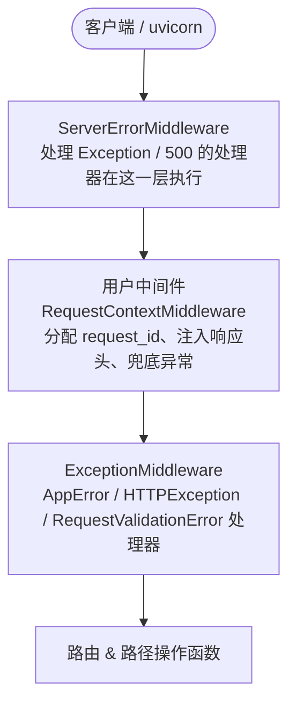
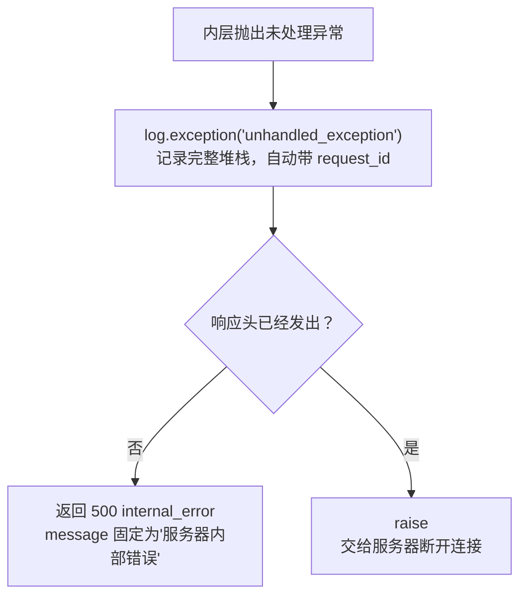

一个 Web 服务对外暴露的错误格式，是前端和调用方解析成本最高的部分。FastAPI 默认的错误响应有好几种形状，出了问题也很难在日志里找到"是哪一次请求出的错"。

本文以一个 FastAPI 服务 `my_service`（FastAPI 0.163 + Starlette 1.10 + structlog 26）的代码为例，介绍如何做到两件事：

* **统一异常处理**：所有错误（业务异常、路由不存在、参数校验失败、未处理异常）都返回同一种 JSON 结构。
* **请求追踪**：每个请求分配一个 `request_id`，写进响应头、错误响应体和这次请求产生的所有日志。

涉及的文件：

| 文件 | 作用 |
|------|------|
| `core/exceptions.py` | 错误响应结构 `ErrorResponse`、业务异常 `AppError` 及子类、异常处理器注册 |
| `core/middleware.py` | 纯 ASGI 中间件 `RequestContextMiddleware`：分配 request_id、访问日志、兜底未处理异常 |
| `core/logging.py` | structlog 配置，合并上下文变量、禁用 uvicorn 自带访问日志 |
| `main.py` | 在 `create_app()` 里注册处理器和中间件 |

## 1. 问题：FastAPI 默认的错误响应

### 1.1. 三种不同的错误格式

请求一个什么都不配置的 `FastAPI()`，结果如下：

| 场景 | 状态码 | Content-Type | 响应体 |
|------|--------|--------------|--------|
| 路由不存在 `GET /not-exist` | 404 | `application/json` | `{"detail":"Not Found"}` |
| 参数校验失败 `GET /items/abc` | 422 | `application/json` | `{"detail":[{"type":"int_parsing","loc":["path","item_id"],"msg":"...","input":"abc"}]}` |
| 未处理异常 `raise RuntimeError` | 500 | `text/plain` | `Internal Server Error` |

前端要分别处理三种情况：`detail` 有时是字符串、有时是数组，500 甚至不是 JSON。业务层自己抛的错误如果再用 `HTTPException(detail=...)`，又会和上面混在一起，没有机器可读的错误码可供分支判断。

### 1.2. 校验错误会回显原始输入

默认的 422 响应里有一个 `input` 字段，原样返回用户提交的值。对登录接口来说，这意味着密码会出现在响应里：

```python
class Login(BaseModel):
    username: str
    password: str = Field(min_length=8)
```

```json
{"detail":[{"type":"string_too_short","loc":["body","password"],
  "msg":"String should have at least 8 characters","input":"123","ctx":{"min_length":8}}]}
```

响应体经常会被网关、前端监控或日志平台记录下来，密码就跟着泄露到这些地方。

### 1.3. 无法定位某一次请求

用户反馈"刚才报错了"，后端日志里只有一堆按时间排列的记录，并发请求的日志交织在一起，分不清哪几行属于出错的那次请求。需要一个贯穿整个请求的标识：

* 响应头里返回给调用方（`X-Request-ID`）；
* 错误响应体里也带上，方便用户截图反馈；
* 这次请求内打印的每一条日志都自动带上。

## 2. 统一错误响应结构

### 2.1. ErrorResponse

所有错误响应都使用同一个 Pydantic 模型：

```python
class ErrorResponse(BaseModel):
    code: str  # 机器可读的错误码，调用方据此做分支判断
    message: str  # 人可读的错误描述
    request_id: str | None = None  # 排查问题时，用它在日志里搜索这次请求
    details: Any = None  # 补充信息，如参数校验失败的字段列表
```

| 字段 | 给谁看 | 用途 |
|------|--------|------|
| `code` | 程序 | 稳定的字符串错误码，前端用 `if (err.code === "not_found")` 做分支，不依赖文案 |
| `message` | 人 | 可直接展示给用户的描述，如 `"用户名已存在"`，文案可以随时改 |
| `request_id` | 运维/开发 | 与响应头 `X-Request-ID` 相同，拿着它去日志里搜索 |
| `details` | 程序 | 结构不固定的补充信息，校验失败时是字段错误列表，业务异常可以放出错的 ID |

一个完整的错误响应：

```json
{"code": "not_found", "message": "用户不存在", "request_id": "6e894181b3814d7b8fad8257d1b7c786", "details": null}
```

### 2.2. 常见错误码

| HTTP 状态码 | code | 来源 |
|-------------|------|------|
| 400 | `bad_request` | `AppError` 基类默认值 |
| 401 | `unauthorized` | `UnauthorizedError`（登录失败、令牌无效） |
| 404 | `not_found` | `NotFoundError`，或框架的路由不存在 |
| 405 | `method_not_allowed` | 框架的请求方法不允许 |
| 409 | `conflict` | `ConflictError`（如用户名已存在） |
| 422 | `validation_error` | 请求参数校验失败 |
| 500 | `internal_error` | 中间件兜底的未处理异常 |

### 2.3. 构造错误响应

所有处理器都通过同一个函数生成响应，`request_id` 从 structlog 的上下文变量里取（第 7 节说明它是怎么放进去的）：

```python
def build_error_response(
    status_code: int,
    code: str,
    message: str,
    *,
    details: Any = None,
    headers: Mapping[str, str] | None = None,
) -> JSONResponse:
    body = ErrorResponse(
        code=code,
        message=message,
        request_id=structlog.contextvars.get_contextvars().get("request_id"),
        details=details,
    )
    return JSONResponse(status_code=status_code, content=body.model_dump(), headers=headers)
```

## 3. AppError 业务异常层次

### 3.1. 基类：用类属性声明 HTTP 信息

```python
class AppError(Exception):
    """业务异常基类。在 service 层抛出，由全局处理器转成统一的错误响应。"""

    status_code: int = status.HTTP_400_BAD_REQUEST
    code: str = "bad_request"
    headers: ClassVar[Mapping[str, str] | None] = None  # 需要额外返回的响应头

    def __init__(self, message: str, *, details: Any = None) -> None:
        super().__init__(message)
        self.message = message
        self.details = details
```

设计要点：

| 成员 | 级别 | 说明 |
|------|------|------|
| `status_code`、`code` | 类属性 | 同一种异常的状态码和错误码是固定的，写在类上，抛出时不用重复传 |
| `headers` | 类属性，`ClassVar` | 字典是可变对象，作为类属性默认值时要标注 `ClassVar`，表明它是类级别共享的常量而不是实例字段（ruff 的 `RUF012` 规则会检查这一点） |
| `message`、`details` | 实例属性 | 每次抛出时不同，通过构造函数传入；`details` 用关键字参数，避免和 message 位置混淆 |

### 3.2. 子类：只覆盖类属性

```python
class UnauthorizedError(AppError):
    status_code = status.HTTP_401_UNAUTHORIZED
    code = "unauthorized"
    # HTTP 规范要求 401 响应带上该头，告诉客户端用哪种方式认证
    headers: ClassVar[Mapping[str, str] | None] = {"WWW-Authenticate": "Bearer"}


class NotFoundError(AppError):
    status_code = status.HTTP_404_NOT_FOUND
    code = "not_found"


class ConflictError(AppError):
    status_code = status.HTTP_409_CONFLICT
    code = "conflict"
```

新增一种业务错误只需要再写一个三行的子类。

### 3.3. service 层只管 raise

service 层不导入任何 FastAPI 的东西，也不关心状态码，只表达"发生了什么"：

```python
class UserService:
    async def create_user(self, data: UserCreate) -> User:
        if await self.users.get_by_username(data.username) is not None:
            raise ConflictError("用户名已存在")

        user = User(username=data.username, password_hash=hash_password(data.password))
        try:
            await self.users.add(user)
            await self.session.commit()
        except IntegrityError as e:
            # 两个请求同时创建同一用户名时，上面的检查可能都通过，由数据库唯一约束兜底
            await self.session.rollback()
            raise ConflictError("用户名已存在") from e
        return user
```

异常转换成 HTTP 响应只在一个地方完成：

```python
@app.exception_handler(AppError)
async def handle_app_error(_: Request, exc: AppError) -> JSONResponse:
    return build_error_response(
        exc.status_code, exc.code, exc.message, details=exc.details, headers=exc.headers
    )
```

处理器注册在基类 `AppError` 上，Starlette 按异常类的 MRO 查找处理器，所以所有子类都会被它处理。

### 3.4. 与 Gin 的对比

| 对比项 | Gin | FastAPI |
|--------|-----|---------|
| 业务错误的传递 | `c.Error(err)` 追加到 `c.Errors`，再 `return` | 直接 `raise`，调用栈自动展开 |
| 统一转换 | 错误中间件在 `c.Next()` 之后检查 `c.Errors.Last()`，用 `errors.As` 判断类型 | `app.exception_handler(类型)` 注册处理器，按异常类查找 |
| 自定义错误类型 | 结构体实现 `error` 接口，状态码作为字段 | 继承 `AppError`，状态码作为类属性 |
| panic/未处理异常 | `gin.Recovery()` 中间件 | 自己写中间件兜底（见第 5、6 节） |

Python 有异常机制，handler 和 service 里不需要层层 `if err != nil { return }`，在最深处 `raise` 即可。

## 4. 注册异常处理器

### 4.1. 两个 HTTPException

FastAPI 里有两个同名的类：

| 类 | 谁会抛出 |
|----|----------|
| `starlette.exceptions.HTTPException` | Starlette 路由层：路由不存在（404）、请求方法不允许（405） |
| `fastapi.HTTPException` | 业务代码手动 `raise HTTPException(...)`；它是前者的子类 |

处理器必须注册在 **Starlette 的 HTTPException** 上。如果注册在 `fastapi.HTTPException` 上，只能处理手动抛出的那部分，框架抛出的 404/405 仍然走默认处理器。例如：

```python
from fastapi import HTTPException  # 注意：这是 fastapi 的子类

@app.exception_handler(HTTPException)
async def h(request, exc):
    return JSONResponse(status_code=exc.status_code, content={"code": "custom"})
```

| 请求 | 结果 |
|------|------|
| 手动 `raise HTTPException(403)` | `{"code":"custom"}` |
| `GET /nope`（路由不存在） | `{"detail":"Not Found"}`，没被捕获 |
| `POST /x`（方法不允许） | `{"detail":"Method Not Allowed"}`，没被捕获 |

正确的写法：

```python
from starlette.exceptions import HTTPException as StarletteHTTPException

@app.exception_handler(StarletteHTTPException)
async def handle_http_error(_: Request, exc: StarletteHTTPException) -> JSONResponse:
    # 框架抛出的 HTTP 错误，如路由不存在（404）、请求方法不允许（405）
    return build_error_response(
        exc.status_code,
        _code_from_status(exc.status_code),
        exc.detail,
        headers=exc.headers,
    )
```

### 4.2. 定制 RequestValidationError

请求参数（路径、查询、请求体）校验失败时，FastAPI 抛出 `RequestValidationError`。`exc.errors()` 里每一项包含 `type`、`loc`、`msg`、`input`，可能还有 `ctx`、`url`。处理器只挑出三个字段：

```python
@app.exception_handler(RequestValidationError)
async def handle_validation_error(_: Request, exc: RequestValidationError) -> JSONResponse:
    # 只返回字段位置、原因和类型，不回显用户提交的原始值（可能含密码等敏感信息）
    details = [
        {"loc": list(e["loc"]), "msg": e["msg"], "type": e["type"]} for e in exc.errors()
    ]
    return build_error_response(
        status.HTTP_422_UNPROCESSABLE_CONTENT,
        "validation_error",
        "请求参数校验失败",
        details=details,
    )
```

| 字段 | 示例 | 用途 |
|------|------|------|
| `loc` | `["path","item_id"]`、`["body","password"]` | 出错字段的位置，前端可据此把错误标到对应输入框 |
| `msg` | `Input should be a valid integer, ...` | 错误原因 |
| `type` | `int_parsing`、`string_too_short` | 稳定的错误类型，可用来做前端本地化文案 |
| ~~`input`~~ | ~~`"123"`~~ | 丢弃，避免回显密码 |

`loc` 原本是元组，`list()` 转一下，序列化结果一样，类型上更明确。

### 4.3. 用状态码生成错误码

`StarletteHTTPException` 只有状态码和 `detail`，没有业务错误码。可以用标准库 `http.HTTPStatus` 的短语自动生成：

```python
from http import HTTPStatus

def _code_from_status(status_code: int) -> str:
    """404 -> "not_found"，405 -> "method_not_allowed"。"""
    try:
        return HTTPStatus(status_code).phrase.lower().replace(" ", "_")
    except ValueError:
        return "http_error"
```

| 状态码 | `HTTPStatus(code).phrase` | 生成的 code |
|--------|---------------------------|-------------|
| 400 | Bad Request | `bad_request` |
| 401 | Unauthorized | `unauthorized` |
| 404 | Not Found | `not_found` |
| 405 | Method Not Allowed | `method_not_allowed` |
| 409 | Conflict | `conflict` |
| 499（非标准） | 抛出 `ValueError` | `http_error`（兜底） |

这样手动抛出的 `HTTPException(409)` 和 `ConflictError` 得到的错误码一致。422 和 500 不走这条路径：校验错误固定用 `validation_error`，未处理异常由中间件固定返回 `internal_error`（`HTTPStatus` 生成的会是 `unprocessable_entity` 和 `internal_server_error`）。

## 5. 为什么不注册 exception_handler(Exception)

很多教程会写一个"万能"处理器兜底所有异常：

```python
@app.exception_handler(Exception)
async def handle_all(request, exc):
    return JSONResponse(status_code=500, content={"code": "internal_error"})
```

本文不这样做，而是在请求中间件里兜底。原因要从中间件栈说起。

### 5.1. Starlette 的中间件栈

FastAPI 构建应用时，按下面的顺序把各层包起来（外层先执行）：



打印 `app.middleware_stack` 会输出：`ServerErrorMiddleware → ExceptionTelemetryMiddleware → 用户中间件 → ExceptionMiddleware → AsyncExitStackMiddleware → APIRouter`，中间两个是 FastAPI 内部的层，图中省略。

关键点：`exception_handler(Exception)`（以及 `exception_handler(500)`）比较特殊，不放在 `ExceptionMiddleware` 里，而是交给**最外层**的 `ServerErrorMiddleware`。其他处理器（`AppError`、`HTTPException`、校验错误）都在 `ExceptionMiddleware` 里，位于用户中间件**内侧**。

### 5.2. 带来的两个问题

`ServerErrorMiddleware` 的源码（Starlette 1.10，有删减）：

```python
async def __call__(self, scope: Scope, receive: Receive, send: Send) -> None:
    ...
    try:
        await self.app(scope, receive, _send)
    except Exception as exc:
        request = Request(scope)
        if self.debug:
            response = await run_in_threadpool(self.debug_response, request, exc)
        elif self.handler is None:
            response = self.error_response(request, exc)  # 默认的纯文本 500
        else:
            response = await self.handler(request, exc)  # 注册的 Exception 处理器

        if not response_started:
            await response(scope, receive, send)  # 用的是最外层的原始 send

        # We always continue to raise the exception.
        raise exc
```

**问题一：响应里没有 X-Request-ID。** 处理器生成的 500 响应用最外层的 `send` 发出，不经过用户中间件包装过的 `send`，自然不会被注入 `X-Request-ID`。而且此时用户中间件的 `with bound_contextvars(...)` 已经退出，`build_error_response` 从上下文变量里取到的 `request_id` 也是 `None`。用一个只注入响应头、不兜底的中间件请求，结果如下：

| 请求 | 状态码 | `X-Request-ID` 头 | 响应体 |
|------|--------|-------------------|--------|
| 正常的 `GET /ok` | 200 | `rid-1` | - |
| 抛 `RuntimeError` 的 `GET /boom` | 500 | 无 | `{"code":"internal_error",...,"request_id":null,...}` |

最需要 request_id 去查日志的 500 错误，偏偏拿不到它。

**问题二：异常还会继续抛出。** 源码最后的 `raise exc` 让异常继续传给服务器，uvicorn 收到后会再打印一遍 `Exception in ASGI application` 和堆栈。如果自己的处理器里已经记录过日志，同一个错误就会出现两份堆栈。

### 5.3. 改为在中间件里兜底

既然用户中间件位于 `ServerErrorMiddleware` 内侧、`ExceptionMiddleware` 外侧，那么：

* `AppError`、`HTTPException`、校验错误在内层就被处理器转成了响应，不会到达中间件；
* 只有真正"没人处理"的异常会从内层冒出来，正好由中间件捕获；
* 中间件里生成的 500 响应用的是包装过的 `send`，同样会注入 `X-Request-ID`；
* 中间件吞掉异常、不再往外抛，`ServerErrorMiddleware` 和 uvicorn 都感知不到，堆栈只由中间件记录一次。

| 兜底位置 | X-Request-ID 头 | 响应体 request_id | 堆栈打印次数 |
|----------|-----------------|-------------------|--------------|
| `exception_handler(Exception)` | 无 | `null` | 自己记录 + uvicorn 再打印 |
| `RequestContextMiddleware` | 有 | 与响应头一致 | 一次（`unhandled_exception` 日志） |

## 6. 纯 ASGI 请求上下文中间件

### 6.1. 为什么不用 BaseHTTPMiddleware

Starlette 提供了写起来更简单的 `BaseHTTPMiddleware`（FastAPI 的 `@app.middleware("http")` 也基于它）：

```python
@app.middleware("http")
async def add_request_id(request: Request, call_next):
    response = await call_next(request)
    response.headers["X-Request-ID"] = "..."
    return response
```

本文没有用它，原因如下：

| 对比项 | BaseHTTPMiddleware | 纯 ASGI 中间件 |
|--------|--------------------|----------------|
| 写法 | `dispatch(request, call_next)`，拿到完整的 `Response` 对象 | `__call__(scope, receive, send)`，处理原始 ASGI 消息 |
| 流式响应（SSE） | 支持不好；LLM 应用等场景常用 SSE 推送模型输出 | 只转发消息，不影响流式输出 |
| contextvars | 有已知的传递问题：`call_next` 在单独的任务里运行下游应用，下游对上下文变量的修改传不回中间件 | 直接 `await self.app(...)`，下游与中间件在同一个任务里 |
| 代码量 | 少 | 稍多，需要理解 ASGI 消息 |

### 6.2. ASGI 中间件的接口

一个 ASGI 应用就是一个异步可调用对象，签名是 `(scope, receive, send)`。中间件把下一层 `app` 包起来，自己也实现同样的签名：

```python
from starlette.types import ASGIApp, Message, Receive, Scope, Send

class RequestContextMiddleware:
    def __init__(self, app: ASGIApp) -> None:
        self.app = app

    async def __call__(self, scope: Scope, receive: Receive, send: Send) -> None:
        if scope["type"] != "http":
            await self.app(scope, receive, send)
            return
        ...
```

| 参数 | 含义 |
|------|------|
| `scope` | 连接信息字典：`type`（`http` / `websocket` / `lifespan`）、`method`、`path`、`headers` 等 |
| `receive` | 读取请求消息（请求体）的协程函数 |
| `send` | 发送响应消息的协程函数 |

`scope["type"]` 不是 `http` 时（`lifespan` 启停事件、`websocket` 连接）直接放行，否则后面读 `scope["method"]` 会出错。

### 6.3. 包装 send，注入 X-Request-ID

一个 HTTP 响应由多条消息组成：先是一条 `http.response.start`（含状态码和响应头），然后是一条或多条 `http.response.body`。中间件不改响应体，只需拦截第一条：

```python
async def send_with_request_id(message: Message) -> None:
    nonlocal status_code, response_started
    if message["type"] == "http.response.start":
        response_started = True
        status_code = message["status"]
        MutableHeaders(scope=message)[REQUEST_ID_HEADER] = request_id
    await send(message)
```

* `status_code`：记下来给访问日志用；
* `response_started`：记录响应头是否已经发出，兜底异常时要判断；
* `MutableHeaders(scope=message)`：Starlette 的工具类，直接修改 `message["headers"]` 这个字节元组列表，不用自己拼 `(b"x-request-id", b"...")`。

流式响应会发出很多条 `http.response.body`，中间件只是原样转发，不会把它们缓冲起来。

### 6.4. 兜底未处理异常

```python
with structlog.contextvars.bound_contextvars(request_id=request_id):
    try:
        await self.app(scope, receive, send_with_request_id)
    except Exception:
        log.exception("unhandled_exception")
        if response_started:
            raise  # 响应已开始发送，无法再改成 500，交给服务器断开连接
        # 不把异常细节返回给调用方，细节只记在日志里
        response = build_error_response(500, "internal_error", "服务器内部错误")
        await response(scope, receive, send_with_request_id)
    finally:
        ...  # 访问日志，见第 8 节
```



| 情况 | 处理 | 原因 |
|------|------|------|
| 响应还没开始发送 | 返回 500 `internal_error` | 状态码还能改；响应体只给固定文案，异常信息（可能含 SQL、路径、密钥）只写日志 |
| 响应已开始发送（如 SSE 推到一半） | `raise` | 状态码和部分内容已经发给客户端，没法再改成 500，只能让服务器断开连接，客户端能感知到响应不完整 |

`log.exception` 等价于 `log.error(..., exc_info=True)`，会把堆栈一起输出。生产环境下 `core/logging.py` 用 `ExceptionDictTransformer(show_locals=False)` 把堆栈转成 JSON，且不输出局部变量，避免密码、token 写进日志。

## 7. request_id 的生成与传递

### 7.1. 优先沿用上游，校验后再用

```python
REQUEST_ID_HEADER = "X-Request-ID"
# 只接受安全字符，防止调用方通过请求头往日志里注入换行等内容
_VALID_REQUEST_ID = re.compile(r"[A-Za-z0-9._-]{1,64}")


def _get_or_create_request_id(scope: Scope) -> str:
    """优先沿用上游（网关、前端）传来的 X-Request-ID，便于跨服务追踪。"""
    for name, value in scope["headers"]:
        if name == b"x-request-id":
            candidate: str = value.decode("latin-1")
            if _VALID_REQUEST_ID.fullmatch(candidate):
                return candidate
            break
    return uuid.uuid4().hex
```

| 细节 | 说明 |
|------|------|
| 沿用上游 | 网关或前端已经生成了 ID 时，后端沿用同一个，一次调用链路上所有服务的日志可以用同一个 ID 串起来 |
| `b"x-request-id"` | ASGI 规范里 `scope["headers"]` 的名字是小写字节串，直接比较即可 |
| `latin-1` 解码 | HTTP 头按字节传输，`latin-1` 能把任意字节一对一解码，不会抛异常 |
| `fullmatch` | 必须整个字符串匹配；用 `match` 或 `search` 时，`abc\n伪造的日志行` 前半段合法就会被放过 |
| 字符集与长度 | 只允许字母、数字和 `. _ -`，最长 64；挡住换行（伪造日志行）、超长值（撑爆日志） |
| 不合法就丢弃 | 不报错，直接生成新的 `uuid4().hex`（32 位十六进制，不带连字符） |

### 7.2. 绑定到上下文变量

```python
with structlog.contextvars.bound_contextvars(request_id=request_id):
    await self.app(scope, receive, send_with_request_id)
```

`bound_contextvars` 把 `request_id` 放进 `contextvars`，`with` 退出时自动恢复。配合 `core/logging.py` 处理链里的 `merge_contextvars`：

```python
shared_processors: list[Processor] = [
    structlog.contextvars.merge_contextvars,  # 合并上下文变量，如request_id
    ...
]
```

这个请求内任何地方打印的日志（service、repository、甚至通过标准库 logging 输出的第三方库日志）都会自动带上 `request_id`，业务代码不用层层传参。`contextvars` 是按异步任务隔离的，并发请求之间互不干扰。

### 7.3. 响应头与响应体一致

`build_error_response` 也从上下文变量里取 `request_id`：

```python
request_id=structlog.contextvars.get_contextvars().get("request_id")
```

`ExceptionMiddleware` 里的处理器和中间件兜底的 500 都在 `with` 块内执行，取到的值和注入响应头的是同一个。可以用测试断言这一点：

```python
async def test_unknown_route_uses_unified_error_format(client: AsyncClient) -> None:
    resp = await client.get("/not-exist")
    assert resp.status_code == 404
    body = resp.json()
    assert body["code"] == "not_found"
    assert body["request_id"] == resp.headers["x-request-id"]
```

## 8. 访问日志

### 8.1. 在 finally 中记录

```python
# 探针每隔几秒请求一次，记录访问日志只会刷屏
_SKIP_ACCESS_LOG_PATHS = frozenset({"/healthz", "/readyz"})

...
start = time.perf_counter()
...
    finally:
        if scope["path"] not in _SKIP_ACCESS_LOG_PATHS:
            log.info(
                "http_request",
                method=scope["method"],
                path=scope["path"],
                status=status_code,
                duration_ms=round((time.perf_counter() - start) * 1000, 2),
            )
```

| 字段 | 来源 | 说明 |
|------|------|------|
| `method`、`path` | `scope` | 请求方法和路径，`scope["path"]` 不含查询字符串 |
| `status` | 包装的 `send` 里记录的 `message["status"]` | 初始值为 500：响应头没能发出时，日志里记为 500 |
| `duration_ms` | `time.perf_counter()` 差值 | `perf_counter` 是单调时钟，不受系统时间调整影响，适合测耗时 |
| `request_id` | 上下文变量 | `finally` 仍在 `with` 块内，自动带上 |

放在 `finally` 里，正常返回、业务异常、未处理异常三种情况都会记录一条。开发环境下的输出：

```text
[info     ] http_request   [my_service.core.middleware] duration_ms=1.61 method=GET path=/demo/items/1 request_id=ac73d1a0dc524ad4bf84b7afc684bd13 status=200
```

### 8.2. 禁用 uvicorn 自带的访问日志

uvicorn 默认也会打印一行访问日志，但它没有 request_id 和耗时。保留它会让每个请求出现两条访问日志，所以在 `setup_logging` 里关掉：

```python
# 访问日志改由 RequestContextMiddleware 输出（带 request_id 和耗时），
# 关掉 uvicorn 自带的，避免重复
logging.getLogger("uvicorn.access").disabled = True
```

## 9. 注册与验证

### 9.1. 在 create_app 中注册

```python
def create_app() -> FastAPI:
    settings = get_settings()
    setup_logging(settings)

    app = FastAPI(...)

    register_exception_handlers(app)
    app.add_middleware(RequestContextMiddleware)

    app.include_router(health.router)
    app.include_router(api_router, prefix="/api/v1")
    return app
```

`register_exception_handlers` 把三个处理器挂到 `app` 上；`add_middleware` 只是登记，真正的中间件栈在第一次请求时才构建，位置固定在 `ServerErrorMiddleware` 和 `ExceptionMiddleware` 之间，与调用顺序无关。

### 9.2. 演示脚本

在 `create_app()` 返回的应用上临时加两个演示路由，用 `TestClient` 请求：

```python
from fastapi.testclient import TestClient

from my_service.core.exceptions import NotFoundError
from my_service.main import create_app

app = create_app()


@app.get("/demo/items/{item_id}")
async def item(item_id: int) -> dict:
    if item_id == 0:
        raise NotFoundError("物品不存在", details={"item_id": item_id})
    return {"id": item_id}


@app.get("/demo/boom")
async def boom() -> None:
    raise RuntimeError("secret internal detail")


client = TestClient(app, raise_server_exceptions=False)
for method, url, headers in [
    ("GET", "/demo/items/1", {}),
    ("GET", "/demo/items/0", {}),
    ("GET", "/demo/items/abc", {}),
    ("GET", "/demo/boom", {}),
    ("GET", "/not-exist", {}),
    ("POST", "/healthz", {}),
    ("GET", "/healthz", {"X-Request-ID": "from-gateway-123"}),
    ("GET", "/healthz", {"X-Request-ID": "bad\nvalue"}),
]:
    r = client.request(method, url, headers=headers)
    print(method, url, r.status_code, r.headers.get("x-request-id"), r.text)
```

没有进入 `with TestClient(...)`，所以不会触发 lifespan、不连数据库，上面这些路由也都用不到数据库。

### 9.3. 演示结果

| 请求 | 状态码 | 响应 | 说明 |
|------|--------|------|------|
| `GET /demo/items/1` | 200 | `{"id":1}` | 正常请求，响应头也有 32 位 `X-Request-ID` |
| `GET /demo/items/0` | 404 | `{"code":"not_found","message":"物品不存在","request_id":"263a...","details":{"item_id":0}}` | 业务异常 `NotFoundError` |
| `GET /demo/items/abc` | 422 | `{"code":"validation_error","message":"请求参数校验失败",...,"details":[{"loc":["path","item_id"],"msg":"Input should be a valid integer, unable to parse string as an integer","type":"int_parsing"}]}` | 没有 `input` 字段 |
| `GET /demo/boom` | 500 | `{"code":"internal_error","message":"服务器内部错误","request_id":"28ad...","details":null}` | 不含 `secret internal detail` |
| `GET /not-exist` | 404 | `{"code":"not_found","message":"Not Found",...}` | 框架的路由不存在 |
| `POST /healthz` | 405 | `{"code":"method_not_allowed","message":"Method Not Allowed",...}` | 框架的方法不允许 |
| `GET /healthz` + `X-Request-ID: from-gateway-123` | 200 | 响应头 `X-Request-ID: from-gateway-123` | 上游 ID 原样返回 |
| `GET /healthz` + `X-Request-ID: bad\nvalue` | 200 | 响应头是新生成的 32 位 ID | 含换行，被丢弃 |

所有错误响应体里的 `request_id` 都和响应头相同。`/demo/boom` 那次请求在日志里留下一条带堆栈的错误记录，`request_id` 与响应相同：

```text
[error    ] unhandled_exception            [my_service.core.middleware] request_id=eb83ed604d574a03928868ae92718864
（下面是完整堆栈，开发环境由 ConsoleRenderer 渲染成彩色表格，此处省略）
```

### 9.4. raise_server_exceptions 参数

`TestClient` 默认 `raise_server_exceptions=True`：异常一路传到 `ServerErrorMiddleware` 后被重新抛出（见 5.2 节的 `raise exc`），`TestClient` 会把它抛进测试代码，拿不到 500 响应。

| 应用 | `TestClient(app)` | `TestClient(app, raise_server_exceptions=False)` |
|------|-------------------|--------------------------------------------------|
| 默认 `FastAPI()`，路由抛 `RuntimeError` | 测试代码里抛出 `RuntimeError` | 得到 500 纯文本响应 |
| 注册了 `exception_handler(Exception)` | 处理器执行后仍抛出 `RuntimeError` | 得到处理器返回的 500 |
| 本文的写法（中间件兜底） | 得到 500 `internal_error` | 得到 500 `internal_error` |

本文的中间件吞掉了异常，所以两种写法都能拿到响应。演示脚本仍然加上这个参数，即使兜底逻辑出了问题，脚本也能打印出响应而不是在半路中断。用 `httpx.ASGITransport` 写的 pytest 测试里，`test_unhandled_exception_returns_500_without_details` 能直接断言 500，也说明异常没有传出中间件：

```python
async def test_unhandled_exception_returns_500_without_details(
    app: FastAPI, client: AsyncClient
) -> None:
    @app.get("/boom")
    async def boom() -> None:
        raise RuntimeError("secret internal detail")

    resp = await client.get("/boom")
    assert resp.status_code == 500
    assert resp.json()["code"] == "internal_error"
    assert "secret internal detail" not in resp.text
```

## 10. 小结

| 要点 | 做法 |
|------|------|
| 统一格式 | 所有错误都是 `ErrorResponse`：`code` 给程序分支、`message` 给人看、`request_id` 查日志、`details` 放补充信息 |
| 业务异常 | `AppError` 基类用类属性声明 `status_code`、`code`、`headers`（可变的用 `ClassVar`），子类只覆盖类属性；service 层只 `raise` |
| 框架异常 | 处理器注册在 `starlette.exceptions.HTTPException` 上，才能接住路由层的 404/405；错误码用 `HTTPStatus(code).phrase` 生成，未知状态码兜底 `http_error` |
| 校验错误 | 只返回 `loc`/`msg`/`type`，丢弃 `input`，避免回显密码 |
| 未处理异常 | 不注册 `exception_handler(Exception)`（它在最外层执行，响应不经过用户中间件，异常还会继续抛出）；在请求中间件里 `log.exception` 后返回 500，响应已开始发送时只能 `raise` |
| 中间件 | 纯 ASGI 写法，非 http 直接放行；包装 `send` 拦截 `http.response.start`，用 `MutableHeaders` 注入 `X-Request-ID`；对 SSE 等流式响应友好 |
| request_id | 优先沿用上游，`fullmatch` 校验 `[A-Za-z0-9._-]{1,64}` 防日志注入，否则 `uuid4().hex`；`bound_contextvars` 绑定后本请求所有日志自动带上 |
| 访问日志 | `finally` 中记录 `method`/`path`/`status`/`duration_ms`，跳过健康检查探针，禁用 `uvicorn.access` 避免重复 |

和 Gin 相比，FastAPI 没有现成的 `Recovery()` 和请求 ID 中间件，需要自己组合异常处理器和 ASGI 中间件。弄清 Starlette 中间件栈里各层的位置，就能判断每种异常该在哪一层处理。
