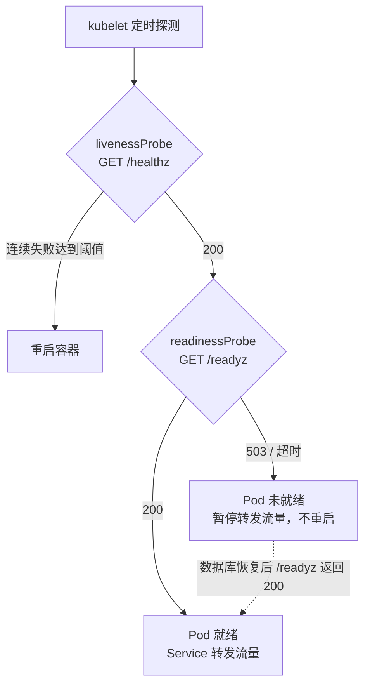

## 1. 为什么需要健康检查

服务部署出去以后，总有"别人"要判断它现在能不能用：

| 调用方 | 它想知道什么 | 判断之后做什么 |
| --- | --- | --- |
| K8s 探针（kubelet） | 容器里的进程还活着吗？能接流量吗？ | 重启容器，或把 Pod 从 Service 的转发列表里摘掉 |
| 负载均衡器 / 网关 | 这台后端实例能处理请求吗？ | 不健康的实例暂时不转发 |
| docker compose | 依赖的服务准备好了吗？ | `depends_on: condition: service_healthy` 时，等它健康了再启动下游 |

这些调用方都不懂业务，只认一个约定：**请求某个固定路径，看 HTTP 状态码**。2xx 表示健康，其它表示不健康。所以应用要专门提供健康检查接口。

下面以一个 FastAPI + SQLAlchemy 异步引擎 + PostgreSQL 的服务为例，提供两个接口：

* `/healthz`：存活检查（liveness）
* `/readyz`：就绪检查（readiness）

## 2. liveness 与 readiness 的区别

### 2.1. 两种检查的含义

* **存活检查（liveness）**：进程还能不能响应请求。进程卡死、死锁、事件循环被阻塞时，它就答不上来。
* **就绪检查（readiness）**：进程能不能**正常处理业务请求**。数据库连不上时，进程虽然活着，业务接口却会报错，这时就是"未就绪"。

### 2.2. 失败后果不同，决定了检查什么

两者最关键的区别在于**失败后 K8s 会做什么**：

| 对比项 | 存活检查 `/healthz` | 就绪检查 `/readyz` |
| --- | --- | --- |
| 回答的问题 | 进程活着吗 | 能接业务流量吗 |
| 检查内容 | 只要能响应就返回 200，不查外部依赖 | 检查数据库等依赖，可用返回 200，否则 503 |
| 失败后 K8s 的动作 | **重启容器** | **暂停转发流量**（从 Service 的 Endpoints 中摘除），不重启 |
| 恢复方式 | 重启后重新开始探测 | 依赖恢复后探测通过，自动重新接流量 |
| 能否依赖数据库 | **不能** | 应该 |

为什么存活检查不能依赖数据库？假设 `/healthz` 里也查数据库：

1. 数据库抖动几秒（主从切换、网络闪断）。
2. **所有**应用实例的存活检查同时失败。
3. K8s 把所有实例一起重启。
4. 重启期间服务完全不可用，而且所有实例同时启动、同时建连接池，还会冲击刚恢复的数据库。

数据库的问题本来就不是重启应用能解决的。正确的做法是把依赖检查放在就绪检查里：数据库不可用时只是暂停转发流量，进程保持运行，数据库恢复后自动重新接流量。

### 2.3. 探针决策流程



## 3. 实现健康检查接口

### 3.1. 完整代码

`src/my_service/api/health.py`：

```python
"""健康检查接口,供 K8s 探针、负载均衡器使用。

- /healthz:存活探针（liveness）,进程能响应就返回 200,不检查外部依赖
- /readyz:就绪探针（readiness）,依赖（数据库等）可用才返回 200,否则 503
"""

import asyncio
from typing import Literal

from fastapi import APIRouter, Request, Response, status
from pydantic import BaseModel
from sqlalchemy import text
from sqlalchemy.ext.asyncio import AsyncEngine

from my_service.core.logging import get_logger

router = APIRouter(tags=["health"])
log = get_logger(__name__)

READY_CHECK_TIMEOUT_SECONDS = 2


class HealthResponse(BaseModel):
    status: Literal["ok", "unavailable"] = "ok"


@router.get("/healthz", summary="存活检查")
async def healthz() -> HealthResponse:
    return HealthResponse()


@router.get(
    "/readyz",
    summary="就绪检查",
    responses={status.HTTP_503_SERVICE_UNAVAILABLE: {"model": HealthResponse}},
)
async def readyz(request: Request, response: Response) -> HealthResponse:
    engine: AsyncEngine = request.app.state.db_engine
    try:
        # 加超时:数据库无响应时,探针要尽快得到结果,不能一直挂着
        async with asyncio.timeout(READY_CHECK_TIMEOUT_SECONDS), engine.connect() as conn:
            await conn.execute(text("SELECT 1"))
    except Exception:
        log.warning("readiness_check_failed", check="database", exc_info=True)
        response.status_code = status.HTTP_503_SERVICE_UNAVAILABLE
        return HealthResponse(status="unavailable")
    return HealthResponse()
```

### 3.2. `/healthz`：什么都不查

`healthz` 直接返回 `{"status": "ok"}`，不做任何 I/O。只要事件循环还能调度这个协程并把响应发出去，就说明进程是活的。

### 3.3. `/readyz`：从 app.state 取引擎

数据库引擎在应用启动时（lifespan）创建，挂到 `app.state` 上（`main.py`）：

```python
@asynccontextmanager
async def lifespan(app: FastAPI) -> AsyncGenerator[None]:
    settings = get_settings()

    # 启动：创建数据库引擎（连接池）。这里不会立即建立连接，第一次使用时才连接
    engine = create_engine(settings)
    app.state.db_engine = engine
    app.state.session_factory = create_session_factory(engine)
    log.info("app_startup", env=settings.app_env, version=__version__)

    yield

    # 关闭：释放连接池中的所有连接
    await engine.dispose()
    log.info("app_shutdown")
```

`readyz` 通过 `request.app.state.db_engine` 拿到同一个引擎，用 `engine.connect()` 从连接池取一个连接，执行 `SELECT 1`。这条 SQL 不读任何表，只验证"能连上、能执行"。

注意注释里那句"不会立即建立连接"：引擎创建成功不代表数据库可用，所以就绪检查必须真的去连一次。

### 3.4. 为什么要加超时

数据库**拒绝连接**时，驱动会很快抛异常；但数据库**无响应**时（进程卡住、网络丢包），连接可能一直挂着等待。如果不加超时：

* 探针请求一直不返回，只能等探针自己的超时，拿不到明确的 503。
* 每次探测都占住一个连接和一个协程，挂起的请求越积越多。

`asyncio.timeout()`（Python 3.11+）给整个 `async with` 块设置时间上限，超时会抛 `TimeoutError`，被下面的 `except Exception` 接住，返回 503。

```python
async with asyncio.timeout(READY_CHECK_TIMEOUT_SECONDS), engine.connect() as conn:
    await conn.execute(text("SELECT 1"))
```

两个上下文管理器写在同一个 `async with` 里，从左到右进入：先开始计时，再取连接，所以"取连接"和"执行 SQL"都在 2 秒限制之内。

### 3.5. 失败时的处理

`except` 分支做三件事：

| 步骤 | 代码 | 作用 |
| --- | --- | --- |
| 记日志 | `log.warning("readiness_check_failed", check="database", exc_info=True)` | `exc_info=True` 带上异常堆栈，排查时能看到具体原因 |
| 改状态码 | `response.status_code = status.HTTP_503_SERVICE_UNAVAILABLE` | 在注入的 `Response` 上改状态码，FastAPI 会用它覆盖默认的 200 |
| 返回响应体 | `return HealthResponse(status="unavailable")` | 响应体仍是同一个模型，调用方解析方式不变 |

日志级别用 `warning` 而不是 `error`：数据库短暂不可用时就绪检查会连续失败，这是预期内的状态变化，由数据库自己的告警负责报错。

### 3.6. 响应模型与 OpenAPI 声明

```python
class HealthResponse(BaseModel):
    status: Literal["ok", "unavailable"] = "ok"
```

* `Literal["ok", "unavailable"]` 把取值限定为两个字符串，OpenAPI 文档里会显示成枚举，返回其它值时 Pydantic 会校验失败。
* 返回值注解 `-> HealthResponse` 让 FastAPI 把它当作 200 响应的模型。
* `responses={503: {"model": HealthResponse}}` 只影响文档：告诉调用方这个接口还可能返回 503，响应体结构相同。它不会改变运行时行为，真正设置 503 的是 `response.status_code`。

## 4. 路径约定

### 4.1. 挂在根路径，不放进 /api/v1

```python
app.include_router(health.router)
app.include_router(api_router, prefix="/api/v1")
```

健康检查路由不加前缀，地址是 `/healthz`、`/readyz`；业务接口才放在 `/api/v1` 下。原因：

* 健康检查是给运维基础设施用的接口，和业务 API 的版本无关。业务 API 升级到 `/api/v2` 时，探针配置不应该跟着改。
* `/healthz`、`/readyz` 是 K8s 生态里常见的命名，运维人员一看就懂。

### 4.2. 中间件跳过访问日志

K8s 每隔几秒探测一次，每个 Pod 有两个探针。如果每次探测都记一条访问日志，日志会被大量无意义的 200 刷屏。`core/middleware.py` 里专门排除了这两个路径：

```python
# 探针每隔几秒请求一次，记录访问日志只会刷屏
_SKIP_ACCESS_LOG_PATHS = frozenset({"/healthz", "/readyz"})

class RequestContextMiddleware:
    async def __call__(self, scope: Scope, receive: Receive, send: Send) -> None:
        ...
            finally:
                if scope["path"] not in _SKIP_ACCESS_LOG_PATHS:
                    log.info(
                        "http_request",
                        method=scope["method"],
                        path=scope["path"],
                        status=status_code,
                        duration_ms=round((time.perf_counter() - start) * 1000, 2),
                    )
```

跳过的只是访问日志。就绪检查失败时 `readyz` 自己记的 `readiness_check_failed` 警告照常输出，排查问题需要的信息不会丢。

## 5. 实验验证

下面通过冻结或停掉数据库容器，观察两个接口的表现。命令中的数据库容器名假设为 `my-service-postgres`。

```shell
# 查看状态码和耗时（本地 fastapi dev 端口为 8000，compose 启动的 app 映射到宿主机 8080）
curl -s -w " %{http_code} %{time_total}s\n" localhost:8000/readyz
curl -s -w " %{http_code}\n" localhost:8000/healthz

# 模拟数据库无响应：冻结容器内所有进程，端口仍在，但不回包
docker pause my-service-postgres
docker unpause my-service-postgres

# 模拟数据库没启动：停掉容器，连接被直接拒绝
docker stop my-service-postgres
docker start my-service-postgres
```

### 5.1. 实验结果

| 场景 | `/readyz` | 耗时 | `/healthz` |
| --- | --- | --- | --- |
| 数据库正常 | 200 `{"status":"ok"}` | — | 200 |
| `docker pause`（数据库卡住、无响应） | 503 `{"status":"unavailable"}` | 约 2～4.5 秒 | — |
| `docker stop`（数据库停掉） | 503 `{"status":"unavailable"}` | 约 0.6 秒，日志里是 `ConnectionRefusedError` | **仍是 200** |
| 数据库恢复后 | 回到 200 | — | 200 |

从结果可以看出：

* **超时生效了**：数据库无响应时，`/readyz` 在 2 秒超时后返回 503，不会一直挂着。总耗时比 2 秒多，是因为超时触发后还要取消连接、做连接清理，这部分时间不在 2 秒限制之内。
* **拒绝连接很快**：数据库停掉时端口直接拒绝，驱动立刻报错，不需要等到超时。
* **存活检查不受影响**：数据库停掉期间 `/healthz` 一直是 200，在 K8s 里就不会触发重启。
* **自动恢复**：数据库恢复后 `/readyz` 回到 200，不需要重启应用。

### 5.2. 用日志里的异常类型排查

`readiness_check_failed` 日志带了异常堆栈，根据异常信息可以快速定位原因：

| 日志中的异常信息 | 原因 | 检查方向 |
| --- | --- | --- |
| `Connection refused`（`ConnectionRefusedError`） | 数据库没启动，或地址 / 端口不对 | 数据库容器状态、`DATABASE_URL` 的主机和端口 |
| `database "xxx" does not exist` | 连接串里的库名和实际创建的库不一致 | `DATABASE_URL` 的库名与 `POSTGRES_DB` |
| `password authentication failed` | 用户名或密码错误 | `DATABASE_URL` 的用户名密码与数据库配置 |
| `TimeoutError` | 数据库无响应 | 数据库是否卡住、网络是否丢包 |

## 6. 在 docker compose 中使用

### 6.1. healthcheck 配置

应用镜像基于 `python:3.12-slim-trixie`，里面**没有 curl**。为了一个健康检查再装 curl 会增大镜像，直接用 Python 标准库 `urllib` 发请求即可（`docker-compose.yml` 中的 app 服务）：

```yaml
  app:
    profiles: ["app"]
    image: my-service:local
    environment: *app-env
    ports:
      - "8080:8000"   # 宿主机用 8080，避免和本地 fastapi dev 的 8000 冲突
    depends_on:
      migrate:
        condition: service_completed_successfully   # 迁移成功后才启动应用
    healthcheck:
      # 镜像里没有 curl，用 Python 自带的 urllib 请求就绪接口
      test: ["CMD", "python", "-c", "import urllib.request; urllib.request.urlopen('http://127.0.0.1:8000/readyz', timeout=3)"]
      interval: 10s
      timeout: 5s
      retries: 3
      start_period: 10s
```

要点：

* `urlopen` 遇到 503 会抛 `HTTPError`，Python 进程以非 0 退出码结束，docker 就判定该次检查失败；返回 200 时正常退出，判定成功。
* 地址用容器内的 `127.0.0.1:8000`，不是宿主机映射出来的 8080。
* 时间要一层套一层：`readyz` 内部超时 2 秒 < `urlopen` 的 `timeout=3` < compose 的 `timeout: 5s`。这样数据库卡住时，拿到的是应用明确返回的 503，而不是外层先超时。

### 6.2. 各参数含义

| 参数 | 值 | 含义 |
| --- | --- | --- |
| `interval` | 10s | 每 10 秒检查一次 |
| `timeout` | 5s | 单次检查超过 5 秒算失败 |
| `retries` | 3 | 连续失败 3 次才标记为 `unhealthy` |
| `start_period` | 10s | 启动后 10 秒内的失败不计入重试次数，给应用留启动时间 |

可以用 `docker compose ps` 查看容器的健康状态（`healthy` / `unhealthy` / `starting`）。如果有其它服务依赖 app，可以写 `depends_on: app: condition: service_healthy`，等 app 就绪后再启动。

## 7. 在 K8s 中配置探针

下面是一段**示意配置**，展示两个接口如何对应到两种探针：

```yaml
# 示意：Deployment 中容器的探针配置
containers:
  - name: my-service
    image: my-service:local
    ports:
      - containerPort: 8000
    livenessProbe:
      httpGet:
        path: /healthz
        port: 8000
      periodSeconds: 10
      timeoutSeconds: 3
      failureThreshold: 3
    readinessProbe:
      httpGet:
        path: /readyz
        port: 8000
      periodSeconds: 10
      timeoutSeconds: 3      # readyz 内部超时 2 秒，这里必须大于 2
      failureThreshold: 3
```

配置要点：

| 要点 | 说明 |
| --- | --- |
| livenessProbe → `/healthz` | 只判断进程是否存活，失败才重启 |
| readinessProbe → `/readyz` | 判断依赖是否可用，失败只摘流量 |
| `timeoutSeconds` 至少 3 | K8s 默认 `timeoutSeconds` 是 1 秒。`/readyz` 内部超时是 2 秒，数据库卡住时要 2 秒以上才返回 503；探针 1 秒就判超时，拿不到应用的明确结果 |
| `failureThreshold` | 连续失败多少次才判定失败，避免一次偶发的慢请求就触发重启或摘流量 |

## 8. 小结

| 主题 | 要点 |
| --- | --- |
| 为什么需要 | K8s 探针、负载均衡器、docker compose 依赖编排都靠固定路径 + 状态码判断服务状态 |
| `/healthz` | 存活检查，不查任何依赖；失败会导致 K8s 重启容器 |
| `/readyz` | 就绪检查，执行 `SELECT 1` 检查数据库；失败返回 503，K8s 只暂停转发流量 |
| 不能把数据库放进存活检查 | 数据库抖动会让所有实例同时被重启 |
| 超时 | `asyncio.timeout(2)` 包住取连接和执行 SQL，数据库无响应时 2 秒后返回 503 |
| 失败处理 | 记 `readiness_check_failed` 警告（含堆栈）、`response.status_code = 503`、返回 `{"status":"unavailable"}` |
| 响应模型 | `Literal["ok", "unavailable"]`；`responses=` 在文档中声明 503 |
| 路径 | 挂在根路径，与 `/api/v1` 业务版本无关；中间件跳过这两个路径的访问日志 |
| 实验结论 | 数据库卡住约 2～4.5 秒返回 503，停掉约 0.6 秒返回 503，期间 `/healthz` 仍是 200，恢复后自动回到 200 |
| docker compose | slim 镜像没有 curl，用 `python -c "urllib.request.urlopen(...)"` 检查 `/readyz` |
| K8s | liveness 用 `/healthz`，readiness 用 `/readyz`，`timeoutSeconds` 至少 3 秒 |
