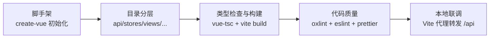

## 1. 路线总览

本文给出一个企业级 Vue 3 前端从空目录到可本地联调的推荐初始化顺序。示例项目名为 `my-app`，技术选型如下：

| 类别 | 选型 |
|------|------|
| 框架 / 语言 | Vue 3（组合式 API）、TypeScript |
| 构建工具 | Vite |
| 路由 | Vue Router |
| 状态管理 | Pinia |
| HTTP 客户端 | axios |
| 脚本编排 | npm-run-all2（`run-p` 并行、`run-s` 串行） |
| 类型检查 | vue-tsc |
| 代码质量 | oxlint（快速 lint）+ ESLint（规则校验）+ Prettier（格式化） |
| 包管理 | pnpm（npm / yarn 亦可） |

这套工具链是官方脚手架 create-vue 的默认组合，也是社区主流选择：Vite 提供秒级启动的开发服务器和基于 Rollup 的生产构建；Vue Router 与 Pinia 是 Vue 官方维护的路由和状态库；TypeScript 在组件、接口、状态层提供类型保障；ESLint、Prettier 统一规范。全部采用官方或官方推荐方案，升级和查文档的成本最低。

本文是路线图，按下面五个阶段把初始化串起来，每个阶段只讲目的、产出和验证方式，具体细节放在同系列的详细篇里。



排列顺序遵循一个原则：**先有骨架，再有约定，最后是质量与联调**。脚手架定出技术选型；目录分层确定代码该放哪里；类型检查和构建保证产物可用；代码质量工具统一规范；本地联调打通前后端。

## 2. 阶段一：用 create-vue 初始化项目

**目的**：用官方脚手架一次性生成 Vue 3 + TypeScript 项目骨架，并把路由、状态、lint、格式化都接好，避免手工拼装。

create-vue 本身只是脚手架：它根据你选择的特性生成一份预配置好的项目，其余交给 Vite。交互式创建用：

```shell
pnpm create vue@latest
```

在当前目录内非交互创建（CI 或脚本里常用），用特性标志一次性指定：

```shell
pnpm create vue@latest . --ts --router --pinia --eslint --prettier
```

各选项的含义：

| 选项 | 作用 |
|------|------|
| `--ts` | 启用 TypeScript，生成 `tsconfig*.json`，组件用 `<script setup lang="ts">` |
| `--router` | 集成 Vue Router，生成 `src/router/` 和示例路由 |
| `--pinia` | 集成 Pinia 状态管理，在入口注册 `createPinia()` |
| `--eslint` | 接入 ESLint，生成扁平配置 `eslint.config.ts` 及 `lint` 脚本 |
| `--prettier` | 接入 Prettier 做格式化，并让 ESLint 不与它冲突 |

命令末尾的 `.` 表示在当前目录创建而不是新建子目录。新版脚手架在启用 ESLint 时会一并加入 oxlint（基于 Rust 的高速 linter），和 ESLint 配合使用（见第 5 章）。

**为什么选这套**：这些都是 Vue 官方维护或官方推荐的方案，开箱即用、互相适配。TypeScript 让接口响应、组件 props、store 状态都有类型；Vue Router 和 Pinia 覆盖路由与状态两大基础能力；ESLint + Prettier 把"查错"和"排版"分开，前者管潜在 bug，后者管风格。

**产出**：`package.json`、`vite.config.ts`、`tsconfig.json` 系列、`eslint.config.ts`、`src/` 骨架、`index.html`、`.gitignore` 等。

**验证**：

```shell
pnpm install
pnpm dev     # 预期：打印本地地址（默认 http://localhost:5173），浏览器打开能看到首页
```

## 3. 阶段二：企业级目录分层约定

**目的**：约定每类代码的落点，让接口、状态、页面、组件、通用逻辑各归其位，新人一看目录就知道去哪里加代码。

脚手架生成的是最小骨架，企业级项目通常在 `src/` 下按职责补全这几层：

```text
src/
├── api/           # 接口封装：HTTP 客户端、各业务模块的请求函数、响应类型
├── stores/        # Pinia 状态：跨组件共享的状态与动作
├── views/         # 页面级组件：与路由一一对应
├── components/    # 可复用组件：不绑定具体页面的通用 UI
├── composables/   # 组合式逻辑：以 use* 命名的可复用逻辑函数
├── router/        # 路由：路由表、守卫
└── assets/        # 样式与静态资源：全局 CSS、图片、字体
```

各层的职责与边界：

| 目录 | 职责 | 边界 |
|------|------|------|
| `api/` | 封装与后端的通信：一个统一的 axios 实例、按业务拆分的请求函数、请求/响应的 TypeScript 类型。拦截器（带令牌、自动刷新、统一错误）集中在这里 | 只负责"发请求、收数据"，不持有应用状态，不操作 DOM |
| `stores/` | 用 Pinia 管理跨组件、跨页面共享的状态（如登录态、用户信息）及其动作 | 调用 `api/` 取数据并存状态；不直接写 `fetch`/`axios` 细节 |
| `views/` | 页面级组件，与路由表里的 `component` 一一对应，负责组织一屏的布局和数据流 | 通过 store 或 composable 拿数据，尽量把可复用 UI 下沉到 `components/` |
| `components/` | 不绑定具体页面的可复用 UI 组件（按钮、图标、开关等） | 通过 props/emits 与外界交互，不直接依赖某个页面或路由 |
| `composables/` | 以 `use*` 命名的组合式函数，封装可跨组件复用的有状态逻辑（如主题、分页、表单） | 返回响应式状态和方法，不渲染 UI |
| `router/` | 路由表与导航守卫，页面懒加载也在这里声明 | 只管"URL ↔ 组件"的映射和访问控制 |
| `assets/` | 全局样式、CSS 变量、图片字体等静态资源 | 纯资源，不含逻辑 |

两个常见写法，值得固定成约定：

**路由懒加载**。首页等首屏必需的页面直接静态导入，其余页面用动态导入，访问到才下载这块代码：

```ts
import { createRouter, createWebHistory } from 'vue-router'
import HomeView from '@/views/HomeView.vue'

const router = createRouter({
  history: createWebHistory(import.meta.env.BASE_URL),
  routes: [
    { path: '/', name: 'home', component: HomeView },
    // 懒加载：访问 /login 时才下载这块代码
    { path: '/login', name: 'login', component: () => import('@/views/LoginView.vue') },
  ],
})

export default router
```

**composable 的模块级单例**。把状态定义在 `use*` 函数之外（模块作用域），整个应用就共享同一份；定义在函数内部则每次调用都是独立实例。例如一个全应用共享的主题逻辑：

```ts
import { ref } from 'vue'

// 模块级单例：整个应用共享同一份主题状态
const mode = ref<'system' | 'light' | 'dark'>('system')

export function useTheme() {
  function setMode(m: typeof mode.value) {
    mode.value = m
  }
  return { mode, setMode }
}
```

`@` 是脚手架在 `vite.config.ts` 里配置的路径别名，指向 `src/`，让深层目录之间的导入不必写一长串 `../../`：

```ts
resolve: {
  alias: {
    '@': fileURLToPath(new URL('./src', import.meta.url)),
  },
},
```

## 4. 阶段三：package.json 脚本编排

**目的**：把构建、类型检查、lint、格式化拆成职责单一、可单独运行、也能被组合的脚本。关键在于用 npm-run-all2 提供的 `run-p`（并行）和 `run-s`（串行）来编排，而不是用 `&&`/`&` 手写。

脚手架生成的脚本大致如下：

```json
{
  "scripts": {
    "dev": "vite",
    "build": "run-p type-check \"build-only {@}\" --",
    "preview": "vite preview",
    "build-only": "vite build",
    "type-check": "vue-tsc --build",
    "lint": "run-s \"lint:*\"",
    "lint:oxlint": "oxlint . --fix",
    "lint:eslint": "eslint . --fix --cache",
    "format": "prettier --write src/"
  }
}
```

逐条说明为什么这样拆：

| 脚本 | 做什么 | 为什么单独拆出来 |
|------|--------|------------------|
| `dev` | 启动 Vite 开发服务器（含 HMR 热更新） | 日常开发入口 |
| `build` | **并行**跑 `type-check` 和 `build-only` | 类型检查和打包互不依赖，并行能省一半等待时间 |
| `build-only` | 只用 Vite 打包生产产物，不做类型检查 | 拆出来让 `build` 能单独调度它；也可在已确信类型没问题时单独跑 |
| `type-check` | 用 `vue-tsc --build` 对 `.vue` 和 `.ts` 做类型检查 | Vite 打包默认不做类型检查（靠 esbuild 转译，只剥离类型），类型校验必须单独一步 |
| `lint` | **串行**跑所有 `lint:*` 脚本 | 先快后慢、先粗后细，顺序执行，输出不会交错 |
| `lint:oxlint` | 用 oxlint 快速扫一遍并自动修 | oxlint 用 Rust 实现，极快，先挡掉大批明显问题 |
| `lint:eslint` | 用 ESLint 做更全面的规则校验，带 `--cache` | ESLint 规则更全但更慢，`--cache` 只检查改动过的文件 |
| `format` | 用 Prettier 格式化 `src/` | 格式化与 lint 分离：Prettier 专管排版，ESLint 专管代码质量 |

几个要点：

* **`vue-tsc` 而不是 `tsc`**：普通 `tsc` 不认识 `.vue` 单文件组件里的 `<template>` 和 `<script setup>`。`vue-tsc` 是 TypeScript 的包装，能对单文件组件做类型检查。`--build` 模式按 `tsconfig` 的项目引用增量编译，速度更快。

* **`run-p` vs `run-s`**：`run-p`（run-parallel）同时启动多个脚本，适合互不依赖的任务（类型检查 + 打包）；`run-s`（run-serial）按顺序执行，适合有先后或需要清晰输出的任务（多个 lint）。二者由 npm-run-all2 提供，比 shell 的 `&`/`&&` 跨平台（Windows 上也一致），还支持 `lint:*` 这样的通配匹配。

* **`build` 里的 `"build-only {@}" --`**：`{@}` 是 npm-run-all2 的占位符，把传给 `build` 的额外参数透传给 `build-only`，末尾的 `--` 用来界定参数边界。这样 `pnpm build --mode staging` 能把 `--mode staging` 传到底层的 `vite build`。

**验证**：

```shell
pnpm type-check   # 预期：无类型错误
pnpm lint         # 预期：oxlint、eslint 依次通过
pnpm format       # 预期：格式化后无改动或仅规范化排版
pnpm build        # 预期：类型检查与打包并行完成，产出 dist/
```

## 5. 阶段四：代码质量三件套各司其职

**目的**：用三个工具分工协作，而不是让一个工具什么都干。

| 工具 | 定位 | 典型职责 |
|------|------|----------|
| oxlint | 高速 linter | 秒级扫描全项目，挡掉未使用变量、明显错误等常见问题 |
| ESLint | 规则校验 | 配合 `eslint-plugin-vue`、TypeScript 规则做更深入的静态检查 |
| Prettier | 格式化 | 统一缩进、引号、换行等纯排版问题 |

分工的意义：**Prettier 管"长什么样"，lint 管"写得对不对"**。把格式化从 lint 里剥离，二者就不会互相打架——脚手架通过 `eslint-config-prettier` 关掉 ESLint 里所有与格式相关的规则，交给 Prettier 专管。oxlint 放在 ESLint 前面，是因为它极快，能先过滤掉大批低级问题，ESLint 再处理需要更强规则引擎的部分。

**验证**：改一处明显问题（比如留一个未使用的变量），运行 `pnpm lint`，预期 oxlint 或 ESLint 报出该问题并在可自动修复时修掉。

详细的规则配置、扁平配置写法、与编辑器集成等放在同系列详细篇（见第 7 章）。

## 6. 阶段五：本地联调与 Vite 代理

**目的**：开发时前端跑在 Vite 的端口、后端跑在另一个端口，直接请求会跨域。用 Vite 开发服务器的代理把前端的 `/api/*` 转发到后端，既避免跨域，又让前端代码里只写相对路径 `/api/...`，无需区分环境。

在 `vite.config.ts` 里配置 `server.proxy`：

```ts
export default defineConfig({
  server: {
    proxy: {
      // 前端 /api/* 转发到本地后端
      '/api': {
        target: 'http://127.0.0.1:8000',
        changeOrigin: true,
      },
    },
  },
})
```

配合一个统一的 axios 实例，`baseURL` 设成 `/api/v1`，所有业务请求都走这个相对路径：

```ts
import axios from 'axios'

export const http = axios.create({
  baseURL: '/api/v1',
})
```

这样做的好处：

* **只在一处配置后端地址**。代理只在开发服务器生效；生产环境由 Nginx 等反向代理把 `/api` 指向真实后端，前端代码不用改。
* **`changeOrigin: true`** 把转发请求的 `Host` 头改成目标地址，后端按正常同源请求处理。
* **避免 CORS**。浏览器看到的始终是同源的 `/api`，跨域发生在开发服务器到后端这一跳，不受浏览器同源策略限制。

**验证**：

```shell
pnpm dev
# 前端页面发起的 /api/... 请求能正常拿到后端响应，浏览器 Network 面板里状态码为 2xx
```

## 7. 小结与后续

初始化顺序是**脚手架 → 目录分层 → 类型检查/构建 → 代码质量 → 本地联调**，每个阶段都为后一个阶段打底：

* 用 `pnpm create vue@latest . --ts --router --pinia --eslint --prettier` 一次性生成 Vue 3 + TypeScript 骨架，技术选型全用官方或官方推荐方案。
* `src/` 按职责分层：`api` 发请求、`stores` 管共享状态、`views` 对应路由页面、`components` 放通用 UI、`composables` 封装可复用逻辑、`router` 管路由、`assets` 放样式资源。
* `package.json` 用 npm-run-all2 的 `run-p`/`run-s` 编排：`build` 并行跑 `type-check`（`vue-tsc --build`）和打包，`lint` 串行跑 oxlint + ESLint，`format` 交给 Prettier。
* 代码质量三件套分工：Prettier 管排版，oxlint 快速过滤，ESLint 深入校验。
* 本地联调用 Vite 的 `server.proxy` 把 `/api` 转发到后端，前端只写相对路径。

同系列后续详细篇会展开以下主题：

* TypeScript 分层配置（`tsconfig.json`/`tsconfig.app.json`/`tsconfig.node.json`）与 Vite 的配合
* ESLint / Prettier / oxlint 工具链的规则配置与编辑器集成
* Vue 应用入口、路由与 Pinia 状态管理的组织方式
* axios 实例封装：请求/响应拦截器、令牌携带与自动刷新
