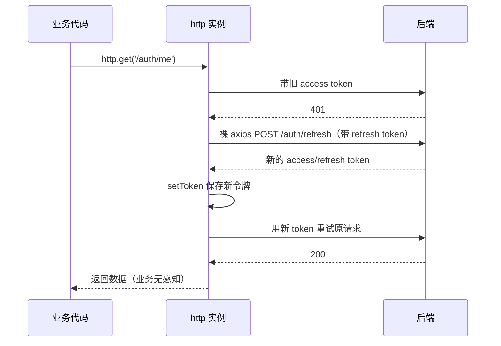

本文讲解前端（Vue 3 + TypeScript 项目）如何用 axios 封装 API 层，并在前后端分离架构下实现基于令牌（access token + refresh token）的认证：请求自动带令牌、401 自动刷新重试、单飞刷新、以及统一错误处理。示例后端约定 RESTful 接口前缀为 `/api/v1`，认证端点为 `/auth/login`、`/auth/refresh`、`/auth/logout`、`/auth/me`。

> 认证机制本身（JWT access token + 可轮换的 refresh token）不在本文展开，这里只关注前端的封装写法。

API 层按职责拆成几个文件，互相引用关系如下：

| 文件 | 作用 |
|------|------|
| `api/token.ts` | 令牌读写，集中封装 `localStorage` 操作 |
| `api/http.ts` | 统一的 axios 实例、请求/响应拦截器、刷新逻辑 |
| `api/auth.ts` | 认证接口函数：login / logout / fetchMe |
| `api/types.ts` | 类型定义：`TokenResponse`、`User`、统一错误结构 |

## 1. API 层分层封装

### 1.1. 为什么要分层

直接在组件里写 `axios.get('/api/v1/...')` 能跑，但会带来几个问题：接口地址前缀散落在各处、令牌的读写逻辑和展示组件混在一起、每个请求都要手动拼 `Authorization` 头。把这些收敛到一个 API 层后，组件只调用语义化的函数（如 `login(username, password)`），不关心底层怎么发请求。

分层的基本原则是：**每个文件只负责一件事**，依赖方向单一（`auth.ts` → `http.ts` → `token.ts`），上层不反向依赖下层的实现细节。

### 1.2. 统一的 axios 实例

用 `axios.create` 建一个带默认配置的实例，而不是直接用全局 `axios`。最常用的默认配置是 `baseURL`：

```typescript
import axios from 'axios'

// 所有业务请求都走这个实例
export const http = axios.create({
  baseURL: '/api/v1',
})
```

之后业务代码里写 `http.get('/auth/me')`，实际请求的是 `/api/v1/auth/me`。好处：

* 接口前缀只写一处，将来版本升级（如 `/api/v2`）只改这一行。
* 拦截器挂在这个实例上，只影响业务请求，不污染全局 `axios`（这一点在第 3 节的刷新逻辑里很关键）。

> `baseURL` 写成相对路径 `/api/v1` 时，请求会发到当前页面的同源地址。前后端分离开发时，一般由构建工具（如 Vite）的 dev server 代理把 `/api` 转发到后端，生产环境则由反向代理或同源部署处理，前端代码不需要写死后端域名。

### 1.3. 令牌读写集中到一个模块

令牌存在哪里（`localStorage`、`sessionStorage`、内存、Cookie）、用什么 key，这些细节应该只出现在一个文件里。其他模块通过函数访问，不直接碰存储：

```typescript
const ACCESS_KEY = 'myapp.access_token'
const REFRESH_KEY = 'myapp.refresh_token'

export function getAccessToken(): string | null {
  return localStorage.getItem(ACCESS_KEY)
}

export function getRefreshToken(): string | null {
  return localStorage.getItem(REFRESH_KEY)
}

export function setToken(access_token: string, refresh_token: string): void {
  localStorage.setItem(ACCESS_KEY, access_token)
  localStorage.setItem(REFRESH_KEY, refresh_token)
}

export function clearToken(): void {
  localStorage.removeItem(ACCESS_KEY)
  localStorage.removeItem(REFRESH_KEY)
}
```

几个约定：

* key 加一个应用前缀（如 `myapp.`），避免和同域下其他应用的存储键冲突。
* 只暴露 `get / set / clear` 四个函数。将来想换存储方式（如换成内存变量以提升安全性），只改这个文件，调用方不受影响。
* `localStorage` 只能存字符串，令牌本身就是字符串，直接存取即可；若要存对象需自己 `JSON.stringify` / `parse`。

> `localStorage` 的数据对同域下的 JavaScript 完全可读，存在被 XSS 窃取的风险。是否用它存令牌是一个安全权衡：换用 `HttpOnly` Cookie 可防 JS 读取，但要另行处理 CSRF。本文聚焦封装写法，存储方案按项目的安全要求选择。

### 1.4. 接口函数与类型定义

接口函数是对单个后端端点的薄封装，只做"发请求、取 `data`"：

```typescript
import { http } from './http'
import type { TokenResponse, User } from './types'

export async function login(username: string, password: string): Promise<TokenResponse> {
  const resp = await http.post<TokenResponse>('/auth/login', { username, password })
  return resp.data
}

export async function logout(refreshToken: string): Promise<void> {
  await http.post('/auth/logout', { refresh_token: refreshToken })
}

export async function fetchMe(): Promise<User> {
  const resp = await http.get<User>('/auth/me')
  return resp.data
}
```

* `http.post<TokenResponse>(...)` 的泛型参数标注响应体类型，于是 `resp.data` 的类型就是 `TokenResponse`，组件里有完整的类型提示。
* 函数返回 `resp.data` 而不是整个 `resp`，调用方拿到的直接是业务数据，不用每次都 `.data`。

类型定义单独放一个文件，和后端的响应结构对齐：

```typescript
export interface TokenResponse {
  access_token: string
  token_type: 'bearer'
  access_token_expires_at: string
  refresh_token: string
  refresh_token_expires_at: string
}

export interface User {
  id: string
  username: string
  is_active: boolean
  created_at: string
}

// 后端统一错误应答结构
export interface ApiError {
  code: string
  message: string
  request_id: string | null
  details: unknown
}
```

字段名直接沿用后端 JSON 的命名（如 `access_token` 用下划线），避免在 API 层来回转换命名风格。

## 2. 请求拦截器：自动带上令牌

每个需要登录的接口都要在请求头里带 `Authorization: Bearer <token>`。与其在每个接口函数里手写，不如用请求拦截器统一注入：

```typescript
import type { InternalAxiosRequestConfig } from 'axios'
import { getAccessToken } from './token'

// 这些认证端点不注入令牌
const AUTH_PATHS = ['/auth/login', '/auth/refresh', '/auth/logout']

function isAuthPath(url: string | undefined): boolean {
  return !!url && AUTH_PATHS.some((p) => url.startsWith(p))
}

http.interceptors.request.use((config: InternalAxiosRequestConfig) => {
  const token = getAccessToken()
  if (token && !isAuthPath(config.url)) {
    config.headers.Authorization = `Bearer ${token}`
  }
  return config
})
```

要点：

* 请求拦截器接收 `config`，修改后必须 `return config`，请求才会带着改动发出去。
* 只有拿到令牌、且不是认证端点时才注入。登录接口本来就没有令牌，刷新接口用的是 refresh token（在请求体里，不走这个头），给它们加上过期的 access token 没有意义，还可能干扰后端判断。
* `config.url` 是相对于 `baseURL` 的路径（如 `/auth/login`），所以用 `startsWith` 判断即可。

## 3. 响应拦截器：401 自动刷新重试

access token 一般有效期很短（如 15 分钟）。过期后再请求，后端返回 401。如果让用户每隔一会儿就重新登录，体验很差。更好的做法：拦截到 401 时，用 refresh token 换一个新的 access token，然后**自动重试原来那个请求**，整个过程对业务代码透明。

### 3.1. 整体流程



### 3.2. 代码

```typescript
import axios, { AxiosError, type InternalAxiosRequestConfig } from 'axios'
import { clearToken, getRefreshToken, setToken } from './token'
import type { TokenResponse } from './types'

http.interceptors.response.use(
  (response) => response,
  async (error: AxiosError) => {
    const original = error.config as
      | (InternalAxiosRequestConfig & { _retry?: boolean })
      | undefined

    if (
      error.response?.status === 401 &&
      original &&
      !original._retry &&
      !isAuthPath(original.url)
    ) {
      original._retry = true
      try {
        const newToken = await runSingleFlightRefresh()
        original.headers.Authorization = `Bearer ${newToken}`
        return http(original) // 用新令牌重试原请求
      } catch (refreshError) {
        // 刷新也失败：清空本地登录态，交给上层跳登录页
        clearToken()
        return Promise.reject(refreshError)
      }
    }

    return Promise.reject(error)
  },
)
```

响应拦截器的第二个参数是**错误回调**，只有响应失败（含非 2xx 状态码）时才进来。逐项说明触发刷新的条件：

| 条件 | 原因 |
|------|------|
| `error.response?.status === 401` | 只对"未授权"做刷新，其他错误（403、500 等）原样抛出 |
| `original` 存在 | 没有原始请求配置就无法重试 |
| `!original._retry` | 见 3.3，防止无限重试 |
| `!isAuthPath(original.url)` | 认证端点自己返回的 401 不触发刷新，否则死循环 |

### 3.3. `_retry` 标记防止无限重试

重试后的请求如果又返回 401（例如新令牌也被后端判为无效），会再次进入错误回调。若不加防护，就会"刷新→重试→401→再刷新……"无限循环。

办法是在原始请求的 config 上挂一个自定义标记 `_retry`：第一次进来时置为 `true`，再进来时因为 `original._retry` 已为真而跳过刷新，直接把错误抛给调用方。`axios` 的 config 对象允许挂额外字段，这里用 TypeScript 的交叉类型 `InternalAxiosRequestConfig & { _retry?: boolean }` 让编译器认识这个字段。

### 3.4. 为什么认证端点要排除

`/auth/refresh` 本身返回 401（refresh token 也过期了）时，如果不排除，拦截器又会去调 `/auth/refresh`，于是陷入死循环。所以刷新逻辑必须把认证端点整体排除在外——这些端点的 401 是"确实需要重新登录"的信号，应当如实抛出，而不是尝试刷新。

### 3.5. 刷新失败的兜底

`runSingleFlightRefresh()` 抛错（没有 refresh token、或刷新接口返回错误）时，`catch` 块里 `clearToken()` 清空本地令牌，然后把错误继续抛出。注意拦截器**不直接跳转登录页**：是否跳转、跳到哪、要不要弹提示，属于路由和界面逻辑，应由上层（路由守卫或 store）决定。API 层只负责"令牌已失效"这个事实，职责不越界。

## 4. 单飞刷新（single-flight）

设想页面加载时并发发了 5 个请求，access token 刚好过期，于是 5 个请求几乎同时收到 401。如果每个都各自去刷新，就会打 5 次 `/auth/refresh`。更糟的是：refresh token 常常是"一次性"的（轮换机制，用一次就作废并发新的），后到的刷新请求会拿着已作废的 refresh token，反而失败。

**单飞**的思路：同一时刻只允许一个刷新请求在途，其余并发的 401 共用同一个刷新结果。

```typescript
// 同一时刻只允许一个刷新在途，其余 401 等它完成后用新令牌重试
let refreshing: Promise<string> | null = null

async function refreshAccessToken(): Promise<string> {
  const refreshToken = getRefreshToken()
  if (!refreshToken) {
    throw new Error('no refresh token')
  }
  // 用裸 axios（见第 5 节）发刷新请求
  const resp = await axios.post<TokenResponse>('/api/v1/auth/refresh', {
    refresh_token: refreshToken,
  })
  setToken(resp.data.access_token, resp.data.refresh_token)
  return resp.data.access_token
}

function runSingleFlightRefresh(): Promise<string> {
  if (!refreshing) {
    refreshing = refreshAccessToken().finally(() => {
      refreshing = null
    })
  }
  return refreshing
}
```

原理：

* 用模块级变量 `refreshing` 保存"正在进行的刷新"这个 Promise。
* 第一个 401 进来时 `refreshing` 为 `null`，于是真正发起刷新，并把返回的 Promise 存进 `refreshing`。
* 后续的 401 进来时 `refreshing` 非空，直接复用同一个 Promise——它们 `await` 的是同一次刷新，拿到的是同一个新令牌。
* 刷新完成（无论成功失败）后，`finally` 把 `refreshing` 置回 `null`，下一轮过期时才能再次发起刷新。

`finally` 里置空是关键：放在 `then` 里的话，刷新失败时不会执行，`refreshing` 永远留着一个已失败的 Promise，之后所有刷新都会复用这个失败结果。

> 这是 JavaScript 里实现单飞的通用模式：用一个共享的 `Promise | null` 变量去重并发的异步操作，在 `finally` 中复位。不限于令牌刷新，任何"并发触发但只需执行一次"的场景都适用。

## 5. 用「裸 axios」发刷新请求

注意第 4 节里刷新用的是全局 `axios.post(...)`，而不是封装好的 `http` 实例。这是刻意的。

`http` 实例挂了请求拦截器和响应拦截器。如果刷新请求也走 `http`：

* 请求拦截器会试图给它注入 access token（虽然已用 `isAuthPath` 排除，但依赖这层排除更脆弱）。
* 更严重的是响应拦截器：刷新请求如果返回 401，会再次触发"401 → 刷新"的逻辑，递归调用自己。

用不带任何拦截器的全局 `axios` 发刷新请求，就彻底绕开了这套拦截逻辑，刷新请求是一次干净的、不会被二次加工的 HTTP 调用。代价是要写完整路径（`/api/v1/auth/refresh`，因为没有 `baseURL`）。

> 通用规律：当一个请求需要"不触发当前实例的拦截器"时，就用裸 `axios`（或另建一个没有拦截器的实例）。令牌刷新是最典型的场景——它既要发 HTTP 请求，又必须站在拦截逻辑之外，否则会和自己递归。

## 6. 前端统一错误处理

后端返回统一的错误结构（见 1.4 的 `ApiError`：`code` / `message` / `request_id` / `details`）。前端展示错误时，应优先用后端给的 `message`（它往往是面向用户的中文提示），取不到再回退到通用文案。

`axios` 把 HTTP 错误包装成 `AxiosError`，但 `catch (e)` 里 `e` 的类型是 `unknown`，不能直接访问 `e.response`。用 `axios.isAxiosError<T>()` 这个**类型守卫**收窄类型：

```typescript
import axios from 'axios'
import type { ApiError } from '@/api/types'

// 优先展示后端统一错误响应里的 message
function extractMessage(e: unknown): string {
  if (axios.isAxiosError<ApiError>(e) && e.response?.data?.message) {
    return e.response.data.message
  }
  return '登录失败，请稍后重试'
}
```

要点：

* `axios.isAxiosError<ApiError>(e)` 返回 `true` 时，TypeScript 把 `e` 收窄为 `AxiosError<ApiError>`，于是 `e.response.data` 的类型是 `ApiError`，`.message` 有类型提示。
* 泛型参数 `<ApiError>` 告诉守卫"响应体是这个结构"，否则 `data` 会是 `any`。
* 用 `?.` 逐层兜底：可能根本没有 `response`（网络断开、请求未发出），也可能有 `response` 但 body 不是预期结构。任何一层缺失都回退到通用文案。
* 通用文案是最后的保险，保证任何异常情况下界面都有可读的提示，而不是把原始错误对象暴露给用户。

调用处（如登录提交）把它接到界面状态上：

```typescript
try {
  await auth.login(username.value, password.value)
  // ...成功后的跳转
} catch (e) {
  error.value = extractMessage(e)
}
```

## 7. 踩坑：SPA 跳转导致 macOS 键盘锁在英文

**现象**：在 macOS 上，于密码框输入后点击登录，登录成功、页面跳转，但之后键盘被锁在英文（ASCII）输入，中文输入法切不过去，像是输入法失灵。整页刷新式的传统登录没有这个问题。

**原因**：浏览器为保护密码，当焦点落在 `<input type="password">` 上时会进入 macOS 的「安全键盘输入模式」（Secure Keyboard Entry），这个模式会接管键盘输入。正常情况下，密码框失焦（`blur`）时浏览器会退出该模式。但在单页应用（SPA）里，登录成功后用路由跳转（如 `router.push('/')`）会把当前视图**整个卸载**，密码框还带着焦点就被移除了，`blur` 事件不触发，浏览器没有机会退出安全输入模式，于是键盘状态被卡住。传统的整页跳转会重建整个文档，模式自然被重置，所以不会复现。

**解决**：跳转前，显式地让当前聚焦的元素失焦，再跳转。

```typescript
// 跳转前让聚焦的密码框失焦，释放 macOS 安全输入模式
;(document.activeElement as HTMLElement | null)?.blur()
router.push('/')
```

`document.activeElement` 是当前获得焦点的元素，调用它的 `blur()` 主动触发失焦，浏览器据此退出安全输入模式；之后再跳转，密码框即便被卸载也已经失过焦了。

> 这条规律适用于任何"从聚焦着的密码框导航离开"的 SPA 场景，不限于登录页：只要在卸载含密码框的视图前主动 `blur`，就能避免 macOS 键盘被锁。行首的分号是为了防止它和上一行代码被 JavaScript 自动分号插入规则连成一句（`?.` / `(` 开头的语句前习惯补分号）。

## 8. 小结

| 知识点 | 做法 | 要点 |
|-------|------|------|
| 统一实例 | `axios.create({ baseURL })` | 前缀集中一处；拦截器只作用于业务请求 |
| 令牌封装 | `token.ts` 暴露 get/set/clear | 存储细节只在一个文件，key 加应用前缀 |
| 分层 | types / token / http / 接口函数分文件 | 依赖方向单一，组件只调语义化函数 |
| 请求拦截器 | 注入 `Authorization: Bearer <token>` | 认证端点跳过注入；记得 `return config` |
| 401 刷新重试 | 响应错误回调里刷新后 `http(original)` | 用 `_retry` 防无限重试；认证端点排除在外 |
| 单飞刷新 | 共享 `refreshing: Promise \| null` | 并发 401 复用一次刷新；`finally` 里复位 |
| 裸 axios | 刷新请求用全局 `axios` 而非 `http` | 绕开拦截器，避免刷新自身递归 |
| 刷新失败兜底 | `clearToken()` 后抛错 | API 层只清令牌，跳转交给上层 |
| 错误处理 | `axios.isAxiosError<ApiError>(e)` 类型守卫 | 优先取后端 `message`，取不到回退通用文案 |
| SPA 键盘锁 | 跳转前 `document.activeElement?.blur()` | 卸载聚焦密码框前主动失焦，释放 macOS 安全输入模式 |
