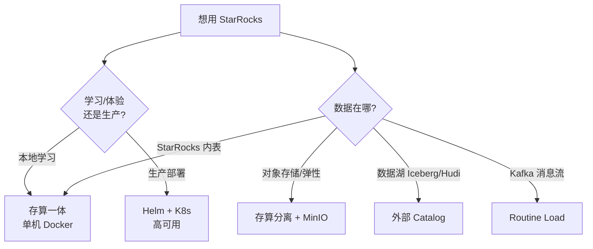
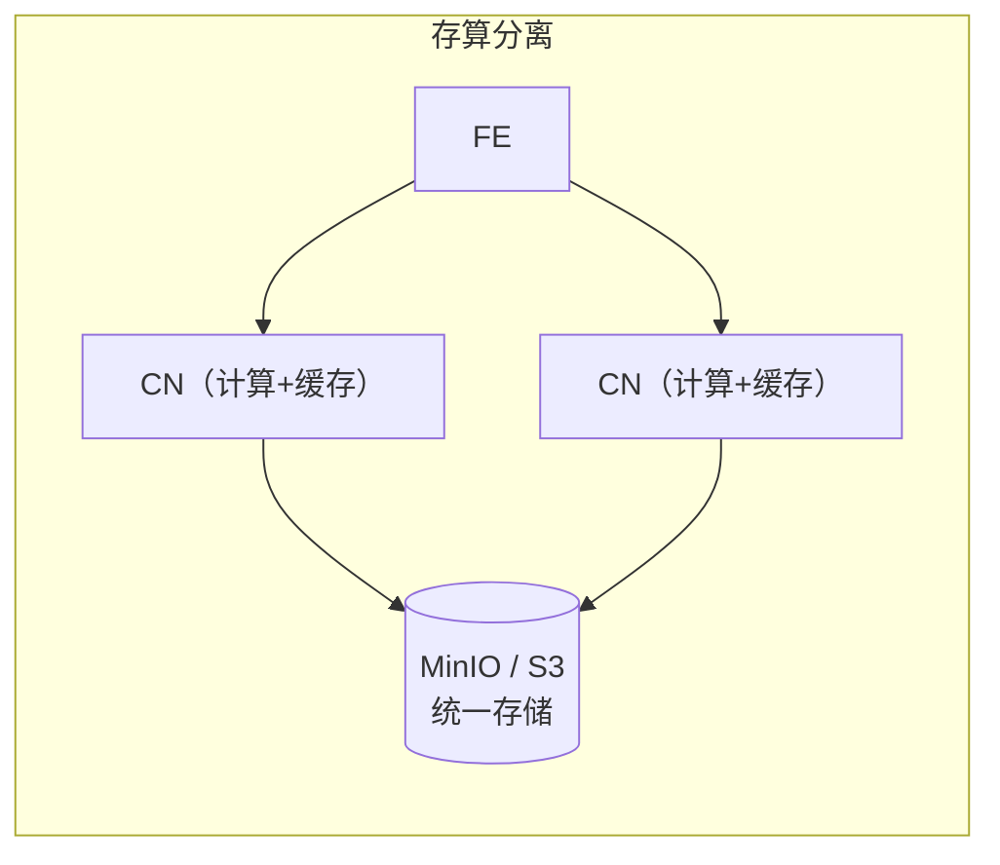

官方的 Quick Start 并不是一篇单一教程，而是一组「StarRocks 各种用法的快速指引」——从最简单的单机 Docker 部署，到存算分离、数据湖分析、Kafka 实时流式导入，再到 Kubernetes 生产部署。这篇文章把这些指引整合成一篇全景导览：先用最详细的篇幅带你跑通「存算一体」这条主线，再把其余几种用法作为独立章节逐一介绍——每章都说清楚「它是什么、什么时候用、怎么最快上手」，让你对 StarRocks 的全部玩法有一张完整的地图。

> 本文以 StarRocks 官方「快速开始」系列为基础整理，并补充了在 Apple Silicon（M 系列芯片）上部署的实战经验。官方原文见：
>
> - [快速开始](https://docs.starrocks.io/zh/docs/quick_start/)
> - [存算一体](https://docs.starrocks.io/zh/docs/quick_start/shared-nothing/)
> - [存算分离](https://docs.starrocks.io/zh/docs/quick_start/shared-data/)
> - [Apache Iceberg 数据湖](https://docs.starrocks.io/zh/docs/quick_start/iceberg/)
> - [通过 Routine Load 导入 Kafka 数据](https://docs.starrocks.io/zh/docs/quick_start/routine-load/)
> - [使用 Helm 部署](https://docs.starrocks.io/zh/docs/quick_start/helm/)
>
> 版本敏感的内容（镜像标签、具体语法、参数、Chart 版本）请以你实际部署版本的官方文档为准。本文验证环境为 StarRocks 4.1.x。

## 1. 快速开始全景：几种用法怎么选

官方 Quick Start 下的每一篇，本质上对应 StarRocks 的一种典型用法或部署形态。先用一张表建立全局认识：

| 用法 | 核心场景 | 复杂度 | 本文章节 |
|---|---|---|---|
| 存算一体（Docker） | 本地学习、单机体验，追求极致查询性能 | ⭐ 最简单 | 第 3~8 章（主线） |
| 存算分离（+ MinIO） | 存储便宜、计算弹性伸缩、资源隔离 | ⭐⭐ | 第 9 章 |
| 数据湖分析（Iceberg / Hudi） | 不搬数据，直接查数据湖 | ⭐⭐ | 第 10 章 |
| Kafka 实时流式导入（Routine Load） | 持续消费消息流、近实时入库 | ⭐⭐⭐ | 第 11 章 |
| Kubernetes 部署（Helm） | 生产级高可用、持久化、可扩展 | ⭐⭐⭐ | 第 12 章 |



> 建议初学者**从第 3~8 章的「存算一体」主线开始**，把部署、建表、导入、查询完整跑一遍。其余章节属于进阶用法，可以先了解「是什么、何时用」，等需要时再深入实操。

---

## 第一部分：存算一体（主线教程）

这是最简单、最适合入门的方式：用一个 Docker 容器把 StarRocks 跑起来，导入两份真实的公开数据集（纽约市交通事故 + 天气），然后用 SQL 分析「天气如何影响交通事故」。

## 2. 前提条件

| 工具 | 要求 | 说明 |
|---|---|---|
| Docker | 已安装 | 为 Docker 分配至少 **4 GB 内存**、10 GB 空闲磁盘 |
| SQL 客户端 | 任选其一 | 容器自带的 MySQL Client，或 DBeaver、MySQL Workbench |
| curl | 已安装 | 用于下载数据集和发起 Stream Load；终端运行 `curl` 可检查 |

## 3. 部署 StarRocks

### 3.1. 官方命令（x86 / Intel 芯片）

使用 `allin1-ubuntu` 镜像（把 FE 和 BE 打包在一个容器里，专供学习体验）：

```bash
docker run -p 9030:9030 -p 8030:8030 -p 8040:8040 -itd \
  --name quickstart starrocks/allin1-ubuntu
```

| 端口 | 用途 |
|---|---|
| `9030` | MySQL 协议端口，SQL 客户端连这个 |
| `8030` | FE 的 HTTP 端口（Stream Load、Web 控制台） |
| `8040` | BE 的 HTTP 端口 |

### 3.2. ⚠️ Apple Silicon（M1/M2/M3/M4）的坑

这是官方文档没强调、但 Mac 用户极易踩中的坑：**不要给 `docker run` 加 `--platform linux/amd64`。**

`allin1` 镜像同时提供 `amd64` 和**原生 `arm64`** 两种架构。

- 强制 `--platform linux/amd64` 会让 Docker 通过 Rosetta/QEMU 模拟 x86。StarRocks 的 **BE 是原生 C++ 程序，对 CPU 指令集敏感**，在模拟层下会**启动即崩溃**（表现为容器 `unhealthy`、`beservice FATAL Exited too quickly`，甚至整个容器 OOM 被杀、退出码 137），且崩得太早、日志里什么都来不及打印。
- 让 Docker 自动选原生 `arm64` 镜像，BE 就能稳定运行。

所以 Apple Silicon 上**不指定 platform**（让 Docker 自动匹配 arm64）：

```bash
docker run -p 9030:9030 -p 8030:8030 -p 8040:8040 -itd \
  --name quickstart starrocks/allin1-ubuntu
```

> 排错口诀：Mac 上 BE 起不来、容器反复重启或 unhealthy，先检查是不是误用了 `--platform linux/amd64`。进容器执行 `uname -m`，返回 `aarch64` 才是原生 arm64。

### 3.3. 确认集群就绪

容器启动后 FE/BE 需几十秒初始化。确认 BE 已存活：

```bash
docker exec quickstart \
  mysql -P 9030 -h 127.0.0.1 -u root -e "SHOW BACKENDS\G" | grep Alive
```

看到 `Alive: true` 即就绪。若一直 `Alive: false` 伴随 `Connection refused`，说明 BE 没起来（Apple Silicon 用户回看 3.2）。

## 4. 下载数据集

在**主机上**（不是容器内）下载两份数据集：

```bash
# 纽约市交通事故数据
curl -O https://raw.githubusercontent.com/StarRocks/demo/master/documentation-samples/quickstart/datasets/NYPD_Crash_Data.csv

# 天气数据
curl -O https://raw.githubusercontent.com/StarRocks/demo/master/documentation-samples/quickstart/datasets/72505394728.csv
```

记住下载目录，第 6 步导入时要在这个目录下执行。

## 5. 连接 StarRocks

### 5.1. 用容器自带的 MySQL Client

```bash
docker exec -it quickstart \
  mysql -P 9030 -h 127.0.0.1 -u root --prompt="StarRocks > "
```

### 5.2. 用 MySQL Workbench / DBeaver

| 配置项 | 值 |
|---|---|
| Hostname | `127.0.0.1` |
| **Port** | **`9030`** |
| Username | `root` |
| Password | 留空（默认无密码） |

> **最常见的连接错误：端口填错。** `9030` 才是 SQL 端口；`8030`/`8040` 是 HTTP 端口、`9050`/`9020` 是内部端口，都不能用来连 SQL。MySQL Workbench 可能弹「版本不受支持」警告，忽略继续即可。

## 6. 建库建表

```sql
CREATE DATABASE IF NOT EXISTS quickstart;
USE quickstart;
```

交通事故表（字段已裁剪，只留教程相关列）：

```sql
CREATE TABLE IF NOT EXISTS crashdata (
    CRASH_DATE DATETIME,
    BOROUGH STRING,
    ZIP_CODE STRING,
    LATITUDE INT,
    LONGITUDE INT,
    LOCATION STRING,
    ON_STREET_NAME STRING,
    CROSS_STREET_NAME STRING,
    OFF_STREET_NAME STRING,
    CONTRIBUTING_FACTOR_VEHICLE_1 STRING,
    CONTRIBUTING_FACTOR_VEHICLE_2 STRING,
    COLLISION_ID INT,
    VEHICLE_TYPE_CODE_1 STRING,
    VEHICLE_TYPE_CODE_2 STRING
);
```

天气表：

```sql
CREATE TABLE IF NOT EXISTS weatherdata (
    DATE DATETIME,
    NAME STRING,
    HourlyDewPointTemperature STRING,
    HourlyDryBulbTemperature STRING,
    HourlyPrecipitation STRING,
    HourlyPresentWeatherType STRING,
    HourlyPressureChange STRING,
    HourlyPressureTendency STRING,
    HourlyRelativeHumidity STRING,
    HourlySkyConditions STRING,
    HourlyVisibility STRING,
    HourlyWetBulbTemperature STRING,
    HourlyWindDirection STRING,
    HourlyWindGustSpeed STRING,
    HourlyWindSpeed STRING
);
```

> 这两张表没显式指定表模型、分区、分桶，StarRocks 用默认设置。这些是后续篇章的核心，这里先专注跑通流程。

## 7. 导入数据：Stream Load

StarRocks 有多种导入方式，本教程用 **curl 发起 Stream Load**——通过 HTTP 把本地文件直接推给 StarRocks。在**数据集所在目录**执行：

```bash
curl --location-trusted -u root \
  -T ./NYPD_Crash_Data.csv \
  -H "label:crashdata-0" \
  -H "column_separator:," \
  -H "skip_header:1" \
  -H "enclose:\"" \
  -H "max_filter_ratio:1" \
  -H "columns:tmp_CRASH_DATE, tmp_CRASH_TIME, CRASH_DATE=str_to_date(concat_ws(' ', tmp_CRASH_DATE, tmp_CRASH_TIME), '%m/%d/%Y %H:%i'),BOROUGH,ZIP_CODE,LATITUDE,LONGITUDE,LOCATION,ON_STREET_NAME,CROSS_STREET_NAME,OFF_STREET_NAME,NUMBER_OF_PERSONS_INJURED,NUMBER_OF_PERSONS_KILLED,NUMBER_OF_PEDESTRIANS_INJURED,NUMBER_OF_PEDESTRIANS_KILLED,NUMBER_OF_CYCLIST_INJURED,NUMBER_OF_CYCLIST_KILLED,NUMBER_OF_MOTORIST_INJURED,NUMBER_OF_MOTORIST_KILLED,CONTRIBUTING_FACTOR_VEHICLE_1,CONTRIBUTING_FACTOR_VEHICLE_2,CONTRIBUTING_FACTOR_VEHICLE_3,CONTRIBUTING_FACTOR_VEHICLE_4,CONTRIBUTING_FACTOR_VEHICLE_5,COLLISION_ID,VEHICLE_TYPE_CODE_1,VEHICLE_TYPE_CODE_2,VEHICLE_TYPE_CODE_3,VEHICLE_TYPE_CODE_4,VEHICLE_TYPE_CODE_5" \
  -XPUT http://localhost:8030/api/quickstart/crashdata/_stream_load
```

提示输入密码时直接回车跳过。成功返回里 `Status` 为 `Success`：

```json
{
    "Label": "crashdata-0",
    "Status": "Success",
    "NumberTotalRows": 423726,
    "NumberLoadedRows": 423725,
    "NumberFilteredRows": 1,
    "ErrorURL": "http://127.0.0.1:8040/api/_load_error_log?file=error_log_xxx"
}
```

- `NumberFilteredRows: 1` 表示有一行脏数据被过滤。想看具体错误，curl 返回里的 `ErrorURL`。

天气数据同理导入（`columns` 很长，照抄即可，未映射的列自动跳过），完整命令见[官方教程](https://docs.starrocks.io/zh/docs/quick_start/shared-nothing/)。

## 8. 查询分析

数据进去后，用 SQL 回答真实问题。

**查询一：每小时交通事故数量**

```sql
SELECT COUNT(*), date_trunc("hour", CRASH_DATE) AS Time
FROM crashdata
GROUP BY Time ORDER BY Time ASC LIMIT 200;
```

结论：工作日早高峰（08:00–10:00）每小时约 40 起事故，明显高于其他时段。

**查询三：能见度对事故的影响（多表 JOIN，核心）**

```sql
SELECT COUNT(DISTINCT c.COLLISION_ID) AS Crashes,
       truncate(avg(w.HourlyDryBulbTemperature), 1) AS Temp_F,
       truncate(avg(w.HourlyVisibility), 2) AS Visibility,
       max(w.HourlyPrecipitation) AS Precipitation,
       date_format((date_trunc("hour", c.CRASH_DATE)), '%d %b %Y %H:%i') AS Hour
FROM crashdata c
LEFT JOIN weatherdata w
  ON date_trunc("hour", c.CRASH_DATE) = date_trunc("hour", w.DATE)
WHERE w.HourlyVisibility BETWEEN 0.0 AND 1.0
GROUP BY Hour ORDER BY Crashes DESC LIMIT 100;
```

把事故表和天气表按「小时」JOIN，分析低能见度（0~1.0 英里）时段的事故。结果显示某一小时最高 129 起——但要注意事故往往是**多因素叠加**（工作日 + 早高峰 + 下雨 + 冰点气温）。

**查询四**把筛选条件换成气温 0~40℉（路面结冰区间），同样能发现大雪天的事故高峰。完整四条查询见官方教程。

## 9. curl 参数与数据转换详解

Stream Load 的 curl 命令参数含义：

| 参数 | 作用 |
|---|---|
| `--location-trusted` | 允许 curl 把认证凭据传给重定向后的 URL |
| `-u root` | 登录用户名 |
| `-T 文件名` | 要传输的文件 |
| `-H "label:xxx"` | 导入作业标签，**必须唯一**，重复跑时递增数字 |
| `-H "column_separator:,"` | 列分隔符，常见 `,`、`\t`、`\|` |
| `-H "skip_header:1"` | 跳过几行表头，无表头填 0 |
| `-H "enclose:\""` | 字段包围符，处理含逗号的字段 |
| `-H "max_filter_ratio:1"` | 允许的错误行比例，生产应设 `0`，调试设 `1` |
| `-H "columns:..."` | CSV 列到表列的映射，**也能做数据转换** |

**导入时转换**：数据集里日期是 `MM/DD/YYYY`、时间是 `HH:MI` 分两列，而 `DATETIME` 要求 `YYYY-MM-DD HH:MI:SS`，用这段逻辑合并转换：

```text
-H "columns:tmp_CRASH_DATE, tmp_CRASH_TIME,
    CRASH_DATE=str_to_date(concat_ws(' ', tmp_CRASH_DATE, tmp_CRASH_TIME), '%m/%d/%Y %H:%i')"
```

先把两列读进临时列，用 `concat_ws` 拼接，再用 `str_to_date` 解析成 DATETIME 存入目标列。脏乱的原始数据在进入 StarRocks 时就被规整好，无需额外 ETL。

---

## 第二部分：其余用法速览

下面几种属于进阶用法。本节讲清每种「是什么、什么时候用、最快怎么上手」，具体操作以对应官方文档为准。

## 10. 存算分离（Shared-data + MinIO）

**是什么**：数据存在远端对象存储（S3、GCS、Azure Blob、MinIO 等），热数据本地缓存；后端用 **CN（计算节点）** 取代 BE，CN 无状态、可秒级增减。

**什么时候用**：想降低存储成本、让计算弹性伸缩、需要资源隔离时。

**关键区别于存算一体**：



**最快上手**（官方用 Docker Compose 一键拉起 StarRocks + MinIO）：

1. 下载官方 `docker-compose.yml` 和数据集，`docker compose up --detach --wait` 启动 FE、CN、MinIO。
2. 在 `/etc/hosts` 加一行 `127.0.0.1 starrocks-cn`（让 Stream Load 能连到 CN）。
3. 在 MinIO 控制台（`http://localhost:9001`）创建 bucket `my-starrocks-bucket`。
4. 关键一步——创建**存储卷（Storage Volume）**，把 StarRocks 指向 MinIO：

```sql
CREATE STORAGE VOLUME s3_volume
    TYPE = S3
    LOCATIONS = ("s3://my-starrocks-bucket/")
    PROPERTIES (
        "enabled" = "true",
        "aws.s3.endpoint" = "minio:9000",
        "aws.s3.access_key" = "<MinIO 访问密钥>",
        "aws.s3.secret_key" = "<MinIO 密钥>",
        "aws.s3.use_instance_profile" = "false",
        "aws.s3.use_aws_sdk_default_behavior" = "false"
    );

SET s3_volume AS DEFAULT STORAGE VOLUME;
```

设为默认存储卷后，之后建的数据库和表的数据就会写进 MinIO。核心配置差异在 FE 的 `fe.conf`：`run_mode = shared_data` 和 `cloud_native_storage_type = S3`。建表、导入、查询的 SQL 与存算一体完全一样。

> 完整步骤（含 MinIO 密钥验证、FQDN 配置）见[存算分离官方文档](https://docs.starrocks.io/zh/docs/quick_start/shared-data/)。

## 11. Kafka 实时流式导入（Routine Load）

**是什么**：**Routine Load** 是一种持续从 Apache Kafka（官方实验用兼容 Kafka 的 Redpanda）消费消息、自动导入 StarRocks 的方式。数据流进 Kafka 主题，Routine Load 作业按计划（默认每 10 秒）消费并入库。

**什么时候用**：有持续产生的消息流（埋点、日志、CDC），需要近实时入库时。

**最快上手**（官方用 Compose 拉起 StarRocks + Redpanda + MinIO，存算分离）：

1. `docker compose up` 启动所有服务，配置存储卷（同第 10 章）。
2. 建一张接收表：

```sql
CREATE TABLE site_clicks (
    `uid` bigint NOT NULL,
    `site` string NOT NULL,
    `vtime` bigint NOT NULL
)
DISTRIBUTED BY HASH(`uid`)
PROPERTIES("replication_num"="1");
```

3. 用脚本往 Kafka 主题 `test2` 发送 JSON 消息。
4. 创建 **Routine Load 作业**，让它持续消费：

```sql
CREATE ROUTINE LOAD quickstart.clicks ON site_clicks
PROPERTIES(
    "format" = "JSON",
    "jsonpaths" = "[\"$.uid\",\"$.site\",\"$.vtime\"]"
)
FROM KAFKA(
    "kafka_broker_list" = "redpanda:29092",
    "kafka_topic" = "test2",
    "kafka_partitions" = "0",
    "kafka_offsets" = "OFFSET_BEGINNING"
);
```

5. 用 `SHOW ROUTINE LOAD\G` 看作业状态（`State: RUNNING`、已加载行数）。之后每往主题发新消息，几秒内就会自动出现在表里。

关键参数：`format`（JSON/CSV/Avro）、`jsonpaths`（取哪些 JSON 字段）、`kafka_broker_list`、`kafka_topic`、`kafka_offsets`（`OFFSET_BEGINNING` 从头消费，默认只消费新数据）。

> 完整步骤见[Routine Load 官方文档](https://docs.starrocks.io/zh/docs/quick_start/routine-load/)。

## 12. 数据湖分析（Apache Iceberg / Hudi）

**是什么**：StarRocks 作为计算引擎，通过**外部 Catalog（External Catalog）** 直接查询数据湖里的数据，**无需把数据搬进 StarRocks**。

**什么时候用**：数据已经在 Iceberg、Hudi、Hive、Delta Lake 等湖格式里，想用 StarRocks 的高性能引擎直接分析。

**最快上手**（以 Iceberg 为例，官方用 Compose 提供带 Iceberg catalog 的环境）：

创建一个指向 Iceberg 的外部 Catalog：

```sql
CREATE EXTERNAL CATALOG 'demo'
COMMENT "External catalog to Apache Iceberg on MinIO"
PROPERTIES(
    "type"="iceberg",
    "iceberg.catalog.type"="rest",
    "iceberg.catalog.uri"="http://iceberg-rest:8181",
    "iceberg.catalog.warehouse"="warehouse",
    "aws.s3.access_key"="admin",
    "aws.s3.secret_key"="password",
    "aws.s3.endpoint"="http://minio:9000",
    "aws.s3.enable_path_style_access"="true"
);
```

创建后用 `SHOW CATALOGS` 能看到内部 catalog（`default_catalog`）和这个 Iceberg catalog（`demo`）并存。之后就能像查本地表一样用三段式 `catalog.database.table` 访问湖上数据，甚至直接写入：

```sql
CREATE TABLE demo.nyc.taxis (
    trip_id bigint, trip_distance float, fare_amount double,
    store_and_fwd_flag string, vendor_id bigint
) PARTITION BY (vendor_id);

INSERT INTO demo.nyc.taxis VALUES
    (1000371, 1.8, 15.32, 'N', 1),
    (1000372, 2.5, 22.15, 'N', 2);
```

数据实际存在 MinIO 的 `warehouse/nyc/taxis/` 下，StarRocks 只负责计算。

> Iceberg 完整示例见[官方文档](https://docs.starrocks.io/zh/docs/quick_start/iceberg/)。Hudi 的快速开始官方当前为占位页面、暂无完整内容，具体以官方后续更新为准。

## 13. Kubernetes 生产部署（Helm）

**是什么**：用 **Helm** 部署 **StarRocks Kubernetes Operator** 和 StarRocks 集群，面向生产：多副本高可用、持久化存储、外部访问。

**什么时候用**：要把 StarRocks 跑在 K8s 上做生产部署，而不只是本地学习时。

**核心流程**：

1. 添加 Helm 仓库：

```bash
helm repo add starrocks https://starrocks.github.io/starrocks-kubernetes-operator
helm repo update
```

2. 写一个 `my-values.yaml`，关键配置项（官方教程的目标）：

| 配置目标 | 对应 values 设置 |
|---|---|
| root 密码 | `initPassword.enabled: true` + 一个 Kubernetes secret |
| 高可用 | `starrocksFESpec.replicas: 3`、`starrocksBeSpec.replicas: 3` |
| 元数据持久化 | `starrocksFESpec.storageSpec.name: fe` |
| 数据持久化 | `starrocksBeSpec.storageSpec.name: be` |
| 外部连 SQL | `starrocksFESpec.service.type: LoadBalancer` |
| 外部 Stream Load | `starrocksFeProxySpec.enabled: true` + `LoadBalancer` |

3. 部署：

```bash
kubectl create secret generic starrocks-root-pass --from-literal=password='<你的密码>'
helm install -f my-values.yaml starrocks starrocks/kube-starrocks
```

4. 用 `kubectl get starrockscluster`、`kubectl get pods` 观察，直到各组件 `running`、pod `1/1`。通过 LoadBalancer 的 EXTERNAL-IP 从集群外连 SQL（`9030`）和做 Stream Load。建表、导入、查询的 SQL 与存算一体一致。

> 完整 values 文件和步骤见[Helm 部署官方文档](https://docs.starrocks.io/zh/docs/quick_start/helm/)。注意 Chart 版本和 APP 版本会随时间更新，`helm search repo starrocks` 查看当前版本。

## 14. 结语

走完这一圈，你应该已经看清 StarRocks 的全部上手姿势：**存算一体**是最简单的起点，一个容器就能学完建表、导入、查询的全链路；当你需要降本和弹性时转向**存算分离**；数据已在湖里就用**外部 Catalog** 直接查；有消息流就用 **Routine Load** 持续入库；上生产就用 **Helm** 部署到 Kubernetes。

它们看似形态各异，但你会发现一个共同点：**无论哪种部署方式，建表、导入、查询用的都是同一套 SQL**。这正是 StarRocks 设计上的克制——用统一的使用体验，覆盖从单机学习到生产湖仓的全部场景。接下来的篇章，我们就从这套 SQL 的地基讲起：四种表模型到底怎么选。
