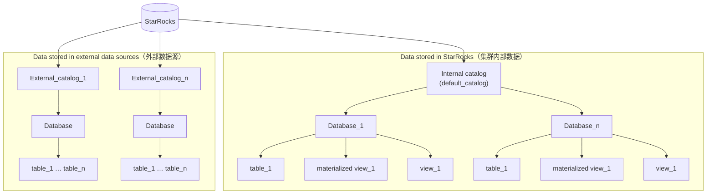

入门篇里我们已经能把 StarRocks 跑起来、建一张最简单的表、导数据并查询。但那张表没有指定表类型、分区、分桶，全用的默认值。从这一篇开始进入「表设计」：先建立整体认识，搞清楚 StarRocks 里的数据是怎么组织的、一张表由哪些设计决策组成；表类型、数据分布、数据压缩、索引、行列混存，分别在后面五篇深入展开。

> 本文内容整理自 StarRocks 官方文档：[Catalogs、databases 和 tables](https://docs.starrocks.io/zh/docs/table_design/)、[表概览](https://docs.starrocks.io/zh/docs/table_design/StarRocks_table_design/)、[数据压缩](https://docs.starrocks.io/zh/docs/table_design/data_compression/)。版本敏感的内容（语法、参数、特性起始版本）请以你实际部署版本的官方文档为准。本文验证环境为 StarRocks 4.1.x。

## 1. StarRocks数据存储

StarRocks 采用 **Catalog → Database → Table** 三层对象层级来组织数据。

* **Catalog** 目录：Catalog 分为 Internal Catalog 和 External Catalog。

  * **Internal Catalog** 内部数据目录：用于管理导入到StarRocks中的数据以及内部的物化视图等。每个集群都有且只有一个名为`default_catalog`的Internal Catalog，包含一个或多个数据库。StarRocks作为数据仓库存储数据，能够显著提高查询性能，尤其应对大规模数据的复杂查询分析。
  * **External Catalog** 外部数据目录：用于连接数据湖中的数据。将StarRocks作为查询引擎，直接查询数据湖上的数据，无需导入数据到StarRocks。

* **database** 数据库：数据库是包含表、视图、物化视图等对象的集合，用于存储、管理和操作数据。

* 表层级：包括表、物化视图、视图等对象。

  * **table** 表：分为内部表和外部表。

    * **内部表**：归属于Internal catalog的数据库，数据保存在StarRocks中。内部表由行和列构成，每行数据是一条记录。

      > 此处内部表的行和列为逻辑概念，在 StarRocks 中数据实际是按列存储的。物理上，一列数据会经过分块编码、压缩等操作，然后持久化存储。

      在 StarRocks 中，根据约束的类型将内部表分四种，分别是主键表、明细表、聚合表和更新表，适用于存储和查询多种业务场景中的数据，比如原始日志、实时数据、以及汇总数据。

      内部表采用分区+分桶的两级数据分布策略，实现数据均匀分布。并且分桶以多副本形式均匀分布至 BE 节点，保证数据高可用。

    * **外部表**：外部表是 External catalog 中的表，实际数据存在外部数据源中，StarRocks 只保存表对应的元数据，您可以通过外部表查询外部数据。

  * **materialized view** 物化视图：物化视图是特殊的物理表，能够存储基于基表的预计算结果。当您对基表执行复杂查询时，StarRocks 可以自动复用物化视图中的预计算结果，实现查询透明加速、湖仓加速和数据建模等业务需求。物化视图分为同步物化视图和异步物化视图。其中异步物化视图能力更加强大，能够存储基于多个基表（内部表和外部表）的预计算结果，并且支持丰富的聚合算子。

  * **view** 视图：视图（也叫逻辑视图）是虚拟表，不实际存储数据，其中所展示的数据来自于基表生成的查询结果。每次在查询中引用某个视图时，都会运行定义该视图的查询。



## 2. 表结构

**表** 是StarRocks中的数据存储单元。

> 理解表结构以及如何设计合理的表结构，有利于优化数据组织，提高查询效率。相比于传统的数据库，StarRocks会以列的方式存储JSON、ARRAY等复杂的半结构化数据，保证高效查询。

和其他关系型数据库一样，StarRocks 的表在逻辑上由**行（Row）**和**列（Column）**构成：

* **行**：每一行代表一条记录，包含一组相关联的数据。
* **列**：每一列代表一个特定属性，所有行的列数相同，同一列的数据类型相同。例如一张员工表可能包含姓名、工号、部门、薪水等列。

建表非常简单，只需在 `CREATE TABLE` 中定义列和列的数据类型即可：

```sql
CREATE DATABASE example_db;
USE example_db;

CREATE TABLE user_access (
    uid         int,
    name        varchar(64),
    age         int,
    phone       varchar(16),
    last_access datetime,
    credits     double
)
ORDER BY (uid, name);
```

上面创建了一张**明细表**（未声明表类型时的默认类型），表中数据没有任何约束，相同的数据行可以重复存在；同时通过 `ORDER BY` 指定前两列 `uid`、`name` 为**排序列**，构成**排序键**。数据按排序键排序后存储，有助于查询时快速定位。

> **副本数提示**：如果你的测试集群只有一个 BE，建表时需要在 `PROPERTIES` 中把副本数设为 1，即 `PROPERTIES("replication_num" = "1")`。默认副本数为 3，也是生产集群推荐值。

建完表后，有两条命令帮你确认表结构和你以为的一致：

```sql
-- 查看列定义（字段、类型、是否可空、是否为 Key 列、默认值等）
DESCRIBE user_access;

-- 查看完整建表语句（含表类型、分布方式、排序键、PROPERTIES 等所有属性）
SHOW CREATE TABLE user_access\G
```

`SHOW CREATE TABLE` 会把你没显式写、但 StarRocks 自动补齐的默认属性都展示出来（比如压缩算法 `LZ4`、副本数、分布方式等），是核对表设计的利器。

## 3. 表设计全景：一条建表语句里的设计决策

上面的 `user_access` 只写了列和排序键，其余全靠默认值。一张认真设计过的表，`CREATE TABLE` 里的每个子句都对应一个设计决策：

```sql
CREATE TABLE orders (
    order_id  BIGINT NOT NULL,
    dt        DATE   NOT NULL,
    user_id   BIGINT,
    amount    DECIMAL(10, 2)
)
PRIMARY KEY (order_id, dt)            -- ① 表类型：相同 Key 的数据怎么处理
PARTITION BY date_trunc('day', dt)    -- ② 分区：数据先按天切开
DISTRIBUTED BY HASH (order_id)        -- ② 分桶：每个分区再切成多个 Tablet
ORDER BY (dt, user_id)                -- ④ 排序键：数据按什么顺序存储
PROPERTIES (
    "replication_num" = "1",          -- 副本数
    "compression"     = "ZSTD",       -- ③ 压缩算法
    "store_type"      = "column_with_row"  -- ⑤ 行列混存（可选）
);
```

这几个决策分别回答一个问题，也正好是表设计系列的分篇方式：

| 子句 | 回答的问题 | 影响 | 详见 |
|---|---|---|---|
| ① `DUPLICATE` / `AGGREGATE` / `UNIQUE` / `PRIMARY KEY` | 相同 Key 的多行数据是保留、聚合还是覆盖 | 数据语义、能否更新 | [基础篇002 · 表类型](StarRocks基础篇002_表类型.md) |
| ② `PARTITION BY` / `DISTRIBUTED BY` | 数据怎么切分、摆放到哪些节点 | 查询扫描量、并行度、数据倾斜、生命周期管理 | [基础篇003 · 数据分布](StarRocks基础篇003_数据分布.md) |
| ③ `"compression"` | 数据以什么算法压缩 | 存储空间、I/O 与 CPU 开销 | [基础篇004 · 数据压缩](StarRocks基础篇004_数据压缩.md) |
| ④ `ORDER BY`、索引 | 查询怎么快速定位到数据 | 过滤效率 | [基础篇005 · 索引](StarRocks基础篇005_索引.md) |
| ⑤ `"store_type"` | 是否同时按行存储 | 主键点查性能 | [基础篇006 · 行列混存](StarRocks基础篇006_行列混存.md) |

决策的先后顺序也有讲究：先选表类型（定数据语义），再定分区分桶（定物理布局）和压缩（定存储方式），最后设计排序键、索引和行列混存（定查询加速）。后一步依赖前一步，比如主键表要求主键必须包含分区列和分桶列，排序键的设计要结合表类型的 Key 来考虑。

## 4. 数据类型

除了基本的数据类型，如数值、日期和字符串，StarRocks 还支持复杂的半结构化数据类型，包括 **ARRAY、JSON、MAP、STRUCT**。和传统数据库不同，这些半结构化数据同样按列存储，查询效率有保障。

建表选类型时要注意，**不同的列能用的类型不一样**：

* **Key 列**（以及排序键）只支持数值、字符串、日期时间这类基础类型；BITMAP、HLL 等类型不能做排序键。
* **Value 列**支持的类型更多，但 BITMAP、HLL、半结构化类型在不同表类型中的支持程度不同。

具体的对照表放在 [基础篇002 · 表类型](StarRocks基础篇002_表类型.md) 的对比章节。全部数据类型的定义和取值范围，请查阅官方[数据类型](https://docs.starrocks.io/zh/docs/sql-reference/data-types/)文档。

## 5. 约束

约束用于确保数据的完整性、一致性和准确性。StarRocks 的约束跟表类型绑定：

| 表类型 | Key 列 | 约束 |
|---|---|---|
| 主键表 | `PRIMARY KEY` | 唯一、非空 |
| 聚合表 | `AGGREGATE KEY` | 唯一 |
| 更新表 | `UNIQUE KEY` | 唯一 |
| 明细表 | `DUPLICATE KEY` | 无 |

> **这里的"唯一"和 MySQL 不同**：MySQL 写入重复主键会直接报错；StarRocks 不会拒绝重复 Key 的数据，而是按表类型把相同 Key 的多行**合并成一行**（聚合或覆盖），从而保证表里的 Key 唯一。合并规则详见 [基础篇002 · 表类型](StarRocks基础篇002_表类型.md)。

## 6. 数据压缩

StarRocks 会对表和索引数据进行压缩，以节省存储空间、减少 I/O，代价是额外的 CPU 开销。支持 LZ4（默认）、Zstandard、zlib、Snappy 四种算法，只能在建表时通过 `"compression"` 属性设置。算法怎么选、怎么设置，详见 [基础篇004 · 数据压缩](StarRocks基础篇004_数据压缩.md)。

## 7. 临时表

### 7.1. 为什么需要临时表

处理数据时，经常需要把中间计算结果保存下来以便后续复用（比如 ETL 的中间结果）。以前只有两种办法，都不理想：

* **CTE（`WITH` 子句）**：只是逻辑概念，不会物理存储结果，也无法在不同查询间共享。
* **自己建一张普通表**：能存能共享，但要自己维护表的生命周期，用完还得记得删。

StarRocks 在 **v3.3.1** 引入了临时表来解决这个问题：

* 临时表的生命周期与 **Session 绑定**，由 StarRocks 管理，Session 结束时自动清除；
* 临时表**仅在当前 Session 内可见**，不同 Session 可以创建同名临时表。

### 7.2. 使用临时表

在以下语句中加上 `TEMPORARY` 关键字，即可创建或删除临时表：

```sql
-- CREATE TABLE
CREATE TEMPORARY TABLE tmp_orders (
    order_id BIGINT,
    amount   DECIMAL(10, 2)
)
DUPLICATE KEY(order_id)
DISTRIBUTED BY HASH(order_id);

-- CREATE TABLE AS SELECT
CREATE TEMPORARY TABLE tmp_big_orders AS
SELECT * FROM orders WHERE amount > 1000;

-- CREATE TABLE LIKE
CREATE TEMPORARY TABLE tmp_orders_copy LIKE orders;

-- DROP TABLE
DROP TEMPORARY TABLE tmp_orders;
```

临时表的命名规则和普通表不同：

* 和其他内部表一样，临时表必须建在 Default Catalog 下的某个 Database 中；
* 因为临时表基于 Session，**命名不受唯一性约束**：不同 Session 可以建同名临时表，也可以建和普通表同名的临时表；
* 同一 Database 里同时有同名的临时表和普通表时，**临时表优先**：在该 Session 内，对这个表名的所有查询和操作都只作用于临时表。

## 7.3. 使用限制

临时表的用法和普通内部表基本相同，但有以下限制：

* 必须创建在 Default Catalog 中；
* 不支持设置 Colocate Group，显式指定的 `colocate_with` 属性会被忽略；
* 建表时 `ENGINE` 必须为 `olap`；
* 不支持 `ALTER TABLE`；
* 不支持基于临时表创建视图和物化视图；
* 不支持用 `EXPORT` 导出；
* 不支持通过异步任务（`SUBMIT TASK`）创建临时表，或向其导入、导出数据。

## 8. 更多特性

除了上面这些常用特性，StarRocks 还提供一些让表结构更健壮的能力，按需了解即可：

| 特性 | 作用 |
|---|---|
| BITMAP / HLL 列 | 加速去重计数（精确去重 / 近似去重） |
| 生成列、自增列 | 加速部分查询；自增列还可以用来生成主键 |
| 数据自动降冷 | 配置冷热数据策略，降低运维成本 |
| Colocate Join | 让参与 JOIN 的表数据分布对齐，加速多表 JOIN |

## 9. 小结

* StarRocks 用 **Catalog → Database → Table** 组织数据：Internal Catalog 管理内部数据，External Catalog 连接数据湖。
* 一条 `CREATE TABLE` 里藏着几个设计决策：**表类型、数据分布、压缩、排序键与索引、行列混存**。先定数据语义，再定物理布局和存储方式，最后定查询加速。
* 数据类型上，Key 列只支持基础类型，Value 列的类型支持随表类型而不同。
* 约束跟表类型绑定，StarRocks 的"唯一"靠合并实现，不是写入时报错。
* 压缩算法默认 LZ4，只能建表时设置；临时表（v3.3.1+）跟 Session 同生共死，适合存放中间结果。

下一篇进入第一个、也是最核心的设计决策：[基础篇002 · 表类型](StarRocks基础篇002_表类型.md)——四种表类型分别怎么处理相同 Key 的数据，以及该怎么选。
