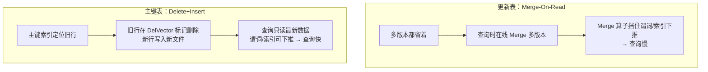
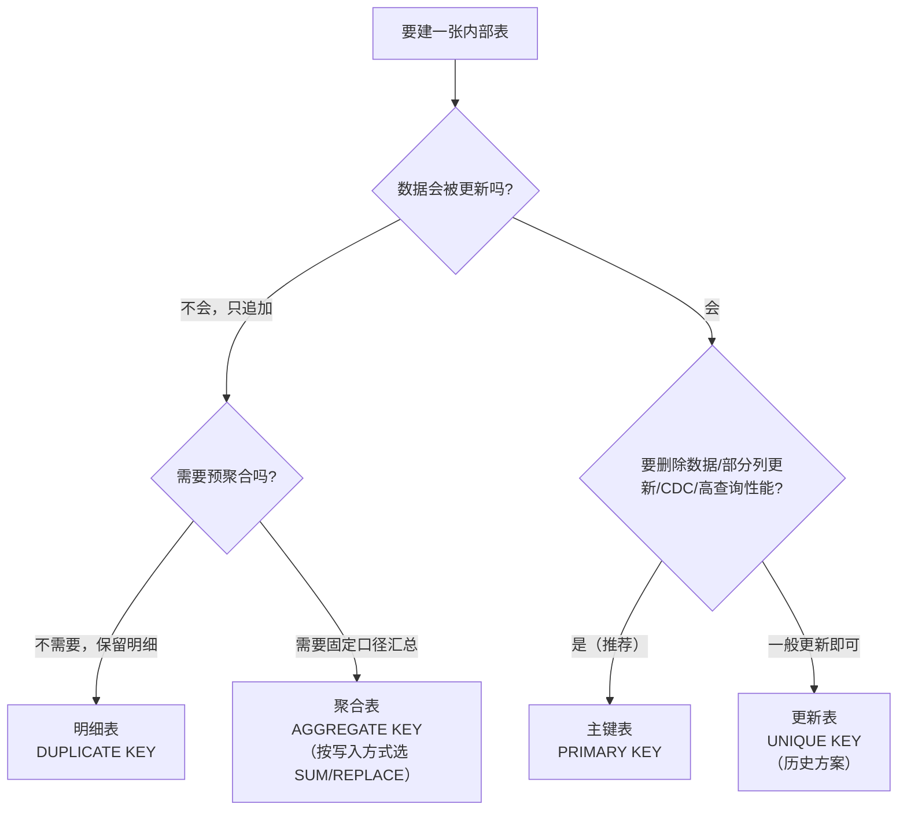

[基础篇001](StarRocks基础篇001_表设计概览.md) 提到，一条建表语句里的第一个设计决策是表类型。它决定了**一张表如何对待"Key 相同的多行数据"**：是全部保留、聚合成一行，还是用新的覆盖旧的。选错表类型会直接改变数据语义，甚至让明细数据永久丢失，而且**建表后不能修改**。这一篇把四种表类型逐个讲透，再横向对比，最后给出选型方法和一个可复现的实验。

> 本文内容整理自 StarRocks 官方文档：[表类型概览](https://docs.starrocks.io/zh/docs/table_design/table_types/)、[明细表](https://docs.starrocks.io/zh/docs/table_design/table_types/duplicate_key_table/)、[聚合表](https://docs.starrocks.io/zh/docs/table_design/table_types/aggregate_table/)、[更新表](https://docs.starrocks.io/zh/docs/table_design/table_types/unique_key_table/)、[主键表](https://docs.starrocks.io/zh/docs/table_design/table_types/primary_key_table/)、[各类表的能力对比](https://docs.starrocks.io/zh/docs/table_design/table_types/table_capabilities/)。版本敏感的内容（语法、参数、特性起始版本）请以你实际部署版本的官方文档为准。本文验证环境为 StarRocks 4.1.x。

# 1. 表类型概述

建表时，你需要指定表类型（Table Type），这样数据导入到表时，StarRocks会按照排序键对数据进行排序、处理、存储。

> **排序键：**
>
> 数据导入到使用某个类型的表，会按照建表时指定的一列或多列排序后存储，这部分用于排序的列就称为排序键。排序键通常为查询时过滤条件频繁使用的一个或多个列，用以加速查询。
>
> 自 3.0 版本起，主键表支持使用 `ORDER BY` 定义排序键，自 3.3 版本起，明细表、聚合表和更新表支持使用 `ORDER BY` 定义排序键。
>
> 排序键如何加速查询（前缀索引原理）、怎么设计，详见 [基础篇004 · 排序键、索引与行列混存](StarRocks基础篇004_排序键、索引与行列混存.md)。本文只讲各表类型的 Key 和排序键是什么关系。

StarRocks 支持四种表类型，分别是明细表 (Duplicate Key Table)、聚合表 (Aggregate Table)、更新表 (Unique Key Table) 和主键表 (Primary Key Table)。它们能支持日志分析、数据汇总分析、实时分析等多种场景，一句话概括各自定位：

- **明细表**：简单易用，数据无约束、可重复，适合存储不需要约束和预聚合的原始数据（如日志）。
- **聚合表**：存储预聚合后的数据，降低聚合查询扫描和计算的数据量，提高聚合效率。
- **更新表**：适用于实时更新场景，目前已逐渐被主键表取代。
- **主键表**：能力最强，具有唯一非空约束，在支撑实时更新、部分列更新的同时保证查询性能，适用于实时查询。

> **先破一个误区：Key ≠ MySQL 的约束**
>
> 从 MySQL 过来的人看到 `PRIMARY KEY`、`UNIQUE KEY`，第一反应是"主键约束、唯一约束"。但在 StarRocks 里，这几个 Key 的含义不一样：
>
> **MySQL 的 Key 回答"能不能写进来"**（写入重复主键直接报错拒绝）；**StarRocks 的 Key 回答"写进来的相同 Key 行怎么合并"**（不报错，按表类型决定去重/聚合/覆盖）。

**注意事项：**

* 建表后，**表类型不支持修改**。如果需要修改表类型，要重新建表。
* 排序键本身的规则（排序次序、支持的数据类型、前缀索引 36 字节限制等）见 [基础篇004](StarRocks基础篇004_排序键、索引与行列混存.md) 第 2 章。

# 2. 明细表（Duplicate Key Table）

明细表是**默认表类型**，建表时不指定任何 Key 就是明细表。表中数据没有任何约束，相同的行可以重复存在。

**适用场景**：

* 分析原始数据，例如原始日志、原始操作记录等；
* 查询方式灵活，不需要局限于预聚合的分析方式；
* 导入日志数据或时序数据，主要特点是旧数据不会更新，只会追加新数据。

**原理——只追加，不合并**：明细表是四种表类型里最"朴素"的——它不对相同 Key 做任何去重、聚合或覆盖，导入什么就存什么。导入两行完全相同的数据，表里就是实实在在的两行，而不是一行。因此它能完整召回所有历史明细数据，但也**不支持修改历史数据**，只能追加新数据。

**建表示例**（分析某时间范围某类事件，把常用过滤列 `event_time`、`event_type` 作为排序键）：

```sql
CREATE TABLE detail (
    event_time  DATETIME NOT NULL COMMENT "datetime of event",
    event_type  INT      NOT NULL COMMENT "type of event",
    user_id     INT      COMMENT "id of user",
    device_code INT      COMMENT "device code",
    channel     INT      COMMENT ""
)
ORDER BY (event_time, event_type);
```

这里把事件时间 `event_time` 和事件类型 `event_type` 定义为排序键——因为分析时经常按"某时间范围、某类事件"过滤，查询条件命中排序键前缀时能快速过滤、减少扫描。

**使用说明**：

* **排序键（v3.3.0 起支持 ORDER BY）**：可用 `ORDER BY` 指定任意列组合作为排序键。注意三条规则：
    * 如果同时写了 `ORDER BY` 和 `DUPLICATE KEY`，则 `DUPLICATE KEY` **无效**，以 `ORDER BY` 为准；
    * 如果两者都不写，默认取**表的前三列**作为排序键；
    * v3.3.0 之前只能用 `DUPLICATE KEY` 来指定排序键。
* **分桶**：v3.1.0 起明细表支持**随机分桶**，并且是默认分桶方式，建表时可以不写 `DISTRIBUTED BY HASH`；v3.1.0 之前必须指定哈希分桶键，否则建表失败。随机分桶目前**只有明细表支持**。
* **分桶数量**：v2.5.7 起，建表和新增分区时可以不设置分桶数量（`BUCKETS`），由 StarRocks 自动设置。
* **索引**：建表时支持为所有列创建 Bitmap 索引、Bloom Filter 索引。

# 3. 聚合表（Aggregate Table）

聚合表为**预聚合**而生：建表时定义聚合键，并给每个**值列**指定聚合函数（SUM/MAX/MIN/REPLACE 等）。相同聚合键的多行，值列按函数自动合并成一行。它能在查询前就把数据按维度汇总，大幅降低聚合查询需要扫描和计算的数据量。

**适用场景**：数据统计和分析类场景，例如：

* 分析网站或 App 的流量、用户停留时间和总访问次数；
* 分析广告的总点击量、总浏览量和消费统计；
* 分析电商年度交易数据，找出各季度、各月份的地域畅销商品。

这类场景的共同特点是：大多数查询是 SUM、MAX、MIN 这类聚合查询；不需要检索原始明细数据；历史数据不常更新，只追加新数据。

**原理——数据会被聚合三次**：


* **导入阶段**：数据按批次导入，每批形成一个版本，同一版本内相同聚合键的数据先聚合；
* **后台 Compaction 阶段**：多个版本的文件定期合并成一个大文件，合并时再聚合相同聚合键的数据；
* **查询阶段**：返回结果前，把所有版本中相同聚合键的数据聚合。

比如导入 `(2020-05-01, CHN, 1)`、`(2020-05-01, CHN, 2)`、`(2020-05-01, USA, 3)`、`(2020-05-01, USA, 4)` 四条，`pv` 列声明为 SUM，导入时就聚合成 `CHN→3`、`USA→7` 两条。

**建表示例**（统计各城市访问各网页的次数，`pv` 列用 SUM 聚合）：

```sql
CREATE TABLE aggregate_tbl (
    site_id   LARGEINT    NOT NULL COMMENT "id of site",
    date      DATE        NOT NULL COMMENT "time of event",
    city_code VARCHAR(20)          COMMENT "city_code of user",
    pv        BIGINT SUM  DEFAULT "0" COMMENT "total page views"
)
AGGREGATE KEY(site_id, date, city_code)
DISTRIBUTED BY HASH(site_id);
```

**使用说明**：

* **聚合函数在建表时就焊死，且和"数据怎么写进来"强绑定**——这是聚合表最容易踩的坑：

    | 写入方式 | 该用的函数 | 效果 |
    |---|---|---|
    | 每次事件写一行 `pv=1` | `SUM` | 自动累加成总次数 |
    | 外部已算好"累计 N"，每次写最新值 | `REPLACE` | 用最新值覆盖 |

    本想"每次 +1"却用了 `REPLACE`，结果永远是 1；本想"写最新值"却用了 `SUM`，数字会被重复累加到爆。
* **聚合键规则**：聚合键必须定义在其他列之前。如果显式用 `AGGREGATE KEY` 定义，它**必须包含除值列之外的所有列**，否则建表失败；若不显式定义，则默认把除值列外的所有列都当作聚合键。聚合键具有唯一性约束。
* **值列与聚合函数**：在列名后指定聚合函数即把该列定义为值列。常用的聚合函数有 SUM、MAX、MIN、REPLACE、REPLACE_IF_NOT_NULL、HLL_UNION、PERCENTILE_UNION、BITMAP_UNION，完整列表以当前版本 `CREATE TABLE` 文档为准。
* **排序键在聚合前过滤，值列在聚合后过滤**：v3.3.0 起聚合表的排序键与聚合键解耦，可用 `ORDER BY` 单独指定（两者的列需相同、顺序可不同）。这个解耦很有价值：查询时**排序键列在多版本聚合之前就能过滤数据，而值列要等聚合之后才能过滤**。所以应把经常用作过滤条件的列设为排序键，让数据在聚合前就被裁掉。
* **分桶**：建表时必须用 `DISTRIBUTED BY HASH` 指定分桶键；v2.5.7 起可以不设置分桶数量，由 StarRocks 自动设置。
* **索引**：建表时只能为 Key 列创建 Bitmap 索引、Bloom Filter 索引。
* **导入时须给出全部列**：例如更新上面的 `aggregate_tbl` 时，必须同时给出 `site_id`、`date`、`city_code`、`pv` 四列。例外是：有默认值的列可以不导入；把值列的聚合函数设为 `REPLACE_IF_NOT_NULL` 可以实现部分列更新（导入值为 NULL 的列保持原值）。

## 3.1. 深入：通用聚合函数状态（v3.4.0 起，Beta）

早期聚合表的值列只能用 SUM、MAX、MIN、REPLACE、HLL_UNION、PERCENTILE_UNION、BITMAP_UNION 等有限的内置聚合函数。为了让理论上所有内置聚合函数都能用于聚合表，v3.4.0 引入了**通用聚合状态**：通过"函数名 + 入参类型"唯一标识一个聚合函数，把它的**中间状态**存进值列，列类型自动推断为该函数的中间状态类型。

**定义方式**：`col_name agg_func_name(parameter1_type, [parameter2_type], ...)`

```sql
CREATE TABLE test_create_agg_table (
    dt             VARCHAR(10),
    hll_sketch_agg ds_hll_count_distinct(varchar),  -- 存储该函数的中间状态
    avg_agg        avg(bigint),
    array_agg_agg  array_agg(int),
    min_by_agg     min_by(varchar, bigint)
)
AGGREGATE KEY(dt)
PARTITION BY (dt)
DISTRIBUTED BY HASH(dt) BUCKETS 4;
```

**三个组合函数**负责操作这些中间状态：

| 组合函数 | 函数类别 | 作用 | 返回值 |
|---|---|---|---|
| `{函数名}_state` | 标量函数 | 把输入参数转换成中间状态，用于写入 | 中间状态类型 |
| `{函数名}_union` | 聚合函数 | 把多个中间状态合并成一个状态 | 中间状态类型 |
| `{函数名}_merge` | 聚合函数 | 合并多个中间状态，并计算出最终结果 | 最终结果类型 |

典型用法是写入时用 `_state` 把明细转成中间状态，查询时用 `_merge` 拿到最终结果：

```sql
-- 写入：把明细表 t1 的数据转成中间状态，灌入聚合表
INSERT INTO test_create_agg_table
SELECT dt,
       ds_hll_count_distinct_state(id),
       avg_state(id),
       array_agg_state(id),
       min_by_state(province, id)
FROM t1;

-- 查询：合并中间状态，得到最终聚合结果
SELECT dt,
       ds_hll_count_distinct_merge(hll_sketch_agg),
       avg_merge(avg_agg),
       array_agg_merge(array_agg_agg),
       min_by_merge(min_by_agg)
FROM test_create_agg_table
GROUP BY dt;
```

通用聚合状态也可以用在同步和异步物化视图里：物化视图中存 `xxx_union(xxx_state(col))`，之后直接写 `avg(id)` 这类普通聚合查询，就能被物化视图透明加速。

**使用限制**：

* 仅支持至少有一个参数的 StarRocks 内置函数，不支持 Java 和 Python UDAF；
* 聚合状态列的类型固定为 Nullable（计数函数除外），且不可修改；
* 定义多参数函数时只需写参数类型，不需要参数值；
* 不支持 ORDER BY、DISTINCT 这类复杂参数；
* GROUP_CONCAT、WINDOW_FUNNEL、APPROX_TOP_K 等函数的支持仍在开发中。

# 4. 更新表（Unique Key Table）

更新表为实时、频繁更新而设计。建表时定义唯一键，多条数据唯一键相同时，value 列会进行 REPLACE，查询时返回唯一键相同的一组数据中的最新数据。**该类型目前已逐渐被主键表取代，新表设计建议优先主键表。**

**适用场景**：实时且频繁更新的业务，例如电商订单分析——订单状态经常变化，每天更新量可达上亿。

**原理——多版本 + 读时合并（Merge-On-Read）**：更新表可以视为聚合表的特例，即 value 列的聚合函数固定为 REPLACE。数据分批导入，每批分配一个版本号；同一唯一键可能存在多个版本，查询时返回版本号最大的那条。

例如下表中 `ID` 是唯一键，`_version` 是 StarRocks 内部的版本号：ID=1 的数据导入了两批（版本 1、2），ID=2 的数据导入了三批（版本 3、4、5）。

| ID | value | _version |
|---|---|---|
| 1 | 100 | 1 |
| 1 | 101 | 2 |
| 2 | 100 | 3 |
| 2 | 101 | 4 |
| 2 | 102 | 5 |

查 ID=1 返回 `101`（版本 2），查 ID=2 返回 `102`（版本 5）。

**建表示例**（电商订单经常按日期统计订单状态，所以把常用过滤列 `create_time`、`order_id` 作唯一键，订单状态和总价作 value 列）：

```sql
CREATE TABLE orders (
    create_time DATE   NOT NULL COMMENT "create time of an order",
    order_id    BIGINT NOT NULL COMMENT "id of an order",
    order_state INT    COMMENT "state of an order",
    total_price BIGINT COMMENT "price of an order"
)
UNIQUE KEY(create_time, order_id)
DISTRIBUTED BY HASH(order_id);
```

**使用说明**：

* **唯一键规则**：唯一键必须用 `UNIQUE KEY` 显式定义，且必须定义在其他列之前，满足唯一性约束。
* **排序键解耦（v3.3.0 起）**：可用 `ORDER BY` 单独指定排序键（排序键与唯一键的列需相同、顺序可不同）。和聚合表同理，排序键能在多版本聚合**之前**过滤数据，value 列要等聚合之后才能过滤，所以应把频繁用作过滤条件的列设为排序键。
* **分桶**：建表时必须用 `DISTRIBUTED BY HASH` 指定分桶键；v2.5.7 起可以不设置分桶数量。
* **索引**：建表时只能为 Key 列创建 Bitmap 索引、Bloom Filter 索引。
* **导入时须给出全部列**：例如上例的 `create_time`、`order_id`、`order_state`、`total_price` 四列都要指明；有默认值的列可以不导入。
* **导入频率不宜太高**：查询需要在线合并多版本，版本过多会拖慢查询。业务要求分钟级就每分钟导一次，不必追求秒级。

# 5. 主键表（Primary Key Table）

主键表使用 StarRocks 全新设计的存储引擎，**既支撑实时数据更新，又保证高效的复杂查询性能**，让实时分析不再受限于 T+1 延迟。主键具有唯一且非空约束，新数据主键与老数据冲突时直接替换老数据。

主键表的能力随版本持续增强，几个关键节点：

* v3.0 起解耦排序键与主键，支持单独指定排序键；
* v3.1 起存算分离模式支持创建主键表；
* v3.1.4 起支持持久化主键索引到本地磁盘；
* v3.3.2 起支持持久化主键索引到对象存储。

**适用场景**：

* **实时对接事务型数据**：TP 库除了插入，还有大量更新和删除。通过 Flink-CDC 等工具直接对接 Binlog，把增删改实时同步到主键表，能简化同步流程，查询性能相比 Merge-On-Read 的更新表提升 3～10 倍。
* **部分列更新实现多流 JOIN**：用户画像等场景常用大宽表，上游数据来自多个业务（购物、快递、银行等）或系统（计算标签的机器学习系统）。各业务只更新自己负责的列即可，同时继续享有实时增删改和高效查询。

**原理——Delete+Insert + 主键索引**：

更新表和聚合表整体采用 Merge-On-Read 策略：写入简单高效，但读取时要在线合并多个版本的数据文件，而且 Merge 算子的存在让谓词和索引无法下推到底层数据，严重影响查询性能。主键表为了兼顾实时更新和查询性能，元数据组织、读写方式完全不同：



主键表借助**主键索引** + **DelVector**（删除标记）实现：

* **写入**：由内部 Loadjob 完成，含一批 Insert/Update/Delete 变更。导入时把对应 Tablet 的主键索引加载进内存。**Delete** 通过主键索引找到旧行所在的数据文件和行号，在 DelVector 中标记删除；**Update** 则是把旧行在 DelVector 标记删除、同时把最新数据写入新文件（相当于 Update = Delete + Insert），并更新主键索引里该行的新位置。
* **读取**：由于历史重复数据写入时已被标记删除，同一主键只需读最新一条，无需在线 Merge；扫描时谓词和各类索引可下推到 Scan 层，减少扫描开销。

## 5.1. 深入：Loadjob 的两阶段与 Tablet 结构

StarRocks 底层是列式存储。一个 Tablet 往往包含多个 Rowset，每个 Rowset 的数据分段存储在 Segment 文件中；Segment 用列存格式组织数据（类似 Parquet），并且**不可修改**。

数据写入时，BE 执行 Loadjob。一个 Loadjob 包含一批数据变更，可视为一个具有 ACID 属性的事务，分 write 和 commit 两阶段：

* **write 阶段**：按分区分桶信息把数据分发到对应 Tablet，每个 Tablet 收到数据后按列存格式存储，形成一个新的 Rowset。
* **commit 阶段**：所有数据都写入成功后，FE 向所有参与的 Tablet 发起 commit，每个 commit 携带一个 version 版本号，代表 Tablet 数据的最新版本。commit 主要包括：查找并更新主键索引，记录所有变更的数据并标记为删除；根据标记为删除的数据生成 DelVector；生成新版本的元数据。

读取时，根据最新的 Tablet 版本在元数据中找到要读的 Rowset，读取 Segment 时查找最新版本的 DelVector，从而跳过同主键的旧数据，只读最新数据；过滤算子下推到 Scan 层，可直接利用各类索引过滤。

一个 Tablet 是实际物理存储单元（以副本分布在各 BE），主要含以下组件：

| 组件 | 作用 |
|---|---|
| **元数据** | 保存 Tablet 的版本历史及每个版本的信息（含哪些 Rowset）。每次 Loadjob 或 Compaction 的 commit 阶段都生成一个新版本 |
| **主键索引** | HashMap 结构，Key 是编码后的主键值，Value 记录数据行位置（rowset_id、segment_id、rowid）。通常只在写入时用到 |
| **DelVector** | 每个 Rowset 中每个 Segment 文件对应的删除标记 |
| **Rowset** | 逻辑概念，存储 Tablet 中一次数据变更的数据集合 |
| **Segment** | Rowset 的数据实际分段存储在一个或多个 Segment（列存文件）中，按列包含列值和列相关的索引信息 |

## 5.2. 建表与使用说明

只需在 `CREATE TABLE` 中用 `PRIMARY KEY` 定义主键，即可创建主键表。主键表只支持哈希分桶，所以还要用 `DISTRIBUTED BY HASH` 定义分桶键：

```sql
CREATE TABLE orders1 (
    order_id bigint NOT NULL,
    dt       date   NOT NULL,
    user_id  INT    NOT NULL,
    good_id  INT    NOT NULL,
    cnt      int    NOT NULL,
    revenue  int    NOT NULL
)
PRIMARY KEY (order_id)
DISTRIBUTED BY HASH (order_id);
```

实际业务中通常还会用到分区和排序键。假设 `order_id` 能唯一标识一行，并且经常按"订单日期 + 商户"查询销售情况，采用 `dt` 分区、`merchant_id` 分桶：

```sql
CREATE TABLE orders2 (
    order_id    bigint  NOT NULL,
    dt          date    NOT NULL,
    merchant_id int     NOT NULL,
    user_id     int     NOT NULL,
    good_id     int     NOT NULL,
    good_name   string  NOT NULL,
    price       int     NOT NULL,
    cnt         int     NOT NULL,
    revenue     int     NOT NULL,
    state       tinyint NOT NULL
)
PRIMARY KEY (order_id, dt, merchant_id)   -- 主键须包含分区列 dt 和分桶列 merchant_id
PARTITION BY date_trunc('day', dt)
DISTRIBUTED BY HASH (merchant_id)
ORDER BY (dt, merchant_id)                -- 排序键与主键解耦，按常用过滤列排序
PROPERTIES ("enable_persistent_index" = "true");
```

**主键**的规则：

* 主键列必须定义在其他列之前；
* 主键必须包含分区列和分桶列；
* 主键列支持数值（整型、布尔）、日期、字符串类型，**不支持 DECIMAL**；
* 默认单条主键值编码后最大长度 128 字节；
* 建表后不支持修改主键定义；
* 主键列的值不能更新，以免破坏数据一致性。

**主键索引**保存主键值和数据行位置的映射，通常只在导入数据时把相关 Tablet 的主键索引加载进内存。可以综合查询和更新性能、内存和磁盘情况，选择是否持久化：

| 模式 | 配置 | 特点 |
|---|---|---|
| 持久化（默认） | `enable_persistent_index = true` | 导入时少部分索引在内存、大部分在磁盘，避免占用过大内存；通常性能接近全内存索引。SSD 建议开启；HDD 且导入频率不高也可开启 |
| 全内存 | `enable_persistent_index = false` | 主键索引全部放内存，内存开销大 |

存算分离集群自 v3.1.4 起支持本地磁盘持久化索引，v3.3.2 起可通过表属性 `persistent_index_type = CLOUD_NATIVE` 持久化到对象存储。

**排序键**（v3.0 起与主键解耦）：由 `ORDER BY` 定义，可以是任意满足类型要求的列组合，用于按序存储并构建前缀索引。

* 指定了排序键，就按排序键构建前缀索引；没指定，就按主键构建；
* 建表后可以用 `ALTER TABLE ... ORDER BY ...` 修改排序键，但不支持删除排序键，也不支持修改排序列的数据类型。

**数据变更**：主键表是唯一支持在导入时删除数据、以及用 `UPDATE` 语句更新数据的表类型，还支持部分列更新，具体能力见第 6.3 节。另外，自增列可以用来生成主键。

# 6. 四种表类型对比

前面逐个讲了四种表类型，这一章从四个角度横向对比，方便选型时速查。

## 6.1. Key 列与排序键

| 维度 | 明细表 | 聚合表 | 更新表 | 主键表 |
|---|---|---|---|---|
| **Key 列** | `DUPLICATE KEY` | `AGGREGATE KEY` | `UNIQUE KEY` | `PRIMARY KEY` |
| **约束** | 无 | 唯一 | 唯一 | 唯一、非空 |
| **相同 Key 的数据** | 新旧数据都保留 | 按值列聚合函数聚合新旧数据 | 新数据替代旧数据 | 新数据替代旧数据 |
| **底层机制** | 直接追加 | 多阶段聚合（Merge-On-Read） | 多版本（Merge-On-Read） | Delete+Insert |
| **查询性能** | 高 | 高（已预聚合） | 较低（在线合并） | 高（谓词和索引可下推） |
| **Key 与排序键** | v3.3.0 起支持 `ORDER BY`；与 `DUPLICATE KEY` 同时使用时后者无效 | v3.3.0 起解耦，两者列相同、顺序可不同 | v3.3.0 起解耦，两者列相同、顺序可不同 | v3.0.0 起解耦，排序键可为任意列组合 |
| **分区/分桶列** | 无要求 | 必须在聚合键中 | 必须在唯一键中 | 必须在主键中 |
| **典型场景** | 日志、明细 | 固定口径汇总 | 实时更新（历史方案） | 实时更新、CDC、部分列更新 |

**UNIQUE 和 PRIMARY 的关键区别**：两者对相同 Key 的处理**结果一样**（后写覆盖），光看查询输出分不出区别，差别在底层机制和性能——更新表靠 Merge-On-Read（查询慢、谓词索引无法下推），主键表靠 Delete+Insert（查询快、可下推、支持部分列更新）。所以选型不是看"要不要覆盖"，而是看"查询性能要求高不高、是不是实时 CDC"。

## 6.2. 列的数据类型

**Key 列**（以及排序键）支持数值（整型、布尔、DECIMAL）、字符串、日期时间。例外是**主键表的 Key 列不支持 DECIMAL**。

**Value 列**都支持数值、字符串、日期时间等基础类型，但对特殊类型的支持各不相同：

| Value 列类型 | 明细表 | 聚合表 | 更新表 | 主键表 |
|---|---|---|---|---|
| **BITMAP** | 不支持 | 支持，聚合函数须为 `bitmap_union`、`replace` 或 `replace_if_not_null` | 支持 | 支持 |
| **HLL** | 不支持 | 支持，聚合函数须为 `hll_union`、`replace` 或 `replace_if_not_null` | 支持 | 支持 |
| **PERCENTILE** | 不支持 | 支持，聚合函数须为 `percentile_union`、`replace` 或 `replace_if_not_null` | 支持 | 支持 |
| **JSON / ARRAY / MAP / STRUCT** | 支持 | 支持，聚合函数须为 `replace` 或 `replace_if_not_null` | 支持 | 支持 |

## 6.3. 数据变更

| 操作 | 明细表 | 聚合表 | 更新表 | 主键表 |
|---|---|---|---|---|
| **导入时 INSERT** | 支持 | 支持（同聚合键的行会聚合） | 支持（同唯一键的行会更新） | 支持，导入任务中配置 `__op=0`。内部把 INSERT 和 UPDATE 都当作 UPSERT |
| **导入时 UPDATE** | 不支持 | 支持（用 REPLACE 聚合函数实现） | 支持（本身就是 REPLACE） | 支持（同上，UPSERT） |
| **导入时 DELETE** | 不支持 | 不支持 | 不支持 | 支持，导入任务中配置 `__op=1` |
| **导入的列是否完整** | 默认须导入全部列，有默认值的列可不导 | 默认须导入全部列；有默认值的列可不导；值列用 `REPLACE_IF_NOT_NULL` 可实现部分列更新 | 默认须导入全部列，有默认值的列可不导 | 默认须导入全部列；开启部分列更新 `partial_update` 或列有默认值时可不导 |
| **DML INSERT** | 支持 | 支持 | 支持 | 支持 |
| **DML UPDATE** | 不支持 | 不支持 | 不支持 | 支持，Key 列和 Value 列都可作过滤条件 |
| **DML DELETE** | 支持，Key 列和 Value 列都可作过滤条件，但只支持简单条件（`=`、`<`、`>` 等） | 只支持 Key 列作过滤条件，且只支持简单条件 | 只支持 Key 列作过滤条件，且只支持简单条件 | 支持，Key 列和 Value 列都可作过滤条件 |

> 上表的"简单条件"指基于列本身的 `=`、`<`、`>` 等比较，不支持函数、子查询这类复杂条件。

## 6.4. 与其他功能的兼容性

| 功能 | 明细表 | 聚合表 | 更新表 | 主键表 |
|---|---|---|---|---|
| **基于 Key 列建 Bitmap / Bloom Filter 索引** | 支持 | 支持 | 支持 | 支持 |
| **基于 Value 列建 Bitmap / Bloom Filter 索引** | 支持 | 不支持 | 不支持 | 支持 |
| **表达式分区 / List 分区** | 支持 | 支持 | 支持 | 支持 |
| **随机分桶** | v3.1 起支持 | 不支持 | 不支持 | 不支持 |
| **异步物化视图** | 支持 | 支持 | 支持 | 支持 |
| **同步物化视图** | 支持 | 支持 | 支持 | 不支持 |
| **CTAS** | 支持 | 不支持 | 不支持 | 支持 |
| **备份与恢复** | 支持 | 支持 | 支持 | v2.5 起支持 |

# 7. 选型决策与动手验证

把四种类型收敛成一条判断链：



**动手验证**：用同一份数据灌进不同类型的表，亲眼看合并语义的差异（单机 Docker 即可，单 BE 记得加 `replication_num=1`）。

```sql
CREATE DATABASE IF NOT EXISTS model_lab;
USE model_lab;

-- 明细：全保留
CREATE TABLE t_dup (id BIGINT, amount INT)
DUPLICATE KEY(id) DISTRIBUTED BY HASH(id)
PROPERTIES("replication_num"="1");

-- 聚合 SUM：累加
CREATE TABLE t_agg_sum (id BIGINT, amount INT SUM)
AGGREGATE KEY(id) DISTRIBUTED BY HASH(id)
PROPERTIES("replication_num"="1");

-- 聚合 REPLACE：覆盖
CREATE TABLE t_agg_rep (id BIGINT, amount INT REPLACE)
AGGREGATE KEY(id) DISTRIBUTED BY HASH(id)
PROPERTIES("replication_num"="1");

-- 主键：覆盖
CREATE TABLE t_pk (id BIGINT NOT NULL, amount INT)
PRIMARY KEY(id) DISTRIBUTED BY HASH(id)
PROPERTIES("replication_num"="1");

-- 同一个 id=1 分两批先后写入 50、80（模拟两个导入批次）
INSERT INTO t_dup     VALUES (1, 50);
INSERT INTO t_dup     VALUES (1, 80);
INSERT INTO t_agg_sum VALUES (1, 50);
INSERT INTO t_agg_sum VALUES (1, 80);
INSERT INTO t_agg_rep VALUES (1, 50);
INSERT INTO t_agg_rep VALUES (1, 80);
INSERT INTO t_pk      VALUES (1, 50);
INSERT INTO t_pk      VALUES (1, 80);

SELECT 'dup'     AS t, id, amount FROM t_dup
UNION ALL SELECT 'agg_sum', id, amount FROM t_agg_sum
UNION ALL SELECT 'agg_rep', id, amount FROM t_agg_rep
UNION ALL SELECT 'pk',      id, amount FROM t_pk
ORDER BY t, amount;
```

> 这里故意用多条 `INSERT` 模拟"同一个 Key 分批到达"。生产环境不要逐行 `INSERT`，批量导入请用 Stream Load 等方式。

预期结果：

| 表 | id=1 的结果 | 原因 |
|---|---|---|
| 明细 t_dup | **两行** 50、80 | 全保留 |
| 聚合 t_agg_sum | 一行 **130** | 50+80 累加 |
| 聚合 t_agg_rep | 一行 **80** | 后写覆盖 |
| 主键 t_pk | 一行 **80** | 后写覆盖 |

两个最该记住的对比：`agg_sum=130 vs agg_rep=80`（同是聚合表，函数不同结果天差地别）；`agg_rep=80 vs pk=80`（结果相同，但聚合表靠 REPLACE 合并、主键表靠 Delete+Insert，机制与适用场景完全不同）。实验做完 `DROP DATABASE model_lab;` 清理即可。

# 8. 小结

* 四种表类型的本质区别是**如何处理 Key 相同的多行数据**：明细表全保留，聚合表按函数聚合，更新表和主键表后写覆盖。
* 聚合表的聚合函数在建表时就定死，选函数前先想清楚数据以什么形态写进来。
* 更新表和主键表结果相同、机制不同：更新表是 Merge-On-Read，主键表是 Delete+Insert。新表优先选主键表。
* 主键表是唯一支持导入时删除数据和 `UPDATE` 语句的表类型，部分列更新能力也最完整；代价是要维护主键索引，并且主键必须包含分区列和分桶列。
* 表类型建表后不能修改，选错只能重建。

表类型定下了数据的语义。接下来要决定数据在集群里怎么摆放：几千万行数据该怎么切开、放到哪些节点，才能让查询既能跳过无关数据、又能充分并行？这就是下一篇 [基础篇003 · 数据分布](StarRocks基础篇003_数据分布.md) 的内容。
