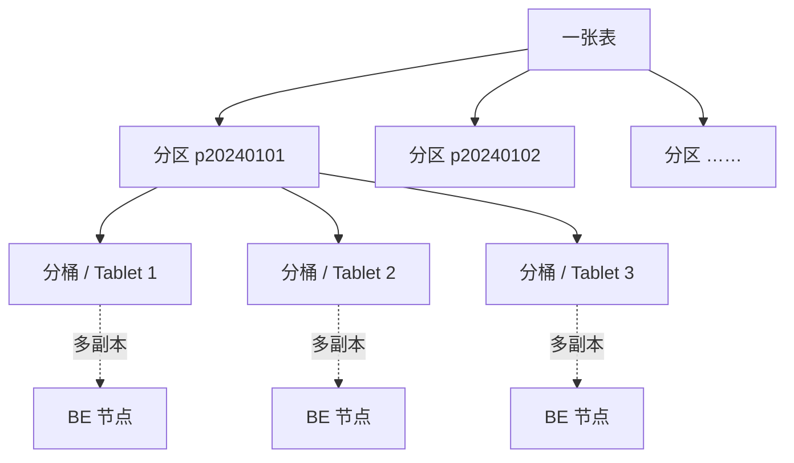

[基础篇002](StarRocks基础篇002_表类型.md) 定下了数据的语义，这一篇决定数据在集群里怎么摆放。一张几千万、几亿行的表，要先切成多少块、每块放到哪些节点上，直接决定了查询要扫多少数据、能并行到什么程度，也决定了数据会不会倾斜、过期数据好不好清理。StarRocks 用**分区 + 分桶**两级策略来回答这些问题。

> 本文内容整理自 StarRocks 官方文档：[数据分布](https://docs.starrocks.io/zh/docs/table_design/data_distribution/)、[表达式分区](https://docs.starrocks.io/zh/docs/table_design/data_distribution/expression_partitioning/)、[Range 分区](https://docs.starrocks.io/zh/docs/table_design/data_distribution/dynamic_partitioning/)、[List 分区](https://docs.starrocks.io/zh/docs/table_design/data_distribution/list_partitioning/)、[临时分区](https://docs.starrocks.io/zh/docs/table_design/data_distribution/Temporary_partition/)、[能力边界](https://docs.starrocks.io/zh/docs/table_design/data_distribution/feature-support-data-distribution/)。

# 1. 数据分布概述

## 1.1. 常见的数据分布方式

数据均匀分布，是指把数据按一定规则划分成子集，并均衡地放到不同节点上。现代分布式数据库常见的数据分布方式有四种：

| 方式 | 规则 | 例子 |
|---|---|---|
| **Round-Robin** | 轮询，把数据逐条放到相邻节点上 | 第 1 行放节点 A，第 2 行放节点 B…… |
| **Range** | 按区间分布 | `[1-3]` 放一个节点，`[4-6]` 放另一个节点 |
| **List** | 按离散取值分布，每个取值映射到一个节点（多个取值可以映射到同一节点） | 按性别、省份分布 |
| **Hash** | 用哈希函数把数据映射到不同节点 | 按 `hash(user_id)` 分布 |

实际业务中也常把它们组合使用，例如 Hash+Hash、Range+Hash、Hash+List。

## 1.2. StarRocks 的两级分布：分区 + 分桶

StarRocks 通过**分区 + 分桶**两级来实现数据分布：

* **第一层是分区**：一张表可以按分区列切成多个分区。支持表达式分区、Range 分区、List 分区，也可以不分区（全表只有一个分区）。
* **第二层是分桶**：每个分区内**必须**分桶。支持哈希分桶、随机分桶，以及 v4.1 起的基于范围的分桶。每个桶的数据称为一个 **Tablet**，Tablet 以多副本（默认 3 个）分布在 BE 节点上，是实际的物理存储和调度单元。



两层的分工不同：**分区负责"能跳过多少数据"和数据的生命周期管理**，**分桶负责"数据怎么在节点间均衡分布、并行度有多高"**。

把分区方式和分桶方式组合起来，就得到 StarRocks 支持的各种数据分布方式：

| 数据分布方式 | 分区方式 | 分桶方式 | 说明 |
|---|---|---|---|
| Random 分布 | 不分区 | 随机分桶 | 默认的数据分布方式，表中数据随机分布到各分桶 |
| Hash 分布 | 不分区 | 哈希分桶 | 按分桶键值的哈希值分布到对应分桶 |
| Range 分布 | 不分区 | 基于范围的分桶 | v4.1 起支持，按表键的取值范围分布到各分桶 |
| Range+Random 分布 | Range 分区 | 随机分桶 | 先按分区列的取值范围分到分区，分区内随机分桶 |
| Range+Hash 分布 | Range 分区 | 哈希分桶 | 先按取值范围分到分区，分区内按分桶键哈希 |
| List+Random 分布 | 表达式分区或 List 分区 | 随机分桶 | 先按枚举值分到分区，分区内随机分桶 |
| List+Hash 分布 | 表达式分区或 List 分区 | 哈希分桶 | 先按枚举值分到分区，分区内按分桶键哈希 |

各种组合的建表写法如下（随机分桶目前仅支持明细表）：

```sql
-- Random 分布：不写分区、不写分桶
CREATE TABLE site_access1 (
    event_day DATE,
    site_id   INT     DEFAULT '10',
    pv        BIGINT  DEFAULT '0',
    city_code VARCHAR(100),
    user_name VARCHAR(32) DEFAULT ''
)
DUPLICATE KEY (event_day, site_id, pv);

-- Hash 分布：哈希分桶，必须指定分桶键
CREATE TABLE site_access2 (
    event_day DATE,
    site_id   INT      DEFAULT '10',
    city_code SMALLINT,
    user_name VARCHAR(32) DEFAULT '',
    pv        BIGINT SUM DEFAULT '0'
)
AGGREGATE KEY (event_day, site_id, city_code, user_name)
DISTRIBUTED BY HASH(event_day, site_id);

-- Range + Hash 分布：按天分区，分区内哈希分桶
CREATE TABLE site_access4 (
    event_day DATE,
    site_id   INT     DEFAULT '10',
    city_code VARCHAR(100),
    user_name VARCHAR(32) DEFAULT '',
    pv        BIGINT SUM DEFAULT '0'
)
AGGREGATE KEY(event_day, site_id, city_code, user_name)
PARTITION BY date_trunc('day', event_day)
DISTRIBUTED BY HASH(event_day, site_id);

-- List + Hash 分布：按城市分区，分区内哈希分桶
CREATE TABLE t_recharge_detail2 (
    id             bigint,
    user_id        bigint,
    recharge_money decimal(32,2),
    city           varchar(20) not null,
    dt             date        not null
)
DUPLICATE KEY(id)
PARTITION BY (city)
DISTRIBUTED BY HASH(city, id);
```

> 和数据分布相关的几个版本节点：
>
> * v2.5.7 起，建表和新增分区时可以不设置分桶数量（`BUCKETS`），由 StarRocks 自动设置；
> * v3.1 起，建表和新增分区时可以不设置分桶键（`DISTRIBUTED BY`），默认使用随机分桶；
> * v3.2 起，建表后可以修改部分数据分布属性，以适应查询模式和数据特点的变化（见第 4 章）。

# 2. 分区

## 2.1. 分区的作用与选择

分区把一张表按分区键拆成不同的管理单元。它有两个作用：

* **裁剪数据**：查询条件命中分区列时，StarRocks 只扫描相关分区，直接跳过其他分区，这就是**分区裁剪**。
* **分区级管理**：可以给每个分区单独设置存储策略，比如分桶数、冷热策略、存储介质、副本数。例如把新数据所在的分区放在 SSD 上，利用 SSD 的随机读写性能加速查询；把旧数据放在 SATA 盘上节省成本。

StarRocks 提供三种分区方式：

| 分区方式 | 适用场景 | 分区怎么创建 |
|---|---|---|
| **表达式分区（推荐）** | 原称自动创建分区，灵活易用，适合大多数场景。适合按连续日期范围或枚举值查询和管理数据 | 导入时自动创建 |
| **Range 分区（不推荐）** | 数据简单有序，按连续日期/数值范围查询和管理；或者特殊场景，比如历史数据按月分区、最近数据按天分区 | 动态、批量或手动创建 |
| **List 分区（不推荐）** | 按枚举值查询和管理，且**一个分区要包含分区列的多个取值**。比如按国家和城市管理数据，用 `city` 分区，一个分区装一个国家的多个城市 | 手动创建 |

> v3.4 起表达式分区进一步优化，统一了所有分区策略，并支持更复杂的方案。大多数情况下建议使用表达式分区，它将在未来版本中逐步取代 Range 分区和 List 分区。

**选择分区列**：分区键由一个或多个分区列组成，要选能有效裁剪扫描数据量的列。

* 业务系统一般**按时间分区**：既能优化大量删除过期数据带来的性能问题，也方便冷热数据分级存储。此时用时间列做表达式分区或 Range 分区。
* 如果经常按枚举值查询和管理数据，就用枚举值列做表达式分区或 List 分区。

**选择分区粒度**：综合考虑数据量、查询特点、数据管理粒度。

* 单月数据量很小 → 按月分区。相比按天分区，元数据更少，元数据管理和调度的开销也更小。
* 单月数据量很大，且大部分查询精确到天 → 按天分区，分区裁剪更有效，扫描的数据更少。
* 数据要求按天过期 → 按天分区。

## 2.2. 表达式分区（推荐）

表达式分区自 v3.0 起支持（原称自动分区）。建表时只需写一个分区表达式，导入数据时 StarRocks 会按数据和表达式规则**自动创建分区**，不需要预先建一大堆分区，也不需要配置动态分区属性。

表达式分区按表达式的形式分成四类：

| 类型 | 起始版本 | 分区表达式 | 例子 |
|---|---|---|---|
| 简单时间函数表达式 | v3.0 | `date_trunc` 或 `time_slice` | `PARTITION BY date_trunc('day', dt)` |
| 列表达式 | v3.1 | 一个或多个列名 | `PARTITION BY dt, city` |
| 复杂时间函数表达式 | v3.4 | 任何返回 `DATE` / `DATETIME` 的表达式 | `PARTITION BY from_unixtime(ts, '%Y%m%d')` |
| 混合表达式 | v3.4 | 多个分区列，其中一个可以是时间函数表达式 | `PARTITION BY from_unixtime(ts, '%Y%m%d'), city` |

### 2.2.1. 简单时间函数表达式

经常按连续时间范围查询和管理数据时，指定一个日期类型（`DATE` 或 `DATETIME`）列作分区列，并在时间函数里写明分区粒度（年、月、周、日、小时）。StarRocks 会按导入的数据自动创建分区，并设置分区的起止时间。

**语法**：

```sql
PARTITION BY expression
...
[ PROPERTIES( { 'partition_live_number' = 'xxx' | 'partition_retention_condition' = 'expr' } ) ]

expression ::=
    { date_trunc ( <time_unit> , <partition_column> ) |
      time_slice ( <partition_column> , INTERVAL <N> <time_unit> [ , boundary ] ) }
```

**参数**：

| 参数 | 必填 | 说明 |
|---|---|---|
| `expression` | 是 | 使用 `date_trunc` 或 `time_slice` 函数。用 `time_slice` 时不需要传 `boundary`，默认是 `floor`，且不能是 `ceil` |
| `time_unit` | 是 | 分区粒度：`hour`、`day`、`week`、`month`、`year`。粒度为 `hour` 时，分区列必须是 `DATETIME` |
| `partition_column` | 是 | 分区列。只能是 `DATE` 或 `DATETIME`，允许 `NULL`。用 `date_trunc` 时可以是两者之一，用 `time_slice` 时必须是 `DATETIME`。**目前只能指定一个分区列** |
| `partition_live_number` | 否 | 保留最近多少个分区。以**当前日期**为基准，更早的分区会被删除 |
| `partition_retention_condition` | 否 | v3.5 起支持。用表达式声明要保留哪些分区，不满足条件的分区会被定期删除 |

分区列的取值范围：`DATE` 为 `[0000-01-01 ~ 9999-12-31]`，`DATETIME` 为 `[0000-01-01 01:01:01 ~ 9999-12-31 23:59:59]`。

> `PARTITION BY date_trunc(column)` 和 `PARTITION BY time_slice(column)` 虽然写法是表达式分区，但会被视为 **Range 分区**，因此可以用 `ALTER TABLE ... ADD PARTITION` 给这类表手动添加分区。

**分区生命周期管理**的两个属性：

* **`partition_live_number`**：StarRocks 会调度任务管理分区数量，调度间隔由 FE 动态参数 `dynamic_partition_check_interval_seconds` 控制，默认 600 秒。假设今天是 2023-04-04，`partition_live_number` 为 2，现有分区 `p20230401`～`p20230404`，则只保留 `p20230403`、`p20230404`。注意它以当前日期为基准：如果导入了未来日期（4 月 5 日、6 日）的脏数据，则 `p20230403`～`p20230406` 都会保留。
* **`partition_retention_condition`**（v3.5 起）：例如 `'partition_retention_condition' = 'dt >= CURRENT_DATE() - INTERVAL 3 MONTH'`。表达式只能包含分区列和常量。对 List 分区表，StarRocks 支持删除被表达式过滤掉的分区；对 Range 分区表，只能借助 FE 的分区裁剪能力过滤和删除分区，分区裁剪不支持的谓词对应的分区无法被删除。

**示例 1：按天分区**。经常按天查询数据时，用 `date_trunc()` 把 `event_day` 按 `day` 分区。同一天的数据放在一个分区里，查询时可以分区裁剪：

```sql
CREATE TABLE site_access1 (
    event_day DATETIME NOT NULL,
    site_id   INT      DEFAULT '10',
    city_code VARCHAR(100),
    user_name VARCHAR(32) DEFAULT '',
    pv        BIGINT   DEFAULT '0'
)
DUPLICATE KEY(event_day, site_id, city_code, user_name)
PARTITION BY date_trunc('day', event_day)
DISTRIBUTED BY HASH(event_day, site_id);

INSERT INTO site_access1 VALUES
    ("2023-02-26 20:12:04", 002, "New York", "Sam Smith", 1),
    ("2023-02-27 21:06:54", 001, "Los Angeles", "Taylor Swift", 1);
```

导入这两行后，StarRocks 自动创建了两个分区：`p20230226`，范围 `[2023-02-26 00:00:00, 2023-02-27 00:00:00)`；`p20230227`，范围 `[2023-02-27 00:00:00, 2023-02-28 00:00:00)`。之后落在这些范围内的数据会自动路由到对应分区。

**示例 2：只保留最近 3 个月**：

```sql
CREATE TABLE site_access2 (
    event_day DATETIME NOT NULL,
    site_id   INT      DEFAULT '10',
    city_code VARCHAR(100),
    user_name VARCHAR(32) DEFAULT '',
    pv        BIGINT   DEFAULT '0'
)
DUPLICATE KEY(event_day, site_id, city_code, user_name)
PARTITION BY date_trunc('month', event_day)
DISTRIBUTED BY HASH(event_day, site_id)
PROPERTIES ("partition_live_number" = "3");
```

**示例 3：按周分区**，用 `time_slice()`：

```sql
CREATE TABLE site_access (
    event_day DATETIME NOT NULL,
    site_id   INT      DEFAULT '10',
    city_code VARCHAR(100),
    user_name VARCHAR(32) DEFAULT '',
    pv        BIGINT   DEFAULT '0'
)
DUPLICATE KEY(event_day, site_id, city_code, user_name)
PARTITION BY time_slice(event_day, INTERVAL 1 week)
DISTRIBUTED BY HASH(event_day, site_id);
```

### 2.2.2. 列表达式（v3.1 起）

经常按某种类型查询和管理数据时，直接把表示类型的列写成分区列。StarRocks 会按导入数据的分区列取值自动创建分区。

```sql
PARTITION BY expression

expression ::= partition_columns
partition_columns ::= <column>, [ <column> [,...] ]
```

* 分区列可以是字符串（不支持 `BINARY`）、`date`、`datetime`、整数、布尔值，允许 `NULL`。
* **每个分区只包含分区列取值完全相同的数据**。如果一个分区要装多个不同取值，要用 List 分区（见 2.4 节）。
* 分区命名规则：多个分区列的值用下划线连接，即 `p<列1的值>_<列2的值>_...`。比如分区列是 `dt` 和 `province`，导入一行 `2022-04-01`、`beijing`，自动创建的分区名是 `p20220401_beijing`。
* v3.4 起可以省略分区列外面的括号，`PARTITION BY (dt, city)` 可以写成 `PARTITION BY dt, city`。

**示例**：经常按时间范围和城市查询机房计费明细，用 `dt` 和 `city` 两列分区，同一天同一城市的数据落在同一分区：

```sql
CREATE TABLE t_recharge_detail1 (
    id             bigint,
    user_id        bigint,
    recharge_money decimal(32,2),
    city           varchar(20) not null,
    dt             varchar(20) not null
)
DUPLICATE KEY(id)
PARTITION BY dt, city
DISTRIBUTED BY HASH(`id`);

INSERT INTO t_recharge_detail1 VALUES (1, 1, 1, 'Houston', '2022-04-01');
```

插入后，StarRocks 自动创建分区 `p20220401_Houston`，之后 `dt='2022-04-01'`、`city='Houston'` 的数据都存到这个分区。

### 2.2.3. 复杂时间函数表达式（v3.4 起）

v3.4.0 起，表达式分区支持**任何返回 `DATE` 或 `DATETIME` 的表达式**。比如表里存的是 Unix 时间戳，不必再额外定义一个生成的日期列，直接在分区表达式里用 `from_unixtime()` 即可。

```sql
-- 示例 1：BIGINT 类型的 Unix 时间戳，按天分区
CREATE TABLE orders (
    ts   BIGINT NOT NULL,
    id   BIGINT NOT NULL,
    city STRING NOT NULL
)
PARTITION BY from_unixtime(ts, '%Y%m%d');

-- 示例 2：INT 类型的 yyyyMMdd 时间戳，先转成 DATE，再按月分区
CREATE TABLE orders_new (
    ts   INT    NOT NULL,
    id   BIGINT NOT NULL,
    city STRING NOT NULL
)
PARTITION BY date_trunc('month', str_to_date(CAST(ts AS STRING), '%Y%m%d'));
```

**分区裁剪**：v3.4.4 起，基于大多数 `DATETIME` 相关函数的分区都支持分区裁剪。例如：

* `PARTITION BY from_unixtime(ts)` 时，`ts > 1727224687` 这样的过滤条件可以裁剪到对应分区；
* `PARTITION BY str2date(CAST(ts AS string), '%Y%m')` 时，`ts = "20240506"` 这样的过滤条件可以裁剪。

**支持的函数**：

* 时间函数：`timediff`、`datediff`、`to_days`、`years_add/sub`、`quarters_add/sub`、`months_add/sub`、`weeks_add/sub`、`date_add/sub`、`days_add/sub`、`hours_add/sub`、`minutes_add/sub`、`seconds_add/sub`、`milliseconds_add/sub`、`date_trunc`、`date_format`、`str2date`、`str_to_date`、`to_iso8601`、`to_date`、`unix_timestamp`、`from_unixtime`、`time_slice`；
* 其他：加、减、类型转换。

几点注意：多个时间函数可以组合使用，比如 `PARTITION BY from_unixtime(cast(str as INT) + 3600, '%Y-%m-%d')`；所有时间函数都使用系统默认时区；`date_format`、`str2date`、`str_to_date`、`from_unixtime` 的格式串必须以最粗的粒度 `%Y` 开头，不能用 `%m-%d` 这样以更细粒度开头的格式。

### 2.2.4. 混合表达式（v3.4 起）

v3.4.0 起，表达式分区支持多个分区列，其中一个可以是时间函数表达式。比如每行数据带 Unix 时间戳，经常按天和城市查询：

```sql
CREATE TABLE orders (
    ts   BIGINT NOT NULL,
    id   BIGINT NOT NULL,
    city STRING NOT NULL
)
PARTITION BY from_unixtime(ts, '%Y%m%d'), city;
```

每个城市每天的数据存在一个分区里。2.2.3 节的分区裁剪规则同样适用于混合表达式。

### 2.2.5. 管理表达式分区

**导入数据**：导入时 StarRocks 按表达式规则自动创建分区，有几点要注意：

* 如果导入作业失败，已经自动创建的分区**不会被自动删除**；
* 单次导入最多自动创建 4096 个分区，由 FE 参数 `auto_partition_max_creation_number_per_load` 控制，防止误建过多分区；
* 时间函数表达式的分区命名规则与动态分区一致（见 2.3.3 节）。

**覆盖写数据**：可以用 `INSERT OVERWRITE` 动态覆盖数据，不用写分区名，StarRocks 会自动路由并覆盖对应分区。要覆盖**指定**分区时，在 `PARTITION()` 里给出该分区的起始时间或列值，而不是分区名；分区不存在时会自动创建：

```sql
-- 时间函数表达式：给出分区范围内的时间
INSERT OVERWRITE site_access1 PARTITION(event_day='2022-06-08 20:12:04')
SELECT * FROM site_access2 PARTITION(p20220608);

-- 列表达式：给出分区包含的列值
INSERT OVERWRITE t_recharge_detail1 PARTITION(dt='2022-04-02', city='texas')
SELECT * FROM t_recharge_detail2 PARTITION(p20220402_texas);
```

**查看分区**：自动创建的分区要用 `SHOW PARTITIONS FROM <table_name>` 查看。`SHOW CREATE TABLE` 只返回建表时写的分区表达式，看不到自动创建的分区。

**合并分区（v3.5 起）**：可以把多个细粒度的分区合并成一个粗粒度的分区，比如把按天分区合并成按月分区，从而对不同时间段的数据使用不同的分区粒度。

```sql
ALTER TABLE [<db_name>.]<table_name>
PARTITION BY <time_expr>
[WHERE <time_range_column>] BETWEEN <start_time> AND <end_time>;

-- 把 2024 年 1～3 月的按天分区合并成按月分区
ALTER TABLE site_access1 PARTITION BY date_trunc('month', event_day)
BETWEEN '2024-01-01' AND '2024-03-31';
```

执行后，1 月、2 月、3 月的日级分区分别合并成 `2024-01`、`2024-02`、`2024-03` 三个月级分区。合并分区只支持基于时间函数的表达式分区，不支持多个分区列的分区，也不能和 Schema Change、DML 操作并行执行。

### 2.2.6. 表达式分区的限制

* 存算分离模式自 v3.1.0 起支持时间函数表达式，自 v3.1.1 起支持列表达式；
* 不支持用 CTAS 创建表达式分区的表；
* 不支持用 Spark Load 向表达式分区的表导入数据；
* 用 `ALTER TABLE <table_name> DROP PARTITION <partition_name>` 删除**列表达式**创建的分区时，数据会被直接删除，无法恢复；
* 自 v3.4.0、v3.3.8、v3.2.13、v3.1.16 起，支持备份和恢复表达式分区的表。

## 2.3. Range 分区（不推荐）

Range 分区适合简单的连续数据，比如时间序列或连续的数值。它需要**显式定义**分区列和"分区 ↔ 分区列取值范围"的映射关系，导入时 StarRocks 按分区列值所属的范围把数据分到对应分区。

除了常规场景，Range 分区还能处理一些表达式分区做不到的特殊场景，比如历史数据按月分区、最近的数据按天分区。

**分区列的类型**：v3.3.0 之前只支持日期和整数类型的分区列。v3.3.0 起可以用三个特定时间函数先把分区列转成日期，再按日期划分分区：

* 分区列是时间戳：用 `from_unixtime`（分区列只支持 INT、BIGINT）或 `from_unixtime_ms`（只支持 BIGINT）；
* 分区列是字符串（STRING、VARCHAR、CHAR）：用 `str2date`。

Range 分区只支持一个函数表达式，且不支持字符串类型的分区键，必须先用 `str2date` 转换。

### 2.3.1. 语法

```sql
PARTITION BY RANGE ( partition_columns | function_expression )
    ( single_range_partition | multi_range_partitions )

partition_columns   ::= <column> [, ...]
function_expression ::= from_unixtime(column) | from_unixtime_ms(column) | str2date(column)

single_range_partition ::= PARTITION <partition_name> VALUES partition_key_desc
partition_key_desc     ::= LESS THAN { MAXVALUE | value_list } | value_range
value_range            ::= [value_list, value_list)   -- 左闭右开区间，必须显式写出 [
value_list             ::= ( <value> [, ...] )

multi_range_partitions ::=
      { PARTITIONS START ("<start_date_value>") END ("<end_date_value>") EVERY ( INTERVAL <int_value> time_unit )
      | PARTITIONS START ("<start_integer_value>") END ("<end_integer_value>") EVERY ( <int_value> ) }

time_unit ::= HOUR | DAY | WEEK | MONTH | YEAR
```

### 2.3.2. 手动创建与批量创建分区

**手动创建**：逐个写出每个分区的范围。

```sql
-- 分区列为日期类型
CREATE TABLE site_access (
    event_day DATE,
    site_id   INT,
    city_code VARCHAR(100),
    user_name VARCHAR(32),
    pv        BIGINT SUM DEFAULT '0'
)
AGGREGATE KEY(event_day, site_id, city_code, user_name)
PARTITION BY RANGE(event_day) (
    PARTITION p1 VALUES LESS THAN ("2020-01-31"),
    PARTITION p2 VALUES LESS THAN ("2020-02-29"),
    PARTITION p3 VALUES LESS THAN ("2020-03-31")
)
DISTRIBUTED BY HASH(site_id);

-- 分区列为整数类型：只需把 PARTITION BY 子句换成
PARTITION BY RANGE (datekey) (
    PARTITION p1 VALUES LESS THAN ("20200131"),
    PARTITION p2 VALUES LESS THAN ("20200229"),
    PARTITION p3 VALUES LESS THAN ("20200331")
)

-- 分区列为时间戳 / 字符串：先用函数转成日期
PARTITION BY RANGE(from_unixtime(event_time)) (      -- 10 位秒级时间戳
    PARTITION p1 VALUES LESS THAN ("2021-01-01"),
    PARTITION p2 VALUES LESS THAN ("2021-01-02")
)
PARTITION BY RANGE(from_unixtime_ms(event_time)) (   -- 13 位毫秒级时间戳
    PARTITION p1 VALUES LESS THAN ("2021-01-01"),
    PARTITION p2 VALUES LESS THAN ("2021-01-02")
)
PARTITION BY RANGE(str2date(string_col, '%Y-%m-%d')) (
    PARTITION p1 VALUES LESS THAN ("2021-01-01"),
    PARTITION p2 VALUES LESS THAN ("2021-01-02")
)
```

**批量创建**：建表时或建表后，用 `START`、`END` 指定起止值，用 `EVERY` 指定增量，一次创建一批分区。批量分区**包含 `START` 的值，不包含 `END` 的值**，分区命名规则同动态分区。

* 分区列是日期类型时，`EVERY` 用 `INTERVAL` 表示时间间隔，单位支持 `HOUR`（v3.0 起）、`DAY`、`WEEK`、`MONTH`、`YEAR`；
* 分区列是整数类型时，`START`、`END` 的值要用英文引号包裹，`EVERY` 的增量值不用引号。

```sql
-- 日期间隔相同：2021-01-01 ~ 2021-01-04，每天一个分区
PARTITION BY RANGE (datekey) (
    START ("2021-01-01") END ("2021-01-04") EVERY (INTERVAL 1 DAY)
)
-- 等价于：
PARTITION BY RANGE (datekey) (
    PARTITION p20210101 VALUES [('2021-01-01'), ('2021-01-02')),
    PARTITION p20210102 VALUES [('2021-01-02'), ('2021-01-03')),
    PARTITION p20210103 VALUES [('2021-01-03'), ('2021-01-04'))
)

-- 日期间隔不同：历史按年、近期按月、最近按天
PARTITION BY RANGE (date_col) (
    START ("2019-01-01") END ("2021-01-01") EVERY (INTERVAL 1 YEAR),
    START ("2021-01-01") END ("2021-05-01") EVERY (INTERVAL 1 MONTH),
    START ("2021-05-01") END ("2021-05-04") EVERY (INTERVAL 1 DAY)
)

-- 整数间隔相同 / 不同
PARTITION BY RANGE (int_col) (
    START ("1") END ("10") EVERY (1)
)
PARTITION BY RANGE (int_col) (
    START ("1")  END ("10")  EVERY (1),
    START ("10") END ("100") EVERY (10)
)

-- 时间戳列批量分区
PARTITION BY RANGE(from_unixtime(event_time)) (
    START ("2021-01-01") END ("2021-01-10") EVERY (INTERVAL 1 DAY)
)
```

### 2.3.3. 动态分区

在 Range 分区的基础上，可以开启**动态分区**：StarRocks 自动**提前创建**新分区、**删除**过期分区，实现分区的生命周期管理（TTL），降低维护成本。

```sql
CREATE TABLE site_access (
    event_day DATE,
    site_id   INT     DEFAULT '10',
    city_code VARCHAR(100),
    user_name VARCHAR(32) DEFAULT '',
    pv        BIGINT  DEFAULT '0'
)
DUPLICATE KEY(event_day, site_id, city_code, user_name)
PARTITION BY RANGE(event_day) (
    PARTITION p20200321 VALUES LESS THAN ("2020-03-22"),
    PARTITION p20200322 VALUES LESS THAN ("2020-03-23"),
    PARTITION p20200323 VALUES LESS THAN ("2020-03-24"),
    PARTITION p20200324 VALUES LESS THAN ("2020-03-25")
)
DISTRIBUTED BY HASH(event_day, site_id)
PROPERTIES (
    "dynamic_partition.enable" = "true",
    "dynamic_partition.time_unit" = "DAY",
    "dynamic_partition.start" = "-3",
    "dynamic_partition.end" = "3",
    "dynamic_partition.prefix" = "p",
    "dynamic_partition.buckets" = "32",
    "dynamic_partition.history_partition_num" = "0"
);
```

**动态分区属性**：

| 属性 | 必填 | 说明 |
|---|---|---|
| `dynamic_partition.enable` | 否 | 是否开启动态分区，默认 `TRUE` |
| `dynamic_partition.time_unit` | 是 | 动态创建分区的粒度：`HOUR`、`DAY`、`WEEK`、`MONTH`、`YEAR`，同时决定分区名后缀格式（见下表）。为 `HOUR` 时分区列只能是 DATETIME |
| `dynamic_partition.time_zone` | 否 | 动态分区的时区，默认与系统时区相同 |
| `dynamic_partition.start` | 否 | 起始偏移量，必须为负整数。早于"当前时间单位 + start"的分区会被删除。默认 `Integer.MIN_VALUE`（-2147483648），即不删除历史分区 |
| `dynamic_partition.end` | 是 | 结束偏移量，必须为正整数。从当前时间单位到 end 的分区会被提前创建 |
| `dynamic_partition.prefix` | 否 | 分区名前缀，默认 `p` |
| `dynamic_partition.buckets` | 否 | 每个动态分区的分桶数，默认与 `BUCKETS` 或自动设置的分桶数相同 |
| `dynamic_partition.history_partition_num` | 否 | 提前创建的历史分区数，默认 0。大于 0 时会创建历史分区。v2.5.2 起支持 |
| `dynamic_partition.start_day_of_week` | 否 | `time_unit` 为 `WEEK` 时，每周的第一天，`1`（周一）～`7`（周日），默认 1 |
| `dynamic_partition.start_day_of_month` | 否 | `time_unit` 为 `MONTH` 时，每月的第一天，`1`～`28`，默认 1，不能是 29、30、31 日 |
| `dynamic_partition.replication_num` | 否 | 动态创建分区的副本数，默认与建表时的副本数相同 |

`time_unit` 决定的分区名后缀格式：

| time_unit | 后缀格式 | 例子 |
|---|---|---|
| `HOUR` | yyyyMMddHH | `2020032101` |
| `DAY` | yyyyMMdd | `20200321` |
| `WEEK` | yyyy_ww | `2020_13`（2020 年第 13 周） |
| `MONTH` | yyyyMM | `202003` |
| `YEAR` | yyyy | `2020` |

> 分区列为 INT 类型时，无论分区粒度是什么，取值格式都必须是 `yyyyMMdd`。

**调度**：FE 参数 `dynamic_partition_check_interval_seconds` 控制动态分区的调度间隔，默认 600 秒，即每 10 分钟检查一次分区是否符合动态分区条件，不符合就自动创建和删除分区。

**查看动态分区**：用 `SHOW PARTITIONS FROM site_access;` 查看。以上面的配置为例，假设当前日期是 2020-03-25，只能看到 2020-03-25 到 2020-03-28 的分区（今天加上提前创建的 3 天）。如果建表时把 `history_partition_num` 设为 3，能看到的范围是 2020-03-22 到 2020-03-28。

**修改动态分区属性**：用 `ALTER TABLE` 修改，例如关闭动态分区。表当前的动态分区属性可以用 `SHOW CREATE TABLE` 查看。

```sql
ALTER TABLE site_access SET ("dynamic_partition.enable" = "false");
```

> **动态分区 vs 表达式分区**：动态分区只是按配置**定期提前创建**一批分区，如果导入的数据不属于这些提前建好的分区，导入会报错；表达式分区则会**按导入的数据按需创建**对应分区。

## 2.4. List 分区（不推荐）

List 分区自 v3.1 起支持。你需要**显式列出每个分区包含的枚举值**，这些值不需要连续。导入时，StarRocks 按分区列值和分区的映射关系，把数据分到对应分区。

它适合列中枚举值不多、经常按枚举值查询和管理数据的场景，比如表示地理位置、状态、类别的列。**最典型的用途是一个分区要包含分区列的多个取值**：比如 `City` 列表示城市，经常按州和城市查询，就可以把同一个州的多个城市放进一个分区 `PARTITION pCalifornia VALUES IN ("Los Angeles","San Francisco","San Diego")`。如果一个分区只需包含一个取值，推荐用表达式分区。

**List 分区和表达式分区（列表达式）的区别**：

| 对比项 | List 分区 | 表达式分区 |
|---|---|---|
| 语法 | `PARTITION BY LIST (cols) (PARTITION p VALUES IN (...), ...)` | `PARTITION BY cols` |
| 一个分区包含多个取值 | 支持 | 不支持，每个取值一个分区。比如 `PARTITION BY (city)` 导入三个城市，就自动建三个分区 |
| 导入前要先建分区 | 必须，而且是在建表时就建好 | 不需要 |
| 导入时自动建分区 | 不支持，数据没有对应分区时报错 | 支持 |
| `SHOW CREATE TABLE` | 返回建表时定义的分区 | 只返回分区表达式，不返回自动创建的分区，要用 `SHOW PARTITIONS` 查看 |

**语法**：

```sql
PARTITION BY LIST (partition_columns) (
    PARTITION <partition_name> VALUES IN (value_list)
    [, ...]
)

partition_columns ::= <column> [, <column> [, ...] ]
value_list        ::= value_item [, value_item [, ...] ]
value_item        ::= { <value> | ( <value> [, <value>, [, ...] ] ) }
```

分区列的值支持字符串（除 BINARY）、日期（DATE 和 DATETIME）、整数和布尔值，v3.3.3 起支持 `NULL`。

**示例 1：单列分区**。按州或城市查询机房收费明细，用 `city` 分区，每个分区装同一个州的城市：

```sql
CREATE TABLE t_recharge_detail2 (
    id             bigint,
    user_id        bigint,
    recharge_money decimal(32,2),
    city           varchar(20) not null,
    dt             varchar(20) not null
)
DUPLICATE KEY(id)
PARTITION BY LIST (city) (
    PARTITION pCalifornia VALUES IN ("Los Angeles", "San Francisco", "San Diego"),
    PARTITION pTexas      VALUES IN ("Houston", "Dallas", "Austin")
)
DISTRIBUTED BY HASH(`id`);
```

**示例 2：多列分区**。按日期范围和州/城市查询，用 `dt` 和 `city` 两列分区：

```sql
CREATE TABLE t_recharge_detail4 (
    id             bigint,
    user_id        bigint,
    recharge_money decimal(32,2),
    city           varchar(20) not null,
    dt             varchar(20) not null
)
DUPLICATE KEY(id)
PARTITION BY LIST (dt, city) (
    PARTITION p202204_California VALUES IN (
        ("2022-04-01", "Los Angeles"),
        ("2022-04-01", "San Francisco"),
        ("2022-04-02", "Los Angeles"),
        ("2022-04-02", "San Francisco")
    ),
    PARTITION p202204_Texas VALUES IN (
        ("2022-04-01", "Houston"),
        ("2022-04-01", "Dallas"),
        ("2022-04-02", "Houston"),
        ("2022-04-02", "Dallas")
    )
)
DISTRIBUTED BY HASH(`id`);
```

**使用限制**：

* 不支持动态 List 分区；
* 存算分离模式自 v3.1.1 起支持；
* `ALTER TABLE <table_name> DROP PARTITION <partition_name>` 会直接删除分区，且不能恢复；
* 自 v3.4.0、v3.3.8、v3.2.13、v3.1.16 起支持备份与恢复 List 分区表；
* 自 v3.3.5 起，异步物化视图支持基于 List 分区的基表创建。

## 2.5. 三种分区方式对比

| 对比项 | 表达式分区（时间函数） | 表达式分区（列表达式） | Range 分区 | List 分区 |
|---|---|---|---|---|
| **分区列类型** | 日期（DATE / DATETIME） | 字符串（除 BINARY）、日期、整数、布尔值 | 字符串（除 BINARY）和时间戳需先用函数转成日期；日期；整数 | 字符串（除 BINARY）、日期、整数、布尔值 |
| **多个分区列** | 不支持，只能一个日期列 | 支持 | 支持 | 支持 |
| **分区列可为 NULL** | 支持 | 支持 | 支持 | v3.3.3 起支持 |
| **导入前手动建分区** | 不需要 | 不需要 | 批量手动创建时需要；用动态分区时不需要 | 需要 |
| **导入时自动建分区** | 支持 | 支持 | 不支持 | 不支持 |

> 从 v3.1 起，表达式分区、Range 分区、List 分区都支持全部四种表类型。

## 2.6. 管理分区

**增加分区**：Range 分区和 List 分区可以手动增加新分区来存放新数据；表达式分区在导入时自动建分区，不需要手动增加。新增分区的分桶数默认与原分区相同，也可以按新分区的数据量调整：

```sql
ALTER TABLE site_access
ADD PARTITION p4 VALUES LESS THAN ("2020-04-30")
DISTRIBUTED BY HASH(site_id);
```

**删除分区**：分区中的数据不会立即删除，会在回收站（Trash）中保留一段时间（默认一天），误删可以用 `RECOVER` 恢复。例外是前面提到的：删除列表达式分区和 List 分区时，数据直接删除且不能恢复。

```sql
ALTER TABLE site_access DROP PARTITION p1;
```

**恢复分区**：

```sql
RECOVER PARTITION p1 FROM site_access;
```

**查看分区**：

```sql
SHOW PARTITIONS FROM site_access;
```

## 2.7. 临时分区

临时分区可以建在一张已经定义好分区规则的分区表上，并为它单独设定数据分布策略：分区范围、分桶数，以及副本数、存储介质等属性。它是"原子替换正式分区"时的临时数据载体。

**适用场景**：

* **原子覆盖写**：要重写某个正式分区，又要保证重写过程中数据一直可查。先建一个对应的临时分区，把新数据导进去，再用替换操作原子地替换掉原正式分区。（非分区表的原子覆盖写，用 `ALTER TABLE ... SWAP`。）
* **调整分桶数**：要修改某个正式分区的分桶数，先建一个范围相同、分桶数不同的临时分区，用 `INSERT INTO` 把原分区数据导过去，再替换。
* **修改分区策略**：要合并多个小分区、或把一个大分区拆成多个小分区，先按合并或拆分后的范围建临时分区，导入数据后再替换。


### 2.7.1. 创建临时分区

```sql
-- 创建一个临时分区（两种写法）
ALTER TABLE <table_name>
ADD TEMPORARY PARTITION <temporary_partition_name> VALUES [("value1"), {MAXVALUE|("value2")})]
[(partition_desc)]
[DISTRIBUTED BY HASH(<bucket_key>)];

ALTER TABLE <table_name>
ADD TEMPORARY PARTITION <temporary_partition_name> VALUES LESS THAN {MAXVALUE|(<"value">)}
[(partition_desc)]
[DISTRIBUTED BY HASH(<bucket_key>)];

-- 批量创建临时分区
ALTER TABLE <table_name>
ADD TEMPORARY PARTITIONS START ("value1") END ("value2") EVERY {(INTERVAL <num> <time_unit>)|<num>}
[(partition_desc)]
[DISTRIBUTED BY HASH(<bucket_key>)];
```

`partition_desc` 用来为临时分区指定分桶数和副本数、存储介质等属性。示例：

```sql
-- tp1：范围 [2020-01-01, 2020-02-01)
ALTER TABLE site_access
ADD TEMPORARY PARTITION tp1 VALUES [("2020-01-01"), ("2020-02-01"));

-- tp2：只写上界，下界取前一个临时分区的上界，即 [2020-02-01, 2020-03-01)
ALTER TABLE site_access
ADD TEMPORARY PARTITION tp2 VALUES LESS THAN ("2020-03-01");

-- tp3：上界 2020-04-01，副本数 1，并指定分桶
ALTER TABLE site_access
ADD TEMPORARY PARTITION tp3 VALUES LESS THAN ("2020-04-01")
("replication_num" = "1")
DISTRIBUTED BY HASH (site_id);

-- 批量：[2020-04-01, 2021-01-01)，每月一个
ALTER TABLE site_access
ADD TEMPORARY PARTITIONS START ("2020-04-01") END ("2021-01-01") EVERY (INTERVAL 1 MONTH);
```

创建时要注意：

* 临时分区的分区列和正式分区相同，不可修改；
* 临时分区的名称不能和正式分区、其他临时分区重复；
* 同一张表的临时分区之间范围不能重叠，但临时分区的范围可以和正式分区重叠。

### 2.7.2. 查看、导入与查询

```sql
-- 查看临时分区
SHOW TEMPORARY PARTITIONS FROM site_access;

-- 用 INSERT INTO 导入
INSERT INTO site_access TEMPORARY PARTITION (tp1) VALUES ("2020-01-01", 1, "ca", "lily", 4);
INSERT INTO site_access TEMPORARY PARTITION (tp2) SELECT * FROM site_access_copy PARTITION p2;

-- 查询临时分区的数据，也可以和其他表的临时分区 JOIN
SELECT * FROM site_access TEMPORARY PARTITION (tp1, tp2);
```

除了 `INSERT INTO`，其他导入方式也能写入临时分区：

| 导入方式 | 怎么指定临时分区 |
|---|---|
| Stream Load | 请求头 `-H "temporary_partitions: tp1, tp2, ..."` |
| Broker Load | `DATA INFILE(...) INTO TABLE site_access TEMPORARY PARTITION (tp1, tp2, ...)` |
| Routine Load | `CREATE ROUTINE LOAD ... ON site_access ... TEMPORARY PARTITION (tp1, tp2, ...)` |

### 2.7.3. 用临时分区替换正式分区

替换成功后，**原正式分区和临时分区都会被删除，且不可恢复**。

```sql
ALTER TABLE <table_name>
REPLACE PARTITION (<partition_name1>[, ...]) WITH TEMPORARY PARTITION (<temporary_partition_name1>[, ...])
[PROPERTIES ("key" = "value")];
```

两个属性控制替换行为：

* **`strict_range`**（默认 `true`）：为 `true` 时，被替换的正式分区的范围并集，必须和临时分区的范围并集**完全相同**；为 `false` 时，只要替换后新正式分区和其他正式分区的范围不重叠即可。

    ```plaintext
    # 并集相同，可以用 tp1、tp2 替换 p1、p2、p3
    正式分区 p1, p2, p3: [10, 20), [20, 30), [40, 50) => [10, 30), [40, 50)
    临时分区 tp1, tp2:   [10, 30), [40, 45), [45, 50) => [10, 30), [40, 50)

    # 并集不同：strict_range = true 时不能替换；为 false 且不与其他正式分区重叠时可以替换
    正式分区 p1:         [10, 50)           => [10, 50)
    临时分区 tp1, tp2:   [10, 30), [40, 50) => [10, 30), [40, 50)
    ```

* **`use_temp_partition_name`**（默认 `false`）：正式分区和临时分区个数相同时，为 `false` 则新正式分区沿用原分区名（数据和属性换成临时分区的），为 `true` 则改用临时分区名。两者个数不同时，这个参数为 `false` 也无效，新正式分区一律使用临时分区名。

```sql
-- 用 tp1 替换 p1，新分区仍叫 p1
ALTER TABLE site_access REPLACE PARTITION (p1) WITH TEMPORARY PARTITION (tp1);

-- 用 tp2、tp3 替换 p2、p3
ALTER TABLE site_access REPLACE PARTITION (p2, p3) WITH TEMPORARY PARTITION (tp2, tp3);

-- 放宽范围校验，并改用临时分区名
ALTER TABLE site_access REPLACE PARTITION (p4, p5) WITH TEMPORARY PARTITION (tp4, tp5)
PROPERTIES (
    "strict_range" = "false",
    "use_temp_partition_name" = "true"
);
```

表上存在临时分区时，不能用 `ALTER` 对表做 Schema Change；反过来，表在做 Schema Change 时也不能添加临时分区。

### 2.7.4. 删除临时分区

```sql
ALTER TABLE site_access DROP TEMPORARY PARTITION tp1;
```

临时分区和正式分区在删除、清空时的行为不同：

| 操作 | 正式分区 | 临时分区 |
|---|---|---|
| `DROP` 整个库或表后用 `RECOVER` 恢复 | 随库表一起恢复 | 不能恢复 |
| `ALTER ... DROP` 删除后用 `RECOVER` 恢复 | 可以恢复 | 不能恢复 |
| `TRUNCATE` 清空整张表 | 被清空 | 被删除，不能恢复 |
| `TRUNCATE` 清空正式分区 | 被清空 | 不受影响 |
| `TRUNCATE` 清空临时分区 | — | 不支持 |

正式分区和临时分区互不关联，操作正式分区不会影响临时分区。

# 3. 分桶

一个分区按分桶方式被切成多个桶，每个桶的数据就是一个 Tablet。分桶是实际物理文件组织的单元。

## 3.1. 分桶方式

| 分桶方式 | 起始版本 | 是否要指定分桶键 | 数据怎么分 |
|---|---|---|---|
| **随机分桶** | v3.1 | 不需要 | 同一分区内，数据随机分布到各个分桶 |
| **哈希分桶** | — | 需要 | 同一分区内，按分桶键哈希分桶，分桶键值相同的行一定落到同一个分桶 |
| **基于范围的分桶** | v4.1（默认关闭） | 不需要 | 同一分区内，按键列的取值范围有序划分，每个 Tablet 存一段连续范围的数据 |

## 3.2. 随机分桶（v3.1 起）

不设置分桶方式时，StarRocks 默认使用随机分桶，并自动设置分桶数量。它把每个分区的数据随机地分到所有分桶中，适合**数据量不大、对查询性能要求不高**的场景。

如果要查询海量数据，且经常用某些列作为查询条件，随机分桶的查询性能可能不够理想，这时建议用哈希分桶：查询条件命中分桶键时，只需扫描和计算少量分桶。

```sql
-- 不写 DISTRIBUTED BY：默认随机分桶 + 自动设置分桶数量
CREATE TABLE site_access1 (
    event_day DATE,
    site_id   INT     DEFAULT '10',
    pv        BIGINT  DEFAULT '0',
    city_code VARCHAR(100),
    user_name VARCHAR(32) DEFAULT ''
)
DUPLICATE KEY(event_day, site_id, pv);

-- 显式写出随机分桶
DISTRIBUTED BY RANDOM BUCKETS;

-- 随机分桶 + 手动设置分桶数量
DISTRIBUTED BY RANDOM BUCKETS 8;
```

**使用限制**：

* 仅支持明细表；
* 不支持指定 Colocation Group；
* 不支持 Spark Load。

v3.2 起，随机分桶表支持根据集群信息和数据量，在导入过程中按需动态增加分桶数量。此时分区内部实际的层次是"分区 > 子分区 > 分桶"：StarRocks 通过新增子分区来增加分桶，所以 `SHOW PARTITIONS` 会返回多条同名分区的记录，分别代表同一分区下的各个子分区。

## 3.3. 哈希分桶

对每个分区的数据，StarRocks 按分桶键和分桶数量做哈希分桶：用分桶键的值算出哈希值，再按哈希值把数据分到对应的桶。

**两个优点**：

1. **提高查询性能**：分桶键值相同的行在同一个桶里，查询命中分桶键时可以只扫少量分桶。
2. **均匀分布数据**：选**高基数**（唯一值多）的列做分桶键，数据能更均匀地分到每个桶。

**怎么选分桶键**：

* 如果某一列**同时**满足"高基数"和"经常作为查询条件"，就选它做分桶键。
* 没有这样的列时，看查询特点：查询比较复杂，就选高基数列，保证数据在各分桶中尽量均衡、提高集群资源利用率；查询比较简单，就选经常作为查询条件的列，提高查询效率。
* 如果数据倾斜严重，可以用多个列组成分桶键，但建议不超过 3 列。

**注意事项**：

* 使用哈希分桶时，建表必须指定分桶键；
* 分桶键的列只支持整型、DECIMAL、DATE/DATETIME、CHAR/VARCHAR/STRING 类型；
* v3.2 起，建表后可以用 `ALTER TABLE` 修改分桶键。

**示例**：`site_access` 表用 `site_id` 做分桶键。一是 `site_id` 是高基数列；二是针对这张表的查询基本都以站点作为过滤条件，用它做分桶键可以在查询时裁掉大量无关分桶。

```sql
CREATE TABLE site_access (
    event_day DATE,
    site_id   INT     DEFAULT '10',
    city_code VARCHAR(100),
    user_name VARCHAR(32) DEFAULT '',
    pv        BIGINT SUM DEFAULT '0'
)
AGGREGATE KEY(event_day, site_id, city_code, user_name)
PARTITION BY RANGE(event_day) (
    PARTITION p1 VALUES LESS THAN ("2020-01-31"),
    PARTITION p2 VALUES LESS THAN ("2020-02-29"),
    PARTITION p3 VALUES LESS THAN ("2020-03-31")
)
DISTRIBUTED BY HASH(site_id);

-- 假设每个分区 10 个分桶，下面的查询能裁掉 9 个分桶，只扫 1/10 的数据
SELECT SUM(pv) FROM site_access WHERE site_id = 54321;
```

**数据倾斜怎么办**：如果 `site_id` 分布很不均匀，大量访问数据集中在少数网站（幂律分布、二八原则），按 `site_id` 分桶会造成严重的数据倾斜，形成局部性能瓶颈。这时可以调整分桶键把数据打散，比如用 `site_id, city_code` 组合分桶：

```sql
CREATE TABLE site_access (
    site_id   INT      DEFAULT '10',
    city_code SMALLINT,
    user_name VARCHAR(32) DEFAULT '',
    pv        BIGINT SUM DEFAULT '0'
)
AGGREGATE KEY(site_id, city_code, user_name)
DISTRIBUTED BY HASH(site_id, city_code);
```

两种分桶方式各有适用：

| 分桶键 | 有利于 | 原因 |
|---|---|---|
| `site_id` | 短查询（扫描数据量不大、单机就能完成扫描） | 减少节点之间的数据交换，提高集群整体性能 |
| `site_id, city_code` | 长查询（扫描数据量大、多机并行能显著提速） | 数据更分散，能利用分布式集群的整体并发性能 |

## 3.4. 基于范围的分桶（v4.1 起）

v4.1 起，StarRocks 引入了基于范围的分布语义，**默认关闭**，需要把 FE 配置项 `enable_range_distribution` 设为 `true` 才能启用。启用后，数据按键列的取值范围有序划分，每个 Tablet 存储一段连续范围内的数据。

**启用后，建表时的默认行为变成**：

| 建表时写了什么 | 结果 |
|---|---|
| 显式指定了 Key 类型（`AGGREGATE` / `UNIQUE` / `PRIMARY` / `DUPLICATE KEY`），但没写 `DISTRIBUTED BY` | 默认采用基于范围的分布 |
| Key 类型、`DISTRIBUTED BY`、`ORDER BY` 都没写 | 创建随机分桶的明细表 |
| 没写 Key 类型和 `DISTRIBUTED BY`，但写了 `ORDER BY` | 创建基于范围分布的明细表，此时 `DUPLICATE KEY` 与 `ORDER BY` 等价 |
| 同时写了 `DUPLICATE KEY` 和 `ORDER BY` | 只有 `ORDER BY` 生效，`DUPLICATE KEY` 被忽略 |

```sql
-- 明细表：指定 DUPLICATE KEY，数据按键列范围分布
CREATE TABLE dup_table (
    tenant_id    varchar(128),
    created_time datetime,
    id           int,
    name         varchar(64)
)
DUPLICATE KEY (tenant_id, created_time, id);

-- 明细表：只写 ORDER BY，数据按排序键范围分布
CREATE TABLE dup_table_order (
    tenant_id    varchar(128),
    created_time datetime,
    id           int,
    name         varchar(64)
)
ORDER BY (tenant_id, created_time, id);

-- 主键表 / 聚合表 / 更新表：指定键类型和键列，数据按键列范围分布
CREATE TABLE pk_table (
    tenant_id    varchar(128),
    created_time datetime,
    id           int,
    name         varchar(64)
)
PRIMARY KEY (tenant_id, created_time, id);
```

**优点**：

* **概念更少**：大多数情况下建表只需定义列和 `ORDER BY`，不用写 `DISTRIBUTED BY`；
* **应对数据倾斜**：Tablet 支持自动拆分与合并，可以动态调整数据分布；
* **兼顾数据本地性和分布均衡**：小租户的数据可以集中在单个 BE/CN 节点上，提高本地性；大租户的数据可以分布到多个节点上，保证扩展性和性能；
* **不再依赖时间分区**：单个分区就能承载大规模数据，不同分区的数据量可以相差很大，分区策略可以按业务灵活设计。

**限制**：基于范围分布的表不支持以下操作。

| 不支持的 DDL | 原因 |
|---|---|
| `ALTER TABLE ... ADD ROLLUP`、未指定 `REFRESH` 和 `DISTRIBUTED BY` 的同步物化视图 | 同步 Rollup 依赖 base 表和 Rollup 表的 Tablet 一一对应、行顺序一致，范围分布无法满足 |
| `ALTER TABLE ... ORDER BY (...)` 修改排序键 | 排序键决定了 Tablet 的边界，修改会使现有范围 Tablet 失效 |
| `ALTER TABLE ... OPTIMIZE` | 会重新分布数据、重新分桶，和范围 Tablet 边界不兼容 |
| `ALTER TABLE ... ADD COLUMN <col> KEY ...` | 在聚合表、更新表或没显式写 `ORDER BY` 的表上，新增的 KEY 列会自动追加到范围排序键中 |
| `DROP COLUMN` / `MODIFY COLUMN` 范围排序键中的列 | 会使已存储的 Tablet 范围边界值失效 |
| `MODIFY COLUMN ... KEY`（把值列变成键列） | 在聚合表、更新表或没显式写 `ORDER BY` 的表上，会改变由键列推导出的范围排序键 |

类似 Rollup 的聚合场景，可以改用显式指定了 `REFRESH` 或 `DISTRIBUTED BY` 的异步物化视图：

```sql
CREATE MATERIALIZED VIEW mv
DISTRIBUTED BY HASH(col)
REFRESH ASYNC
AS SELECT ... FROM range_table;
```

## 3.5. 设置分桶数量

### 3.5.1. 建表时设置

**自动设置（推荐）**：v2.5.7 起，StarRocks 会根据机器资源和数据量自动设置分区中的分桶数量，不写 `BUCKETS` 即可。

```sql
CREATE TABLE site_access (
    site_id   INT      DEFAULT '10',
    city_code SMALLINT,
    user_name VARCHAR(32) DEFAULT '',
    event_day DATE,
    pv        BIGINT SUM DEFAULT '0'
)
AGGREGATE KEY(site_id, city_code, user_name, event_day)
PARTITION BY date_trunc('day', event_day)
DISTRIBUTED BY HASH(site_id, city_code);   -- 不写 BUCKETS，自动设置
```

> 如果单个分区的原始数据量预计超过 100 GB，建议手动设置分桶数量。

**手动设置**：v2.4 起，StarRocks 支持自适应的 Tablet 并行扫描，即查询中的任意一个 Tablet 都可能被多个线程分段并行扫描，Tablet 数量对查询能力的限制变小了。因此分桶数量可以这样估算：**先预估每个分区的数据量，再按每 10 GB 原始数据一个 Tablet 计算**。

```sql
-- 假设一个分区导入 300 GB 原始数据，按每 10 GB 一个 Tablet，分桶数设为 30
DISTRIBUTED BY HASH(site_id, city_code) BUCKETS 30;
```

要开启 Tablet 并行扫描，需要确保系统变量 `enable_tablet_internal_parallel` 全局生效：

```sql
SET GLOBAL enable_tablet_internal_parallel = true;
```

### 3.5.2. 建表后设置

建表后同样可以自动或手动设置分桶数量，范围可以是全部分区、指定分区或新增分区：

```sql
-- 自动设置：所有分区 / 指定分区 / 新增分区
ALTER TABLE site_access DISTRIBUTED BY HASH(site_id, city_code);
ALTER TABLE site_access PARTITIONS (p20230101, p20230102)
DISTRIBUTED BY HASH(site_id, city_code);
ALTER TABLE site_access ADD PARTITION p20230106 VALUES [('2023-01-06'), ('2023-01-07'))
DISTRIBUTED BY HASH(site_id, city_code);

-- 手动设置：所有分区 / 指定分区 / 新增分区
ALTER TABLE site_access DISTRIBUTED BY HASH(site_id, city_code) BUCKETS 30;
ALTER TABLE site_access PARTITIONS p20230104
DISTRIBUTED BY HASH(site_id, city_code) BUCKETS 30;
ALTER TABLE site_access ADD PARTITION p20230106 VALUES [('2023-01-06'), ('2023-01-07'))
DISTRIBUTED BY HASH(site_id, city_code) BUCKETS 30;
```

随机分桶表的写法相同，把 `DISTRIBUTED BY HASH(...)` 换成 `DISTRIBUTED BY RANDOM` 即可。

### 3.5.3. 查看分桶数量

用 `SHOW PARTITIONS` 查看各分区的分桶数量。如果是开启了按需动态增加分桶的随机分桶表，返回的是分区**当前**的分桶数，导入过程中会动态增加。

> v4.1 起，单个 Tablet 的最大容量调整为 100 GB。

# 4. 建表后优化数据分布（v3.2 起）

随着业务的查询模式和数据量变化，建表时设置的分桶方式、分桶数量和排序键可能不再合适，导致查询性能下降。这时可以用 `ALTER TABLE` 调整它们来优化数据分布（存算分离模式暂不支持）。典型场景：

* **分区数据量变大，增加分桶数量**：按天分区的数据量比以前大了很多，原来的分桶数不再合适，可以加大分桶数量，让每个 Tablet 的大小一般控制在 1 GB～10 GB。
* **调整分桶键，避免数据倾斜**：原来的分桶键会导致数据倾斜（比如只有 `k1` 一列），可以换成更合适的列，或往分桶键里加列：

    ```sql
    ALTER TABLE t DISTRIBUTED BY HASH(k1, k2) BUCKETS 20;

    -- v3.1 及以上的明细表，建议直接改成默认分桶设置：随机分桶 + 自动设置分桶数量
    ALTER TABLE t DISTRIBUTED BY RANDOM;
    ```

* **调整排序键**：主键表的查询模式有较大变化，经常要用另外几个列作为条件列时，可以调整排序键：

    ```sql
    ALTER TABLE t ORDER BY k2, k1;
    ```

# 5. 最佳实践

分区和分桶的选择对 StarRocks 非常关键，建表时要结合业务情况选好分区键和分桶键：

| 关注点 | 建议 |
|---|---|
| **数据倾斜** | 单独用倾斜度大的列做分桶键，很容易导致访问数据倾斜，建议用多列组合分桶 |
| **高并发** | 分区和分桶应尽量覆盖查询语句所带的条件，减少扫描的数据，提高并发 |
| **高吞吐** | 尽量把数据打散，让集群以更高的并发扫描数据、完成计算 |
| **元数据管理** | Tablet 过多会增加 FE/BE 的元数据管理和调度开销，分区不宜过细、分桶数不宜过多 |

# 6. 小结

* 数据分布分两级：**分区**负责裁剪扫描数据和管理数据生命周期，**分桶**负责数据均衡和并行度。每个分桶就是一个 Tablet。
* 分区优先用**表达式分区**：时间函数表达式按时间自动建分区，列表达式按枚举值自动建分区；v3.4 起还支持复杂时间函数和混合表达式，v3.5 起支持合并分区和通用分区 TTL。
* Range 分区适合需要不同时间粒度、或要用动态分区提前建分区的场景；List 分区适合一个分区要包含多个枚举值的场景。
* 临时分区是原子替换正式分区的工具，用于覆盖写、调整分桶数和修改分区策略。
* 分桶优先选"高基数 + 常用过滤条件"的列做哈希分桶键，倾斜严重时用多列组合；明细表可以直接用随机分桶；v4.1 起还可以选择基于范围的分桶。
* 分桶数量优先交给 StarRocks 自动设置，手动设置时按每 10 GB 原始数据一个 Tablet 估算；建表后可以用 `ALTER TABLE` 调整分桶和排序键。

数据摆放好之后，还要让查询能在每个 Tablet 里快速找到需要的行。这就是下一篇 [基础篇004 · 排序键、索引与行列混存](StarRocks基础篇004_排序键、索引与行列混存.md) 的内容。
