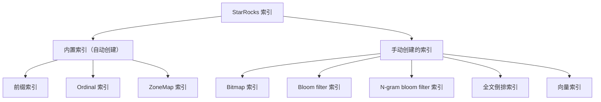
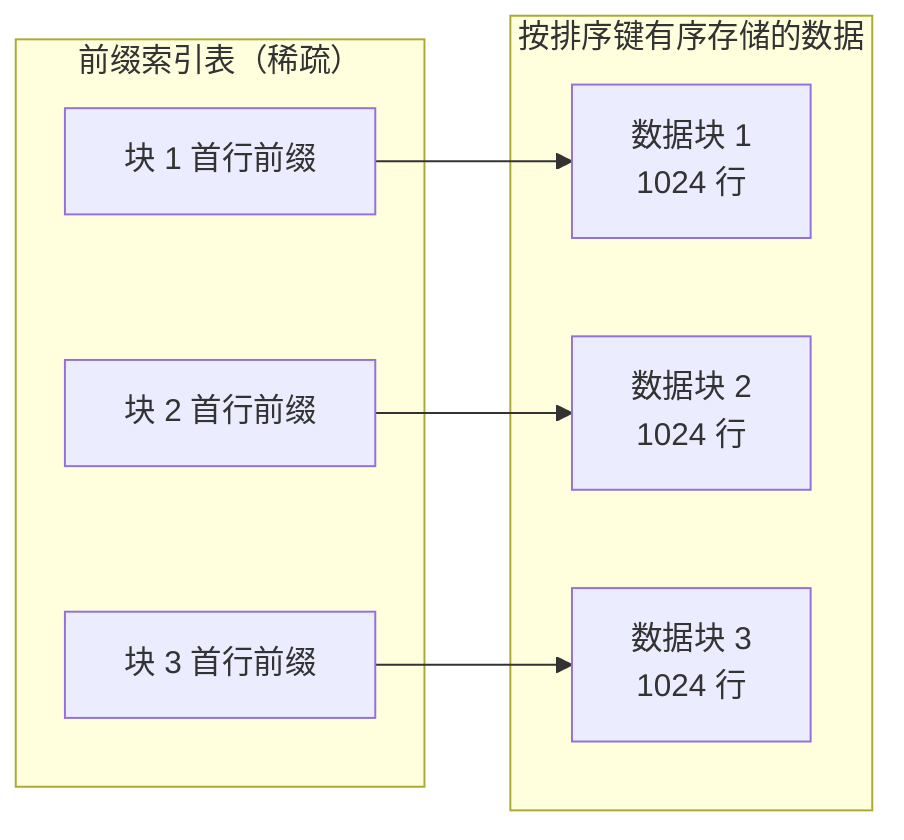
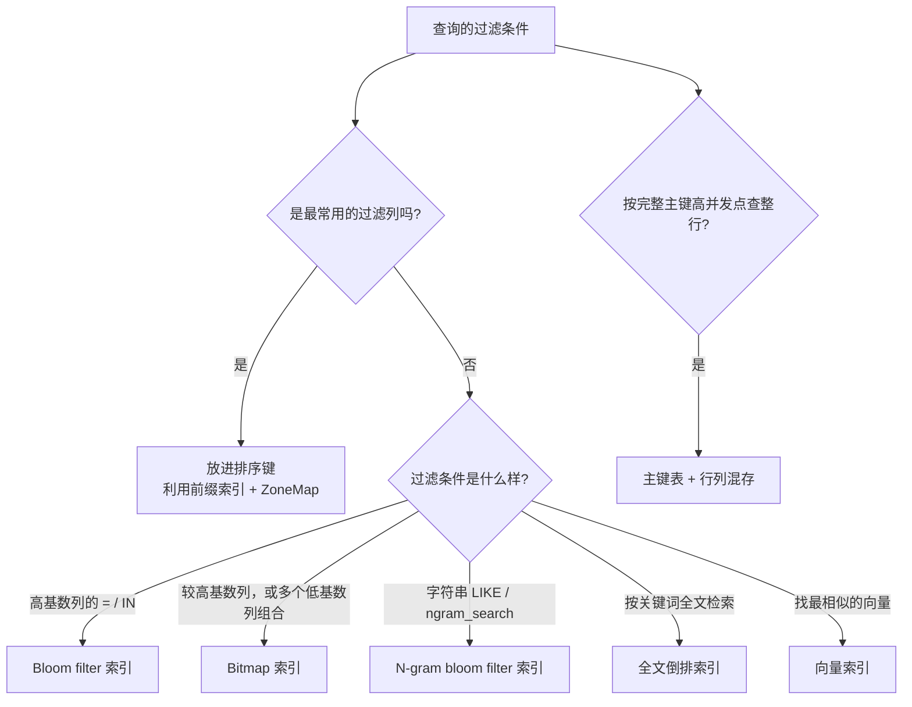

[基础篇003](StarRocks基础篇003_数据分布.md) 把数据切开、摆放到了各个 Tablet 上。这一篇关注查询怎么在 Tablet 里**快速找到需要的那些行**：先讲排序键和前缀索引，它们决定了最常用的过滤条件能不能少扫数据；再讲排序键管不到的过滤条件该用哪种索引；最后讲为高并发点查准备的行列混存。

> 本文内容整理自 StarRocks 官方文档：[索引](https://docs.starrocks.io/zh/docs/table_design/indexes/)、[前缀索引和排序键](https://docs.starrocks.io/zh/docs/table_design/indexes/Prefix_index_sort_key/)、[Bitmap 索引](https://docs.starrocks.io/zh/docs/table_design/indexes/Bitmap_index/)、[Bloom filter 索引](https://docs.starrocks.io/zh/docs/table_design/indexes/Bloomfilter_index/)、[N-gram bloom filter 索引](https://docs.starrocks.io/zh/docs/table_design/indexes/Ngram_Bloom_Filter_Index/)、[全文倒排索引](https://docs.starrocks.io/zh/docs/table_design/indexes/inverted_index/)、[向量索引](https://docs.starrocks.io/zh/docs/table_design/indexes/vector_index/)、[行列混存](https://docs.starrocks.io/zh/docs/table_design/hybrid_table/)。

# 1. 索引概述

索引能帮查询快速定位满足条件的数据：如果表在某些列上建了索引，查询又用得上这些索引，就不用扫描全表，只读一部分数据就能找到目标行。

StarRocks 的索引分两大类：

* **内置索引**：StarRocks 自动创建，包括前缀索引、Ordinal 索引、ZoneMap 索引；
* **手动创建的索引**：查询条件中的列不是前缀字段时，根据数据和查询特点手动创建，包括 Bitmap 索引、Bloom filter 索引、N-gram bloom filter 索引、全文倒排索引、向量索引。



| 索引 | 类别 | 解决什么问题 |
|---|---|---|
| 前缀索引 | 内置 | 过滤条件命中排序键前缀时，快速定位数据 |
| Ordinal 索引 | 内置 | 通过行号找到列数据页的物理地址 |
| ZoneMap 索引 | 内置 | 按数据块的最大最小值等统计信息，整块跳过数据 |
| Bitmap 索引 | 手动 | 较高基数列的查询、多个低基数列的组合查询 |
| Bloom filter 索引 | 手动 | 高基数列（如 ID）的 `=`、`IN` 查询 |
| N-gram bloom filter 索引 | 手动（Beta） | 加速 `LIKE` 和 `ngram_search` 类函数 |
| 全文倒排索引 | 手动（Beta） | 按关键词全文检索 |
| 向量索引 | 手动（Beta） | 近似最近邻搜索（ANNS） |

# 2. 排序键与前缀索引

## 2.1. 原理

建表时可以指定一个或多个列构成**排序键（Sort Key）**，表中的数据行按排序键排序后再落盘存储。

数据写入时还会**自动生成前缀索引**：数据按排序键排好序后，每 1024 行构成一个逻辑数据块（Data Block），前缀索引表中为每个数据块存一个索引项，内容是**该块第一行数据的排序列组成的前缀**。



有了"数据有序 + 稀疏索引"这两层结构，查询时就能用二分查找快速跳过不符合条件的数据块。前缀索引是**稀疏索引**，大小至少比数据量小 1024 倍，一般可以全量缓存在内存里。

> 排序键不是传统数据库的二级索引。它决定的是数据在文件里的**物理顺序**，前缀索引只是建立在这个顺序之上的稀疏目录。所以一张表只有一个前缀索引。

## 2.2. 各表类型如何使用排序键

v3.0 起主键表支持用 `ORDER BY` 定义排序键，v3.3 起明细表、聚合表和更新表也支持。四种表类型处理数据和排序的顺序不同：

| 表类型 | 数据如何排序 |
|---|---|
| 明细表 | 按 `ORDER BY` 排序，排序键可以是任意列的组合。同时指定 `ORDER BY` 和 `DUPLICATE KEY` 时，`DUPLICATE KEY` 不生效 |
| 聚合表 | 先按 `AGGREGATE KEY` 聚合，再按 `ORDER BY` 排序。两者的列需一致，顺序可以不同 |
| 更新表 | 先按 `UNIQUE KEY` 做 REPLACE，再按 `ORDER BY` 排序。两者的列需一致，顺序可以不同 |
| 主键表 | 先按 `PRIMARY KEY` 做 REPLACE，再按 `ORDER BY` 排序 |

前缀索引的来源：表通过 `ORDER BY` 指定了排序键，就按排序键构建前缀索引；没有指定，就按 Key 列构建。建表后可以用 `SHOW CREATE TABLE` 返回结果中的 `ORDER BY` 子句查看排序列和它们的顺序。

## 2.3. 前缀字段的规则

前缀索引项不一定包含排序键的全部列，它受两条限制：

* **前缀字段不超过 3 个，前缀索引项最长 36 字节**，超出部分被截断；
* **CHAR、VARCHAR、STRING 类型的列只能出现一次，并且只能在末尾**。遇到字符串类型的列，截断后就不再往后取。

**例 1**：下表排序键为 `uid`、`name`。

```sql
CREATE TABLE user_access (
    uid         int,
    name        varchar(64),
    age         int,
    phone       varchar(16),
    last_access datetime,
    credits     double
)
ORDER BY (uid, name);
```

前缀索引项 = `uid`（4 字节）+ `name`（只取前 32 字节），刚好 36 字节，前缀字段为 `uid` 和 `name`。

**例 2**：另一张表 `user_access2` 的前三列 `name varchar(20)`、`uid int`、`last_access datetime` 为排序列。前缀索引以 VARCHAR 类型的 `name` 开头，取完 `name`（20 字节）就直接截断，即使还没到 36 字节也不再往后取。所以前缀字段只有 `name`。

## 2.4. 如何设计排序键

**排序列不宜过多**：一般 3 个，建议不超过 4 个。排序列过多并不能提升查询性能，反而会增加导入时的排序开销。

**选择排序列和排序列顺序**，按以下优先级考虑：

1. **选经常作为查询过滤条件的列**。多个排序列时，按作为过滤条件的频率排列，最常用的放最前面。以上面的 `user_access`（前缀字段 `uid`、`name`）为例：

    | 查询 | 能否利用前缀索引 |
    |---|---|
    | `WHERE uid = 123 AND name = 'Jane Smith'` | 包含全部前缀，充分利用，效果最好 |
    | `WHERE uid = 123` | 包含部分前缀，可以利用 |
    | `WHERE name = 'Jane Smith'` | 不包含前缀，无法利用 |

    过滤条件只要包含前缀就能用上前缀索引，但包含的前缀越短，效果越弱。

2. **过滤频率差不多时，看列的基数**：
    * 基数较高的列，过滤掉的数据更多；基数过低的列（比如布尔类型）过滤效果不好。
    * 不过实际业务中，基于基数稍低的列过滤往往更频繁。如果经常按高基数列、甚至唯一列过滤，这类查询其实更偏向 OLTP 的点查，而不是 OLAP 的分析查询。
    * 还要考虑压缩：如果低基数列和高基数列谁前谁后对查询影响不大，**把低基数列放前面**，排序后低基数列的压缩率会高很多。

**建表时的注意事项**：

* 排序列的数据类型：主键表支持数值（整型、布尔）、字符串、时间日期；明细表、聚合表、更新表支持数值（整型、布尔、Decimal）、字符串、时间日期。BITMAP、HLL 类型不能作排序列。
* 聚合表和更新表中，排序列必须定义在其他列之前。
* 排序键在建表语句中出现的次序，就是数据存储时多重排序的次序。

## 2.5. 修改排序键

业务的查询特点变了，查询条件经常用前缀字段之外的列，现有前缀索引就过滤不了数据，查询性能可能下降。这时有两种办法：

* **修改排序键**：v3.0 起支持修改主键表的排序键，v3.3 起支持修改明细表、聚合表和更新表的排序键。明细表和主键表的排序键可以是任意列的组合；聚合表和更新表的排序键必须包含全部 Key 列，但顺序可以不同。

    ```sql
    ALTER TABLE t ORDER BY k2, k1;
    ```

* **建同步物化视图**：基于该表建一个同步物化视图，用其他常用的过滤列构建前缀索引。代价是增加存储空间。

## 2.6. 判断前缀索引是否生效

执行查询后，在 Query Profile 的 scan 节点中查看 `ShortKeyFilterRows` 等指标，就能知道前缀索引是否生效以及过滤了多少行。

# 3. 其他内置索引

## 3.1. Ordinal 索引

StarRocks 底层是列式存储，每一列的数据以 **Data Page** 为单位分块存储，每个 Data Page 一般是 64 × 1024 字节（`data_page_size = 64 * 1024`）。每个 Data Page 都对应一条 Ordinal 索引项，记录该页的起始行号等信息。

这样就可以**通过行号找到列 Data Page 的物理地址**。其他索引查找数据时，最终都要通过 Ordinal 索引找到列 Data Page 的位置。

## 3.2. ZoneMap 索引

ZoneMap 索引存储每块数据的统计信息：Min（最小值）、Max（最大值）、HasNull（是否有空值）、HasNotNull（是否不全为空）。查询时，StarRocks 根据这些统计信息快速判断哪些数据块可以整块跳过，减少扫描的数据量。

"每块"数据有两种粒度，对应两种 ZoneMap 索引：一种存每个 **Segment** 的统计信息，另一种存每个列的每个 **Data Page** 的统计信息。

# 4. Bitmap 索引

## 4.1. 原理

Bitmap 索引用位图（bitmap）建索引。位图是一个 bit 数组，每个 bit 对应表中的一行，取值 0 或 1，表示这一行是否等于某个列值。

一张表只有一个前缀索引，如果查询的过滤条件不包含前缀索引的前缀，就可以给过滤列建 Bitmap 索引来提高查询效率。

## 4.2. 什么时候适合用

选择 Bitmap 索引，首先考虑**列的基数**和**对查询的过滤效果**。和普遍印象相反，Bitmap 索引适合：

* **较高基数列的查询**；
* **多个低基数列的组合查询**。

这两种情况下 Bitmap 索引的过滤效果好，至少能过滤掉 999/1000 的数据，从而少读很多 Page。如果是**单个低基数列的查询**，过滤效果不好：要读的行很多，而且散落在大量 Page 中。

评估过滤效果时，要看加载数据的开销。StarRocks 底层以 Page（默认 64K）为单位组织和加载数据，开销主要是从磁盘加载 Page 的 I/O 时间，以及 Page 解压缩和解码的时间。行被过滤掉了，但它所在的 Page 还是要读，就省不下多少开销。

基数也不是越高越好，Bitmap 索引还有三项额外开销要权衡：

* **磁盘空间**：基数过高时，索引占用较多磁盘空间；
* **导入性能**：导入时要构建 Bitmap 索引，导入频繁时会受影响；
* **查询时加载索引**：查询只按需加载 Bitmap 索引，加载量约为"查询条件涉及的列值数量 / 基数 × Bitmap 索引大小"，这个值越大开销越大。

所以官方建议结合实际数据和查询做性能测试，权衡过滤效果和这些额外开销。好在 StarRocks 会自适应地决定是否使用 Bitmap 索引（见下一节），建了不合适的索引，查询也不会因此明显变慢。

## 4.3. 自适应选择是否使用

StarRocks 会根据列基数和查询自适应选择是否使用 Bitmap 索引：如果用了起不到过滤较多 Page 的效果，或者加载索引的开销较大，默认就不使用。

**判断规则**：一般来说，"查询条件涉及的列值数量 / 列的基数"越小，过滤效果越好。StarRocks 以 `bitmap_max_filter_ratio / 1000` 为阈值，只有当

```text
过滤条件涉及的值的数量 / 列的基数  <  bitmap_max_filter_ratio / 1000
```

时才使用 Bitmap 索引。`bitmap_max_filter_ratio` 默认为 1，取值范围 1～1000；设为 1000 表示只要列上有 Bitmap 索引就强制使用。

**例子**：表 `employees` 的 `gender` 列只有 `male`、`female` 两个值，`city` 列有 10000 个值。

| 查询 | 计算 | 是否使用 Bitmap 索引 |
|---|---|---|
| `WHERE gender = 'male'` | 1/2，大于 1/1000 | 不使用 |
| `WHERE gender = 'male' AND city IN ('北京', '上海')` | 两列相乘：(1×2)/(2×10000)，小于 1/1000 | 使用 |

## 4.4. 优势与适用范围

**优势**：

* 能快速定位查询的列值所在的行号，适合点查或小范围查询；
* 适合交并集运算（OR 和 AND），可以优化多维查询。

**能优化的查询**：等值 `=`、`[NOT] IN`、`>`、`>=`、`<`、`<=`、`IS NULL`。不适合优化 `!=` 和 `[NOT] LIKE`。

**支持的列**：主键表和明细表的所有列都能建 Bitmap 索引；聚合表和更新表只有 Key 列可以建。支持的数据类型：

* 日期：DATE、DATETIME；
* 数值：TINYINT、SMALLINT、INT、BIGINT、LARGEINT、DECIMAL、BOOLEAN；
* 字符串：CHAR、STRING、VARCHAR；
* 其他：HLL。

## 4.5. 基本操作

**创建**：建表时创建，或建表后用 `CREATE INDEX` 创建。同一张表的 Bitmap 索引不能重名；可以给多个列分别建，多个索引定义之间用逗号隔开。

```sql
-- 建表时创建
CREATE TABLE lineorder_partial (
    lo_orderkey      int(11)     NOT NULL,
    lo_orderdate     int(11)     NOT NULL,
    lo_orderpriority varchar(16) NOT NULL,
    lo_quantity      int(11)     NOT NULL,
    lo_revenue       int(11)     NOT NULL,
    INDEX lo_orderdate_index (lo_orderdate) USING BITMAP
)
DUPLICATE KEY(lo_orderkey)
DISTRIBUTED BY HASH(lo_orderkey) BUCKETS 1;

-- 建表后创建
CREATE INDEX lo_quantity_index ON lineorder_partial (lo_quantity) USING BITMAP;
```

**查看创建进度**：创建 Bitmap 索引是**异步**的，用下面的命令查看进度，`State` 为 `FINISHED` 即创建成功。每张表同时只能进行一个 Schema Change 任务，前一个 Bitmap 索引没建完，不能创建新的。

```sql
SHOW ALTER TABLE COLUMN [FROM db_name];
```

**查看索引**：只能看到已经创建完成的索引。

```sql
SHOW { INDEX[ES] | KEY[S] } FROM [db_name.]table_name [FROM db_name];
```

**删除索引**：

```sql
DROP INDEX index_name ON [db_name.]table_name;
```

**查看查询是否命中**：看查询 Profile 中的 `BitmapIndexFilterRows` 字段。

## 4.6. 性能测试结论

官方用 SSB 20G 的 `lineorder` 表（约 1.4 亿行）做了测试：一张表不建索引作对照，另一张表在 `lo_shipmode`（基数 7）、`lo_quantity`（50）、`lo_discount`（11）、`lo_orderdate`（2406）、`lo_tax`（9）、`lo_partkey`（60 万）上建 Bitmap 索引。这些索引占用的磁盘空间从 130M 到 601M 不等，`lo_partkey` 最大。

测试中"强制使用"是在各 BE 的 `be.conf` 里设置 `bitmap_max_filter_ratio=1000` 并重启 BE；测试前关闭了 Page 缓存（BE 配置 `disable_storage_page_cache = true`）。Scan 耗时如下：

| 查询 | 不建索引 | 强制使用 Bitmap 索引 | 默认（自适应） |
|---|---|---|---|
| 单个低基数列 `lo_shipmode = "MAIL"` | 约 0.91 秒 | 约 2.08 秒，反而更慢 | 不使用索引，约 0.91 秒 |
| 多个低基数列组合 `lo_shipmode、lo_quantity、lo_discount、lo_tax` | 约 1.76 秒 | 约 0.68 秒 | 使用索引，约 0.67 秒 |
| 单个高基数列 `lo_partkey = 10000` | 约 0.43 秒 | 约 0.015 秒 | 使用索引，约 0.014 秒 |

几个结论：

* **单个低基数列**：Bitmap 索引虽然把要读的行从 1.4 亿降到约 2000 万，但这些行随机散落在各个 Page，Page 一个都没少读（8795 → 8802），还额外付出了加载和使用索引的开销，所以更慢。自适应机制正确地没有使用索引。
* **多个低基数列组合**：读取的 Page 减少了约 2/3（35168 → 11325），加载数据的时间大幅下降。
* **单个高基数列**：只读了 225 个 Page，耗时从 0.43 秒降到 0.015 秒。

# 5. Bloom filter 索引

## 5.1. 原理

Bloom filter（布隆过滤器）索引能快速判断数据文件中**是否可能**包含要查询的数据，不包含就跳过，减少扫描量。它空间效率高，适合**基数较高**的列，比如 ID 列。

查询条件命中前缀索引列时，StarRocks 会用前缀索引快速返回结果；但前缀索引长度有限，要快速查询一个非前缀索引列、且该列基数较高时，就可以给它建 Bloom filter 索引。

例如在 `table1` 的 `column1` 上建了 Bloom filter 索引，执行 `SELECT xxx FROM table1 WHERE column1 = something;` 时：

* 索引判断某个数据文件**不存在**目标数据，就跳过该文件；
* 索引判断某个数据文件**可能存在**目标数据，就读取该文件确认。

注意"可能存在"的判断有一定误判率，即**假阳性概率**（False Positive Probability）：判断某处包含目标数据，实际却不包含。但它不会漏判：判断为不存在的，一定不存在。

## 5.2. 使用说明

* 主键表和明细表的所有列都能建 Bloom filter 索引；聚合表和更新表只有 Key 列可以建。
* 支持的数据类型：
    * 数值：SMALLINT、INT、BIGINT、LARGEINT；
    * 字符串：CHAR、STRING、VARCHAR；
    * 日期：DATE、DATETIME。
* **只能加速包含 `IN` 和 `=` 过滤条件的查询**，例如 `WHERE xxx IN (...)`、`WHERE column = xxx`。
* 查看查询是否命中：看 Profile 中的 `BloomFilterFilterRows` 字段。

## 5.3. 创建、查看与修改

**创建**：建表时在 `PROPERTIES` 中用 `bloom_filter_columns` 指定，多个列用逗号隔开。

```sql
CREATE TABLE table1 (
    k1 BIGINT,
    k2 LARGEINT,
    v1 VARCHAR(2048),
    v2 SMALLINT DEFAULT "10"
)
PRIMARY KEY(k1, k2)
DISTRIBUTED BY HASH (k1, k2)
PROPERTIES ("bloom_filter_columns" = "k1,k2");
```

**查看**：用 `SHOW CREATE TABLE table1;` 查看。

**修改**：用 `ALTER TABLE` 重新设置 `bloom_filter_columns`，实现增加、减少、删除索引：

```sql
-- 增加索引列 v1
ALTER TABLE table1 SET ("bloom_filter_columns" = "k1,k2,v1");
-- 去掉索引列 k2
ALTER TABLE table1 SET ("bloom_filter_columns" = "k1");
-- 删除全部 Bloom filter 索引
ALTER TABLE table1 SET ("bloom_filter_columns" = "");
```

修改索引是异步操作，可以用 `SHOW ALTER TABLE` 查看进度。每张表同时只能进行一个修改索引的任务。

# 6. N-gram bloom filter 索引（Beta）

## 6.1. 原理

N-gram bloom filter 索引是一种特殊的 Bloom filter 索引，通常用来加速 `LIKE` 查询，以及 `ngram_search` 和 `ngram_search_case_insensitive` 函数的计算。它只适用于字符串类型（STRING、CHAR、VARCHAR）的列。

它和普通 Bloom filter 索引的区别在于：**先把字符串切成固定长度的子串，再把子串写入 Bloom filter**。比如列值 `Technical`：

* 普通 Bloom filter 索引：把整个字符串 `Technical` 写入索引；
* `gram_num` 为 4 的 N-gram bloom filter 索引：先切成 `"Tech"`、`"echn"`、`"chni"`、`"hnic"`、`"nica"`、`"ical"` 六个子串，再分别写入索引。

## 6.2. 使用说明

* 明细表和主键表的所有字符串列都能建；聚合表和更新表只能在字符串类型的 Key 列上建；
* 只能为 CHAR、STRING、VARCHAR 类型的列创建；
* **一个列只能建一种**：Bloom filter 索引和 N-gram bloom filter 索引二选一；
* 查看查询是否命中：看 Profile 中的 `BloomFilterFilterRows` 字段。

## 6.3. 创建、查看与修改

```sql
CREATE TABLE test.table1 (
    k1 CHAR(10),
    k2 CHAR(10),
    v1 INT SUM,
    INDEX index_name (k2) USING NGRAMBF ("gram_num" = "4",
                                         "bloom_filter_fpp" = "0.05") COMMENT ''
)
AGGREGATE KEY(k1, k2)
DISTRIBUTED BY HASH(k1);
```

| 参数 | 必填 | 说明 |
|---|---|---|
| `index_name` | 是 | 索引名，表内唯一 |
| `column_name` | 是 | 建索引的列，只能指定一个，上例中是 `k2` |
| `gram_num` | 否 | 分词后子串的长度，默认 2 |
| `bloom_filter_fpp` | 否 | Bloom filter 的误报率，范围 0.0001～0.05，默认 0.05。越小过滤效果越好，但存储开销越大 |
| `case_sensitive` | 否 | 是否区分大小写，默认 `true` |
| `COMMENT` | 否 | 索引注释 |

```sql
-- 查看：索引是异步创建的，建好之后才能看到
SHOW CREATE TABLE table1;
SHOW INDEX FROM table1;

-- 添加
ALTER TABLE table1
ADD INDEX new_index_name(k1) USING NGRAMBF ("gram_num" = "4",
                                            "bloom_filter_fpp" = "0.05") COMMENT '';
-- 删除
ALTER TABLE table1 DROP INDEX new_index_name;
```

修改索引是异步操作，可以用 `SHOW ALTER TABLE` 查看进度，每次只能运行一个修改索引的任务。

## 6.4. 能加速的查询

* **`LIKE` 查询**：只有 `gram_num` 小于被查询字符串的长度时才能加速。比如 `gram_num` 为 4，`LIKE "%abc"` 中的 `abc` 只有 3 个字符，无法加速；`LIKE "%abcd"`、`LIKE "%abcde%"` 可以加速。
* **`ngram_search`**：函数作用的列建有 N-gram bloom filter 索引，且函数中指定的 `gram_num` 与索引的 `gram_num` 一致时，索引会自动过滤掉字符串相似度为 0 的数据，显著加快函数执行。
* **`ngram_search_case_insensitive`**：用法和 `ngram_search` 相同，但它不区分大小写，所以建索引时要把 `case_sensitive` 设为 `false`：

    ```sql
    INDEX index_name (k2) USING NGRAMBF ("gram_num" = "4",
                                         "bloom_filter_fpp" = "0.05",
                                         "case_sensitive" = "false") COMMENT ''
    ```

# 7. 全文倒排索引（Beta）

## 7.1. 原理

全文倒排索引自 v3.3.0 起支持，主键表自 v4.0 起支持。它把文本拆成一个个词，为每个词建一个索引条目，记录这个词出现在数据文件的哪些行。

比如行号 123 的数据是 `"hello world"`，分词后建出两个索引条目：`hello -> 123`、`world -> 123`。全文检索时，StarRocks 用搜索关键词查倒排索引，直接找到关键词出现的行号，大幅减少要扫描的行数。

每个数据文件都包含基于索引列的全文倒排索引。v4.1 起，除了默认的 CLucene 实现，还提供 builtin（内置）实现，见 7.6 节。

## 7.2. 创建

先开启 FE 配置项 `enable_experimental_gin`：

```sql
ADMIN SET FRONTEND CONFIG ("enable_experimental_gin" = "true");
```

为表创建全文倒排索引时，必须关闭该表的 `replicated_storage`：v4.0 及以上版本创建索引时会自动关闭；v4.0 之前的版本要手动把表属性 `replicated_storage` 设为 `false`。

```sql
-- 建表时创建：在列 v 上建英文分词的全文倒排索引
CREATE TABLE t (
    k BIGINT NOT NULL,
    v STRING,
    INDEX idx (v) USING GIN("parser" = "english")
)
DUPLICATE KEY(k)
DISTRIBUTED BY HASH(k) BUCKETS 1
PROPERTIES ("replicated_storage" = "false");

-- 建表后添加
ALTER TABLE t ADD INDEX idx (v) USING GIN('parser' = 'english');
CREATE INDEX idx ON t (v) USING GIN('parser' = 'english');
```

索引列的数据类型必须是 CHAR、VARCHAR 或 STRING。`parser` 指定分词方法：

| parser | 分词方法 | 说明 |
|---|---|---|
| `none`（默认） | 不分词 | 整个列值作为一个索引项 |
| `english` | 英文分词 | 在非字母字符处分词，大写字母转成小写 |
| `chinese` | 中文分词 | 使用 CLucene 的 CJK Analyzer |
| `standard` | 多语言分词 | 基于 Unicode 文本分段算法，适合大多数语言和中英文混合，大写字母转成小写 |

## 7.3. 查看与删除

```sql
-- 查看
SHOW CREATE TABLE t\G

-- 删除
DROP INDEX idx ON t;
ALTER TABLE t DROP INDEX idx;
```

## 7.4. 用全文倒排索引加速查询

建好索引后，要确保系统变量 `enable_gin_filter` 已开启。能加速哪些查询，取决于索引列有没有分词。

**索引列已分词**（`parser` 为 `standard`、`english` 或 `chinese`）：只支持用 `MATCH`、`MATCH_ANY`、`MATCH_ALL` 谓词过滤，关键词必须是字符串字面量，不支持表达式：

* `<col_name> (NOT) MATCH '%keyword%'`：匹配关键词，可以用 `%` 模糊匹配；
* `<col_name> (NOT) MATCH_ANY 'keyword1, keyword2'`：包含任意一个关键词；
* `<col_name> (NOT) MATCH_ALL 'keyword1, keyword2'`：同时包含所有关键词。

```sql
CREATE TABLE t (
    id1   bigint(20)   NOT NULL,
    value varchar(255) NOT NULL,
    INDEX gin_english (value) USING GIN ("parser" = "english") COMMENT 'english index'
)
DUPLICATE KEY(id1)
DISTRIBUTED BY HASH(id1)
PROPERTIES ("replicated_storage" = "false");

INSERT INTO t VALUES
    (1, "starrocks is a database"),
    (2, "starrocks is a data warehouse");

SELECT * FROM t WHERE t.value MATCH "starrocks";          -- 包含 starrocks
SELECT * FROM t WHERE t.value MATCH "data%";              -- 包含以 data 开头的词
SELECT * FROM t WHERE t.value MATCH_ANY "database data";  -- 包含 database 或 data
SELECT * FROM t WHERE t.value MATCH_ALL "database data";  -- 同时包含 database 和 data
```

几个容易踩的坑：

* **关键词必须是单词的一部分**。`MATCH "star%"` 能匹配到 `starrocks`；`MATCH "starrocks "`（末尾带空格）匹配不到，因为分词后的词里没有空格。
* **关键词要用小写**。英文分词和多语言分词在存储时会把大写转成小写，所以 `MATCH "BEST"` 查不到 `StarRocks is the BEST`，`MATCH "best"` 才能查到。
* **谓词必须能下推**：`MATCH`、`MATCH_ANY`、`MATCH_ALL` 必须写在 `WHERE` 子句中，并作用于索引列。写在 `SELECT` 列表里（如 `SELECT value MATCH "test" FROM t_match`），或作用于没有索引的列，都会报错 `Match can only be used as a pushdown predicate on a column with GIN in a single query.`
* 对可为空的索引列，值为 `NULL` 的行不会出现在 `NOT MATCH`、`NOT MATCH_ANY`、`NOT MATCH_ALL` 的结果中。

**索引列未分词**（`'parser' = 'none'`）：以下下推谓词都能利用全文倒排索引过滤数据：

* 表达式谓词：`(NOT) LIKE`、`(NOT) MATCH`、`(NOT) MATCH_ANY`、`(NOT) MATCH_ALL`。此时 `MATCH` 在语义上等同于 `LIKE`，并且两者只支持 `(NOT) <col_name> MATCH|LIKE '%keyword%'` 这种格式。`LIKE` 不符合这个格式时查询照常执行，但不会用全文倒排索引过滤。
* 常规谓词：`==`、`!=`、`<=`、`>=`、`NOT IN`、`IN`、`IS NOT NULL`、`NOT NULL`。

## 7.5. 验证是否加速

执行查询后，在 Query Profile 的 scan 节点中查看 `GinFilterRows`（用全文倒排索引过滤掉的行数）和 `GinFilter`（过滤耗时）。

## 7.6. Builtin 倒排索引（v4.1 起）

v4.1 起，StarRocks 提供 **builtin** 倒排索引实现，作为默认 CLucene 实现的补充。它是 StarRocks 原生的倒排索引，基于 bitmap 索引构建。

| 实现 | 起始版本 | 存算一体 | 存算分离 | 说明 |
|---|---|---|---|---|
| CLucene（默认） | v3.3.0 | 支持 | 不支持 | 基于 CLucene 全文搜索库 |
| builtin | v4.1.0 | 支持 | 支持 | StarRocks 原生实现 |

创建索引时可以用 `imp_lib` 参数显式指定实现。不指定时按集群模式自动选择：存算一体集群默认用 CLucene，存算分离集群默认用 builtin（存算分离不支持 CLucene）。

```sql
CREATE TABLE t_builtin (
    id1   bigint(20)   NOT NULL,
    value varchar(255) NOT NULL,
    INDEX gin_english (value) USING GIN ("parser" = "english", "imp_lib" = "builtin") COMMENT 'builtin english index'
)
DUPLICATE KEY(id1)
DISTRIBUTED BY HASH(id1)
PROPERTIES ("replicated_storage" = "false");

-- 建表后添加
CREATE INDEX idx_builtin ON t (v) USING GIN('parser' = 'english', 'imp_lib' = 'builtin');
```

builtin 实现还有两个专属参数：

| 参数 | 默认值 | 说明 |
|---|---|---|
| `dict_gram_num` | `-1`（关闭） | 在倒排索引的字典上再建一层 n-gram 字典索引，加速通配符和子串查询 |
| `lower_case` | `true` | 仅在 `"parser" = "english"` 时有效。`true` 时建索引和匹配都转成小写，匹配不区分大小写；`false` 时保留大小写，匹配区分大小写，用于区分 `Apple`、`apple`、`APPLE` 这类词 |

**`dict_gram_num` 的原理**：设为 2 时，字典条目 `"starrocks"` 会被拆成 `"st"`、`"ta"`、`"ar"`、`"rr"`、`"ro"`、`"oc"`、`"ck"`、`"ks"`。执行 `MATCH '%rock%'` 时，查询串 `"rock"` 也拆成 `"ro"`、`"oc"`、`"ck"`，通过 n-gram 索引快速缩小候选字典条目，避免扫描整个字典。在不同值很多的列上效果尤其明显。

取值建议：

* 值小（如 2）：每个条目生成的 n-gram 多，索引更大，但对短查询模式过滤效果更好；
* 值大（如 4）：n-gram 少，索引更小，但对短查询模式过滤效果差；
* 查询多用短通配符（如 `%ab%`）时，用较小的值；
* 查询串比 `dict_gram_num` 还短时，n-gram 索引用不上，会退化为全字典扫描。

```sql
CREATE TABLE t_gram (
    id1      bigint(20)   NOT NULL,
    text_val varchar(255) NOT NULL,
    INDEX idx_gram (text_val) USING GIN (
        "parser" = "english",
        "imp_lib" = "builtin",
        "dict_gram_num" = "2"
    ) COMMENT 'builtin index with ngram'
)
DUPLICATE KEY(id1)
DISTRIBUTED BY HASH(id1)
PROPERTIES ("replicated_storage" = "false");

-- 查询包含 "rock" 的行，n-gram 字典索引可以加速
SELECT * FROM t_gram WHERE text_val MATCH "%rock%";
```

# 8. 向量索引（Beta）

## 8.1. 原理

向量索引用来做**近似最近邻搜索**（ANNS），比如在一堆 embedding 向量里找和查询向量最相似的几个。目前 StarRocks 在 Segment 文件级别建向量索引：索引把每个搜索项映射到 Segment 文件中的行 ID，直接定位到数据行，不需要对每一行做暴力的向量距离计算。

StarRocks 提供两种向量索引：

* **IVFPQ（倒排文件与乘积量化）**：
    * **倒排文件**：把数据集划分成多个簇，每个簇有一个质心，每个向量分配到最近的簇。搜索时只搜最近的几个簇，大大缩小范围；
    * **乘积量化**：把高维向量切成多个子向量，每个子向量量化到预定义集合中最近的点，在保持较高精度的同时降低存储和计算成本。
* **HNSW（分层可导航小世界）**：基于图的算法。它构建一个分层图，每层都是一个可导航小世界图，顶点是数据点，边表示相似性。高层顶点少、连接稀疏，用于快速全局搜索；低层包含所有顶点、连接密集，用于精确的局部搜索。搜索时从顶层快速找到近似区域，再逐层往下找到最近邻。

| 对比项 | IVFPQ | HNSW |
|---|---|---|
| 数据压缩比 | 高（约 1:0.15） | 低（约 1:0.8） |
| 排序 | 索引只给出粗排结果，需要额外精排，计算量和延迟更高 | 无需额外处理即可给出精确排序，计算成本和延迟更低 |
| 存储成本 | 低 | 高 |
| 召回率调整 | 支持；召回率相近时计算成本更高 | 支持 |
| 缓存策略 | 可以调整索引块的缓存比例，平衡内存和延迟 | 目前只支持整个文件缓存 |

## 8.2. 前提条件

* 每张表只支持一个向量索引；
* 被索引的列必须是 `ARRAY<FLOAT> NOT NULL`；
* 只有明细表和主键表支持向量索引。

## 8.3. 创建

```sql
-- HNSW 向量索引
CREATE TABLE hnsw (
    id     BIGINT(20)   NOT NULL,
    vector ARRAY<FLOAT> NOT NULL,
    INDEX hnsw_vector (vector) USING VECTOR (
        "index_type" = "hnsw",
        "dim" = "5",
        "metric_type" = "l2_distance",
        "is_vector_normed" = "false",
        "M" = "16",
        "efconstruction" = "40"
    )
)
DUPLICATE KEY(id)
DISTRIBUTED BY HASH(id) BUCKETS 1;

-- IVFPQ 向量索引
CREATE TABLE ivfpq (
    id     BIGINT(20)   NOT NULL,
    vector ARRAY<FLOAT> NOT NULL,
    INDEX ivfpq_vector (vector) USING VECTOR (
        "index_type" = "ivfpq",
        "dim" = "5",
        "metric_type" = "l2_distance",
        "is_vector_normed" = "false",
        "nbits" = "8",
        "nlist" = "40",
        "M_IVFPQ" = "1"
    )
)
DUPLICATE KEY(id)
DISTRIBUTED BY HASH(id) BUCKETS 1;
```

也可以用 `CREATE INDEX` 或 `ALTER TABLE ADD INDEX` 给已有的表添加向量索引：

```sql
CREATE INDEX ivfpq_vector ON ivfpq (vector)
USING VECTOR (
    "index_type" = "ivfpq",
    "metric_type" = "l2_distance",
    "is_vector_normed" = "false",
    "dim" = "5",
    "nlist" = "256",
    "nbits" = "8",
    "M_IVFPQ" = "1"
);
```

**通用参数**：

| 参数 | 必填 | 默认值 | 说明 |
|---|---|---|---|
| `index_type` | 是 | — | `hnsw` 或 `ivfpq` |
| `dim` | 是 | — | 向量维度，≥ 1。索引建好后，维度不符的向量会被拒绝导入 |
| `metric_type` | 是 | — | 距离度量：`l2_distance`（欧氏距离，越小越相似）、`cosine_similarity`（余弦相似度，越大越相似）、`inner_product`（内积，越大越相似，保留向量模长） |
| `is_vector_normed` | 否 | `false` | 向量是否已归一化，仅 `cosine_similarity` 时生效。已归一化时距离在 [-1, 1]，且向量平方和必须为 1，否则报错 |
| `index_build_threshold` | 否 | 10000 | 写入行数低于该阈值时不建索引，查询回退到暴力检索。IVFPQ 还要求该值 ≥ `nlist` |
| `index_build_mode` | 否 | `sync` | 存算分离集群的建索引方式：`sync` 写入时同步建，导入延迟高；`async` 写入后由后台任务建，建好之前查询回退到暴力检索 |

**HNSW 专属参数**：

| 参数 | 默认值 | 说明 |
|---|---|---|
| `M` | 16 | 建图时每个新元素建立的双向连接数，≥ 2。越大搜索效率越高，但建图和存储成本越高 |
| `efconstruction` | 40 | 建图时候选列表的大小，≥ 1。越大图质量越好，但建图耗时越长 |
| `efsearch` | 40 | 搜索时候选列表的大小。越大越准，但越慢。也可以在查询中指定 |
| `quantizer` | `flat` | 量化器，用更小的索引换一定的召回率下降：`flat` 不量化；`sq4` 4-bit 标量量化，最小；`sq8` 8-bit 标量量化，推荐的压缩起点；`pq` 乘积量化，须配合 `m_pq` |
| `m_pq` | — | 仅 `quantizer = pq` 时必填。子量化器数量，必须能整除 `dim`，典型值 4～32 |
| `nbits_pq` | 8 | 仅 `quantizer = pq` 时可设。每个子量化器的位数，4～16 |

**IVFPQ 专属参数**：

| 参数 | 默认值 | 说明 |
|---|---|---|
| `nlist` | 16 | 簇（倒排列表）的数量，≥ 1。越大聚类越细，搜索越准但越复杂 |
| `nbits` | 8 | 乘积量化使用的位数，目前只支持 8 |
| `M_IVFPQ` | — | 必填。向量被切成的子向量数量，必须能整除 `dim` |

存算分离集群用 `async` 模式时，可以查 `information_schema.partitions_meta` 的 `VISIBLE_VERSION`、`MIN_VI_BUILT_VERSION`、`MAX_VI_BUILT_VERSION` 看建索引进度：`MIN_VI_BUILT_VERSION` 等于 `VISIBLE_VERSION` 说明分区内所有 Tablet 的索引都已建好。另外，存算分离集群里用 `ALTER TABLE ADD INDEX` 加索引会重写现有数据，即使设了 `async`，也要等索引建完 Schema Change 才算完成。

## 8.4. 查看与删除

```sql
SHOW CREATE TABLE hnsw\G

DROP INDEX ivfpq_vector ON ivfpq;
ALTER TABLE ivfpq DROP INDEX ivfpq_vector;
```

## 8.5. 用向量索引做近似搜索

**查询要满足的条件**：

```sql
SELECT *, <vector_index_distance_func>(v1, [1,2,3]) AS dis
FROM table_name
WHERE <vector_index_distance_func>(v1, [1,2,3]) <= 10
ORDER BY <vector_index_distance_func>(v1, [1,2,3])
LIMIT 10;
```

* **`ORDER BY`**：必须是 `ORDER BY <距离函数>(向量列, 常量数组)`，不能有其他排序列。常量数组必须是和索引 `dim` 匹配的 `ARRAY<FLOAT>`，向量列必须是建了索引的列。距离函数和排序方向要和 `metric_type` 对应：

    | metric_type | 距离函数 | 排序方向 | 范围谓词 |
    |---|---|---|---|
    | `l2_distance` | `approx_l2_distance` | `ASC` | `<= 常量` |
    | `cosine_similarity` | `approx_cosine_similarity` | `DESC` | `>= 常量` |
    | `inner_product` | `approx_inner_product` | `DESC` | `>= 常量`（常量可以为负数） |

* **必须有 `LIMIT N`**。
* **谓词**：所有谓词都必须是距离函数表达式，用 `AND` 组合，比较方向和排序方向一致。距离函数的结果可以转成 FLOAT 或 DOUBLE，比如 `CAST(approx_l2_distance(v1, [1,2,3]) AS DOUBLE)`。

**几种搜索方式**（以 `test_hnsw` 表为例，它和上面的 `hnsw` 表结构相同，设置了 `"index_build_threshold" = "1"`，插入了几行 5 维向量）：

```sql
-- 近似搜索：命中向量索引，找 [1,1,1,1,1] 最近的 1 个向量
SELECT id, approx_l2_distance([1,1,1,1,1], vector)
FROM test_hnsw
ORDER BY approx_l2_distance([1,1,1,1,1], vector)
LIMIT 1;

-- 标量 + 向量联合搜索
SELECT id, approx_l2_distance([1,1,1,1,1], vector)
FROM test_hnsw
WHERE id = 1
ORDER BY approx_l2_distance([1,1,1,1,1], vector)
LIMIT 1;

-- 范围搜索：score < 40 的条件会下推到索引中
SELECT * FROM (
    SELECT id, approx_l2_distance([1,1,1,1,1], vector) score
    FROM test_hnsw
) a
WHERE score < 40
ORDER BY score
LIMIT 1;

-- 精确计算：用不带 approx_ 的函数，忽略向量索引，直接算精确距离
SELECT id, l2_distance([1,1,1,1,1], vector)
FROM test_hnsw
WHERE id = 1
ORDER BY l2_distance([1,1,1,1,1], vector)
LIMIT 1;
```

## 8.6. 调优与验证

**搜索参数**：通过会话变量 `ann_params` 或 SQL Hint 传入。建议先在小数据集上调到满意的召回率和延迟，再用到大数据集上。

```sql
-- HNSW：调大 efsearch
SELECT /*+ SET_VAR (ann_params='{"efsearch":"256"}') */
    id, approx_l2_distance([1,1,1,1,1], vector)
FROM test_hnsw
ORDER BY approx_l2_distance([1,1,1,1,1], vector)
LIMIT 1;

-- IVFPQ
SELECT /*+ SET_VAR (ann_params='{"nprobe":"256","max_codes":"0","scan_table_threshold":"0","polysemous_ht":"0","range_search_confidence":"0.1"}') */
    id, approx_l2_distance([1,1,1,1,1], vector)
FROM test_ivfpq
ORDER BY approx_l2_distance([1,1,1,1,1], vector)
LIMIT 1;
```

| 参数 | 适用 | 默认值 | 说明 |
|---|---|---|---|
| `efsearch` | HNSW | 40 | 搜索时候选列表大小，越大越准越慢。查询中显式指定的值优先 |
| `nprobe` | IVFPQ | 1 | 搜索时检查的倒排列表数量，越大越准越慢 |
| `max_codes` | IVFPQ | 0 | 每个倒排列表最多检查的编码数 |
| `scan_table_threshold` | IVFPQ | 0 | 多义哈希参数：汉明距离低于该阈值的元素加入候选列表 |
| `polysemous_ht` | IVFPQ | 0 | 多义哈希参数：汉明距离低于该阈值的元素直接加入结果 |
| `range_search_confidence` | IVFPQ | 0.1 | 近似范围搜索的置信度，[0, 1]，设为 1 结果最准 |

**候选数量与精排**（会话变量）：

* `k_factor`（默认 1）：每个 Segment 请求的候选数 = `LIMIT` × `k_factor`。调大能提高多个 Segment 合并后的召回率，但开销更大；
* `enable_vector_index_refine`（默认 `false`）：对 IVFPQ，以及用了 `sq4`、`sq8`、`pq` 量化器的 HNSW 索引，用原始向量重新算精确距离并重排候选。对未量化的 HNSW（`quantizer = flat`）无效；
* `pq_refine_factor`（默认 1）：开启精排的范围查询中，在 `k_factor` 基础上再放大候选数。

```sql
SET enable_vector_index_refine = true;
SET k_factor = 2;
SET pq_refine_factor = 2;
```

候选倍率越大，召回率通常越高，但索引检索、I/O、距离计算的开销也越大。`EXPLAIN` 中的 `Refine: ON/OFF` 可以确认是否开启了精排。

**计算召回率**：用暴力检索的 topK 和近似检索的结果求交集，`Recall = TP / (TP + FN)`。比如近似检索 `LIMIT 5` 返回 8、9、7、5、1，暴力检索（`l2_distance`）返回 8、9、5、7、10，两者有 4 个相同，召回率为 4/5 = 80%。

**验证是否命中**：对查询执行 `EXPLAIN`，`OlapScanNode` 中出现 `VECTORINDEX: ON`，说明近似搜索用上了向量索引。

# 9. 行列混存

## 9.1. 列存与行列混存

StarRocks 作为 OLAP 数据库，原本用**列式存储**，能提升聚合查询这类复杂查询的性能。v3.2.3 起，StarRocks 还支持**行列混存**（Beta）：数据同时按行和按列存储。它适合基于主键的高并发、低延迟点查和部分列更新，同时保留了接近列存的分析能力。行列混存还支持 prepared statement，能提高查询性能和安全性。

| 对比项 | 列式存储 | 行列混存 |
|---|---|---|
| **存储方式** | 只按列存 | 按行和按列都存。表里多一个隐藏的二进制列 `__row`：写入时，把每行所有 value 列的值编码后写入 `__row`。因此有额外的存储开销 |
| **适合的场景** | 复杂数据分析，例如海量数据上的聚合分析、多表 JOIN；字段很多的宽表，但查询只涉及少数几列 | 同时支持行存和列存的场景。行存场景包括：基于主键的高并发点查；字段少的表上查询大部分字段；部分列更新（更新多个列、少量行） |

## 9.2. 基本用法

**建表**：先开启 FE 配置项 `enable_experimental_rowstore`，再在建表时把 `PROPERTIES` 中的 `store_type` 设为 `column_with_row`。

```sql
ADMIN SET FRONTEND CONFIG ("enable_experimental_rowstore" = "true");

CREATE TABLE users (
    id      bigint NOT NULL,
    country string,
    city    string,
    revenue bigint
)
PRIMARY KEY (id)
DISTRIBUTED BY HASH (id)
PROPERTIES ("store_type" = "column_with_row");
```

建表要求：

* 表必须是主键表；
* `__row` 列的长度不能超过 1 MB；
* v3.2.4 起，支持 BITMAP、HLL、JSON、ARRAY、MAP、STRUCT 类型的列。

**增删改**：和列存表一样，可以用导入和 DML 语句插入、删除、更新数据。

```sql
INSERT INTO users (id, country, city, revenue) VALUES
    (1, 'USA', 'New York', 5000),
    (2, 'UK', 'London', 4500),
    (3, 'France', 'Paris', 6000),
    (4, 'Germany', 'Berlin', 4000),
    (5, 'Japan', 'Tokyo', 7000),
    (6, 'Australia', 'Sydney', 7500);

DELETE FROM users WHERE id = 6;
UPDATE users SET revenue = 6500 WHERE id = 4;
```

**点查走短路径**：点查会走"短路径"（short circuit），直接查行存数据，提高查询性能。

1. 确认开启了查询短路：

    ```sql
    SHOW VARIABLES LIKE '%enable_short_circuit%';
    -- 未开启时：
    SET enable_short_circuit = true;
    ```

2. 查询满足条件时才走短路径：`WHERE` 子句的条件列**包含全部主键列**，并且运算符是 `=` 或 `IN`。条件列除了全部主键列之外，还可以包含其他列。

    ```sql
    SELECT * FROM users WHERE id = 1;
    ```

3. 用 `EXPLAIN` 验证，查询计划中出现 `Short Circuit Scan: true` 说明走了短路径：

    ```sql
    EXPLAIN SELECT * FROM users WHERE id = 1;
    -- ...
    --   0:OlapScanNode
    --      TABLE: users
    --      PREDICATES: 1: id = 1
    --      partitions=1/1
    --      tabletRatio=1/6
    --      Short Circuit Scan: true
    ```

**Prepared statement**：

```sql
PREPARE select_all_stmt   FROM 'SELECT * FROM users';
PREPARE select_by_id_stmt FROM 'SELECT * FROM users WHERE id = ?';

SET @id1 = 1, @id2 = 2;

EXECUTE select_by_id_stmt USING @id1;
EXECUTE select_by_id_stmt USING @id2;
```

## 9.3. 限制

* 存算分离集群暂不支持行列混存；
* v3.2.4 起，行列混存的表支持用 `ALTER TABLE` 修改；
* 查询短路目前只适合"定时批量导入、导入完成后再查询"的场景。数据写入的 apply 阶段可能和查询短路产生索引互斥，导致写入阻塞短路查询，影响写入期间点查的响应时间；
* 行列混存会明显增加存储占用：数据存了行、列两份，而且行存的压缩率可能不如列存；
* 导入的耗时和资源消耗会增加；
* 可以作为在线服务的一种方案，但性能可能比不上成熟的 OLTP 数据库；
* 不支持依赖列存的功能，比如列模式的部分列更新；
* 必须是主键表。

# 10. 如何选择

按过滤条件的特点选择加速手段：



几个索引在支持范围上的差异，放在一起对比：

| 索引 | 明细表 / 主键表 | 聚合表 / 更新表 | 支持的列类型 | 加速的过滤条件 |
|---|---|---|---|---|
| Bitmap | 所有列 | 仅 Key 列 | 日期、数值、字符串、HLL | `=`、`[NOT] IN`、范围比较、`IS NULL` |
| Bloom filter | 所有列 | 仅 Key 列 | SMALLINT～LARGEINT、字符串、日期 | `=`、`IN` |
| N-gram bloom filter | 所有字符串列 | 仅字符串 Key 列 | CHAR、STRING、VARCHAR | `LIKE`、`ngram_search` 类函数 |
| 全文倒排 | 明细表支持；主键表 v4.0 起支持 | — | CHAR、VARCHAR、STRING | `MATCH` 系列；不分词时还支持 `LIKE` 和常规谓词 |
| 向量 | 支持，每表一个 | 不支持 | `ARRAY<FLOAT> NOT NULL` | 按距离函数 `ORDER BY ... LIMIT` |

# 11. 小结

* **排序键决定数据的物理顺序**，前缀索引是建在这个顺序上的稀疏索引：每 1024 行一个索引项，前缀最多 3 个字段、36 字节，字符串列只能在末尾。最常用的过滤列放前面，排序列一般 3 个。
* Ordinal 索引负责按行号找到数据页，ZoneMap 索引按数据块的统计信息整块跳过数据，两者都自动生效。
* 排序键管不到的过滤条件，按需手动建索引：高基数列等值查询用 **Bloom filter**；较高基数列或多个低基数列组合用 **Bitmap**（StarRocks 会自适应决定是否使用）；字符串模糊查询用 **N-gram bloom filter**；全文检索用**全文倒排索引**；向量相似度搜索用**向量索引**。
* **行列混存**让主键表在保留分析能力的同时支持高并发点查，代价是额外的存储和导入开销。

到这里，表设计的几个决策（表类型、数据分布、排序键与索引、压缩）就都讲完了。表建好之后，下一步是把数据可靠地导进来，这是导入篇的内容。
